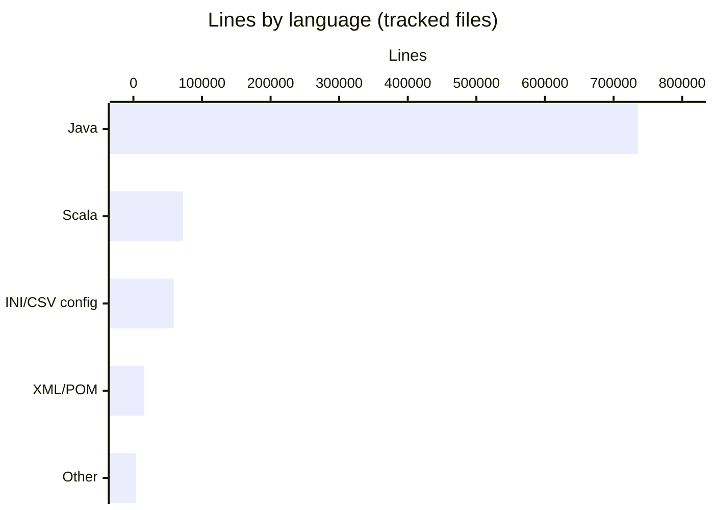
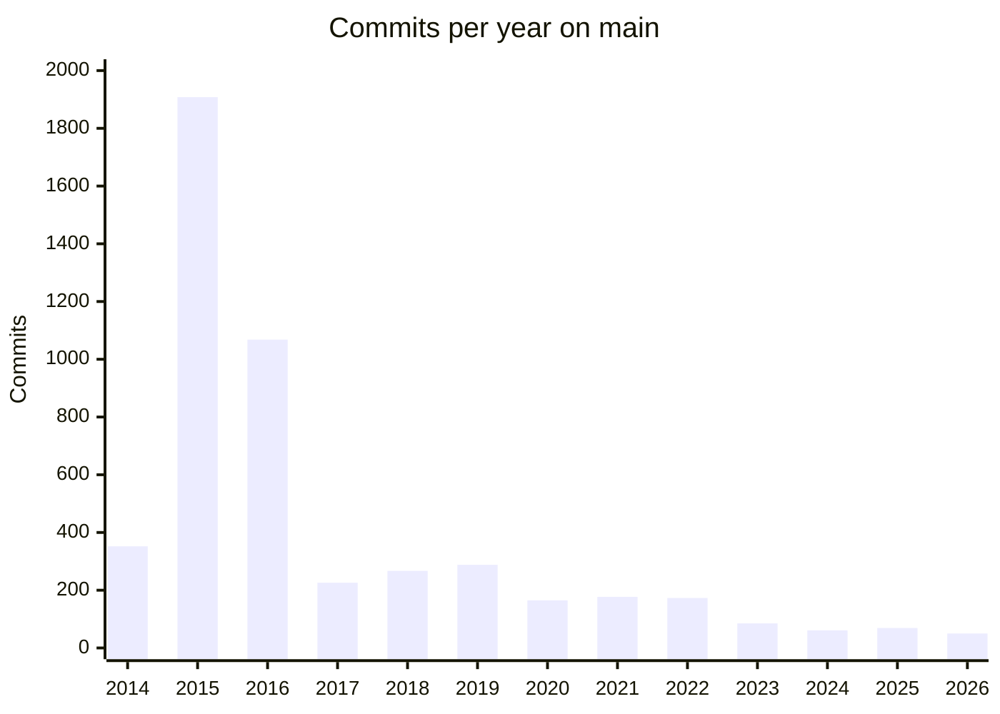

# By the numbers

Data collected on 2026-10-28. The figures describe branch `auto_model_migration` at commit `7caa43e`. History statistics come from the `main` branch (tip `fa85830`, last commit 2026-10-21) unless a section says otherwise. Every number on this page was produced by `git` commands and a small Python line counter run against the working tree; Maven was not run.

Related pages: [Lore](lore.md), [Modules](modules/index.md), [Architecture](overview/architecture.md).

## Size

### Lines by language

| Language | Files | Lines | Share of lines |
|---|---:|---:|---:|
| Java | 3,039 | 735,718 | 83.0% |
| Scala | 234 | 72,091 | 8.1% |
| INI/CSV config | 275 | 58,806 | 6.6% |
| XML/POM | 93 | 15,915 | 1.8% |
| Other (Markdown, `.txt`, `.json`, `.yml`, Eclipse `.epf`/`.launch`, `.properties`, `.py` and similar) | 64 | 3,893 | 0.4% |
| Total | 3,705 | 886,423 | 100% |

Method: `cloc` is not installed, so the files come from `git ls-files` with `droid-wiki/` and any `target/` path removed, and lines are newline counts (blank and comment lines included). Language is assigned by extension: `.java`, `.scala`, `.ini`/`.csv`, `.xml`/`.pom`/`.xsd`. Untracked files such as `step_by_step_guide.md` are not counted.

### Main, test and configuration files

| Kind | Files | Lines |
|---|---:|---:|
| Main source (`src/main/java`, `src/main/scala`) | 1,951 | 542,004 |
| Test source (`src/test/...`) | 1,317 | 264,597 |
| Resources and configuration (`src/main/resources`, `src/test/resources`) | 361 | 72,340 |
| Build-only source (`modules/collect/src/build`) | 5 | 1,208 |
| Everything else (POMs, CI, docs, IDE settings) | 71 | 6,274 |

Method: path patterns applied to the same `git ls-files` list. Across the whole repository there are 0.49 lines of test code per line of main code.

### Per-module main and test code

| Module | Main files | of which Scala | Main lines | Test files | Test lines | Test-to-code ratio (lines) |
|---|---:|---:|---:|---:|---:|---:|
| `modules/collect` | 122 | 114 | 33,759 | 100 | 19,271 | 0.57 |
| `modules/basics` | 126 | 119 | 38,562 | 76 | 20,877 | 0.54 |
| `modules/data` | 41 | 0 | 8,987 | 31 | 3,788 | 0.42 |
| `modules/product` | 435 | 0 | 174,994 | 312 | 45,483 | 0.26 |
| `modules/math` | 247 | 0 | 31,009 | 159 | 23,013 | 0.74 |
| `modules/market` | 209 | 0 | 64,472 | 154 | 21,204 | 0.33 |
| `modules/loader` | 69 | 0 | 18,689 | 18 | 8,568 | 0.46 |
| `modules/pricer` | 360 | 0 | 108,295 | 322 | 102,666 | 0.95 |
| `modules/calc` | 69 | 0 | 14,199 | 41 | 6,147 | 0.43 |
| `modules/measure` | 174 | 0 | 36,093 | 84 | 11,814 | 0.33 |
| `modules/report` | 52 | 0 | 6,069 | 14 | 1,061 | 0.17 |
| `examples` | 47 | 0 | 6,876 | 6 | 705 | 0.10 |
| Total | 1,951 | 233 | 542,004 | 1,317 | 264,597 | 0.49 |

Method: `.java` and `.scala` files under each module's `src/main/java|scala` and `src/test`. The ratio is test lines divided by main lines. `modules/product` has a low ratio partly because about half of a typical Joda-Bean file is generated code, which is exercised through `TestHelper.coverImmutableBean` rather than line-by-line tests. The tests of `modules/collect` and `modules/basics` are still Java.

## Activity

### Commits per year on main

| Year | Commits |
|---|---:|
| 2014 | 352 |
| 2015 | 1,908 |
| 2016 | 1,068 |
| 2017 | 226 |
| 2018 | 267 |
| 2019 | 288 |
| 2020 | 165 |
| 2021 | 177 |
| 2022 | 173 |
| 2023 | 85 |
| 2024 | 61 |
| 2025 | 69 |
| 2026 (to 21 Oct) | 50 |

Method: `git log main --format=%ad --date=format:%Y | sort | uniq -c`. `main` has 4,890 commits in total, 801 of them merges. The first commit in history order is dated 2014-06-17; one commit with an older author date (`73efd09`, dated 2013-10-22) is not shown in the table. The 2015 peak is the main build-out of the library before the 1.0 release.

### Last 24 months on main

| Month | Commits | Month | Commits |
|---|---:|---|---:|
| 2024-11 | 6 | 2025-11 | 0 |
| 2024-12 | 1 | 2025-12 | 6 |
| 2025-01 | 20 | 2026-01 | 1 |
| 2025-02 | 3 | 2026-02 | 5 |
| 2025-03 | 9 | 2026-03 | 4 |
| 2025-04 | 4 | 2026-04 | 7 |
| 2025-05 | 4 | 2026-05 | 4 |
| 2025-06 | 0 | 2026-06 | 3 |
| 2025-07 | 10 | 2026-07 | 4 |
| 2025-08 | 7 | 2026-08 | 3 |
| 2025-09 | 3 | 2026-09 | 12 |
| 2025-10 | 3 | 2026-10 | 7 |

Method: `git log main --since=2024-10-01 --format=%ad --date=format:%Y-%m | sort | uniq -c`, keeping November 2024 to October 2026. Months that do not appear in the output are shown as 0. The 24 months total 126 commits, an average of about 5 per month.

### Churn hotspots

`main` had 22 commits in the last 90 days and 56 in the last 12 months. Every release adds two `[maven-release-plugin]` commits that touch all 13 POM files (`pom.xml`, `modules/pom.xml`, each `modules/*/pom.xml` and `examples/pom.xml`), so POMs top the raw lists: `modules/pom.xml` and `examples/pom.xml` changed 9 times in 90 days and 29 times in 12 months. The tables below leave out `pom.xml` files to show where code changed.

| Directory (excluding POMs) | Changes, last 90 days | Changes, last 12 months |
|---|---:|---:|
| `modules/measure` | 5 | 18 |
| `modules/loader` | 4 | 17 |
| `modules/basics` | 2 | 12 |
| `modules/product` | 5 | 9 |
| `modules/pricer` | 6 | 6 |
| `config` | 4 | 4 |
| `modules/market` | 0 | 3 |
| `.factory` | 3 | 3 |
| `modules/collect` | 2 | 2 |
| `examples` | 2 | 2 |

| File (excluding POMs) | Changes, last 12 months |
|---|---:|
| `modules/loader/src/test/java/com/opengamma/strata/loader/csv/TradeCsvLoaderTest.java` | 6 |
| `modules/product/src/main/java/com/opengamma/strata/product/common/ExchangeIds.java` | 3 |
| `modules/loader/src/test/resources/com/opengamma/strata/loader/csv/fx-option-alt.csv` | 3 |
| `modules/loader/src/main/java/com/opengamma/strata/loader/csv/FxVanillaOptionTradeCsvPlugin.java` | 3 |
| `modules/loader/src/main/java/com/opengamma/strata/loader/csv/FullSwapTradeCsvPlugin.java` | 3 |
| `modules/basics/src/test/java/com/opengamma/strata/basics/date/GlobalHolidayCalendarsTest.java` | 2 |
| `modules/basics/src/main/java/com/opengamma/strata/basics/date/GlobalHolidayCalendars.java` | 2 |
| `README.md` | 2 |
| `.circleci/config.yml` | 2 |

Method: `git log main --since='90 days ago'` (and `'12 months ago'`) `--format= --name-only`, filtered with `grep -v 'pom.xml$'`, grouped by `modules/<name>` or top-level directory, counted with `sort | uniq -c`. A count is the number of file changes, so one commit touching three files in a module counts three. In the last 90 days, the files that changed twice were `TradeCsvLoaderTest.java`, `FullSwapTradeCsvPlugin.java`, `README.md` and `.circleci/config.yml`; every other file changed once.

### Scala migration commits on this branch

| Measure | Value |
|---|---:|
| Commits on `auto_model_migration` not on `main` (`git log main..HEAD`) | 26 (all dated 2026-10-23) |
| Files changed (`git diff --shortstat main...HEAD`) | 383 |
| Lines inserted / deleted | 62,013 / 61,435 |
| Files added / deleted / renamed / modified | 142 / 137 / 96 / 8 |
| Files changed under `modules/collect` | 182 (+29,539 / -27,868 lines) |
| Files changed under `modules/basics` | 195 (+32,428 / -33,504 lines) |

Method: `git diff --numstat main...HEAD` and `git diff --name-status main...HEAD`, grouped by path. The remaining 6 changed files are `.circleci/config.yml`, `README.md`, `RELEASE.md`, `AGENTS.md` and two files under `.factory/`. Including the branch, `HEAD` has 4,916 commits. See [Lore](lore.md) for the story behind these commits.

## Bot-attributed commits

| Measure (on `main`, 4,890 commits) | Commits | Share |
|---|---:|---:|
| Authored by a bot account | 393 | 8.0% |
| With a `Co-authored-by` trailer naming a bot | 111 | 2.3% |
| Either of the above | 432 | 8.8% |

| Measure (on `HEAD` of `auto_model_migration`, 4,916 commits) | Commits | Share |
|---|---:|---:|
| Authored by a bot account | 393 | 8.0% |
| With a `Co-authored-by` trailer naming a bot | 137 | 2.8% |
| Either of the above | 458 | 9.3% |

What is counted: a commit is bot-authored when its author name or email matches `[bot]`, `dependabot`, `opengammacibot` or `github-actions` (case-insensitive). On `main` these are `opengammacibot` (292 commits, nearly all `[maven-release-plugin]` release commits), `dependabot[bot]` (54), `dependabot-preview[bot]` (46) and `mergify[bot]` (1). A co-author trailer counts when `git log --format='%(trailers:key=Co-authored-by,valueonly)'` contains "bot"; on `main` the names are `mergify[bot]` (46), `dependabot[bot]` (41), `dependabot-preview[bot]` (32), `factory-droid[bot]` (3) and `opengammacibot` (1), with some commits carrying more than one. All 26 branch commits are authored by a person and carry a `factory-droid[bot]` co-author trailer.

These figures are a lower bound for AI assistance. They only see bots that sign commits under a recognisable name or add a trailer; code written with an AI tool and committed under a person's name is not detectable from history. Most of the bot activity on `main` is release automation and dependency updates rather than code authoring. In the last 12 months 29 of 56 `main` commits were bot-authored, and 8 of 22 in the last 90 days.

Unique contributors: `main` has 82 distinct non-bot author email addresses (`git log main --format='%aN|%aE'`, bot patterns removed, emails lower-cased). One person can use several addresses, so the number of people is likely lower.

## Complexity

### Average file size and public types per module

| Module | Average main file size (lines) | Public types (approx.) | Joda-Bean files |
|---|---:|---:|---:|
| `modules/collect` | 277 | 181 | 16 |
| `modules/basics` | 306 | 224 | 43 |
| `modules/data` | 219 | 26 | 20 |
| `modules/product` | 402 | 388 | 253 |
| `modules/math` | 126 | 229 | 1 |
| `modules/market` | 308 | 165 | 99 |
| `modules/loader` | 271 | 38 | 3 |
| `modules/pricer` | 301 | 330 | 103 |
| `modules/calc` | 206 | 42 | 29 |
| `modules/measure` | 207 | 100 | 40 |
| `modules/report` | 117 | 37 | 7 |
| `examples` | 146 | 40 | 1 |
| Total | 278 | 1,800 | 615 |

Method: average size is main lines divided by main files from the per-module table. Public types are counted per main source file with line-anchored regular expressions: for Java, `^public (final )?(abstract )?(class|interface|enum)` (top-level declarations only, so nested types, records and annotations are not counted); for Scala, a line starting with optional modifiers (`final`, `sealed`, `abstract`, `case`, `open`, `private[...]`) followed by `class`, `trait`, `object` or `enum`. The Scala count includes companion objects, so a class with a companion counts twice and the `collect` and `basics` numbers run high compared with the Java modules. Joda-Bean files are main source files containing the text `AUTOGENERATED START`; in `collect` and `basics` these are Scala files that kept the marker block. Including test sources, 623 files contain the marker.

### Ten largest source files

| Lines | File |
|---:|---|
| 8,959 | `modules/pricer/src/test/java/com/opengamma/strata/pricer/impl/option/BlackFormulaRepositoryTest.java` |
| 5,776 | `modules/pricer/src/test/java/com/opengamma/strata/pricer/impl/option/BlackScholesFormulaRepositoryTest.java` |
| 3,072 | `modules/loader/src/test/java/com/opengamma/strata/loader/csv/TradeCsvLoaderTest.java` |
| 2,021 | `modules/basics/src/main/scala/com/opengamma/strata/basics/schedule/PeriodicSchedule.scala` |
| 1,900 | `modules/loader/src/test/java/com/opengamma/strata/loader/fpml/FpmlDocumentParserTest.java` |
| 1,758 | `modules/collect/src/main/scala/com/opengamma/strata/collect/Guavate.scala` |
| 1,579 | `modules/pricer/src/main/java/com/opengamma/strata/pricer/capfloor/SabrIborCapletFloorletVolatilityCalibrationDefinition.java` |
| 1,532 | `modules/product/src/main/java/com/opengamma/strata/product/swap/type/OvernightRateSwapLegConvention.java` |
| 1,531 | `modules/product/src/main/java/com/opengamma/strata/product/swap/IborRateCalculation.java` |
| 1,515 | `modules/pricer/src/main/java/com/opengamma/strata/pricer/bond/DiscountingCapitalIndexedBondProductPricer.java` |

Method: all tracked `.java` and `.scala` files (main and test) sorted by newline count. The two largest are table-driven tests of the Black and Black-Scholes formula repositories.

### Tags and releases

The repository has 200 tags (`git tag | wc -l`). 179 are release tags starting with `v`, from `v0.7.0` to `v2.12.77`; 18 are milestone tags (`m1.1.0-M1` to `m2.1.0-M4`); 3 mark work on this fork (`pre-agent-readiness`, `agent-readiness-complete`, `scala-migration-final`). On `main`, 292 commits are `[maven-release-plugin]` commits, two per release.
