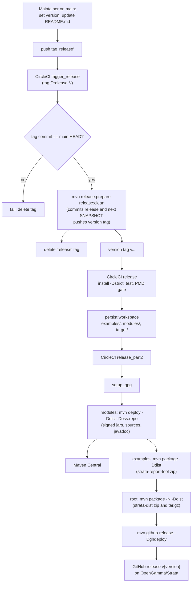

# Deployment

Strata is a library, so "deployment" means publishing versioned jars to Maven Central and attaching distribution zips to a GitHub release. This page describes the CircleCI jobs in `.circleci/config.yml`, the Maven profiles they switch on, the manual steps in `RELEASE.md`, and the GitHub automation in `.github/`.

## Summary

| Item | Where | What it does |
| --- | --- | --- |
| Branch build | `build` and `build21` jobs, `build` workflow | `mvn install -Dstrict` without tests, then `mvn test` and the PMD baseline gate on JDK 17 and JDK 21 |
| Release trigger | `trigger_release` job, tag `release*` | Runs `mvn release:prepare release:clean` on `main`, which creates the version tag |
| Release build | `release` job, tag `v*` | Repeats the full build and tests, then saves the workspace |
| Publish | `release_part2` job, tag `v*` | Signs and deploys the module jars, builds the distribution zips, creates the GitHub release |
| Dependency updates | `.github/dependabot.yml` | Weekly Maven dependency pull requests |
| Merging | `.github/mergify.yml` | Squash-merges labelled, approved pull requests once the `build` check passes |

## CircleCI configuration

### Executors

Two Docker executors are defined, `jdk17` (`cimg/openjdk:17.0`) and `jdk21` (`cimg/openjdk:21.0`). Both set:

- `JAVA_TOOL_OPTIONS: -XX:MaxRAM=3572m`. The comment in the file explains that this is needed "as cgroups settings are not passed to the JVM". Because `JAVA_TOOL_OPTIONS` is read by every JVM, it also caps the forked Surefire test JVMs.
- `MAVEN_OPTS: -Xmx1g` for the Maven process itself.

Before the Scala migration the file also had `jdk8` and `jdk11` executors and `build11`/`build17` jobs. They were removed on the `auto_model_migration` branch because Scala 3.9.0 needs JDK 17 (see [Scala migration](background/scala-migration.md)). The release jobs moved from JDK 8 to JDK 17 at the same time.

### Reusable commands

| Command | Steps |
| --- | --- |
| `init_maven` | Writes `.mvn/maven.config` with `-e`, `-B`, `-DtrimStackTrace=false` and `--settings .circleci/maven-settings.xml` |
| `restore_maven_cache` / `store_maven_cache` | Caches `~/.m2/repository` under a key built from `CACHE_VERSION`, `CIRCLE_JOB` and the checksum of the root `pom.xml`, with two fallback keys; resolves dependencies up front with `go-offline-maven-plugin` 1.1.0 |
| `maven_install` | `mvn install -T 4 -DskipTests -Dstrict` |
| `maven_test` | `mvn test -T 1 -Dcheckstyle.skip=true`, then `python3 config/pmd/check-pmd-baseline.py`, then `store_maven_tests` |
| `store_maven_tests` | Copies Surefire XML reports and `target/pmd.xml` files, uploads them as test results and as a `test-results.zip` artifact |
| `with_maven` | Wraps a list of steps with `init_maven`, cache restore and cache store |
| `setup_gpg` | Decrypts `.circleci/codesigning.asc.gpg` with `SIGNING_PASSWORD`, imports the key, shreds the decrypted file, and enables loopback pinentry |
| `maven_deploy_modules` | In `modules/`: `mvn deploy -Ddist -Doss.repo -DskipTests -Dcheckstyle.skip=true` |
| `maven_package_examples` | In `examples/`: `mvn package -Ddist -DskipTests -Dcheckstyle.skip=true` |
| `maven_package_root` | At the root: `mvn package -N -X -Ddist -DskipTests -Dcheckstyle.skip=true` |
| `maven_github_releases` | `mvn github-release:github-release -N -Dghdeploy` |
| `maven_release` | Checks that the tagged commit is `main` HEAD, sets the git identity `opengammacibot`, runs `mvn release:prepare release:clean`, then always deletes the triggering tag locally and on `origin` |

The test step runs with `-T 1`. The comment says to keep one module active at a time because Surefire runs up to two forked test JVMs, which together with `MaxRAM` keeps memory use inside the container.

### Workflows and filters

| Workflow | Jobs | Runs on |
| --- | --- | --- |
| `build` | `build` (JDK 17), `build21` (JDK 21) | Every branch push (no filters) |
| `trigger_release` | `trigger_release` | Tags matching `/^release.*/` only |
| `release` | `release`, then `release_part2` | Tags matching `/^v.*/` only |

All jobs use the CircleCI context `OG-OSS`, which is where the secrets listed below would come from. The JDK 17 job keeps the name `build` because Mergify waits for a check of that name.

## Release pipeline

### Step by step

1. A maintainer follows `RELEASE.md`: merge everything, check out a clean `main`, optionally change the next version with `mvn versions:set -DgenerateBackupPoms=false -DartifactId=* -DgroupId=com.opengamma.strata`, update the version in `README.md`, then push a tag called `release` with `git push origin HEAD:refs/tags/release`.
2. `trigger_release` refuses to run unless the tagged commit is the HEAD of `main`. It then runs the Maven release plugin, which commits the release version, tags it, and commits the next snapshot version. The `release` tag is removed whatever the outcome.
3. The version tag starts the `release` workflow. The `maven-release-plugin` configuration, including the tag name format, comes from the parent POM `com.opengamma:corporate-parent` 2.9.2, which is not in this repository. The `/^v.*/` filter and the `ghdeploy` profile's `<tagName>v${project.version}</tagName>` in the root `pom.xml` both assume tags of the form `v2.12.x`.
4. `release` repeats the normal build and tests on JDK 17 and persists `examples/`, `modules/` and `target/` to the workspace.
5. `release_part2` attaches that workspace, imports the signing key, and runs the four publishing commands in order.

### Maven profiles used by the release

| Flag | Defined in | Effect |
| --- | --- | --- |
| `-Dstrict` | `modules/pom.xml` profile `strict` | Enforcer rules (banned dependencies such as `commons-logging` and `org.json:json`, duplicate classes, plugin versions) and Joda-Beans `validate` with `stopOnError` |
| `-Ddist` | `modules/pom.xml` profile `build-dist-javadoc-and-jars` | Attaches `-sources` and `-javadoc` jars to every module and builds the aggregate Javadoc, excluding `com.opengamma.strata.loader.impl`, `math.impl`, `pricer.impl` and `examples` |
| `-Ddist` | `modules/collect/pom.xml`, `modules/basics/pom.xml` profile `scaladoc-jar` | Attaches ScalaDoc as the `javadoc`-classifier jar, since `maven.javadoc.skip` is `true` in these two modules |
| `-Ddist` | `modules/report/pom.xml` profile `build-report-tool` | Copies the runtime dependencies and their sources into `modules/report/target/dependency` and `dependency-sources` |
| `-Ddist` | `examples/pom.xml` profile `build-report-tool` | Builds a shaded `jar-with-dependencies` and the `strata-report-tool-${project.version}` zip from `examples/src/assembly/report-tool-dist.xml` |
| `-Ddist` | root `pom.xml` profile `build-dist-zip` | Builds `strata-dist-${project.version}` as zip and tar.gz from `src/assembly/dist.xml` |
| `-Doss.repo` | parent POM `com.opengamma:corporate-parent` | Open source deployment: GPG signing and upload to the Sonatype repository (not visible in this repository) |
| `-Dghdeploy` | root `pom.xml` profile `ghdeploy` | `github-release-maven-plugin` 1.0.7 creates release `Release v${project.version}` on `OpenGamma/Strata`, target `main`, and uploads the report-tool zip and the dist zip |

`src/assembly/dist.xml` packages `LICENSE.txt`, `NOTICE.txt`, `README.md`, the aggregate API docs from `modules/target/site/apidocs`, the examples jar and sources jar, and the jars collected by the `report` module into `lib/` and `src/`.

Only the eleven library modules are deployed. Both the root `pom.xml` and `examples/pom.xml` set `maven.install.skip` and `maven.deploy.skip` to `true`, and the deploy command runs only inside `modules/`.

### Credentials

`.circleci/maven-settings.xml` declares three servers whose credentials come from environment variables:

| Server id | Variables | Used for |
| --- | --- | --- |
| `central` | `OSS_SONATYPE_USER`, `OSS_SONATYPE_PASSWORD` | Deploying to Maven Central |
| `opengamma-repo` | `ARTIFACTORY_USER`, `ARTIFACTORY_PASSWORD` | OpenGamma's Artifactory |
| `github` | `GITHUB_TOKEN` | The GitHub release plugin |

`SIGNING_PASSWORD` decrypts the signing key in `setup_gpg`. The root `.env.example` lists all of these with the file that consumes each one; none is needed to build or test.

### Documentation website

`RELEASE.md` ends with manual steps: update the docs website, build Javadoc on Java 17 with `mvn package -Ddist -DskipTests`, generate ScalaDoc for `collect` and `basics` with `mvn -pl modules/collect,modules/basics net.alchim31.maven:scala-maven-plugin:4.10.0:doc`, copy the result to the website, and post on the forum. Under `-Ddist` the Java modules' Javadoc no longer hyperlinks to `collect` and `basics` types, because those modules publish ScalaDoc (recorded as a known residual in `step_by_step_guide.md`).

## GitHub automation

- `.github/dependabot.yml` opens Maven update pull requests weekly at 02:30, up to 20 at a time, without automatic rebasing, assigned to `jodastephen`. It ignores `com.beust:jcommander` from 1.78.a and `org.openjfx:javafx-controls` from 12.a.
- `.github/mergify.yml` defines one queue, `default`, with squash merges and one check at a time. A pull request is queued when it has the `auto-merge` label, a successful `build` status, at least one approving review, no conflicts, and no "wip"/"WIP" in its title.
- `.github/CODEOWNERS` assigns every path to `@jodastephen`.

## Status of this branch

The configuration above is inherited from upstream OpenGamma Strata, and the upload targets (`OpenGamma/Strata` in the `ghdeploy` profile, the `OG-OSS` context) point at the upstream project. The `auto_model_migration` branch is a local migration branch: `step_by_step_guide.md` records it as "local only, never pushed", and the annotated tag `scala-migration-final` on commit `7ca24cb` is described in its own message as a local tag that was not pushed. Nothing in the repository shows that this branch's Scala build has run in CircleCI or been released. The JDK 21 job in particular was not run locally during the migration; commit `7caa43e` fixed a JDK 21 compile problem found afterwards.

## Related pages

- [Getting started](overview/getting-started.md)
- [Tooling](how-to-contribute/tooling.md)
- [Configuration reference](reference/configuration.md)
- [Scala migration](background/scala-migration.md)
- [Pitfalls](background/pitfalls.md)
