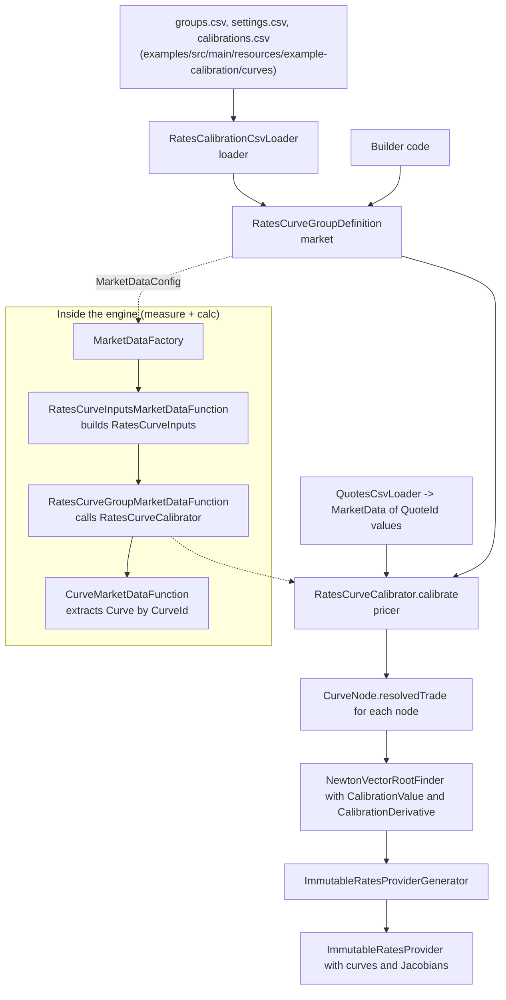

# Curve calibration

Active contributors: Stephen Colebourne, Yuki Iwashita, Alexis Skitini

## Purpose

Interest rate pricers need discount and forward curves, but markets quote instruments (deposits, FRAs, futures, swaps), not curves. Curve calibration finds the curve parameters that reprice a chosen set of instruments to their market quotes. In Strata, a curve group definition says which curves to build and which instruments (nodes) to use; `RatesCurveCalibrator` solves for the parameters and returns an `ImmutableRatesProvider` that pricers can use directly.

Calibration can be called directly, or it can run inside the market data layer of the engine, where `RatesCurveGroupMarketDataFunction` calibrates a curve group the first time a calculation needs one of its curves.

## How it works



### Curve group definitions

`RatesCurveGroupDefinition` (`modules/market/src/main/java/com/opengamma/strata/market/curve/RatesCurveGroupDefinition.java`) holds a group name, a list of `RatesCurveGroupEntry` objects (curve name plus the currencies it discounts and the indices it forecasts), and a `CurveDefinition` per curve. The usual curve definition is `InterpolatedNodalCurveDefinition`, which lists the curve nodes, value type (for example zero rate), day count, interpolator and extrapolators. Flags on the group control whether Jacobian matrices and present value sensitivity to market quotes are computed. `CurveGroupDefinition` (`modules/market/src/main/java/com/opengamma/strata/market/curve/CurveGroupDefinition.java`) is the general interface; its Javadoc notes it became an interface in Strata v2 and that code should migrate to `RatesCurveGroupDefinition`.

`filtered(valuationDate, refData)` removes nodes that clash on date, using each node's `CurveNodeDateOrder` and `CurveNodeClashAction`. The examples call it before calibrating.

### Curve nodes

A `CurveNode` (`modules/market/src/main/java/com/opengamma/strata/market/curve/CurveNode.java`) represents one calibration instrument. Its key methods are `requirements()` (the `QuoteId`s it needs), `date(...)` and `metadata(...)` (the node date and parameter metadata), `trade(...)` and `resolvedTrade(...)` (the instrument priced at the market quote), and `initialGuess(...)`. Implementations are in `modules/market/src/main/java/com/opengamma/strata/market/curve/node/`:

| Node | Instrument |
| --- | --- |
| `TermDepositCurveNode`, `IborFixingDepositCurveNode` | Deposits and index fixings |
| `FraCurveNode` | FRAs |
| `IborFutureCurveNode`, `OvernightFutureCurveNode` | STIR futures |
| `FixedIborSwapCurveNode`, `FixedOvernightSwapCurveNode`, `IborIborSwapCurveNode`, `OvernightIborSwapCurveNode`, `OvernightOvernightSwapCurveNode`, `ThreeLegBasisSwapCurveNode` | Single-currency swaps |
| `XCcyIborIborSwapCurveNode`, `XCcyOvernightOvernightSwapCurveNode`, `FxSwapCurveNode` | Cross-currency instruments |
| `FixedInflationSwapCurveNode` | Inflation swaps |
| `CdsIsdaCreditCurveNode`, `CdsIndexIsdaCreditCurveNode` | Credit curves (ISDA model, calibrated separately) |

### CSV configuration

`RatesCalibrationCsvLoader.load(groups, settings, calibrations)` in `modules/loader/src/main/java/com/opengamma/strata/loader/csv/RatesCalibrationCsvLoader.java` returns a map of `CurveGroupName` to `RatesCurveGroupDefinition`. The three files are:

- **groups**: `Group Name,Curve Type,Reference,Curve Name`, for example `USD-DSCON-LIBOR3M,Forward,USD-LIBOR-3M,USD-3ML`.
- **settings**: `Curve Name,Value Type,Day Count,Interpolator,Left Extrapolator,Right Extrapolator`.
- **calibrations** (nodes): `Curve Name,Label,Symbology,Ticker,Field Name,Type,Convention,Time,Date,Min Gap,Clash Action,Spread`. `Type` selects the node class (for example `DEP`) and `Convention` names a trade convention such as `USD-ShortDeposit-T0`.

`loadWithSeasonality` also reads a seasonality file for inflation curves. Group files alone can be read with `RatesCurveGroupDefinitionCsvLoader`. Market quotes come from `QuotesCsvLoader` (`Valuation Date,Symbology,Ticker,Field Name,Value`), and fixings from `FixingSeriesCsvLoader`. More loaders are described in [loader](../modules/loader.md).

### The calibrator

`RatesCurveCalibrator` (`modules/pricer/src/main/java/com/opengamma/strata/pricer/curve/RatesCurveCalibrator.java`) has two `calibrate` methods. The short form takes a definition, `MarketData` and `ReferenceData`, and builds the starting `ImmutableRatesProvider` from the market data's FX rates and index time series. The long form takes a list of group definitions and an existing provider, and calibrates the groups one after another so later groups can depend on earlier ones.

For each group the calibrator:

1. Binds index fixings with `bindTimeSeries`, resolves one trade per node with `resolvedTrades(marketData, refData)` and collects initial guesses.
2. Uses `ImmutableRatesProviderGenerator` to turn a parameter vector into a provider.
3. Solves with a `NewtonVectorRootFinder` (Broyden by default). `CalibrationValue` computes, for each trade, the value of its `CalibrationMeasure` (for par spread this is zero at the solution) and `CalibrationDerivative` supplies the analytic Jacobian from point sensitivities.
4. Optionally builds `JacobianCalibrationMatrix` entries (`modules/market/src/main/java/com/opengamma/strata/market/curve/JacobianCalibrationMatrix.java`) and stores them in curve metadata. These are later used for market quote sensitivities; see [Sensitivities](sensitivities.md).

`CalibrationMeasures` (`modules/pricer/src/main/java/com/opengamma/strata/pricer/curve/CalibrationMeasures.java`) groups one `CalibrationMeasure` per trade type. It has three constants: `PAR_SPREAD` (used by `RatesCurveCalibrator.standard()`, tolerance 1e-9 and up to 1000 steps), `MARKET_QUOTE` (default for synthetic calibration) and `PRESENT_VALUE` (used for present value sensitivity to market quotes). Individual measures are in `TradeCalibrationMeasure`, `MarketQuoteMeasure` and `PresentValueCalibrationMeasure` in the same package.

`SyntheticRatesCurveCalibrator` in the same package calibrates curves to synthetic quotes computed from an existing `RatesProvider`, for example to re-express risk on a different set of instruments.

### Calibration inside the engine

The standard market data functions (`StandardComponents.marketDataFunctions()` in `modules/measure/src/main/java/com/opengamma/strata/measure/StandardComponents.java`) include three curve functions that `DefaultMarketDataFactory` runs through its dependency tree:

1. `RatesCurveInputsMarketDataFunction` (`modules/measure/src/main/java/com/opengamma/strata/measure/rate/RatesCurveInputsMarketDataFunction.java`) builds `RatesCurveInputs` for a `RatesCurveInputsId`: the quotes needed by every node of one curve, with curve metadata.
2. `RatesCurveGroupMarketDataFunction` (`modules/measure/src/main/java/com/opengamma/strata/measure/rate/RatesCurveGroupMarketDataFunction.java`) builds a `RatesCurveGroup` for a `RatesCurveGroupId`. It reads the `RatesCurveGroupDefinition` from `MarketDataConfig`, creates a calibrator using a `RootFinderConfig` from the config if present (`modules/measure/src/main/java/com/opengamma/strata/measure/curve/RootFinderConfig.java`), and calibrates once per scenario when scenario inputs differ. The no-argument constructor uses `CalibrationMeasures.PAR_SPREAD`.
3. `CurveMarketDataFunction` (`modules/measure/src/main/java/com/opengamma/strata/measure/curve/CurveMarketDataFunction.java`) satisfies a `CurveId` by finding the named curve in the already built group. It does not calibrate.

The application wiring, from `examples/src/main/java/com/opengamma/strata/examples/finance/SwapPricingWithCalibrationExample.java`:

```java
Map<CurveGroupName, RatesCurveGroupDefinition> defns =
    RatesCalibrationCsvLoader.load(GROUPS_RESOURCE, SETTINGS_RESOURCE, CALIBRATION_RESOURCE);
RatesCurveGroupDefinition curveGroupDefinition = defns.get(CURVE_GROUP_NAME).filtered(VAL_DATE, refData);
MarketDataConfig marketDataConfig = MarketDataConfig.builder()
    .add(CURVE_GROUP_NAME, curveGroupDefinition)
    .build();
RatesMarketDataLookup ratesLookup = RatesMarketDataLookup.of(curveGroupDefinition);
CalculationRules rules = CalculationRules.of(functions, ratesLookup);
MarketDataRequirements reqs = MarketDataRequirements.of(rules, trades, columns, refData);
MarketData calibratedMarketData = marketDataFactory().create(reqs, marketDataConfig, marketData, refData);
Results results = runner.calculate(rules, trades, columns, calibratedMarketData, refData);
```

`RatesMarketDataLookup.of(curveGroupDefinition)` makes the calculation functions ask for `CurveId`s in that group, which in turn pulls in the group and its inputs.

## Examples

| Example | What it does |
| --- | --- |
| `examples/src/main/java/com/opengamma/strata/examples/finance/SwapPricingWithCalibrationExample.java` | Calibrates USD curves inside the engine and prints a swap report |
| `examples/src/main/java/com/opengamma/strata/examples/finance/CalibrationCheckExample.java` | Two USD curves; prices the calibration instruments to check that their PV is close to zero |
| `examples/src/main/java/com/opengamma/strata/examples/finance/CalibrationSimpleForwardCheckExample.java` | Same check with a simpler forward curve setup (`settings-fwd.csv`) |
| `examples/src/main/java/com/opengamma/strata/examples/finance/CalibrationEur3CheckExample.java` | Three EUR curves |
| `examples/src/main/java/com/opengamma/strata/examples/finance/CalibrationXCcyCheckExample.java` | Four curves in USD and EUR with cross-currency instruments |
| `examples/src/main/java/com/opengamma/strata/examples/finance/CalibrationXCcyOisCheckExample.java` | Cross-currency calibration on overnight-indexed swaps (added 2022) |
| `examples/src/main/java/com/opengamma/strata/examples/finance/CalibrationUsdCpiExample.java` | USD curves plus a CPI inflation curve |
| `examples/src/main/java/com/opengamma/strata/examples/finance/CalibrationUsdFfsExample.java` | USD calibration using Fed Funds swaps (Fed Fund against Libor 3M) |
| `examples/src/main/java/com/opengamma/strata/examples/blog/multicurve1/CalibrationPV01Example.java` | Direct `RatesCurveCalibrator` use, then PV and market quote bucketed PV01 |
| `examples/src/main/java/com/opengamma/strata/examples/blog/multicurve1/CalibrationPVPerformanceExample.java` | Times repeated calibration and PV01 |
| `examples/src/main/java/com/opengamma/strata/examples/blog/multicurve2/CalibrationInterpolationExample.java` | Calibrates with several interpolators and compares risk |

The CSV inputs are under `examples/src/main/resources/example-calibration/` (`curves/`, `quotes/`, `fixings/`).

## Key types

| Type | Path | Role |
| --- | --- | --- |
| `RatesCurveGroupDefinition` | `modules/market/src/main/java/com/opengamma/strata/market/curve/RatesCurveGroupDefinition.java` | Curves, entries and nodes to calibrate |
| `CurveNode` | `modules/market/src/main/java/com/opengamma/strata/market/curve/CurveNode.java` | One calibration instrument |
| `RatesCurveGroup` | `modules/market/src/main/java/com/opengamma/strata/market/curve/RatesCurveGroup.java` | Calibrated discount and forward curves |
| `RatesCalibrationCsvLoader` | `modules/loader/src/main/java/com/opengamma/strata/loader/csv/RatesCalibrationCsvLoader.java` | Loads definitions from CSV |
| `RatesCurveCalibrator` | `modules/pricer/src/main/java/com/opengamma/strata/pricer/curve/RatesCurveCalibrator.java` | Solves for curve parameters |
| `CalibrationMeasures` | `modules/pricer/src/main/java/com/opengamma/strata/pricer/curve/CalibrationMeasures.java` | Per-trade-type measures for the root finder |
| `RatesCurveGroupMarketDataFunction` | `modules/measure/src/main/java/com/opengamma/strata/measure/rate/RatesCurveGroupMarketDataFunction.java` | Calibrates in the engine |

## Integration points

- **Math.** The root finder comes from `com.opengamma.strata.math.rootfind`; interpolators come from `modules/market/src/main/java/com/opengamma/strata/market/curve/interpolator/`. See [math](../modules/math.md) and [market](../modules/market.md).
- **Conventions.** Node conventions (for example `USD-ShortDeposit-T0`) are named trade conventions from `modules/product`, configured in INI files. See [Reference data and configuration](reference-data-and-configuration.md).
- **Scenarios.** Perturbing quotes before calibration, or curves after it, is covered in [Scenarios](scenarios.md).
- **Sensitivities.** Jacobians stored during calibration drive market quote PV01.

## Entry points for modification

- **New node type.** Implement `CurveNode` in `modules/market/src/main/java/com/opengamma/strata/market/curve/node/`, add a `TradeCalibrationMeasure` (and a market quote or PV measure if needed) in `modules/pricer/src/main/java/com/opengamma/strata/pricer/curve/`, register it in the `CalibrationMeasures` constants, and teach `RatesCalibrationCsvLoader` its CSV `Type`.
- **Solver settings.** Use `RatesCurveCalibrator.of(...)` directly, or add a `RootFinderConfig` to `MarketDataConfig` for engine calibration.
- **Engine behaviour.** Per-scenario calibration logic is in `RatesCurveGroupMarketDataFunction.buildCurveGroup`.

## Key source files

| File | Purpose |
| --- | --- |
| `modules/pricer/src/main/java/com/opengamma/strata/pricer/curve/RatesCurveCalibrator.java` | Group-by-group calibration and Jacobians |
| `modules/pricer/src/main/java/com/opengamma/strata/pricer/curve/CalibrationValue.java` | Root-finder target function |
| `modules/pricer/src/main/java/com/opengamma/strata/pricer/curve/CalibrationDerivative.java` | Root-finder derivative |
| `modules/pricer/src/main/java/com/opengamma/strata/pricer/curve/ImmutableRatesProviderGenerator.java` | Parameters to provider |
| `modules/pricer/src/main/java/com/opengamma/strata/pricer/curve/SyntheticRatesCurveCalibrator.java` | Calibration to synthetic quotes |
| `modules/market/src/main/java/com/opengamma/strata/market/curve/RatesCurveGroupDefinition.java` | Group definition |
| `modules/market/src/main/java/com/opengamma/strata/market/curve/InterpolatedNodalCurveDefinition.java` | Usual curve definition |
| `modules/loader/src/main/java/com/opengamma/strata/loader/csv/RatesCalibrationCsvLoader.java` | CSV loader |
| `modules/measure/src/main/java/com/opengamma/strata/measure/rate/RatesCurveGroupMarketDataFunction.java` | Engine calibration |
| `modules/measure/src/main/java/com/opengamma/strata/measure/rate/RatesCurveInputsMarketDataFunction.java` | Engine calibration inputs |
| `modules/measure/src/main/java/com/opengamma/strata/measure/curve/CurveMarketDataFunction.java` | Curve lookup from a built group |

## Related pages

- [Pricing a trade](pricing-a-trade.md)
- [Sensitivities](sensitivities.md)
- [Scenarios](scenarios.md)
- [pricer](../modules/pricer/index.md), [market](../modules/market.md), [loader](../modules/loader.md), [measure](../modules/measure.md)
