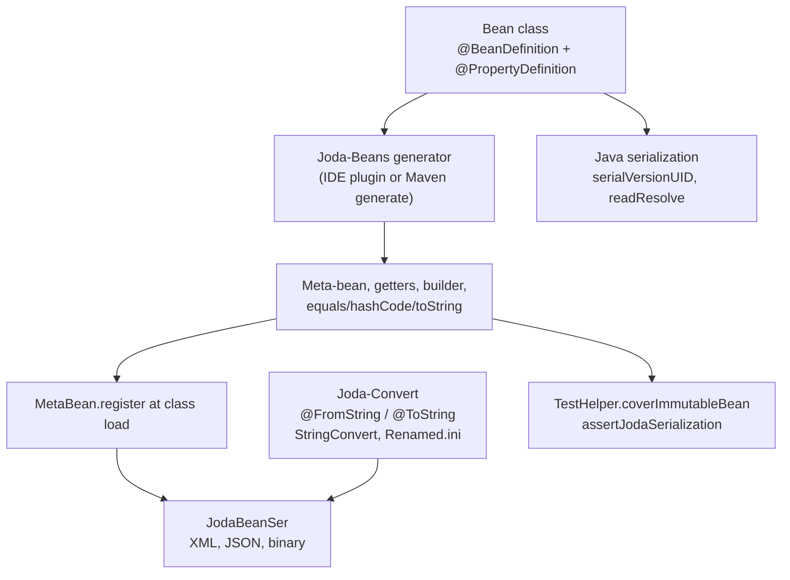

# Joda-Beans and serialization

Active contributors: Stephen Colebourne, Yuki Iwashita, Marc Henrard

## Purpose

Most Strata value types (trades, products, conventions, identifiers, curve definitions, reference data) are immutable Joda-Beans. The bean metadata gives every such type a uniform way to be built, inspected, compared and serialized. This page explains the bean styles Strata uses, how beans are serialized to XML, JSON and binary with `JodaBeanSer`, how Joda-Convert turns simple types into strings, and how Java serialization is kept stable.

For the coding rules of a bean (field annotations, validation hooks, the generated block) see [Patterns and conventions](../how-to-contribute/patterns-and-conventions.md). This page focuses on what the metadata is used for.

## How it works

A bean class declares its properties as annotated fields. The Joda-Beans code generator writes a meta-bean and accessor code into the class between the `AUTOGENERATED START` and `AUTOGENERATED END` markers. At class load the meta-bean is registered with `MetaBean.register`. Serializers and tools then work through the meta-bean, not through reflection on fields. Leaf values inside a bean (dates, currencies, identifiers) are written as strings through Joda-Convert.

### Bean styles

`@BeanDefinition` takes a `style` attribute. Strata uses three:

| Style | Generated meta-bean | Builder | Typical use | Java files |
| --- | --- | --- | --- | --- |
| Default (full) | Nested `Meta` class extending `DirectMetaBean`, with one `MetaProperty` field per property | Nested `Builder` (scope set by `builderScope`) | Trades, products, conventions with many properties, for example `SwapTrade` | the majority of the 563 bean files |
| `light` | `LightMetaBean.of(...)`, built from the fields with method handles; much less generated code | None | Small identifiers and values, for example `QuoteId` | 99 |
| `minimal` | `MinimalMetaBean.of(...)` with explicit getter lambdas | A builder can still be generated | Types that need custom accessors, for example `SwaptionExerciseDate` | 10 |

Examples:

- Full: `modules/product/src/main/java/com/opengamma/strata/product/swap/SwapTrade.java` (`@BeanDefinition`, `@ImmutableDefaults`, a public `Builder`, `serialVersionUID = 1L`).
- Full with a private builder: `modules/product/src/main/java/com/opengamma/strata/product/TradeInfo.java` (`builderScope = "private", constructorScope = "package"`) and `modules/basics/src/main/scala/com/opengamma/strata/basics/ImmutableReferenceData.scala` (`builderScope = "private"`).
- Light: `modules/market/src/main/java/com/opengamma/strata/market/observable/QuoteId.java` (`style = "light", cacheHashCode = true`).
- Minimal: `modules/product/src/main/java/com/opengamma/strata/product/swaption/SwaptionExerciseDate.java`.

On this branch about 60 Scala files in `collect` and `basics` also contain bean code. The generator does not read Scala, so that code is maintained by hand. See [Scala and Java interoperability](scala-java-interop.md#joda-beans-in-scala).

### Serialization with `JodaBeanSer`

`org.joda.beans.ser.JodaBeanSer` writes and reads any registered bean. Two settings are used in Strata: `JodaBeanSer.PRETTY` (indented, for people) and `JodaBeanSer.COMPACT` (for machines). Each has XML, JSON and binary readers and writers.

| Format | Where Strata uses it |
| --- | --- |
| XML | `examples/src/main/java/com/opengamma/strata/examples/finance/SwapTradeExample.java` prints swap legs and trades with `JodaBeanSer.PRETTY.xmlWriter()`. `examples/src/main/java/com/opengamma/strata/examples/report/JodaBeanParameterConverter.java` reads beans from XML for the report runner's command-line parameters. |
| JSON | `TestHelper.assertJodaSerialization` writes with `JodaBeanSer.PRETTY.jsonWriter()` and reads back with `JodaBeanSer.COMPACT.jsonReader()`. |
| Binary | `SerializedValue` in `modules/collect/src/main/scala/com/opengamma/strata/collect/io/SerializedValue.scala` stores a bean with `JodaBeanSer.COMPACT.binWriter()` and reads it with `JodaBeanSer.COMPACT.withDeserializers(SerDeserializers.LENIENT).binReader()`. |

`SerializedValue` is a light bean that carries an object in serialized form so it can be passed to another Java process that may not have the class on its classpath. It accepts a Joda-Convert type, a Joda-Bean or a `Serializable` object.

Some beans need custom deserialization. `ImmutableHolidayCalendar` exposes a `DESERIALIZER` (`ImmutableHolidayCalendarDeserializer` in `modules/basics/src/main/scala/com/opengamma/strata/basics/date/ImmutableHolidayCalendarDeserializer.scala`) so that holiday calendars serialized in an older format can still be read.

Tests that exercise these formats include `modules/basics/src/test/java/com/opengamma/strata/basics/date/SerializeTest.java` (XML round trip), `modules/basics/src/test/java/com/opengamma/strata/basics/date/ImmutableHolidayCalendarTest.java`, `modules/basics/src/test/java/com/opengamma/strata/basics/currency/FxMatrixTest.java` and `modules/pricer/src/test/java/com/opengamma/strata/pricer/rate/ImmutableRatesProviderTest.java`.

### Locked JSON forms

`TestHelper.assertJodaSerialization(bean, id, oldIds...)` in `modules/collect/src/test/java/com/opengamma/strata/collect/TestHelper.java` pins the serialized form of a bean:

1. It writes the bean as pretty JSON.
2. It loads `JodaSerialization.txt` from the same package on the test classpath and finds the section headed `# <id>`.
3. It fails if the JSON differs from that section ("JSON format has changed"), then checks the round trip.
4. For each old id, it reads the old JSON and checks that it still produces an equal bean.

About 19 test classes use it, mainly in `modules/product` (for example `SecurityInfoTest`, `GenericSecurityTest`, `EtdFutureTradeTest`), with expected forms in `modules/product/src/test/resources/com/opengamma/strata/product/JodaSerialization.txt` and `modules/product/src/test/resources/com/opengamma/strata/product/etd/JodaSerialization.txt`. If you rename or retype a property, add the new form as a new id and keep the old id in the `oldIds` list so stored data keeps loading.

### Joda-Convert

Simple value types round-trip through a single string instead of a nested bean. A static factory annotated `@FromString` parses, and a method annotated `@ToString` formats. About 149 files use `@FromString`. Examples are `Currency` (`modules/basics/src/main/scala/com/opengamma/strata/basics/currency/Currency.scala`), `Tenor` and `HolidayCalendarId` (`modules/basics/src/main/scala/com/opengamma/strata/basics/date/HolidayCalendarId.scala`, where `getName()` is the `@ToString` method). `JodaBeanSer` uses these converters for leaf values, which is why a serialized trade shows `"currency": "GBP"` rather than a nested object.

Code can use the converters directly through `StringConvert.INSTANCE`. `AttributeType` in `modules/product/src/main/java/com/opengamma/strata/product/AttributeType.java` uses it to normalize attribute values, and `ExplainMap` in `modules/market/src/main/java/com/opengamma/strata/market/explain/ExplainMap.java` uses it to print values.

When a type is renamed, old names are mapped in `META-INF/org/joda/convert/Renamed.ini`. Strata has three: `modules/product/src/main/resources/META-INF/org/joda/convert/Renamed.ini` (for example `TradeAttributeType` to `AttributeType`), and the equivalents in `modules/market` and `modules/calc`. `ExtendedEnum` and `CombinedExtendedEnum` resolve provider class names through `RenameHandler.INSTANCE.lookupType`, so renamed provider classes in INI files keep working. The shaded examples jar merges these files with an `AppendingTransformer` in `examples/pom.xml`.

### Java serialization

Beans and value types also implement `Serializable`:

- Java classes declare `private static final long serialVersionUID = 1L;`; Scala classes use `@SerialVersionUID(1L)`.
- Types with a canonical instance per name use `readResolve` to return it after deserialization. `Currency.readResolve` returns `Currency.of(code)`, `HolidayCalendarId.readResolve` returns `HolidayCalendarId.of(name)` (which restores the transient resolver), and `Tenor` does the same. In other modules, `SecurityPriceInfo`, `CcpId`, `ExchangeId` and `EtdVariant` in `modules/product` are examples.
- Transient caches, such as `cachedHashCode` in `HolidayCalendarId`, are rebuilt rather than stored.

`TestHelper.assertSerialization(obj)` performs a Java serialization round trip and checks equality.

On this branch the Java serialization stream of every converted `collect` and `basics` class must match the Java baseline. Where a Scala field had to be renamed, explicit `writeObject` and `readObject` keep the old field name in the stream; `Result` is the example (its `_failure` field is written as `failure`).

## Key types

| Type | Path | Role |
| --- | --- | --- |
| `SwapTrade` | `modules/product/src/main/java/com/opengamma/strata/product/swap/SwapTrade.java` | Full bean with builder and defaults |
| `QuoteId` | `modules/market/src/main/java/com/opengamma/strata/market/observable/QuoteId.java` | Reference light bean |
| `SwaptionExerciseDate` | `modules/product/src/main/java/com/opengamma/strata/product/swaption/SwaptionExerciseDate.java` | Minimal-style bean |
| `ImmutableReferenceData` | `modules/basics/src/main/scala/com/opengamma/strata/basics/ImmutableReferenceData.scala` | Scala bean with hand-maintained meta-bean |
| `SerializedValue` | `modules/collect/src/main/scala/com/opengamma/strata/collect/io/SerializedValue.scala` | Carries an object in binary bean, Joda-Convert or Java serialized form |
| `ImmutableHolidayCalendarDeserializer` | `modules/basics/src/main/scala/com/opengamma/strata/basics/date/ImmutableHolidayCalendarDeserializer.scala` | Custom `SerDeserializer` |
| `TestHelper` | `modules/collect/src/test/java/com/opengamma/strata/collect/TestHelper.java` | `coverImmutableBean`, `assertJodaSerialization`, `assertJodaConvert`, `assertSerialization` |

## Integration points

- Versions: `modules/pom.xml` sets `joda-beans.version` 2.11.1 and `joda-convert.version` 2.2.3 in `dependencyManagement`, and mirrors the first into `joda.beans.version`. The parent POM is `com.opengamma:corporate-parent` 2.9.2.
- Validation: the `strict` profile in `modules/pom.xml` (activated by `-Dstrict`, as CI does) runs the `joda-beans-maven-plugin` `validate` goal in the `validate` phase with `stopOnError`. A Java bean whose generated block is out of date fails the build. Regenerate with the IDE plugin or the plugin's `generate` goal.
- Calculation results and reports: the report layer and `ExplainMap` read bean properties and Joda-Convert strings to format values. See [report](../modules/report.md).
- Loaders produce beans; [loader](../modules/loader.md) covers CSV and FpML input, which do not use `JodaBeanSer`.

## Entry points for modification

- Adding a property to a Java bean: add the annotated field, regenerate, and update `JodaSerialization.txt` if the class has a locked form.
- Adding a property to a Scala bean in `collect` or `basics`: edit the hand-maintained generated code to match what the generator would write for Java. See [Scala and Java interoperability](scala-java-interop.md).
- Renaming a Joda-Convert type: add a line to the module's `META-INF/org/joda/convert/Renamed.ini`.
- Changing serialized forms: keep `readResolve` and `serialVersionUID`, and add an old-form id to `assertJodaSerialization` calls.

## Key source files

| File | Purpose |
| --- | --- |
| `modules/pom.xml` | Joda-Beans and Joda-Convert versions, strict-profile `validate` goal |
| `modules/collect/src/test/java/com/opengamma/strata/collect/TestHelper.java` | Serialization and bean coverage assertions |
| `modules/collect/src/main/scala/com/opengamma/strata/collect/io/SerializedValue.scala` | Binary bean serialization wrapper |
| `examples/src/main/java/com/opengamma/strata/examples/finance/SwapTradeExample.java` | XML output of trades and legs |
| `examples/src/main/java/com/opengamma/strata/examples/report/JodaBeanParameterConverter.java` | XML input of bean parameters |
| `modules/product/src/main/resources/META-INF/org/joda/convert/Renamed.ini` | Joda-Convert type renames |
| `modules/basics/src/test/java/com/opengamma/strata/basics/date/SerializeTest.java` | XML round-trip test |

## Related pages

- [Patterns and conventions](../how-to-contribute/patterns-and-conventions.md)
- [Scala and Java interoperability](scala-java-interop.md)
- [Testing](../how-to-contribute/testing.md)
- [Tooling](../how-to-contribute/tooling.md)
- [Data models](../reference/data-models.md)
- [collect](../modules/collect.md)
