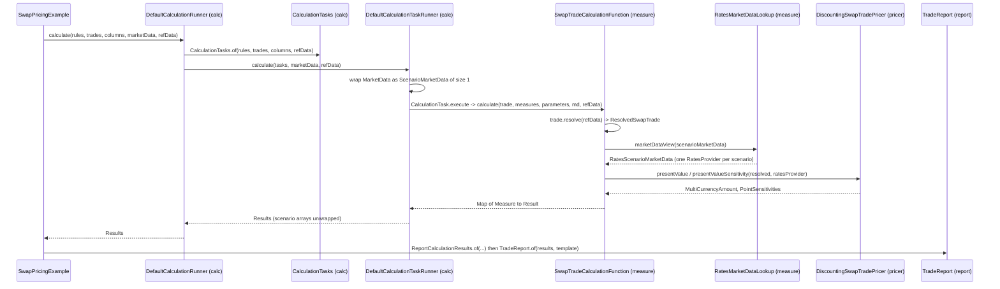

# Pricing a trade

Active contributors: Stephen Colebourne, Yuki Iwashita, Guillaume Santoro

## Purpose

Pricing a trade in Strata means turning an immutable `Trade` plus market data into numbers such as present value, par rate or PV01. There are two ways to do this:

- **Through the calculation engine.** The application asks for a grid of results (rows are trades, columns are measures). The engine works out which market data is needed, runs one calculation function per trade, and returns a `Results` object that the reporting layer can format. This is what the runnable examples do.
- **Directly with a pricer.** The application resolves the trade itself and calls a pricer such as `DiscountingSwapTradePricer` with a `RatesProvider`. This avoids the engine and is common in tests and in quantitative code.

Both paths end up in the same pricer classes in `modules/pricer`, so the numbers are identical.

## How it works

The walk-through below follows `examples/src/main/java/com/opengamma/strata/examples/SwapPricingExample.java`. `examples/src/main/java/com/opengamma/strata/examples/FxPricingExample.java` has the same structure with FX forwards, an FX swap and a bullet payment.



### 1. Build trades

The example creates `SwapTrade` objects in two ways: from a convention, for example `FixedIborSwapConventions.USD_FIXED_6M_LIBOR_3M.toTrade(tradeInfo, start, end, BuySell.BUY, notional, rate)`, and by hand with `RateCalculationSwapLeg.builder()` and `Swap.of(payLeg, receiveLeg)`. Each trade carries a `TradeInfo` with an id, counterparty and settlement date. Products and trades live in `modules/product`; see [product](../modules/product/index.md).

### 2. Choose columns and measures

A `Column` (`modules/calc/src/main/java/com/opengamma/strata/calc/Column.java`) wraps a `Measure`. The standard measures are constants in `modules/measure/src/main/java/com/opengamma/strata/measure/Measures.java` (`PRESENT_VALUE`, `PV01_CALIBRATED_SUM`, `PV01_CALIBRATED_BUCKETED`, `PAR_RATE`, `LEG_PRESENT_VALUE`, `ACCRUED_INTEREST` and others). Gamma measures such as `PV01_SEMI_PARALLEL_GAMMA_BUCKETED` are in `modules/measure/src/main/java/com/opengamma/strata/measure/AdvancedMeasures.java`.

### 3. Provide market data and rules

The example builds a `MarketData` snapshot with `ExampleMarketData.builder().buildSnapshot(valuationDate)` from files under `examples/src/main/resources/example-marketdata/`. It then combines two things into `CalculationRules` (`modules/calc/src/main/java/com/opengamma/strata/calc/CalculationRules.java`):

- `StandardComponents.calculationFunctions()`, which maps each trade type to its calculation function (`SwapTrade` to `SwapTradeCalculationFunction`, `FxSingleTrade` to `FxSingleTradeCalculationFunction`, and so on).
- A `RatesMarketDataLookup` from `ExampleMarketDataBuilder.ratesLookup(valuationDate)`, which tells the functions which curve to use for each currency and index. The lookup is passed to functions as a `CalculationParameter`.

`CalculationRules.of(functions, Currency.USD, lookup)` also sets a reporting currency, as `examples/src/main/java/com/opengamma/strata/examples/finance/CurveScenarioExample.java` does.

### 4. Run the engine

`CalculationRunner.ofMultiThreaded()` returns a `DefaultCalculationRunner` backed by a thread pool; it is `AutoCloseable`, so the examples use try-with-resources. `calculate(rules, trades, columns, marketData, ReferenceData.standard())`:

1. Builds `CalculationTasks` (`modules/calc/src/main/java/com/opengamma/strata/calc/runner/CalculationTasks.java`): one `CalculationTask` per trade, each holding the function, the parameters and the cells (measure plus reporting currency) for that row.
2. Hands the tasks to `DefaultCalculationTaskRunner`, which wraps the single `MarketData` as a one-scenario `ScenarioMarketData` and calls `calculateMultiScenario`. Calculation functions are therefore always written against scenario data.
3. `CalculationTask.execute` intersects the requested measures with `function.supportedMeasures()`, calls the function, and converts each result to the reporting currency through a `ScenarioFxRateProvider`. Missing measures become `Failure` results instead of exceptions.
4. For the single-scenario API, the runner unwraps each one-element `ScenarioArray` so the caller sees plain values.

The engine does not build missing derived market data by itself. When curves need calibrating, the application calls `MarketDataFactory.create(...)` first; see [Curve calibration](curve-calibration.md). The engine internals are described in [calc](../modules/calc.md).

### 5. Calculation function and pricer

`SwapTradeCalculationFunction` (`modules/measure/src/main/java/com/opengamma/strata/measure/swap/SwapTradeCalculationFunction.java`) shows the pattern used by every `*TradeCalculationFunction`:

- `requirements(...)` reads the `RatesMarketDataLookup` parameter and asks it for the curves needed by the trade's currencies and indices.
- `calculate(...)` resolves the trade once with `trade.resolve(refData)` into a `ResolvedSwapTrade`, gets a `RatesScenarioMarketData` view from the lookup, and then evaluates each measure through a static `CALCULATORS` map. Each calculation is wrapped in `Result.of(...)`, so a pricing exception becomes a `Failure` for that cell only.
- The calculators delegate to `SwapMeasureCalculations`, which loops over scenarios and calls `DiscountingSwapTradePricer` (`modules/pricer/src/main/java/com/opengamma/strata/pricer/swap/DiscountingSwapTradePricer.java`) with `marketData.scenario(i).ratesProvider()`.

The `RatesProvider` given to the pricer is built on demand by `DefaultLookupRatesProvider` in `modules/measure/src/main/java/com/opengamma/strata/measure/rate/DefaultLookupRatesProvider.java`, which reads curves from market data using the ids in the lookup. Pricers are described in [pricer](../modules/pricer/index.md), and the measure layer in [measure](../modules/measure.md).

### 6. Results and reports

`Results` (`modules/calc/src/main/java/com/opengamma/strata/calc/Results.java`) is a grid of `Result<?>` cells with column headers. The example wraps it in `ReportCalculationResults.of(valuationDate, trades, columns, results, functions, refData)`, loads a report template with `ExampleData.loadTradeReportTemplate("swap-report-template")` (templates are INI files under `examples/src/main/resources/example-reports/`), and prints `TradeReport.of(...).writeAsciiTable(System.out)`. See [report](../modules/report.md).

## Pricing without the engine

The engine is optional. `examples/src/main/java/com/opengamma/strata/examples/blog/multicurve1/CalibrationPV01Example.java` resolves a swap and calls the pricer directly on a calibrated `ImmutableRatesProvider`:

```java
ImmutableRatesProvider multicurve = CALIBRATOR.calibrate(configs.get(CONFIG_NAME), MARKET_QUOTES, REF_DATA);
ResolvedSwapTrade swap = GBP_FIXED_6M_LIBOR_6M.createTrade(
    VALUATION_DATE, SWAP_PERIOD_TO_START, Tenor.of(SWAP_TENOR), BuySell.BUY, SWAP_NOTIONAL, SWAP_COUPON, REF_DATA)
    .resolve(REF_DATA);
MultiCurrencyAmount pv = PRICER_SWAP.presentValue(swap, multicurve);
PointSensitivities pts = PRICER_SWAP.presentValueSensitivity(swap, multicurve);
```

Here `PRICER_SWAP` is `DiscountingSwapTradePricer.DEFAULT`. An `ImmutableRatesProvider` can also be assembled by hand with `ImmutableRatesProvider.builder(valuationDate)` (`modules/pricer/src/main/java/com/opengamma/strata/pricer/rate/ImmutableRatesProvider.java`), which is what many pricer tests do.

A middle option is the `*TradeCalculations` classes in `modules/measure`, for example `SwapTradeCalculations.DEFAULT` in `modules/measure/src/main/java/com/opengamma/strata/measure/swap/SwapTradeCalculations.java`. They expose each measure as a method (`presentValue`, `pv01CalibratedSum`, `parRate`, `cashFlows` and others) with two overloads: one taking `RatesMarketDataLookup` plus `ScenarioMarketData` and returning scenario arrays, and one taking a `RatesProvider` and returning a single value. The caller resolves the trade first.

## Key types

| Type | Module | Path | Role |
| --- | --- | --- | --- |
| `Trade`, `SwapTrade` | product | `modules/product/src/main/java/com/opengamma/strata/product/Trade.java` | Immutable trade with `TradeInfo` and a product |
| `ResolvedSwapTrade` | product | `modules/product/src/main/java/com/opengamma/strata/product/swap/ResolvedSwapTrade.java` | Trade with schedules and holidays applied, ready to price |
| `CalculationRunner` | calc | `modules/calc/src/main/java/com/opengamma/strata/calc/CalculationRunner.java` | Engine entry point (`calculate`, `calculateMultiScenario`, async variants) |
| `CalculationRules` | calc | `modules/calc/src/main/java/com/opengamma/strata/calc/CalculationRules.java` | Functions, parameters and reporting currency |
| `CalculationTask` | calc | `modules/calc/src/main/java/com/opengamma/strata/calc/runner/CalculationTask.java` | One row of work: target, function, parameters, cells |
| `CalculationFunction` | calc | `modules/calc/src/main/java/com/opengamma/strata/calc/runner/CalculationFunction.java` | Interface implemented by each `*TradeCalculationFunction` |
| `RatesMarketDataLookup` | measure | `modules/measure/src/main/java/com/opengamma/strata/measure/rate/RatesMarketDataLookup.java` | Maps currencies and indices to curve ids; builds `RatesProvider` views |
| `DiscountingSwapTradePricer` | pricer | `modules/pricer/src/main/java/com/opengamma/strata/pricer/swap/DiscountingSwapTradePricer.java` | Swap present value, sensitivities, par rate |
| `RatesProvider` | pricer | `modules/pricer/src/main/java/com/opengamma/strata/pricer/rate/RatesProvider.java` | Discount factors, forward rates, FX, time series |
| `Results` | calc | `modules/calc/src/main/java/com/opengamma/strata/calc/Results.java` | Grid of `Result` cells |
| `TradeReport` | report | `modules/report/src/main/java/com/opengamma/strata/report/trade/TradeReport.java` | Formats results as ASCII or CSV |

## Integration points

- **Reference data.** Every function resolves trades with the `ReferenceData` passed to the runner. Missing holiday calendars or securities show up as failures. See [Reference data and configuration](reference-data-and-configuration.md).
- **Market data.** The engine only reads market data; derived data such as calibrated curves must be built first with `MarketDataFactory` from `StandardComponents.marketDataFactory()`.
- **Failures.** All per-cell errors use `Result` and `Failure` from `modules/collect/src/main/scala/com/opengamma/strata/collect/result/Result.scala`.
- **Listeners.** `calculateAsync` delivers results to a `CalculationListener` (`modules/calc/src/main/java/com/opengamma/strata/calc/runner/CalculationListener.java`) as each task finishes.

## Entry points for modification

- **New measure for an existing trade type.** Add a `Measure` constant to `Measures`, add an entry to the `CALCULATORS` map in the relevant `*TradeCalculationFunction`, and add the method to the matching `*MeasureCalculations` and `*TradeCalculations` classes.
- **New trade type.** Write a pricer in `modules/pricer`, a calculation function in `modules/measure`, and register it in `StandardComponents` (`modules/measure/src/main/java/com/opengamma/strata/measure/StandardComponents.java`).
- **Engine behaviour** (threading, unwrapping, listeners) lives in `DefaultCalculationRunner` and `DefaultCalculationTaskRunner`.

## Key source files

| File | Purpose |
| --- | --- |
| `examples/src/main/java/com/opengamma/strata/examples/SwapPricingExample.java` | Engine-based swap pricing with a trade report |
| `examples/src/main/java/com/opengamma/strata/examples/FxPricingExample.java` | Engine-based FX and bullet payment pricing |
| `modules/calc/src/main/java/com/opengamma/strata/calc/DefaultCalculationRunner.java` | Builds `CalculationTasks` and delegates to the task runner |
| `modules/calc/src/main/java/com/opengamma/strata/calc/runner/DefaultCalculationTaskRunner.java` | Runs tasks on an executor; unwraps single-scenario results |
| `modules/calc/src/main/java/com/opengamma/strata/calc/runner/CalculationTask.java` | Invokes the function and converts currencies per cell |
| `modules/measure/src/main/java/com/opengamma/strata/measure/StandardComponents.java` | Standard calculation functions, market data functions and factory |
| `modules/measure/src/main/java/com/opengamma/strata/measure/swap/SwapTradeCalculationFunction.java` | Swap calculation function |
| `modules/measure/src/main/java/com/opengamma/strata/measure/swap/SwapMeasureCalculations.java` | Per-scenario loops that call the pricer |
| `modules/measure/src/main/java/com/opengamma/strata/measure/rate/DefaultLookupRatesProvider.java` | `RatesProvider` backed by market data and a lookup |
| `modules/pricer/src/main/java/com/opengamma/strata/pricer/swap/DiscountingSwapTradePricer.java` | Swap trade pricer |
| `modules/report/src/main/java/com/opengamma/strata/report/ReportCalculationResults.java` | Bundles inputs and results for reporting |

## Related pages

- [Architecture](../overview/architecture.md)
- [Curve calibration](curve-calibration.md)
- [Sensitivities](sensitivities.md)
- [Scenarios](scenarios.md)
- [calc](../modules/calc.md), [measure](../modules/measure.md), [pricer](../modules/pricer/index.md), [report](../modules/report.md), [examples](../modules/examples.md)
