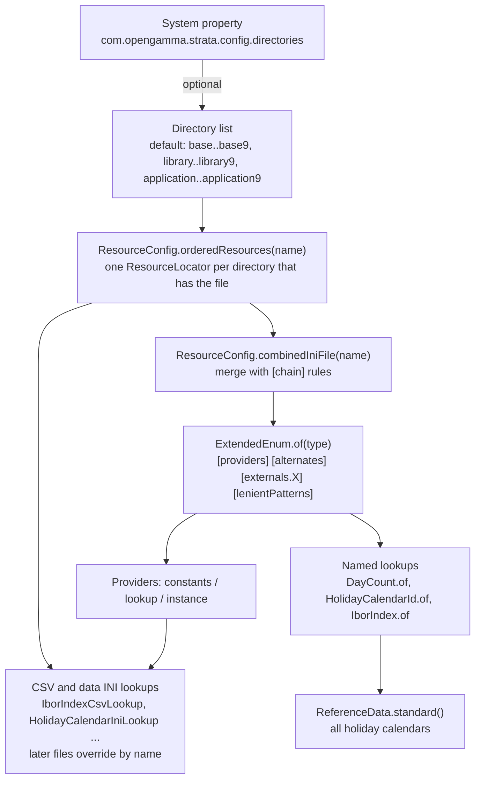

# Reference data and configuration

Active contributors: Stephen Colebourne, Andras Vig, Ben Hamilton-Brown

## Purpose

Pricing needs static data that does not change from one valuation to the next: holiday calendars, securities, legal entities, ETD contract specifications. Strata calls this reference data and passes it explicitly as a `ReferenceData` object. Separately, the built-in catalogues of named things (currencies, day counts, holiday calendars, indices, conventions, measures) are loaded from INI and CSV files on the classpath by `ResourceConfig`. Applications can add to or override both.

This page covers the `ReferenceData` API, the configuration directory search and merge rules, how `ExtendedEnum` providers are configured, and how to add a custom holiday calendar or index. For the types themselves see [basics](../modules/basics.md) and [collect](../modules/collect.md).

## Reference data

`ReferenceData` (`modules/basics/src/main/scala/com/opengamma/strata/basics/ReferenceData.scala`) is a typed map. Keys implement `ReferenceDataId<T>` (`modules/basics/src/main/scala/com/opengamma/strata/basics/ReferenceDataId.scala`), whose `getReferenceDataType()` says what type of value the key refers to. Lookups are `getValue(id)` (throws `ReferenceDataNotFoundException` if missing), `findValue(id)` (returns `Optional`), `queryValueOrNull(id)` and `containsValue(id)`.

Implementations of `ReferenceDataId`:

| Id | Value type | Path |
| --- | --- | --- |
| `HolidayCalendarId` | `HolidayCalendar` | `modules/basics/src/main/scala/com/opengamma/strata/basics/date/HolidayCalendarId.scala` |
| `SecurityId` | `Security` | `modules/product/src/main/java/com/opengamma/strata/product/SecurityId.java` |
| `LegalEntityId` | `LegalEntity` | `modules/product/src/main/java/com/opengamma/strata/product/LegalEntityId.java` |
| `EtdContractSpecId` | `EtdContractSpec` | `modules/product/src/main/java/com/opengamma/strata/product/etd/EtdContractSpecId.java` |

Static factories on `ReferenceData`:

| Method | Contents |
| --- | --- |
| `ReferenceData.standard()` | Every holiday calendar known to `HolidayCalendars.extendedEnum()`, built once in `StandardReferenceData.STANDARD`. Intended for examples and tests; its Javadoc notes that production code will usually not rely on it. |
| `ReferenceData.minimal()` | Only `HolidayCalendars.NO_HOLIDAYS`, `SAT_SUN`, `FRI_SAT` and `THU_FRI` |
| `ReferenceData.of(Map)` | The supplied entries plus the minimal set; supplied entries win on a key clash |
| `ReferenceData.empty()` | Nothing |
| `ImmutableReferenceData.of(Map)` | Exactly the supplied entries, without the minimal set |
| `refData.combinedWith(other)` | A `CombinedReferenceData` that checks this instance first, then `other` |

`ImmutableReferenceData` (`modules/basics/src/main/scala/com/opengamma/strata/basics/ImmutableReferenceData.scala`) is a Joda-Bean that validates each entry's value type against its id. `StandardReferenceData` is in `modules/basics/src/main/scala/com/opengamma/strata/basics/StandardReferenceData.scala`.

Reference data is consumed when a trade or product is resolved: `Resolvable.resolve(ReferenceData)` produces a `Resolved*` type with concrete dates. `HolidayCalendarId` is itself `Resolvable`, and its resolver only calls `refData.queryValueOrNull(this)`. The calculation runner takes the `ReferenceData` as an argument, as in `CalculationRunner.calculate(rules, trades, columns, marketData, ReferenceData.standard())`. See [Pricing a trade](pricing-a-trade.md).

## Configuration loading

`ResourceConfig` (`modules/collect/src/main/scala/com/opengamma/strata/collect/io/ResourceConfig.scala`) finds and merges configuration files on the classpath under `META-INF/com/opengamma/strata/config/<dir>/`. It is documented in `modules/basics/src/main/resources/META-INF/com/opengamma/strata/config/README.md`.

### Directory groups and priority

By default 30 directories are searched, in this order from lowest to highest priority:

1. `base`, `base1` ... `base9`: reserved for Strata
2. `library`, `library1` ... `library9`: reserved for libraries built on Strata
3. `application`, `application1` ... `application9`: for applications

Strata's own modules use more than one base directory where a later module adds to an earlier one. `modules/calc/src/main/resources/META-INF/com/opengamma/strata/config/base/Measure.ini` has an empty provider list and `modules/measure/src/main/resources/META-INF/com/opengamma/strata/config/base2/Measure.ini` adds `StandardMeasures` and `StandardCreditMeasures`. Similarly `modules/product/src/main/resources/META-INF/com/opengamma/strata/config/base1/Index.ini` adds `SwapIndex` to the index types in the `basics` `modules/basics/src/main/resources/META-INF/com/opengamma/strata/config/base/Index.ini`.

The JVM system property `com.opengamma.strata.config.directories` (constant `ResourceConfig.RESOURCE_DIRS_PROPERTY`) replaces the directory list with a comma-separated list, for example `base,library,application,user`. Each name should match `[A-Za-z0-9-]+`; an invalid name only logs a warning. The property is read once, when `ResourceConfig` is initialized, so it must be set at JVM start (for example `-Dcom.opengamma.strata.config.directories=...`).

For each directory, `orderedResources(name)` asks the class loader for the resource. If the same resource appears more than once on the classpath (Strata present twice), it is accepted only if all copies have identical bytes; otherwise it throws `IllegalStateException`. If no directory has the file at all, it also throws `IllegalStateException`.

### INI merge and chaining

`combinedIniFile(name)` merges the ordered files into one `IniFile`. Files are processed from lowest to highest priority, and for each section the properties of the higher-priority file override those of the lower one (`PropertySet.overrideWith`). A higher-priority file can control the merge with a `[chain]` section:

- `chainNextFile = false` discards everything loaded from lower-priority files, so only this file and higher ones count.
- `chainRemoveSections = a, b` removes the listed sections that came from lower-priority files.

The `[chain]` section itself is not copied into the result. The test resources `modules/collect/src/test/resources/META-INF/com/opengamma/strata/config/base/TestChain*.ini` and `.../application/TestChain*.ini` show each case, exercised by `modules/collect/src/test/java/com/opengamma/strata/collect/io/ResourceConfigTest.java`.

Data files are not always merged this way. The CSV and data INI loaders call `orderedResources` and read each file in order, putting entries into a map by name, so a later file replaces an entry with the same name and adds new ones. This applies to `HolidayCalendarData.ini` (`HolidayCalendarIniLookup`), `IborIndexData.csv` (`IborIndexCsvLookup`), `OvernightIndexData.csv`, `FxIndexData.csv`, `PriceIndexData.csv` and `SwapIndexData.csv` (`modules/product/src/main/java/com/opengamma/strata/product/swap/SwapIndexCsvLookup.java`).

## ExtendedEnum providers

`ExtendedEnum.of(Class)` in `modules/collect/src/main/scala/com/opengamma/strata/collect/named/ExtendedEnum.scala` loads `<SimpleName>.ini` through `combinedIniFile`. For example `HolidayCalendars` calls `ExtendedEnum.of(classOf[HolidayCalendar])`, which reads `HolidayCalendar.ini`. The file has these sections:

| Section | Meaning |
| --- | --- |
| `[providers]` | Key is a provider class name, resolved through Joda-Convert's `RenameHandler`. Value is `constants` (public static constants of the type on that class), `lookup` (the class implements `NamedLookup` and has a no-argument constructor) or `instance` (a static `INSTANCE` field of type `NamedLookup`). |
| `[alternates]` | Alternate name = standard name, for example `KRW-CD-3M = KRW-CD-13W` in `IborIndex.ini` |
| `[externals.<group>]` | Mapping of names used by an external system, for example `[externals.FpML]` in `DayCount.ini` maps `ACT/365.FIXED` to `Act/365F`. Read with `externalNames(group)`. |
| `[lenientPatterns]` | Regex rules used by lenient lookup |

The base `HolidayCalendar.ini` registers three providers: `HolidayCalendars` (constants), `HolidayCalendarIniLookup` (instance, reads `HolidayCalendarData.ini`) and `GlobalHolidayCalendarLookup` (instance, the calendars coded in `GlobalHolidayCalendars.scala`). `IborIndex.ini` registers `IborIndexCsvLookup`, which reads `IborIndexData.csv`.

`CombinedExtendedEnum` (`modules/collect/src/main/scala/com/opengamma/strata/collect/named/CombinedExtendedEnum.scala`) reads a `[types]` section instead and joins several extended enums behind one lookup. `Index.ini` uses it to combine Ibor, overnight, price, FX and (from `product`) swap indices.

If an `ExtendedEnum` fails to load, `ExtendedEnum.of` logs a severe message and returns an empty enum, so lookups later fail with "unknown name" errors. Check the log for "Failed to load ExtendedEnum" when a name you expect is missing. [Debugging](../how-to-contribute/debugging.md) has more on config problems.

## Adding a custom holiday calendar or index

### Through configuration

Put files on the application classpath under `META-INF/com/opengamma/strata/config/application/` (or `library/` for a shared library):

- Holiday calendar: add `HolidayCalendarData.ini` with one section per calendar. Each section needs a `Weekend` key (for example `Weekend = Sat,Sun`) and at least one holiday, given as ISO dates (`2016-01-04`), year lines (`2017 = Jan2,Apr14,Apr17`), or `WorkingDays` exceptions. The format is described in the header of `modules/basics/src/main/resources/META-INF/com/opengamma/strata/config/base/HolidayCalendarData.ini`. A section with the same name as a built-in calendar replaces it. A default calendar per currency can be set in `HolidayCalendarDefaultData.ini` under `[defaultByCurrency]`.
- Ibor, overnight, FX or price index: add `IborIndexData.csv` (or the matching file) with the same header as the base file in `modules/basics/src/main/resources/META-INF/com/opengamma/strata/config/base/`. Rows replace base rows of the same name.
- Alias or new provider: add an INI with the same name as the base file (for example `IborIndex.ini`) containing only the new `[alternates]` entries or `[providers]` lines. The merge keeps the base entries.
- New currency: add a section to `CurrencyData.ini` (`minorUnitDigits`, optional `triangulationCurrency`).

These files are read once, the first time the extended enum or lookup class is used, so they must be on the classpath at startup.

### Through code

For a calendar that comes from a data vendor, build an `ImmutableHolidayCalendar` with one of its `of` factories (`modules/basics/src/main/scala/com/opengamma/strata/basics/date/ImmutableHolidayCalendar.scala`) and supply it as reference data: `ReferenceData.of(Map.of(id, calendar))`, or `yourRefData.combinedWith(ReferenceData.standard())` so that your entries are found first and the standard calendars fill the gaps. This only changes what a resolve with that `ReferenceData` finds; the extended enum lookup `HolidayCalendars.of(name)` still returns only configured calendars.

## Key types

| Type | Path | Role |
| --- | --- | --- |
| `ReferenceData` | `modules/basics/src/main/scala/com/opengamma/strata/basics/ReferenceData.scala` | Typed lookup of reference data, static factories |
| `ImmutableReferenceData` | `modules/basics/src/main/scala/com/opengamma/strata/basics/ImmutableReferenceData.scala` | Map-backed bean implementation |
| `CombinedReferenceData` | `modules/basics/src/main/scala/com/opengamma/strata/basics/CombinedReferenceData.scala` | Two-level lookup from `combinedWith` |
| `ReferenceDataId` | `modules/basics/src/main/scala/com/opengamma/strata/basics/ReferenceDataId.scala` | Typed key |
| `ResourceConfig` | `modules/collect/src/main/scala/com/opengamma/strata/collect/io/ResourceConfig.scala` | Directory search and INI merge |
| `ExtendedEnum` | `modules/collect/src/main/scala/com/opengamma/strata/collect/named/ExtendedEnum.scala` | Provider-based named lookups |
| `HolidayCalendarIniLookup` | `modules/basics/src/main/scala/com/opengamma/strata/basics/date/HolidayCalendarIniLookup.scala` | Loads `HolidayCalendarData.ini` and currency defaults |
| `IborIndexCsvLookup` | `modules/basics/src/main/scala/com/opengamma/strata/basics/index/IborIndexCsvLookup.scala` | Loads `IborIndexData.csv` |

## Integration points

- Every module that defines named types ships INI files: `basics` (24 files in `base`), `product` (conventions and contract specs, 21 in `base` plus `modules/product/src/main/resources/META-INF/com/opengamma/strata/config/base1/Index.ini`), `market` (`CurveInterpolator.ini`, `CurveExtrapolator.ini`), `loader` (parser and writer plugins such as `TradeCsvParserPlugin.ini`), `calc` and `measure` (`Measure.ini`).
- Loaders resolve names such as `GBP-LIBOR-3M` or `GBLO` through these extended enums, and the FpML parser uses the `externals.FpML` groups. See [loader](../modules/loader.md).
- The `com.opengamma.strata.config.directories` property is the one runtime system property Strata reads, as noted in `AGENTS.md`. [Configuration](../reference/configuration.md) lists it with the other settings.

## Entry points for modification

- Change the default directory list or merge algorithm: `DEFAULT_DIRS` and `combinedIniFile` in `ResourceConfig.scala`.
- Add a new extended enum type: create the `Named` interface with a static `of`, a holder class calling `ExtendedEnum.of(...)`, and a `base/<Type>.ini` in the defining module.
- Change what standard reference data includes: `StandardReferenceData.scala`.

## Key source files

| File | Purpose |
| --- | --- |
| `modules/basics/src/main/resources/META-INF/com/opengamma/strata/config/README.md` | Short description of the configuration directories and property |
| `modules/basics/src/main/resources/META-INF/com/opengamma/strata/config/base/HolidayCalendar.ini` | Holiday calendar providers |
| `modules/basics/src/main/resources/META-INF/com/opengamma/strata/config/base/HolidayCalendarData.ini` | INI-defined calendars and format description |
| `modules/basics/src/main/resources/META-INF/com/opengamma/strata/config/base/IborIndexData.csv` | Ibor index definitions |
| `modules/basics/src/main/resources/META-INF/com/opengamma/strata/config/base/DayCount.ini` | Day count providers and FpML names |
| `modules/basics/src/main/scala/com/opengamma/strata/basics/StandardReferenceData.scala` | Standard and minimal reference data |
| `modules/collect/src/test/java/com/opengamma/strata/collect/io/ResourceConfigTest.java` | Tests of ordering and chaining |

## Related pages

- [basics](../modules/basics.md)
- [collect](../modules/collect.md)
- [Configuration](../reference/configuration.md)
- [Pricing a trade](pricing-a-trade.md)
- [Patterns and conventions](../how-to-contribute/patterns-and-conventions.md)
- [Pitfalls](../background/pitfalls.md)
