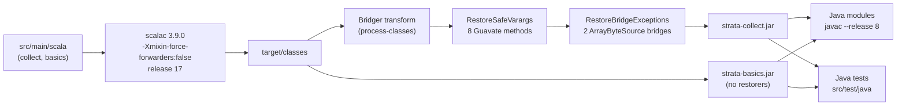

# Scala and Java interoperability

Active contributors: Stephen Colebourne, factory-jim-frink, James White

## Purpose

On the `auto_model_migration` branch the `collect` and `basics` modules are written in Scala 3.9.0, while the other nine modules, the examples, all tests and external users are Java. This page explains how the Scala code keeps the Java API of those two modules unchanged at source and bytecode level, which compiler settings and build steps make that work, and what to check when you change the Scala code.

For the history and the reasoning behind the migration, read [Scala migration](../background/scala-migration.md). For the content of the two modules, read [collect](../modules/collect.md) and [basics](../modules/basics.md). The full record of decisions and validation results is the untracked guide `step_by_step_guide.md` at the repository root.

## The compatibility contract

`AGENTS.md` states the rule: the Java-facing API of `collect` and `basics` is a compatibility contract. Class and member names, method descriptors, static entry points, checked exceptions and Joda-Beans metadata must stay as they were in the Java baseline (`main` at `fa85830`). A Java caller compiled against the old jars must still link, and Java source written against the old API must still compile.

`step_by_step_guide.md` lists the differences that were accepted in advance. In summary:

- Scala may widen protected, package-private or companion-accessed members in bytecode, but must not remove or narrow anything.
- The public and package-private enums are Scala 3 enums, so they have extra members and non-final constant fields. `switch`, `values`, `valueOf`, `EnumSet`, serialization and Joda-Convert still work.
- Companion classes, accessors, forwarders and Scala `Seq` overloads may be added.
- 47 constants (for example in `StandardSchemes` and `FailureAttributeKeys`) keep their name, type, value and `public static final` modifiers but lose the JVM `ConstantValue` attribute. Java callers can no longer use them in annotation values or `switch` labels.

## How it works

The Scala sources live in `src/main/scala` of each module. The `scala-maven-plugin` 4.10.0 compiles them in the `process-resources` phase with `<release>17</release>` and mixed compile order. In `collect`, Bridger and two bytecode restorers then rewrite a few class files at `process-classes` before the jar is built. The Java modules and the Java tests compile against those class files.



The restorers exist only in `collect`; `basics` has no affected methods. Both module POMs skip `maven-javadoc-plugin` and, under `-Ddist`, attach the ScalaDoc as the `javadoc`-classifier jar through the `scaladoc-jar` profile. In `collect` that profile runs `doc-jar` at `process-classes`, before the restorers, because `doc-jar` forks a compile that would otherwise overwrite the restored classes. In `basics` it runs at `package`.

### Static entry points with `@static`

Java callers write `Currency.of("GBP")` or `ReferenceData.standard()`. Scala has no static methods, so by default scalac puts companion object methods on the `Foo$` class and adds static forwarders on `Foo`. That is not always enough:

- A forwarder is not generated when the class inherits a static method of the same name from a Scala trait. Strata's `Named` interface declares a static `of`, so every `Named` implementation would lose its own static `of(String)`.
- Constants read through a forwarder are not JVM static fields.

The migration annotates such companion members with `scala.annotation.static` so scalac emits a real static member on the class itself. There are 138 files using `@static` across the two modules. Examples:

- `HolidayCalendarId.of(String)` in `modules/basics/src/main/scala/com/opengamma/strata/basics/date/HolidayCalendarId.scala`
- `ReferenceData.standard()`, `minimal()`, `empty()` and `of(Map)` in `modules/basics/src/main/scala/com/opengamma/strata/basics/ReferenceData.scala`
- the index constants such as `GBP_LIBOR_3M` in `modules/basics/src/main/scala/com/opengamma/strata/basics/index/IborIndices.scala`
- `ResourceConfig.RESOURCE_DIRS_PROPERTY` in `modules/collect/src/main/scala/com/opengamma/strata/collect/io/ResourceConfig.scala`, so that reading the constant does not trigger loading of the configuration directories

The code records the reason where it is not obvious, as in `ImmutableReferenceData`:

```scala
  // @static because the inherited static ReferenceData.of suppresses the static forwarder
  @static def of(values: Map[? <: ReferenceDataId[?], ?]): ImmutableReferenceData = {
```

Utility classes follow the pattern `final class X private ()` plus a companion object, so they keep the single private constructor that `TestHelper.assertUtilityClass` checks.

### Java-style accessors

Scala classes keep explicit Java getters instead of Scala-style accessors. `CurrencyAmount` in `modules/basics/src/main/scala/com/opengamma/strata/basics/currency/CurrencyAmount.scala` declares `def getCurrency(): Currency` and `def getAmount(): Double` over private fields. Constructor parameters are named `rawX` and validated into private fields, so that no Scala accessor clashes with the Java getter names.

### Mixin forwarders

Both `modules/collect/pom.xml` and `modules/basics/pom.xml` pass `-Xmixin-force-forwarders:false`. By default Scala 3 adds a forwarder method to every class for each trait or Java default method it inherits. Java classes have no such methods, and the forwarders add stack frames and change reflection results. With the flag, scalac adds a forwarder only where the JVM needs one. A side effect is that redundant direct interfaces (for example `Bean` on bean classes that also implement `ImmutableBean`) disappear from the class declaration, which matches what the Java baseline exposed through reflection.

### Varargs and `@SafeVarargs`

Java varargs entry points are written with `@varargs` (23 files use it, including `modules/collect/src/main/scala/com/opengamma/strata/collect/Guavate.scala` and `modules/collect/src/main/scala/com/opengamma/strata/collect/io/SafeFiles.scala`). scalac generates an array-taking forwarder that calls a `Seq` version, but it cannot put `@SafeVarargs` on the forwarder. Without it, Java callers of generic varargs methods get unchecked warnings.

`modules/collect/src/build/java/RestoreSafeVarargs.java` uses ASM to add the annotation to exactly eight `Guavate` methods, matched by name, descriptor and access flags: `concatToList`, `concatItemsToList`, `concatToSet`, `combineMapsOverwriting`, both `firstNonEmpty` overloads, `list` and `set`. It fails the build if a target is missing, duplicated or has unexpected flags, or if another method already carries the annotation.

### Checked exceptions and bridge methods

Scala does not check exceptions, but Java callers do. Methods that throw `IOException` in the Java baseline declare it with `@throws[IOException]` so the `Exceptions` attribute is present in bytecode (for example in `modules/collect/src/main/scala/com/opengamma/strata/collect/io/StringCharSource.scala` and `UriByteSource.scala`).

One case cannot be expressed in Scala source. `ArrayByteSource` overrides Guava's `openStream()` and `openBufferedStream()` with covariant methods returning `ByteArrayInputStream`. javac copies `throws IOException` onto the synthetic `InputStream`-returning bridge methods; Scala 3 bridges carry no exceptions. `modules/collect/src/build/java/RestoreBridgeExceptions.java` adds `IOException` to exactly those two bridges and checks that the concrete methods still declare none.

Both restorers run through `maven-antrun-plugin` 3.1.0 in `modules/collect/pom.xml`: one execution compiles `src/build/java` with `release="8"`, `-Xlint:all -Xlint:-options -Werror`, then one execution per restorer runs it on `target/classes`. ASM 9.5 and the Scala 3.9.0 compiler are plugin dependencies only and nothing from `src/build` is packaged. Control programs in `modules/collect/src/build/test` (`RestoreSafeVarargsControls.java`, `RestoreBridgeExceptionsControls.java`) run in the `test` phase and are skipped with `-DskipTests`. The bridge control compiles a real Scala fixture, `modules/collect/src/build/test-fixtures/ArrayByteSource.scala`, outside `target/classes`.

The later commit `7caa43e` (23 Oct 2026) added `-Xlint:-options` because JDK 21 javac warns that release 8 is obsolete and `-Werror` turned that into a failure in the `build21` CI job.

### Joda-Beans in Scala

The Joda-Beans code generator only reads Java, so the 60 Scala files with bean code keep a hand-maintained translation of the generated meta-bean, builder and property code between the usual `AUTOGENERATED START` and `AUTOGENERATED END` markers. Property annotations are written as `@(PropertyDefinition @field)(...)` so that the annotation lands on the field, which is where Joda-Beans looks for it. See `modules/collect/src/main/scala/com/opengamma/strata/collect/io/XmlElement.scala` or `modules/basics/src/main/scala/com/opengamma/strata/basics/ImmutableReferenceData.scala`.

Where a Scala field name would clash with a Java API method, the field gets a different name and the serialized form is kept with explicit hooks. `Result` in `modules/collect/src/main/scala/com/opengamma/strata/collect/result/Result.scala` stores its failure in `_failure`, which Joda-Beans still binds to the `failure` property, and its `writeObject`/`readObject` write and read the field as `failure` so the Java serialization stream is unchanged. See [Joda-Beans and serialization](joda-beans-and-serialization.md) for the bean model itself.

### `ExtendedEnum` and Scala enums

`ExtendedEnum` loads `constants` providers by reflecting over `public static final` fields. Scala 3 enum constant fields are not final, so `parseConstants` in `modules/collect/src/main/scala/com/opengamma/strata/collect/named/ExtendedEnum.scala` also accepts a public static field of an enum class when its value is one of that enum's own constants. This keeps registrations such as `com.opengamma.strata.basics.date.StandardDayCounts = constants` in `modules/basics/src/main/resources/META-INF/com/opengamma/strata/config/base/DayCount.ini` working now that `StandardDayCounts` is a Scala enum. Java enum providers behave as before.

### `FailureItem` stack traces

`FailureItem` records a stack trace when a failure is created without an exception. In Scala the stack contains frames Java code never had: the `@varargs` array forwarder that calls the `Seq` method, and the static forwarder on class `X` that calls the companion `X$`. `modules/collect/src/main/scala/com/opengamma/strata/collect/result/FailureItem.scala` walks the stack with a `StackWalker` and drops a frame only when:

- both frames are Strata frames from `.scala` files, with the same method name, and
- it is a varargs forwarder (the callee's descriptor ends with a `scala.collection.immutable.Seq` parameter where the caller has an array), or a static forwarder (callee class is the caller class plus `$`, same descriptor, no line number).

Companion frames are printed as `X.method`, as Java would show them. Overload calls and recursion are kept.

Like `Thread.getStackTrace()`, the walk keeps at most `-XX:MaxJavaStackTraceDepth` frames. Commit `d9c689c` (23 Oct 2026) replaced the code that read that option through `com.sun.management.HotSpotDiagnosticMXBean` with a fixed 1024 (the JVM default), because the `jdk-non-portable` forbiddenapis signatures ban that API and `mvn verify` failed in `strata-collect`.

Known residuals, from `step_by_step_guide.md`: lambda frames inside Strata code have compiler-chosen names (for example `Result.ofOptional$anonfun$2` instead of `Result.lambda$ofOptional$1`), and `ArgChecker.isTrue`/`isFalse` failures name a private helper as the top frame.

### Java tests stay Java

Scala test compilation is disabled. All 176 test sources in the two modules are still Java under `src/test/java`, so compiling and running them is itself a check of the Java-facing API. The guide records 8,190 tests in the two modules and 17,914 tests in the full reactor, the same counts as the baseline.

## Key types and files

| Item | Path | Role |
| --- | --- | --- |
| `RestoreSafeVarargs` | `modules/collect/src/build/java/RestoreSafeVarargs.java` | Adds `@SafeVarargs` to 8 `Guavate` methods after compilation |
| `RestoreBridgeExceptions` | `modules/collect/src/build/java/RestoreBridgeExceptions.java` | Adds `throws IOException` to 2 `ArrayByteSource` bridges |
| Restorer controls | `modules/collect/src/build/test/RestoreSafeVarargsControls.java`, `modules/collect/src/build/test/RestoreBridgeExceptionsControls.java` | Tests of the restorers, run in the `test` phase |
| `FailureItem` | `modules/collect/src/main/scala/com/opengamma/strata/collect/result/FailureItem.scala` | Filters Scala forwarder frames from recorded stack traces |
| `ExtendedEnum` | `modules/collect/src/main/scala/com/opengamma/strata/collect/named/ExtendedEnum.scala` | Accepts Scala enum constant fields from `constants` providers |
| `Result` | `modules/collect/src/main/scala/com/opengamma/strata/collect/result/Result.scala` | Example of a renamed field with explicit serialization hooks |
| `ImmutableReferenceData` | `modules/basics/src/main/scala/com/opengamma/strata/basics/ImmutableReferenceData.scala` | Example of a Scala Joda-Bean and of `@static` to restore a suppressed forwarder |
| Module POMs | `modules/collect/pom.xml`, `modules/basics/pom.xml` | Scala plugin, compiler flags, antrun restorers, `scaladoc-jar` profile |

## Integration points

- Every Java module depends on `strata-collect` and most on `strata-basics`. They compile with `--release 8` against the Scala class files, so Java sources outside these modules must stay Java 8 compatible while the runtime floor is JDK 17.
- The published jars depend on `scala3-library_3` at runtime.
- `-Dstrict` runs the Joda-Beans `validate` goal and the enforcer on the Scala modules too. The enforcer rejects a property as plugin version, which is why both POMs write `scala-maven-plugin` version `4.10.0` literally.
- Under `-Ddist`, the javadoc of the Java modules no longer links to `collect` and `basics` types, because those modules publish ScalaDoc. Type names still appear without hyperlinks.

## Rules when changing Scala code

- Keep the Java signature. Compare the class with `javap -p` against the baseline if you touch a public or protected member: name, descriptor, static or instance, return type and declared exceptions.
- Static entry points go on the companion object. Add `@static` when the class inherits a static method of the same name (for example `of` from `Named`, or `of`/`empty` from `ReferenceData`), when it is a constant Java callers read, or when reading it must not trigger companion initialization.
- Declare checked exceptions with `@throws[...]` wherever the Java baseline did.
- Generic varargs used from Java need `@varargs`. If the Java baseline had `@SafeVarargs`, the method must be in the `TARGETS` list of `RestoreSafeVarargs.java`; the tool fails the build if the list and the class disagree.
- Do not add trait mixins or default-method overrides that change the class shape without checking the effect of `-Xmixin-force-forwarders:false`.
- For Joda-Beans, use `@(PropertyDefinition @field)`, keep property order, types and validation, and update the hand-written code between the `AUTOGENERATED` markers to match what the generator would produce for the Java equivalent.
- Keep `serialVersionUID` (`@SerialVersionUID(1L)`) and any `readResolve`, `writeObject` or `readObject` hooks so Java serialization stays compatible.
- Use a Scala enum for a `constants` provider only if `ExtendedEnum` can still find its constants; run the `ExtendedEnum` tests.
- Write tests in Java under `src/test/java`.
- Build `basics` together with `collect` in one reactor (`-pl modules/collect,modules/basics -am`), so Maven does not pick up an older Java `collect` jar from `~/.m2`.
- After running the standalone ScalaDoc goal, run `package` again before using `target/classes`, because that goal recompiles without the restorers.

## Entry points for modification

- Compiler flags and plugin configuration: the `scala-maven-plugin` block in `modules/collect/pom.xml` and `modules/basics/pom.xml`.
- New bytecode restoration: add a class to `modules/collect/src/build/java`, a matching control in `modules/collect/src/build/test`, and an antrun execution at `process-classes` after the existing ones.
- Stack trace behavior: `javaStackFrames` and `isForwarderFrame` in `FailureItem.scala`.

## Related pages

- [Scala migration](../background/scala-migration.md)
- [collect](../modules/collect.md)
- [basics](../modules/basics.md)
- [Joda-Beans and serialization](joda-beans-and-serialization.md)
- [Tooling](../how-to-contribute/tooling.md)
- [Pitfalls](../background/pitfalls.md)
- [Patterns and conventions](../how-to-contribute/patterns-and-conventions.md)
