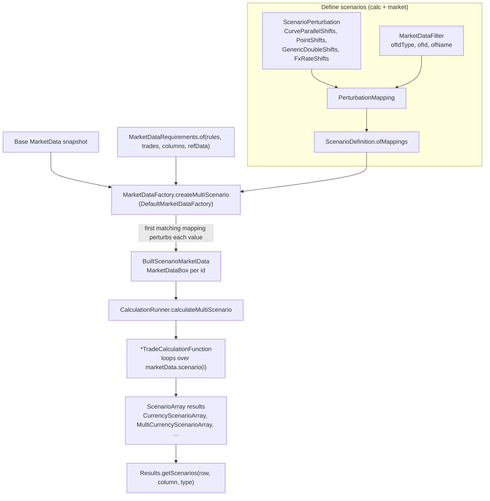

# Scenarios

Active contributors: Stephen Colebourne, Ashley Heath

The scenario classes have had almost no non-bot commits on `main` since 2019; the names above are the most recent human committers to the scenario packages in `data` and `calc`.

## Purpose

Scenario analysis reprices the same trades many times under changed market data: parallel curve shifts, node-by-node historical moves, FX shocks or quote bumps. Strata treats this as a first-class mode of the calculation engine. A `ScenarioDefinition` describes the changes, `MarketDataFactory` builds a `ScenarioMarketData` that holds one value per scenario where data differs, and `CalculationRunner.calculateMultiScenario` returns results as `ScenarioArray`s with one entry per scenario.

Single-scenario pricing reuses the same path: the runner wraps ordinary `MarketData` as a one-scenario `ScenarioMarketData` and unwraps the results afterwards (see [Pricing a trade](pricing-a-trade.md)). Calculation functions are therefore always scenario-aware.

## How it works



### Describing a scenario

- **`ScenarioPerturbation<T>`** (`modules/data/src/main/java/com/opengamma/strata/data/scenario/ScenarioPerturbation.java`) turns a `MarketDataBox<T>` into a box with one value per scenario. It reports its `getScenarioCount()` and `getMarketDataType()`. `ScenarioPerturbation.none()` is a no-op.
- **Built-in perturbations** (all Joda-Beans):

  | Class | Path | Effect |
  | --- | --- | --- |
  | `CurveParallelShifts` | `modules/market/src/main/java/com/opengamma/strata/market/curve/CurveParallelShifts.java` | Absolute (`absolute(double...)`) or relative (`relative(double...)`) parallel shift of a whole `Curve`, one amount per scenario |
  | `PointShifts` | `modules/market/src/main/java/com/opengamma/strata/market/param/PointShifts.java` | Different shifts per node of any `ParameterizedData` (curves, surfaces, model parameters), matched on parameter metadata identifier or label; built with `PointShifts.builder(ShiftType).addShift(scenario, nodeId, amount)` |
  | `GenericDoubleShifts` | `modules/market/src/main/java/com/opengamma/strata/market/GenericDoubleShifts.java` | Shifts a `Double` value such as a market quote, with an optional constant spread |
  | `FxRateShifts` | `modules/market/src/main/java/com/opengamma/strata/market/FxRateShifts.java` | Shifts an `FxRate` for a currency pair |

  `ShiftType` (`modules/market/src/main/java/com/opengamma/strata/market/ShiftType.java`) selects absolute, relative or scaled shifts.
- **`MarketDataFilter`** (`modules/calc/src/main/java/com/opengamma/strata/calc/marketdata/MarketDataFilter.java`) chooses which market data a perturbation applies to: `ofIdType(CurveId.class)` for every value with that id type, `ofId(id)` for one id, or `ofName(CurveName.of("USD-Disc"))` for a named value. Implementations are `IdTypeFilter`, `IdFilter` and `NameFilter` in the same package.
- **`PerturbationMapping<T>`** (`modules/calc/src/main/java/com/opengamma/strata/calc/marketdata/PerturbationMapping.java`) pairs a filter with a perturbation.
- **`ScenarioDefinition`** (`modules/calc/src/main/java/com/opengamma/strata/calc/marketdata/ScenarioDefinition.java`) holds the mappings and scenario names. Every mapping must have the same scenario count; scenario *i* uses the *i*-th perturbation from every mapping. The Javadoc example: mappings "USD curves: -10bp, 0, +10bp" and "EUR/USD: +5%, 0, -5%" give three scenarios, not nine.

### Building scenario market data

`MarketDataFactory.createMultiScenario(requirements, config, suppliedData, refData, scenarioDefinition)` (`modules/calc/src/main/java/com/opengamma/strata/calc/marketdata/MarketDataFactory.java`) is implemented by `DefaultMarketDataFactory`. It builds a dependency tree of the required market data and then repeatedly builds the leaves: time series, observable quotes, then derived values from `MarketDataFunction`s such as curve calibration. Each value, whether supplied or built, goes through `addValue`, which applies the **first** `PerturbationMapping` whose filter matches. Because perturbations are applied as each layer is built, the order matters:

- Perturbing a `QuoteId` input with `GenericDoubleShifts` changes the quotes before calibration. `RatesCurveGroupMarketDataFunction` sees scenario values in its inputs and calibrates one curve group per scenario (see [Curve calibration](curve-calibration.md)).
- Perturbing a `CurveId` with `CurveParallelShifts` or `PointShifts` changes the curve after it has been built.

The result is a `BuiltScenarioMarketData` (`modules/calc/src/main/java/com/opengamma/strata/calc/marketdata/BuiltScenarioMarketData.java`). Failures to build or perturb a value are kept as `Result` failures so they surface in the affected cells only.

`ScenarioMarketData` (`modules/data/src/main/java/com/opengamma/strata/data/scenario/ScenarioMarketData.java`) can also be built by hand: `ScenarioMarketData.of(scenarioCount, marketData)` repeats one snapshot, `ImmutableScenarioMarketData.builder(...)` takes explicit boxes, and `withPerturbation(id, perturbation, refData)` applies a perturbation to one id without the factory.

### Market data boxes

Each value in scenario market data is a `MarketDataBox<T>` (`modules/data/src/main/java/com/opengamma/strata/data/scenario/MarketDataBox.java`). A `SingleMarketDataBox` holds one value shared by all scenarios, so unperturbed data is not copied. A `ScenarioMarketDataBox` holds one value per scenario. `isScenarioValue()`, `getValue(scenarioIndex)` and `map(...)` let functions treat both the same way. `scenario(i)` on `ScenarioMarketData` returns an ordinary `MarketData` view for one scenario.

### Calculating and reading results

`CalculationRunner.calculateMultiScenario(rules, trades, columns, scenarioMarketData, refData)` runs the same tasks as single-scenario pricing. Calculation functions such as `SwapTradeCalculationFunction` obtain a `RatesScenarioMarketData` from the `RatesMarketDataLookup` and loop over `marketData.scenario(i).ratesProvider()`, returning `ScenarioArray` implementations from `modules/data/src/main/java/com/opengamma/strata/data/scenario/`:

| Result type | Holds |
| --- | --- |
| `CurrencyScenarioArray` | One `CurrencyAmount` per scenario, stored as a currency and a `DoubleArray` |
| `MultiCurrencyScenarioArray` | One `MultiCurrencyAmount` per scenario |
| `DoubleScenarioArray` | One `double` per scenario, for example par rate |
| `DefaultScenarioArray` | Any object type, for example `CurrencyParameterSensitivities` |

Types that implement `ScenarioFxConvertible` are converted to the reporting currency using the FX rate of each scenario. `Results.getScenarios(row, column, CurrencyAmount.class)` returns a typed `Result<ScenarioArray<C>>`.

## Examples

**`examples/src/main/java/com/opengamma/strata/examples/finance/CurveScenarioExample.java`** runs two scenarios on one USD swap: a base case and a 1bp parallel shift of every curve.

```java
PerturbationMapping<Curve> mapping = PerturbationMapping.of(
    MarketDataFilter.ofIdType(CurveId.class),
    CurveParallelShifts.absolute(0, ONE_BP));
ScenarioDefinition scenarioDefinition = ScenarioDefinition.ofMappings(mapping);
MarketDataRequirements reqs = MarketDataRequirements.of(rules, trades, columns, refData);
ScenarioMarketData scenarioMarketData =
    marketDataFactory().createMultiScenario(reqs, MarketDataConfig.empty(), marketData, refData, scenarioDefinition);
Results results = runner.calculateMultiScenario(rules, trades, columns, scenarioMarketData, refData);
```

It then compares the PV difference between the two scenarios with the analytic `PV01_CALIBRATED_SUM` from the base scenario. A TODO in the example notes that the trade report framework does not yet support scenario results, so the example prints the numbers itself.

**`examples/src/main/java/com/opengamma/strata/examples/finance/HistoricalScenarioExample.java`** builds a historical P&L series for a swap, as input to historical VaR. It loads a history of calibrated USD curve groups from `examples/src/main/resources/example-historicalscenario-marketdata/`, computes the day-on-day change in each node's zero rate, and turns those changes into three `PointShifts` perturbations mapped with `MarketDataFilter.ofName` to the curves `USD-Disc`, `USD-3ML` and `USD-6ML`. Each historical date becomes one scenario applied to the valuation-date snapshot.

## Key types

| Type | Path | Role |
| --- | --- | --- |
| `ScenarioDefinition` | `modules/calc/src/main/java/com/opengamma/strata/calc/marketdata/ScenarioDefinition.java` | Set of mappings and scenario names |
| `PerturbationMapping` | `modules/calc/src/main/java/com/opengamma/strata/calc/marketdata/PerturbationMapping.java` | Filter plus perturbation |
| `MarketDataFilter` | `modules/calc/src/main/java/com/opengamma/strata/calc/marketdata/MarketDataFilter.java` | Selects data to perturb |
| `ScenarioPerturbation` | `modules/data/src/main/java/com/opengamma/strata/data/scenario/ScenarioPerturbation.java` | Produces per-scenario values |
| `ScenarioMarketData` | `modules/data/src/main/java/com/opengamma/strata/data/scenario/ScenarioMarketData.java` | Market data for many scenarios |
| `MarketDataBox` | `modules/data/src/main/java/com/opengamma/strata/data/scenario/MarketDataBox.java` | Single or per-scenario value |
| `ScenarioArray` | `modules/data/src/main/java/com/opengamma/strata/data/scenario/ScenarioArray.java` | Per-scenario results |
| `DefaultMarketDataFactory` | `modules/calc/src/main/java/com/opengamma/strata/calc/marketdata/DefaultMarketDataFactory.java` | Builds and perturbs market data |

## Integration points

- **Calculation functions** must loop over scenarios and return `ScenarioArray` values. The `*MeasureCalculations` classes in `modules/measure` show the pattern, and derived functions built on `AbstractDerivedCalculationFunction` (`modules/calc/src/main/java/com/opengamma/strata/calc/runner/AbstractDerivedCalculationFunction.java`) follow it too. See [measure](../modules/measure.md).
- **Curve calibration** reruns per scenario when calibration inputs are perturbed.
- **Sensitivities** can be checked against finite-difference scenarios, as in `CurveScenarioExample`. See [Sensitivities](sensitivities.md).
- **Data module.** The scenario containers live in `modules/data` so that `market` and `pricer` can use them without depending on the engine. See [data](../modules/data.md).

## Entry points for modification

- **New perturbation.** Implement `ScenarioPerturbation<T>` as a Joda-Bean, following `CurveParallelShifts` or `GenericDoubleShifts`.
- **New way to select data.** Implement `MarketDataFilter<T, I>`; `matches` receives the id, the box and reference data, so filters can inspect values as well as ids.
- **Perturbation order or matching rules.** `DefaultMarketDataFactory.addValue` and the dependency-tree loop in `createMultiScenario`.
- **New result container.** Implement `ScenarioArray` and, if amounts should be FX-converted, `ScenarioFxConvertible`.

## Key source files

| File | Purpose |
| --- | --- |
| `modules/calc/src/main/java/com/opengamma/strata/calc/marketdata/DefaultMarketDataFactory.java` | Dependency-tree building and perturbation |
| `modules/calc/src/main/java/com/opengamma/strata/calc/marketdata/ScenarioDefinition.java` | Scenario definition and scenario-count checks |
| `modules/calc/src/main/java/com/opengamma/strata/calc/marketdata/BuiltScenarioMarketData.java` | Factory output |
| `modules/data/src/main/java/com/opengamma/strata/data/scenario/ImmutableScenarioMarketData.java` | Hand-built scenario market data |
| `modules/data/src/main/java/com/opengamma/strata/data/scenario/CurrencyScenarioArray.java` | Currency amounts per scenario |
| `modules/market/src/main/java/com/opengamma/strata/market/curve/CurveParallelShifts.java` | Parallel curve shifts |
| `modules/market/src/main/java/com/opengamma/strata/market/param/PointShifts.java` | Node-level shifts |
| `modules/calc/src/main/java/com/opengamma/strata/calc/runner/DefaultCalculationTaskRunner.java` | `calculateMultiScenario` |
| `examples/src/main/java/com/opengamma/strata/examples/finance/CurveScenarioExample.java` | Parallel shift example |
| `examples/src/main/java/com/opengamma/strata/examples/finance/HistoricalScenarioExample.java` | Historical P&L example |

## Related pages

- [Pricing a trade](pricing-a-trade.md)
- [Curve calibration](curve-calibration.md)
- [Sensitivities](sensitivities.md)
- [data](../modules/data.md), [calc](../modules/calc.md), [market](../modules/market.md)
