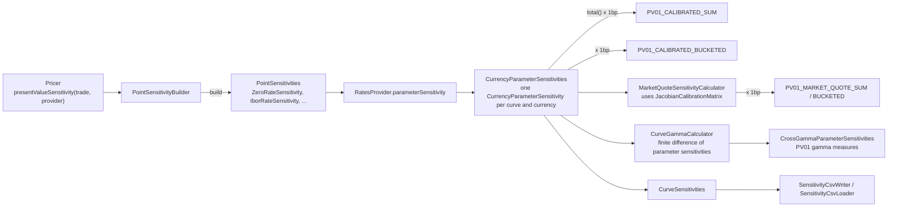

# Sensitivities

Active contributors: Stephen Colebourne, Yuki Iwashita, Ben Hamilton-Brown

## Purpose

A sensitivity says how much a trade's value changes when market data moves. Strata computes most first-order risk analytically in three steps:

1. A pricer returns **point sensitivities**: derivatives of present value with respect to individual curve queries, such as "the USD discount factor at 2019-09-12" or "the USD-LIBOR-3M forward rate fixing on 2016-03-10".
2. The `RatesProvider` projects the point sensitivities onto curve parameters, giving **parameter sensitivities** (one number per curve node). Scaled by one basis point, this is calibrated bucketed PV01.
3. Optionally, `MarketQuoteSensitivityCalculator` uses the Jacobian matrices stored by curve calibration to convert parameter sensitivities into **market quote sensitivities** (sensitivity to the input deposit, FRA and swap rates).

Second-order risk (gamma) is computed by finite difference on top of the first-order sensitivities.

## How it works



### Point sensitivities

Pricers build sensitivities lazily with `PointSensitivityBuilder` (`modules/market/src/main/java/com/opengamma/strata/market/sensitivity/PointSensitivityBuilder.java`). Builders can be combined (`combinedWith`), scaled (`multipliedBy`), relabelled (`withCurrency`) and finally turned into an immutable `PointSensitivities` with `build()` (which uses `MutablePointSensitivities` internally). `PointSensitivities` (`modules/market/src/main/java/com/opengamma/strata/market/sensitivity/PointSensitivities.java`) is a list of `PointSensitivity` objects; duplicates are allowed until `normalized()` merges them.

The concrete point sensitivity types live in `modules/pricer`, next to the market data they refer to, for example `ZeroRateSensitivity` (`modules/pricer/src/main/java/com/opengamma/strata/pricer/ZeroRateSensitivity.java`), `IborRateSensitivity`, `OvernightRateSensitivity` and `InflationRateSensitivity` in `modules/pricer/src/main/java/com/opengamma/strata/pricer/rate/`, `FxForwardSensitivity` and `FxIndexSensitivity` in `modules/pricer/src/main/java/com/opengamma/strata/pricer/fx`, and model-specific types such as `SwaptionSabrSensitivity` and `FxOptionSensitivity`.

Trade pricers expose them as `presentValueSensitivity`, for example `DiscountingSwapTradePricer.presentValueSensitivity(ResolvedSwapTrade, RatesProvider)` returns `PointSensitivities`.

### Parameter sensitivities

`RatesProvider.parameterSensitivity(PointSensitivities)` (`modules/pricer/src/main/java/com/opengamma/strata/pricer/rate/RatesProvider.java`) dispatches each point to the object that produced it: a `ZeroRateSensitivity` goes to the currency's `DiscountFactors`, an `IborRateSensitivity` to `IborIndexRates`, an `FxForwardSensitivity` to `FxForwardRates`, and so on. Each returns a `CurrencyParameterSensitivity` for its underlying curve, and the results are combined.

`CurrencyParameterSensitivity` (`modules/market/src/main/java/com/opengamma/strata/market/param/CurrencyParameterSensitivity.java`) holds the market data name (for example the curve name), the parameter metadata for each node (tenor, date or label), the currency and a `DoubleArray` of values. `CurrencyParameterSensitivities` collects these and provides `total()`, `multipliedBy`, `convertedTo`, `mergedWith`, `split()` (for combined curves) and `equalWithTolerance`.

### Market quote sensitivities

`MarketQuoteSensitivityCalculator.sensitivity(paramSensitivities, provider)` (`modules/pricer/src/main/java/com/opengamma/strata/pricer/sensitivity/MarketQuoteSensitivityCalculator.java`) multiplies each curve's parameter sensitivity by the `JacobianCalibrationMatrix` found in the curve metadata. Those matrices exist only for curves produced by `RatesCurveCalibrator` with Jacobian computation switched on; see [Curve calibration](curve-calibration.md). When the calibration instruments are quoted as par rates, the Javadoc notes this is also called par rate sensitivity.

### Measures

The engine exposes these as measures in `modules/measure/src/main/java/com/opengamma/strata/measure/Measures.java` and `modules/measure/src/main/java/com/opengamma/strata/measure/AdvancedMeasures.java`. For swaps, `SwapMeasureCalculations` (`modules/measure/src/main/java/com/opengamma/strata/measure/swap/SwapMeasureCalculations.java`) implements the PV01 and gamma rows as shown:

| Measure | Calculation |
| --- | --- |
| `PV01_CALIBRATED_SUM` | `provider.parameterSensitivity(pricer.presentValueSensitivity(...)).total()` times 1bp |
| `PV01_CALIBRATED_BUCKETED` | Same parameter sensitivities times 1bp, kept per curve and node |
| `PV01_MARKET_QUOTE_SUM` | `MarketQuoteSensitivityCalculator.DEFAULT.sensitivity(...)`, totalled, times 1bp |
| `PV01_MARKET_QUOTE_BUCKETED` | Market quote sensitivities times 1bp, per curve and node |
| `PV01_SEMI_PARALLEL_GAMMA_BUCKETED` | `CurveGammaCalculator.calculateSemiParallelGamma`; supports a single curve only |
| `PV01_SINGLE_NODE_GAMMA_BUCKETED` | `CurveGammaCalculator.calculateCrossGammaIntraCurve(...).diagonal()` times 1bp squared |
| `VEGA_MARKET_QUOTE_BUCKETED` | Volatility sensitivities, offered by option functions such as `IborFutureOptionTradeCalculationFunction` and `CmsTradeCalculationFunction`, not by swaps |

Other asset classes follow the same pattern in their own `*MeasureCalculations` classes. `examples/src/main/java/com/opengamma/strata/examples/SwapPricingExample.java` requests both calibrated PV01 measures and the semi-parallel gamma.

`examples/src/main/java/com/opengamma/strata/examples/finance/CurveScenarioExample.java` checks the analytic PV01 against a finite difference: it reprices with a 1bp parallel curve shift and prints both numbers. See [Scenarios](scenarios.md).

### Gamma and finite differences

`CurveGammaCalculator` (`modules/pricer/src/main/java/com/opengamma/strata/pricer/sensitivity/CurveGammaCalculator.java`) bumps curve parameters (by default a forward difference of 1bp) and differentiates the parameter sensitivity function again. `calculateCrossGammaIntraCurve` and `calculateCrossGammaCrossCurve` return `CrossGammaParameterSensitivities` (`modules/market/src/main/java/com/opengamma/strata/market/param/CrossGammaParameterSensitivities.java`), each entry a `CrossGammaParameterSensitivity` matrix; `diagonal()` gives the single-node gamma. The Javadoc cites the OpenGamma paper "Interest Rate Cross-gamma for Single and Multiple Curves".

`RatesFiniteDifferenceSensitivityCalculator` in the same package computes parameter sensitivities by bumping, which tests use to validate the analytic results. `NotionalEquivalentCalculator` converts market quote sensitivities into notional equivalents.

### Sensitivity files

`CurveSensitivities` (`modules/market/src/main/java/com/opengamma/strata/market/sensitivity/CurveSensitivities.java`) is a portfolio item that carries `CurrencyParameterSensitivities` keyed by `CurveSensitivitiesType` (`ZERO_RATE_DELTA`, `ZERO_RATE_GAMMA`). It lets risk be passed into calculations instead of trades.

- `SensitivityCsvLoader` (`modules/loader/src/main/java/com/opengamma/strata/loader/csv/SensitivityCsvLoader.java`) reads three CSV layouts: standard (one row per type, reference and tenor), list (one column per sensitivity type) and grid (one column per reference). Columns include `Reference`, `Sensitivity Type`, `Sensitivity Tenor`, optional `Sensitivity Date` and `Currency`, and `Value`. `load(...)` returns `ValueWithFailures<ListMultimap<String, CurveSensitivities>>`, so bad rows are reported rather than thrown.
- `SensitivityCsvWriter` (`modules/loader/src/main/java/com/opengamma/strata/loader/csv/SensitivityCsvWriter.java`) writes `CurveSensitivities` in the standard format with `write(curveSens, appendable)`.

## Direct use

`examples/src/main/java/com/opengamma/strata/examples/blog/multicurve1/CalibrationPV01Example.java` runs the full chain without the engine:

```java
PointSensitivities pts = PRICER_SWAP.presentValueSensitivity(swap, multicurve);
CurrencyParameterSensitivities ps = multicurve.parameterSensitivity(pts);
CurrencyParameterSensitivities mqs = MQC.sensitivity(ps, multicurve);
```

`MQC` is `MarketQuoteSensitivityCalculator.DEFAULT` and `multicurve` is the `ImmutableRatesProvider` returned by `RatesCurveCalibrator.calibrate`.

## Key types

| Type | Path | Role |
| --- | --- | --- |
| `PointSensitivityBuilder` | `modules/market/src/main/java/com/opengamma/strata/market/sensitivity/PointSensitivityBuilder.java` | Lazy builder used inside pricers |
| `PointSensitivities` | `modules/market/src/main/java/com/opengamma/strata/market/sensitivity/PointSensitivities.java` | Point sensitivities to curve queries |
| `CurrencyParameterSensitivities` | `modules/market/src/main/java/com/opengamma/strata/market/param/CurrencyParameterSensitivities.java` | Sensitivities to curve parameters |
| `CrossGammaParameterSensitivities` | `modules/market/src/main/java/com/opengamma/strata/market/param/CrossGammaParameterSensitivities.java` | Second-order sensitivities |
| `CurveSensitivities` | `modules/market/src/main/java/com/opengamma/strata/market/sensitivity/CurveSensitivities.java` | Typed sensitivities as a portfolio item |
| `MarketQuoteSensitivityCalculator` | `modules/pricer/src/main/java/com/opengamma/strata/pricer/sensitivity/MarketQuoteSensitivityCalculator.java` | Parameter to market quote conversion |
| `CurveGammaCalculator` | `modules/pricer/src/main/java/com/opengamma/strata/pricer/sensitivity/CurveGammaCalculator.java` | Finite-difference gamma |

## Integration points

- **Curve calibration** supplies the Jacobians that market quote sensitivities need.
- **Parameter metadata** (`modules/market/src/main/java/com/opengamma/strata/market/param/`) labels each bucket; the CSV loader and writer rely on tenor metadata.
- **Reporting.** Bucketed results are `CurrencyParameterSensitivities` (or a `ScenarioArray` of them); the report layer formats them. See [report](../modules/report.md).
- **FX conversion.** `CurrencyParameterSensitivities.convertedTo` and the engine's reporting currency handling convert results using an `FxRateProvider`.

## Entry points for modification

- **New point sensitivity type.** Implement `PointSensitivity` and `PointSensitivityBuilder` in `modules/pricer`, give the producing market data object a `parameterSensitivity` method, and add a branch to `RatesProvider.parameterSensitivity` (or the equivalent provider for credit, bonds or volatilities).
- **New sensitivity measure.** Add the constant to `Measures` or `AdvancedMeasures`, then implement it in the relevant `*MeasureCalculations` and register it in the function's `CALCULATORS` map.
- **CSV formats.** Extend `SensitivityCsvLoader`, `SensitivityCsvWriter`, or plug in a custom `SensitivityCsvInfoResolver` / `SensitivityCsvInfoSupplier`.

## Key source files

| File | Purpose |
| --- | --- |
| `modules/market/src/main/java/com/opengamma/strata/market/sensitivity/PointSensitivity.java` | Point sensitivity interface |
| `modules/market/src/main/java/com/opengamma/strata/market/sensitivity/MutablePointSensitivities.java` | Mutable accumulator used by builders |
| `modules/market/src/main/java/com/opengamma/strata/market/param/CurrencyParameterSensitivity.java` | Sensitivity to one curve |
| `modules/pricer/src/main/java/com/opengamma/strata/pricer/rate/RatesProvider.java` | `parameterSensitivity` projection |
| `modules/pricer/src/main/java/com/opengamma/strata/pricer/sensitivity/MarketQuoteSensitivityCalculator.java` | Market quote conversion |
| `modules/pricer/src/main/java/com/opengamma/strata/pricer/sensitivity/CurveGammaCalculator.java` | Gamma |
| `modules/pricer/src/main/java/com/opengamma/strata/pricer/sensitivity/RatesFiniteDifferenceSensitivityCalculator.java` | Bump-and-reprice sensitivities |
| `modules/measure/src/main/java/com/opengamma/strata/measure/swap/SwapMeasureCalculations.java` | PV01 and gamma measures for swaps |
| `modules/loader/src/main/java/com/opengamma/strata/loader/csv/SensitivityCsvLoader.java` | CSV loading |
| `modules/loader/src/main/java/com/opengamma/strata/loader/csv/SensitivityCsvWriter.java` | CSV writing |

## Related pages

- [Pricing a trade](pricing-a-trade.md)
- [Curve calibration](curve-calibration.md)
- [Scenarios](scenarios.md)
- [market](../modules/market.md), [pricer](../modules/pricer/index.md), [loader](../modules/loader.md)
- [Glossary](../overview/glossary.md)
