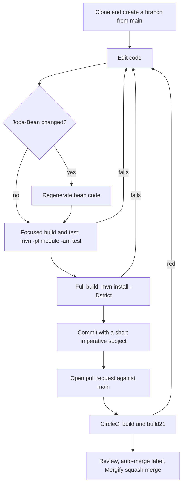

# Development workflow

This page walks through one change from clone to merge: getting the code, building and testing it with Maven, keeping formatting and generated code in line, writing the commit, and getting the pull request merged. Commands are taken from `AGENTS.md`, `.factory/skills/build-and-test/SKILL.md` and `.circleci/config.yml`.

## The cycle



## Prerequisites

- JDK 17 or later. The `collect` and `basics` modules are Scala 3.9.0, which needs JDK 17. CI uses JDK 17 and 21. `README.md` advises against non-LTS Java releases.
- Maven 3.5 or later. There is no Maven wrapper.
- Nothing from `.env.example` is needed to build or test. That file only lists variables used by CI and the release process.

## Clone and branch

```sh
git clone https://github.com/OpenGamma/Strata.git
cd Strata
git checkout -b my-change main
```

The default branch is `main`. The Spotless check compares changed files against `main` (see below), so keep a local `main` branch available.

If you work in a linked git worktree (`git worktree add`) or in a copy without `.git`, Spotless cannot run its ratchet check. Add `-Dspotless.check.skip=true` to every Maven command in that case.

## Build

From the repository root:

| Goal | Command |
| --- | --- |
| Build, test and install all modules | `mvn install` |
| Run all tests without installing | `mvn test` |
| Reproduce the main CI build | `mvn install -Dstrict` |
| Build one module and its dependencies | `mvn -pl modules/pricer -am install -DskipTests` |
| Run one test class | `mvn -pl modules/basics -am -Dtest=CurrencyAmountTest -Dsurefire.failIfNoSpecifiedTests=false test` |
| Run one test method | `mvn -pl modules/basics -am -Dtest=CurrencyAmountTest#test_of_Currency -Dsurefire.failIfNoSpecifiedTests=false test` |
| Run an example | `mvn -f examples/pom.xml org.codehaus.mojo:exec-maven-plugin:3.1.0:java -Dexec.mainClass=com.opengamma.strata.examples.FxPricingExample` |

Notes on the focused commands:

- `-am` builds the upstream modules too. Keep it when working on `basics` or any module downstream of `collect`, otherwise Maven may use older `strata-collect` or `strata-basics` jars from `~/.m2` instead of the current Scala classes.
- `-Dsurefire.failIfNoSpecifiedTests=false` stops the upstream modules from failing because they do not contain the named test.

CI splits the build into two steps: `mvn install -T 4 -DskipTests -Dstrict` and then `mvn test -T 1 -Dcheckstyle.skip=true`, followed by `python3 config/pmd/check-pmd-baseline.py`. Running the same three commands locally is the closest reproduction of a CI run. [Testing](testing.md) has more on test runs.

## Keep the quality gates green while editing

### Formatting

Import `eclipse/install/Strata-Eclipse-Formatter-Java.xml` into your IDE as described in `eclipse/README.md`. Style is two-space indentation with no tabs.

The `spotless-maven-plugin` 2.43.0 in `modules/pom.xml` and `examples/pom.xml` runs `check` in the `validate` phase with `ratchetFrom main`. Only Java files that differ from `main` are checked. If it fails, either reformat in the IDE or run `mvn spotless:apply` on the affected module and review the diff. Scala files in `collect` and `basics` are not covered by Spotless; format them by hand to match neighbouring code.

### Checkstyle

Checkstyle runs in `process-sources` and fails the build on errors. The rules come from the OpenGamma `build-config` artifact (version 2.8.1) and are not stored in this repository. Fix the reported file and line rather than skipping the check.

### Joda-Beans

If you add, remove or change a `@PropertyDefinition` field in a Java bean, regenerate the code between the `AUTOGENERATED START` and `AUTOGENERATED END` markers. Two options:

- the Joda-Beans plugin for your IDE
- the Maven plugin, for example `mvn -pl modules/product org.joda:joda-beans-maven-plugin:generate` (the plugin version comes from the `corporate-parent` 2.9.2 POM)

Under `-Dstrict`, the `validate` goal of the same plugin fails the build if a Java bean's generated block is out of date. Scala beans in `collect` and `basics` are not generated or validated; [Patterns and conventions](patterns-and-conventions.md) explains how to update them by hand.

### Java 8 source compatibility

Java modules compile with `maven.compiler.release` 8, so APIs added after Java 8 (`List.of`, `String.isBlank`, `var` and so on) fail to compile. The Scala modules target Java 17 bytecode but must keep their Java-facing API unchanged.

## Commit messages

Recent history on `main` (`git log main --format=%s`) shows these conventions:

- A short subject in sentence case, usually imperative: "Fix contract specs for ESTR 1M futures", "Bond irregular dates", "Add PLN-POLSTR".
- An optional ticket prefix for internal work: "PROD-57270: Result.ofOptional lazy create the failure".
- Mergify squash merges append the pull request number: "Stop deploying snapshot versions (#2814)". About 1,400 subjects on `main` end this way.
- Release commits are made by `opengammacibot` with `[maven-release-plugin] prepare release vX.Y.Z` and `prepare for next development iteration`. Do not imitate these.

The commits on the `auto_model_migration` branch use longer imperative subjects ("Let the build helpers compile on JDK 21") with a body that explains the cause and how the change was verified.

## Pull request and merge

1. Push the branch and open a pull request against `main` on `OpenGamma/Strata`.
2. CircleCI runs the `build` (JDK 17) and `build21` (JDK 21) jobs. Test reports and PMD reports are uploaded as artifacts.
3. The code owner (`@jodastephen`, from `.github/CODEOWNERS`) reviews.
4. Once approved, add the `auto-merge` label. Mergify queues the pull request and squash-merges it when `build` is green, there is no conflict and the title has no `WIP`.

The full rule set is on [How to contribute](index.md).

## Releases

Releases are cut from `main` by pushing a `release` tag, after which CircleCI runs `mvn release` and publishes to Maven Central and GitHub Releases. The steps are in `RELEASE.md`. Patch releases have been frequent: twelve releases from v2.12.66 (February 2026) to v2.12.77 (October 2026). See [Deployment](../deployment.md) for the CI side.

## Related pages

- [Testing](testing.md)
- [Debugging](debugging.md)
- [Tooling](tooling.md)
- [Getting started](../overview/getting-started.md)
