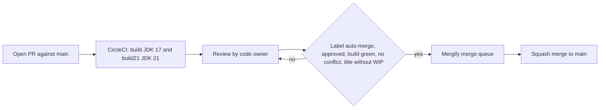

# How to contribute

This section explains where changes to Strata come from, how a pull request gets reviewed and merged, and what a change must satisfy before it is considered done. The pages that follow cover the day-to-day workflow, tests, debugging, tooling and code conventions.

## Pages in this section

| Page | What it covers |
| --- | --- |
| [Development workflow](development-workflow.md) | Clone, branch, build, format, commit, open a pull request, merge |
| [Testing](testing.md) | JUnit 5 and AssertJ, test layout, `TestHelper`, running one test or one module |
| [Debugging](debugging.md) | Symptom, cause and fix for common build and runtime failures, and how to turn up logging |
| [Patterns and conventions](patterns-and-conventions.md) | Immutable types, Joda-Beans, `ArgChecker`, `ExtendedEnum`, `Result`, `impl` packages, code style |
| [Tooling](tooling.md) | Maven plugins and versions, quality gates, Eclipse setup, CI summary, agent tooling |

## Where work comes from

Strata is developed by OpenGamma at `https://github.com/OpenGamma/Strata`; the repository this wiki describes is a fork of it. The root `pom.xml` and `modules/pom.xml` both point issue management at GitHub issues on that repository.

- **Issues.** `.github/issue_template.md` asks users to raise questions on the Strata forum first. GitHub issues are "intended primarily for use by the development team", and outside reporters should only open one for a confirmed bug, preferably with a failing test case.
- **Contribution guidelines.** `.github/contributing.md` contains a single line that links to the guidelines on the Strata website (`https://strata.opengamma.io/contributions/`). There is no longer guide in the repository.
- **Security reports.** `SECURITY.md` asks for vulnerabilities to be reported by email to the OpenGamma security address rather than as public issues. Only the latest release is supported.
- **Dependency updates.** Dependabot (`.github/dependabot.yml`) checks Maven dependencies weekly at 02:30, opens up to 20 pull requests at a time, assigns them to `jodastephen`, and does not rebase them. It ignores `com.beust:jcommander` from 1.78 onwards and `org.openjfx:javafx-controls` from 12 onwards.
- **Internal work.** Most commits on `main` reference an OpenGamma ticket or describe a product change, for example "PROD-57270: Result.ofOptional lazy create the failure (#2800)". Holiday calendar updates, new exchange ids and calculation function additions are the most common kinds of change in recent history.

## Pull request process

### Code owners

`.github/CODEOWNERS` contains one rule, `* @jodastephen`, so every pull request requests a review from Stephen Colebourne.

### Required checks

The CircleCI workflow `build` in `.circleci/config.yml` runs two jobs on every branch:

- `build` on the `cimg/openjdk:17.0` image
- `build21` on the `cimg/openjdk:21.0` image

Each job runs `mvn install -T 4 -DskipTests -Dstrict`, then `mvn test -T 1 -Dcheckstyle.skip=true`, then `python3 config/pmd/check-pmd-baseline.py`. The config file notes that the first job is named `build` because Mergify requires a check with that name. See [Deployment](../deployment.md) for the release jobs.

### Mergify rules

`.github/mergify.yml` defines one merge queue (`default`, one parallel check) and one pull request rule. A pull request is queued for merge when all of these hold:

- it has the label `auto-merge`
- the `build` status is successful
- at least one approving review
- no merge conflict
- the title does not contain `wip` or `WIP`

The queue merges with the `squash` method, which is why most commits on `main` are a single line ending in the pull request number, such as `(#2814)`.

## Definition of done

A change is ready to merge when all of the following are true.

| Requirement | How it is checked |
| --- | --- |
| The full build passes with `mvn install -Dstrict` on JDK 17 (and JDK 21 in CI) | CircleCI `build` and `build21` jobs |
| New and changed behavior has tests, one test class per production class | Review; see [Testing](testing.md) |
| Public classes and methods have Javadoc (ScalaDoc in `collect` and `basics`) | Review; Javadoc lint (`-Xdoclint:missing`, `-Xdoclint:reference`) when Javadoc is built under `-Ddist` |
| Checkstyle passes | `maven-checkstyle-plugin` at `process-sources` with `failsOnError` |
| Changed Java files match the Eclipse formatter | Spotless `check` at `validate`, ratcheting from `main` |
| Joda-Beans generated code is regenerated, not hand-edited | `joda-beans-maven-plugin` `validate` goal under `-Dstrict` |
| No new PMD complexity or dead-code findings | `config/pmd/check-pmd-baseline.py` in CI |
| No forbidden JDK APIs (default locale or charset, unsafe or non-portable APIs) | `forbiddenapis` `check` and `testCheck` |
| Java modules use only Java 8 APIs | `maven.compiler.release` 8 in the `forcejavaversion` profile of `modules/pom.xml` |
| The public API stays backwards compatible, except in `impl` packages | Review; optional `japicmp` check with `-Dcompat` |
| `collect` and `basics` keep their Java-facing binary API (names, descriptors, static entry points, checked exceptions, bean metadata) | Review, the Java tests of those modules, and the bytecode restorer controls in `modules/collect/src/build/test` |

`AGENTS.md` and `.factory/skills/code-conventions/SKILL.md` state the same rules in checklist form. The reasoning behind them is on [Patterns and conventions](patterns-and-conventions.md), and the risky areas are collected in [Pitfalls](../background/pitfalls.md).

## Related pages

- [Development workflow](development-workflow.md)
- [Tooling](tooling.md)
- [Deployment](../deployment.md)
- [Scala migration](../background/scala-migration.md)
