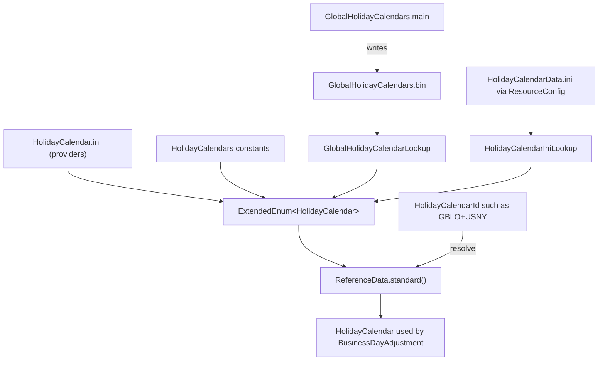
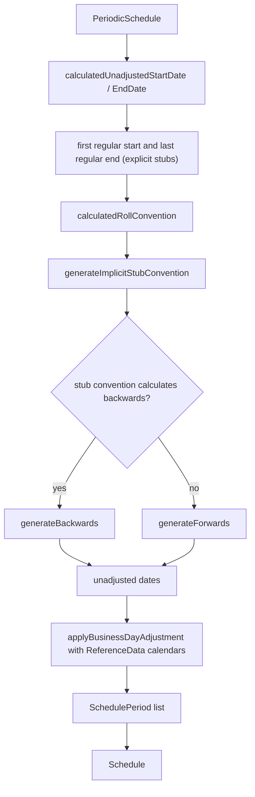

# basics

Active contributors: Stephen Colebourne, Andras Vig, Ben Hamilton-Brown

`modules/basics` (artifact `strata-basics`) defines the financial vocabulary that every other Strata module uses: currencies and amounts, FX rates, holiday calendars, day counts and business day rules, floating rate indices, periodic schedules, value schedules, and the `ReferenceData` lookup that turns identifiers into resolved data. On this branch the module is written in Scala 3.9.0, with the same Java API as before and Java tests.

## Purpose

The module answers questions that come up before any pricing happens:

- Which currency is this, how many minor-unit digits does it have, and which currency is the market base of a pair?
- Is a date a business day in London, and how do we move a date that falls on a holiday?
- What is the accrual fraction between two dates under Act/360 or 30E/360?
- What are the fixing, effective and maturity dates of GBP-LIBOR-3M or USD-SOFR?
- Given a start date, end date, frequency and stub rules, what are the accrual periods of a swap leg?

It depends only on `modules/collect` (for `ArgChecker`, `ExtendedEnum`, `ResourceConfig`, `IniFile`, `CsvFile` and arrays) plus Guava, Joda-Beans and Joda-Convert. All other Strata modules depend on it. See the [module map](index.md).

### Subsystem stats

| Measure | Value |
| --- | --- |
| Production Scala files | 119 (about 38,400 lines) under `modules/basics/src/main/scala` |
| Other production files | 7 `package-info.java` files, 21 INI/CSV config files, 1 binary holiday file, 1 `country.properties` |
| Java test files | 76 (about 20,900 lines) under `modules/basics/src/test/java` |
| Test-to-code ratio | 0.64 by file count, 0.54 by line count |
| Human committers on `main` since 2022 | 18 (Stephen Colebourne has 18 of the 48 human commits; 176 further commits are by `opengammacibot`) |

The commit counts come from `git log main`, so they cover the Java history before the Scala conversion. The conversion commits on `auto_model_migration` are described in [Scala migration](../background/scala-migration.md).

## Directory layout

```
modules/basics/
├── pom.xml                                  scala-maven-plugin setup, Scala runtime dependency
└── src/
    ├── main/
    │   ├── java/com/opengamma/strata/basics/**/package-info.java   package docs only
    │   ├── scala/com/opengamma/strata/basics/
    │   │   ├── *.scala          ReferenceData, ImmutableReferenceData, StandardId, Resolvable, CalculationTarget
    │   │   ├── currency/        Currency, CurrencyAmount, MultiCurrencyAmount, FxRate, FxMatrix, Payment
    │   │   ├── date/            HolidayCalendar(Id), DayCount, BusinessDayAdjustment, DaysAdjustment, Tenor
    │   │   ├── index/           IborIndex, OvernightIndex, PriceIndex, FxIndex, FloatingRateName, CSV lookups
    │   │   ├── location/        Country
    │   │   ├── schedule/        PeriodicSchedule, Schedule, SchedulePeriod, Frequency, RollConvention, StubConvention
    │   │   └── value/           ValueSchedule, ValueStep, ValueAdjustment, Rounding, ValueDerivatives
    │   └── resources/
    │       ├── META-INF/com/opengamma/strata/config/base/   *.ini and *.csv definitions
    │       ├── META-INF/org/joda/beans/JodaBeans.ini
    │       └── com/opengamma/strata/basics/
    │           ├── date/GlobalHolidayCalendars.bin           precomputed holiday calendars
    │           └── location/country.properties
    └── test/
        ├── java/com/opengamma/strata/basics/...             JUnit 5 + AssertJ tests, one per type
        └── resources/META-INF/com/opengamma/strata/config/base/HolidayCalendarData*.ini  test fixtures
```

## Key abstractions

| Type | Path | Description |
| --- | --- | --- |
| `ReferenceData` | `modules/basics/src/main/scala/com/opengamma/strata/basics/ReferenceData.scala` | Trait for looking up values by `ReferenceDataId<T>`. Static factories `standard()`, `minimal()`, `empty()`, `of(Map)`. |
| `ImmutableReferenceData` | `modules/basics/src/main/scala/com/opengamma/strata/basics/ImmutableReferenceData.scala` | Joda-Bean map-backed implementation. Validates that each value matches its identifier's type. |
| `StandardId` | `modules/basics/src/main/scala/com/opengamma/strata/basics/StandardId.scala` | Scheme plus value identifier (for example `OG-Trade~123`), used for trades, securities and counterparties. |
| `Resolvable<T>` | `modules/basics/src/main/scala/com/opengamma/strata/basics/Resolvable.scala` | Anything that becomes a resolved form given `ReferenceData`. |
| `Currency` | `modules/basics/src/main/scala/com/opengamma/strata/basics/currency/Currency.scala` | ISO-4217 code with minor-unit digits and triangulation currency, loaded from `Currency.ini`. |
| `CurrencyAmount`, `MultiCurrencyAmount` | `modules/basics/src/main/scala/com/opengamma/strata/basics/currency/CurrencyAmount.scala` | Amount in one currency, and a set of amounts in several currencies. Both are `FxConvertible`. |
| `FxRate`, `FxMatrix`, `FxRateProvider` | `modules/basics/src/main/scala/com/opengamma/strata/basics/currency/FxMatrix.scala` | A single rate, a matrix of rates with triangulation, and the conversion interface. |
| `HolidayCalendar`, `HolidayCalendarId` | `modules/basics/src/main/scala/com/opengamma/strata/basics/date/HolidayCalendarId.scala` | Business day calendar and its identifier. Ids such as `GBLO+USNY` resolve to combined calendars. |
| `DayCount` | `modules/basics/src/main/scala/com/opengamma/strata/basics/date/DayCount.scala` | Year fraction rule (Act/360, 30E/360, Bus/252 ...). Extended enum backed by `StandardDayCounts` and `Business252DayCount`. |
| `BusinessDayAdjustment`, `DaysAdjustment` | `modules/basics/src/main/scala/com/opengamma/strata/basics/date/DaysAdjustment.scala` | Move a date to a business day by convention and calendar; add N business or calendar days. |
| `Tenor`, `Frequency`, `MarketTenor` | `modules/basics/src/main/scala/com/opengamma/strata/basics/date/Tenor.scala` | Periods such as 3M; `Frequency` (in `schedule/`) adds `TERM` and events-per-year. |
| `IborIndex`, `OvernightIndex`, `PriceIndex`, `FxIndex` | `modules/basics/src/main/scala/com/opengamma/strata/basics/index/IborIndex.scala` | Index definitions, implemented by `Immutable*Index` beans and loaded from CSV. |
| `FloatingRateName` | `modules/basics/src/main/scala/com/opengamma/strata/basics/index/FloatingRateName.scala` | Maps FpML/ISDA floating rate names (for example `EUR-EURIBOR-Reuters`) to Strata indices. |
| `PeriodicSchedule`, `Schedule`, `SchedulePeriod` | `modules/basics/src/main/scala/com/opengamma/strata/basics/schedule/PeriodicSchedule.scala` | Schedule definition, and the generated list of accrual periods. |
| `RollConvention`, `StubConvention` | `modules/basics/src/main/scala/com/opengamma/strata/basics/schedule/StubConvention.scala` | Day-of-month roll rules (EOM, IMM, day 1-30) and stub rules (`SHORT_INITIAL`, `SMART_FINAL`, `BOTH` ...). |
| `ValueSchedule`, `Rounding` | `modules/basics/src/main/scala/com/opengamma/strata/basics/value/ValueSchedule.scala` | Initial value plus steps (for amortising notionals or step-up rates); rounding rules for amounts. |
| `Country` | `modules/basics/src/main/scala/com/opengamma/strata/basics/location/Country.scala` | ISO-3166 country code, with 3-letter codes from `country.properties`. |

The general patterns behind these types (immutable Joda-Beans, `of(...)` factories, `ExtendedEnum`) are covered in [Patterns and conventions](../how-to-contribute/patterns-and-conventions.md).

## How it works

### Named types from configuration

Most named types in the module (`HolidayCalendar`, `DayCount`, `BusinessDayConvention`, `RollConvention`, `IborIndex`, `OvernightIndex`, `PriceIndex`, `FxIndex`, `FloatingRateName`, `DateSequence`, `PeriodAdditionConvention`) are `ExtendedEnum`s. A static `ENUM_LOOKUP` field (for example in `modules/basics/src/main/scala/com/opengamma/strata/basics/index/IborIndices.scala`) calls `ExtendedEnum.of(classOf[IborIndex])`, which reads the INI file with the same simple name, `IborIndex.ini`. That file lists the providers:

```ini
[providers]
com.opengamma.strata.basics.index.IborIndexCsvLookup = instance

[alternates]
KRW-CD-3M = KRW-CD-13W
```

A provider is `constants` (public static fields, as in `StandardDayCounts`), `lookup` (a `NamedLookup` with a no-arg constructor, as in `DayRollConventions`) or `instance` (a static `INSTANCE` field). INI files can also declare `[alternates]`, `[externals.FpML]`/`[externals.SWIFT]` name mappings and `[lenientPatterns]`; `DayCount.ini` uses all three so that strings such as `ACT/365.FIXED` or `Actual/360` resolve.

The CSV lookups read their data through `ResourceConfig.orderedResources(...)`, so a file of the same name in the `library` or `application` config directory adds or overrides rows. Directory order and the `com.opengamma.strata.config.directories` property are covered in [Reference data and configuration](../features/reference-data-and-configuration.md).

| Type | Provider config | Data file | Loader |
| --- | --- | --- | --- |
| `Currency` | (not an extended enum) | `Currency.ini`, `CurrencyPair.ini`, `CurrencyData.ini` | `modules/basics/src/main/scala/com/opengamma/strata/basics/currency/CurrencyDataLoader.scala` |
| `IborIndex` | `IborIndex.ini` | `IborIndexData.csv` (name, currency, day count, fixing calendar, offsets, tenor convention, fixing time and zone) | `modules/basics/src/main/scala/com/opengamma/strata/basics/index/IborIndexCsvLookup.scala` |
| `OvernightIndex` | `OvernightIndex.ini` | `OvernightIndexData.csv` (publication and effective offsets) | `modules/basics/src/main/scala/com/opengamma/strata/basics/index/OvernightIndexCsvLookup.scala` |
| `PriceIndex` | `PriceIndex.ini` | `PriceIndexData.csv` | `modules/basics/src/main/scala/com/opengamma/strata/basics/index/PriceIndexCsvLookup.scala` |
| `FxIndex` | `FxIndex.ini` | `FxIndexData.csv` (fixing calendar, maturity days and calendar such as `EUTA+USNY`) | `modules/basics/src/main/scala/com/opengamma/strata/basics/index/FxIndexCsvLookup.scala` |
| `FloatingRateName` | `FloatingRateName.ini` | `FloatingRateNameData.ini` (`[ibor]`, overnight and price sections) | `modules/basics/src/main/scala/com/opengamma/strata/basics/index/FloatingRateNameIniLookup.scala` |
| `HolidayCalendar` | `HolidayCalendar.ini` | `GlobalHolidayCalendars.bin`, `HolidayCalendarData.ini`, `HolidayCalendarDefaultData.ini` | `GlobalHolidayCalendarLookup`, `HolidayCalendarIniLookup` |

`Index.ini` is different: it lists the four index types for the `CombinedExtendedEnum` in `modules/basics/src/main/scala/com/opengamma/strata/basics/index/Indices.scala`, so `Index.of("GBP-SONIA")` searches all of them.

### Holiday calendars

`HolidayCalendar.ini` registers three providers in order: `HolidayCalendars` (constants `NO_HOLIDAYS`, `SAT_SUN`, `FRI_SAT`, `THU_FRI`), `HolidayCalendarIniLookup` and `GlobalHolidayCalendarLookup`.

- **Built-in calendars.** `modules/basics/src/main/scala/com/opengamma/strata/basics/date/GlobalHolidayCalendars.scala` contains code that computes holidays for 25 calendars (GBLO, EUTA, USNY, USGS, JPTO, AUSY, BRBD, CATO and others) from public holiday rules. Its `main` method writes them to `modules/basics/src/main/resources/com/opengamma/strata/basics/date/GlobalHolidayCalendars.bin` (header `HCal`, then `ImmutableHolidayCalendar.writeExternal` records). At runtime `GlobalHolidayCalendarLookup` only reads the binary file, so a rule change has no effect until `main` is run again.
- **INI calendars.** `HolidayCalendarIniLookup` parses every section of `HolidayCalendarData.ini` (in base this only holds `[THBA]`). Keys are an ISO date, a year with a list such as `2017 = Jan2,Apr14,...` (replacing the whole year), `Weekend = Sat,Sun`, or `WorkingDays = ...`.
- **Currency defaults.** `HolidayCalendarDefaultData.ini` maps currencies to calendars (`GBP = GBLO`, `USD = USNY`); `HolidayCalendarId.defaultByCurrency` and `defaultByCurrencyPair` read it.

Code refers to calendars by `HolidayCalendarId`, not by `HolidayCalendar`. `HolidayCalendarId.of("GBLO+USNY")` builds a resolver that looks up each part in `ReferenceData` and combines them (with `+` a day is a holiday if it is a holiday in either calendar; with `~` a day is a business day if it is a business day in either calendar). `ReferenceData.standard()` (built in `modules/basics/src/main/scala/com/opengamma/strata/basics/StandardReferenceData.scala`) is a map of every calendar the extended enum knows. `ReferenceData.of(map)` adds the four weekend-only calendars from `minimal()` to whatever the caller supplies.



### Schedule generation

`PeriodicSchedule` is the definition of a swap leg's accrual dates: start and end date, `Frequency`, a main `BusinessDayAdjustment`, optional start/end adjustments, `StubConvention`, `RollConvention`, optional explicit `firstRegularStartDate`/`lastRegularEndDate`, and an optional `overrideStartDate`. `createSchedule(refData)` turns it into a `Schedule` of `SchedulePeriod`s, each with adjusted and unadjusted start and end dates.



Details from `modules/basics/src/main/scala/com/opengamma/strata/basics/schedule/PeriodicSchedule.scala`:

- If `firstRegularStartDate` or `lastRegularEndDate` differs from the start or end date, that gap is an explicit stub.
- `Frequency.TERM` gives a single period and rejects explicit stubs.
- If no stub convention is set but the roll convention's day-of-month matches the end (or start) date, the implicit convention becomes `SMART_INITIAL` (or `SMART_FINAL`); otherwise it is `NONE`, which fails if the dates do not divide evenly.
- If the definition does not set a roll convention, `calculatedRollConvention` derives one from the regular start/end dates and the stub direction.
- Adjusted dates that collide raise `ScheduleException`, unless `createSchedule(refData, true)` is used to merge them.
- `createUnadjustedDates()` and `createAdjustedDates(refData)` expose the intermediate date lists. The JavaFX example `examples/src/main/java/com/opengamma/strata/examples/gui/ScheduleGui.java` calls `createSchedule` interactively.

### Values and money

`CurrencyAmount` is a light immutable class holding a `Currency` and a `double`. `MultiCurrencyAmount` holds a set of them, and `CurrencyAmountArray`/`MultiCurrencyAmountArray` hold one value per scenario. Anything `FxConvertible` can be converted with an `FxRateProvider`; `FxMatrix` is the in-memory provider, built with `FxMatrixBuilder`. Each `Currency` also records a triangulation currency (from `Currency.ini`), used when a quote has to go through a third currency. `ValueSchedule` (initial value plus `ValueStep`s or a `ValueStepSequence`) describes notionals and rates that change over time, and `Rounding` (`NoRounding`, `HalfUpRounding`) rounds amounts.

## Integration points

- **Upstream:** `modules/collect` provides `ExtendedEnum`, `ResourceConfig`, `IniFile`, `CsvFile`, `ArgChecker` and `DoubleArray`. See [collect](collect.md).
- **Products:** `modules/product` builds swap legs from `PeriodicSchedule`, `ValueSchedule`, `DayCount` and the indices, and resolves trades with `ReferenceData`. See [product](product/index.md).
- **Market data:** `modules/data` uses `FxRate`, `Currency` and index ids for its `MarketDataId` types; `modules/market` keys curves by index and currency. See [data](data.md) and [market](market.md).
- **Calculation engine:** `CalculationTarget` and `ReferenceData` from this module are part of the `CalculationRunner.calculate` signature in [calc](calc.md).
- **Loaders:** FpML and CSV parsing use the `[externals.FpML]` sections and `FloatingRateName` to map external names. See [loader](loader.md).
- **Java callers:** Scala companion methods are annotated `@static` so Java sees `Currency.of(...)`, `ReferenceData.standard()` and so on as static methods. How this stays binary compatible is explained in [Scala and Java interoperability](../features/scala-java-interop.md).

## Build setup

`modules/basics/pom.xml` adds `scala3-library_3` as a compile dependency and configures `scala-maven-plugin` 4.10.0 with `scalaVersion` 3.9.0, `release` 17, `compileOrder` Mixed and `sendJavaToScalac`. The compile runs at `process-resources`, before `maven-compiler-plugin` compiles the Java tests. Compiler arguments are `-deprecation`, `-feature` and `-Xmixin-force-forwarders:false` (only emit the trait forwarders the JVM needs, matching the former Java classes). The plugin adds `jackson-annotations` 2.21 for ScalaDoc. `maven.javadoc.skip` is true, and the `scaladoc-jar` profile (activated by `-Ddist`) attaches ScalaDoc as the `javadoc` classifier jar. Unlike `collect`, basics has no bytecode restorer step. The reasons for these settings are in [Scala migration](../background/scala-migration.md).

## Entry points for modification

- **Add or override an index:** add a row to `IborIndexData.csv`, `OvernightIndexData.csv`, `PriceIndexData.csv` or `FxIndexData.csv`. Applications should put a file with the same name in the `application` config directory rather than editing base. Add a matching constant to `IborIndices`/`OvernightIndices` and so on only if Java code needs one.
- **Add an external name:** add a line to `FloatingRateNameData.ini`, or to the `[externals.*]` or `[alternates]` section of the relevant INI file.
- **Change built-in holidays:** edit the `generate*` method in `GlobalHolidayCalendars.scala`, run its `main` method from `modules/basics` so the relative path resolves, and commit the regenerated `.bin`. Tests in `modules/basics/src/test/java/com/opengamma/strata/basics/date/GlobalHolidayCalendarsTest.java` check specific dates.
- **Add a holiday calendar without code:** add a section to `HolidayCalendarData.ini` in an application config directory, and a currency default to `HolidayCalendarDefaultData.ini` if needed.
- **Change schedule logic:** `PeriodicSchedule.scala` (generation), `StubConvention.scala` (`toImplicit`, stub direction) and `RollConvention.scala`/`StandardRollConventions.scala`. `PeriodicScheduleTest` holds the regression cases.
- **Any change to a public type:** keep the Java-visible names, signatures and Joda-Beans metadata unchanged. See [Pitfalls](../background/pitfalls.md).

## Key source files

| File | Why it matters |
| --- | --- |
| `modules/basics/pom.xml` | Scala compiler setup and ScalaDoc profile |
| `modules/basics/src/main/scala/com/opengamma/strata/basics/ReferenceData.scala` | Reference data interface and standard/minimal factories |
| `modules/basics/src/main/scala/com/opengamma/strata/basics/StandardReferenceData.scala` | Builds `standard()` from all known holiday calendars |
| `modules/basics/src/main/scala/com/opengamma/strata/basics/currency/CurrencyDataLoader.scala` | Loads `Currency.ini`, `CurrencyPair.ini`, `CurrencyData.ini` |
| `modules/basics/src/main/scala/com/opengamma/strata/basics/date/HolidayCalendarId.scala` | Calendar ids, `+`/`~` composition, resolver, currency defaults |
| `modules/basics/src/main/scala/com/opengamma/strata/basics/date/GlobalHolidayCalendars.scala` | Holiday rules and the generator for the binary data file (1,435 lines) |
| `modules/basics/src/main/scala/com/opengamma/strata/basics/date/HolidayCalendarIniLookup.scala` | INI holiday calendar parser |
| `modules/basics/src/main/scala/com/opengamma/strata/basics/date/ImmutableHolidayCalendar.scala` | Bit-packed (`Array[Int]`) calendar implementation and its binary format |
| `modules/basics/src/main/scala/com/opengamma/strata/basics/date/StandardDayCounts.scala` | Day count implementations |
| `modules/basics/src/main/scala/com/opengamma/strata/basics/index/IborIndexCsvLookup.scala` | CSV to `ImmutableIborIndex` mapping |
| `modules/basics/src/main/scala/com/opengamma/strata/basics/index/FloatingRateNameIniLookup.scala` | External floating rate name mapping |
| `modules/basics/src/main/scala/com/opengamma/strata/basics/schedule/PeriodicSchedule.scala` | Schedule generation (2,021 lines, the largest file in the module) |
| `modules/basics/src/main/scala/com/opengamma/strata/basics/schedule/StubConvention.scala` | Stub rules as a Scala `enum` extending `java.lang.Enum` |
| `modules/basics/src/main/resources/META-INF/com/opengamma/strata/config/base/DayCount.ini` | Example of providers, externals and lenient patterns |
| `modules/basics/src/main/resources/META-INF/com/opengamma/strata/config/README.md` | Description of the base/library/application directories |

## Related pages

- [Modules](index.md)
- [collect](collect.md)
- [Reference data and configuration](../features/reference-data-and-configuration.md)
- [Scala and Java interoperability](../features/scala-java-interop.md)
- [Scala migration](../background/scala-migration.md)
- [Patterns and conventions](../how-to-contribute/patterns-and-conventions.md)
- [Glossary](../overview/glossary.md)
