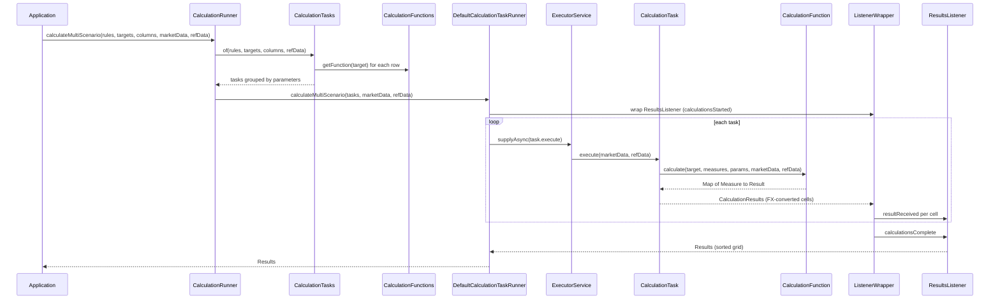

# calc

Active contributors: Stephen Colebourne, Will Nicholson, Ujjwal Tyagi

## Purpose

`modules/calc` (artifact `strata-calc`) is the calculation engine. A pricer in `modules/pricer` prices one trade against one set of market data; the engine prices many targets (usually trades) for many measures and, optionally, many scenarios, and returns the outcome as a grid of `Result` cells with one row per target and one column per measure.

The module knows nothing about specific products or pricing models. It defines the contracts (`CalculationFunction`, `MarketDataFunction`, `Measure`) and the machinery that schedules work and builds market data. The implementations for each asset class live in [measure](measure.md), which also wires them together in `StandardComponents`.

The module depends only on `strata-collect`, `strata-basics` and `strata-data`, plus Guava, Joda-Beans, Joda-Convert and SLF4J (`modules/calc/pom.xml`).

| Statistic | Value |
| --- | --- |
| Production files (`src/main/java`) | 69 Java files, about 14,200 lines (3 are `package-info.java`) |
| Test files (`src/test/java`) | 41 Java files, about 6,150 lines |
| Test-to-code ratio | 0.59 by file count, 0.43 by line count |
| Unique committers to `modules/calc` on `main` since 2022 | 4 (3 people plus the `opengammacibot` release bot, which made 176 of the 181 commits) |

For the full story of how a trade becomes a report line, read [Pricing a trade](../features/pricing-a-trade.md). Scenario definitions and perturbations are covered in [Scenarios](../features/scenarios.md). This page focuses on what happens inside the engine.

## Directory layout

```
modules/calc/
├── pom.xml
├── README.md
└── src/
    ├── main/
    │   ├── java/com/opengamma/strata/calc/
    │   │   ├── CalculationRunner.java        public entry point (interface)
    │   │   ├── DefaultCalculationRunner.java
    │   │   ├── CalculationRules.java         functions + reporting currency + default parameters
    │   │   ├── Column.java, ColumnName.java, ColumnHeader.java
    │   │   ├── Measure.java, ImmutableMeasure.java, MeasureHelper.java
    │   │   ├── ReportingCurrency.java, ReportingCurrencyType.java
    │   │   ├── Results.java                  the result grid
    │   │   ├── runner/                       tasks, functions, parameters, listeners, FX lookup
    │   │   └── marketdata/                   market data building and scenario perturbation
    │   └── resources/META-INF/
    │       ├── com/opengamma/strata/config/base/Measure.ini
    │       └── org/joda/convert/Renamed.ini
    └── test/java/com/opengamma/strata/calc/  JUnit 5 tests, same three packages
```

The three packages split the work:

- `com.opengamma.strata.calc` holds what callers touch: the runner, rules, columns, measures and results.
- `com.opengamma.strata.calc.runner` holds the task model and the extension points for calculation logic (`CalculationFunction`, `CalculationParameter`, `CalculationListener`).
- `com.opengamma.strata.calc.marketdata` builds market data from requirements. Its `package-info.java` names `MarketDataFactory` as the main entry point.

## Key abstractions

| Type | Kind | Role |
| --- | --- | --- |
| `CalculationRunner` | interface, `AutoCloseable` | Four `calculate*` methods: single or multi-scenario market data, synchronous or with a listener. Created by `ofMultiThreaded()` or `of(ExecutorService)` |
| `CalculationRules` | Joda-Bean | The `CalculationFunctions` to use, the default `ReportingCurrency` (natural unless set) and default `CalculationParameters` |
| `Column` | Joda-Bean | One output column: a `ColumnName`, a `Measure`, an optional reporting currency and column-specific parameters |
| `Measure` | interface, `Named` | A named output such as present value. An `ExtendedEnum`; `isCurrencyConvertible()` controls currency conversion |
| `CalculationTarget` | interface (in `modules/data`) | Something to calculate on, usually a `Trade`. `ResolvableCalculationTarget` targets are resolved with `ReferenceData` first |
| `CalculationFunctions` | interface | Finds the `CalculationFunction` for a target. The default implementation is a map keyed by target class |
| `CalculationFunction<T>` | interface | Logic for one target type: `supportedMeasures()`, `naturalCurrency()`, `requirements()` and `calculate()` |
| `DerivedCalculationFunction<T, R>` | interface | Calculates one extra measure from measures produced by another function; added with `CalculationFunctions.composedWith` |
| `CalculationParameter` / `CalculationParameters` | interface / light bean | Typed settings keyed by `queryType()`, for example a rates lookup or an `FxRateLookup`. Column parameters override rule parameters |
| `CalculationTasks` | light bean | All tasks for a grid plus the targets and columns. Also computes `MarketDataRequirements` |
| `CalculationTask` | light bean | One target, one function, one parameter set and one or more `CalculationTaskCell`s. The unit of work on a thread |
| `CalculationTaskRunner` | interface | Lower-level runner that takes prebuilt `CalculationTasks`; `DefaultCalculationTaskRunner` runs them on an `ExecutorService` |
| `CalculationListener` | interface | Callbacks `calculationsStarted`, `resultReceived`, `calculationsComplete` |
| `AggregatingCalculationListener<T>` / `ResultsListener` | abstract class / class | A listener that builds one value and exposes it as a `CompletableFuture`; `ResultsListener` builds `Results` |
| `Results` | Joda-Bean | Row-major grid of `Result<?>` cells with `ColumnHeader`s; typed getters and `getScenarios` for `ScenarioArray` values |
| `MarketDataRequirements` | Joda-Bean | Observable ids, non-observable ids, time series ids and output currencies needed by the tasks |
| `MarketDataFactory` | interface | Builds `BuiltMarketData` or `BuiltScenarioMarketData` from requirements, `MarketDataConfig`, supplied data and an optional `ScenarioDefinition` |
| `MarketDataFunction<T, I>` | interface | Builds one kind of non-observable data (a curve group, say) for one `MarketDataId` type |
| `ObservableDataProvider` / `TimeSeriesProvider` | interfaces | Plugin points for fetching quotes and time series from an external source. `none()` returns failures |
| `ScenarioDefinition` / `PerturbationMapping` | Joda-Beans | A list of filter-plus-perturbation mappings that turn base data into one data set per scenario |

## How it works

### From rules, targets and columns to tasks

`DefaultCalculationRunner` does almost nothing itself. Each of its four methods calls `CalculationTasks.of(rules, targets, columns, refData)` and passes the result to its `CalculationTaskRunner`.

`CalculationTasks.of` in `modules/calc/src/main/java/com/opengamma/strata/calc/runner/CalculationTasks.java` does the one-off setup:

1. Each column is combined with the rule defaults (`Column.combineWithDefaults`). Column parameters win over rule parameters with the same query type, and a column without a reporting currency takes the rules' currency.
2. For each target (row), a `ResolvableCalculationTarget` is resolved with the reference data. If resolution throws, the target is replaced with an `UnresolvableTarget`, which is handled by `UnresolvableTargetCalculationFunction` so the row fails with a message instead of stopping the run.
3. The function is looked up with `rules.getFunctions().getFunction(target)`. `DefaultCalculationFunctions` uses the exact class of the target as the map key (`functions.get(target.getClass())`), so a subclass does not match a function registered for its parent. If nothing matches, `MissingConfigCalculationFunction` is used; it reports "No function configured for measures ..." as a failed result.
4. For each column a `CalculationTaskCell` (row, column, measure, reporting currency) is created. Cells are grouped by their filtered `CalculationParameters`, and each group becomes one `CalculationTask`. A task can therefore compute several measures for one trade in a single function call, which lets functions share work such as building a rates provider.

`CalculationTasks.requirements(refData)` merges `CalculationTask.requirements` across tasks. Each task asks its function for `FunctionRequirements` (value ids, time series ids, output currencies and an `ObservableSource`), applies the observable source to observable ids, and adds `FxRateId`s for converting each output currency into the reporting currency of currency-convertible cells. `MarketDataRequirements.of(rules, targets, columns, refData)` is a shortcut that builds the tasks and returns their requirements.

### Building market data

Callers who already have a complete `MarketData` can skip this step. Otherwise the requirements go to a `MarketDataFactory`; `StandardComponents.marketDataFactory()` in `modules/measure/src/main/java/com/opengamma/strata/measure/StandardComponents.java` returns one configured with all standard market data functions, `ObservableDataProvider.none()` and `TimeSeriesProvider.none()`.

`DefaultMarketDataFactory.createMultiScenario` in `modules/calc/src/main/java/com/opengamma/strata/calc/marketdata/DefaultMarketDataFactory.java` works as follows:

1. `MarketDataNode.buildDependencyTree` builds a tree whose root stands for the calculations. Children are the ids the calculations need, and their children are the ids needed to build them (for example curve, then curve group, then quotes). The tree is built by `DependencyTreeBuilder` using each `MarketDataFunction.requirements(id, config)`.
2. While the root still has children, the leaves are removed (`withLeavesRemoved`) and built:
   - time series come from the supplied data or from the `TimeSeriesProvider`;
   - observable values not already present are requested in one bulk call to `ObservableDataProvider.provideObservableData`;
   - non-observable values are built by the `MarketDataFunction` registered for the id's class, wrapped in `Result.of` so an exception becomes a failure.
3. Every value is passed through the first `PerturbationMapping` in the `ScenarioDefinition` whose filter matches. This is how one base data set becomes many scenarios. Only the first matching mapping is applied to a value.
4. The output is a `BuiltScenarioMarketData`, which records build failures in `valueFailures` and `timeSeriesFailures` and reports them when the missing value is later queried.

`create` (single scenario) wraps the supplied data with `ScenarioMarketData.of(1, ...)`, runs the same code with `ScenarioDefinition.empty()` and returns `BuiltMarketData`. Configuration for non-observable data, such as curve group definitions, is passed in a `MarketDataConfig`, a map keyed by type and name. [Curve calibration](../features/curve-calibration.md) describes the market data functions that calibrate curves inside this loop.

### Running tasks

`DefaultCalculationTaskRunner` in `modules/calc/src/main/java/com/opengamma/strata/calc/runner/DefaultCalculationTaskRunner.java` always works in scenario form:

- `calculateMultiScenarioAsync` wraps the listener in a `ListenerWrapper` and submits every task with `CompletableFuture.supplyAsync(() -> task.execute(marketData, refData), executor).thenAccept(wrapper)`.
- `calculateMultiScenario` creates a `ResultsListener`, calls the async method and blocks on `listener.result()`.
- `calculate` and `calculateAsync` (single `MarketData`) wrap the data with `ScenarioMarketData.of(1, marketData)`, run the multi-scenario path and then unwrap any `ScenarioArray` of size one, so functions only ever deal with scenario data.

`CalculationTask.execute`:

1. Intersects the requested measures with `function.supportedMeasures()` and calls `function.calculate(target, measures, parameters, marketData, refData)`.
2. Fills in missing measures with failures: `UNSUPPORTED` if the function does not support the measure, `CALCULATION_FAILED` if it should have returned it.
3. Converts any `RuntimeException` into a failure for every measure of the task: `MISSING_DATA` for `MarketDataNotFoundException` and `ReferenceDataNotFoundException`, `UNSUPPORTED` for `UnsupportedOperationException`, otherwise `CALCULATION_FAILED`.
4. For each cell, converts currency-convertible successful values (`ScenarioFxConvertible`) into the reporting currency. The FX provider comes from an `FxRateLookup` parameter if one is set, else from the market data directly. A conversion error becomes a `CURRENCY_CONVERSION` failure.

The result is a `CalculationResults` (one target, several `CalculationResult` cells with row and column indices).

### Threading

`CalculationRunner.ofMultiThreaded()` creates a fixed thread pool sized to `Runtime.availableProcessors()`, with daemon threads named `CalculationTaskRunner-...`. `close()` shuts the pool down, so the runner is normally used in try-with-resources. `CalculationRunner.of(ExecutorService)` accepts any executor and leaves its life cycle to the caller; the class comment notes that "single or direct executors also work", which is how to run on a single thread or on the calling thread.

Listeners never need to be thread-safe. `ListenerWrapper` in `modules/calc/src/main/java/com/opengamma/strata/calc/runner/ListenerWrapper.java` lets only one thread call the listener at a time: other threads queue their results and return, and the delivering thread drains the queue. It calls `calculationsStarted` before any result and `calculationsComplete` once the expected number of tasks have reported. Exceptions thrown by the listener are logged and ignored.

### Producing `Results`

`ResultsListener` collects every `CalculationResult`, sorts them by row then column when the run completes, and builds `Results.of(headers, cells)`. Headers come from `Column.toHeader()`, which records the reporting currency only when it is specific. `Results` stores cells row-major and validates that the cell count equals rows times columns. Callers read cells with `get(row, column)`, `get(row, ColumnName, Class)`, `getScenarios(...)` for multi-scenario output, or `columnResults(column)` as a stream.

### Runner flow



When market data must be built first, the application calls `MarketDataRequirements.of(...)` and `MarketDataFactory.createMultiScenario(...)` before this sequence. `examples/src/main/java/com/opengamma/strata/examples/finance/CurveScenarioExample.java:132-135` shows the three calls together.

## Integration points

- **Upstream:** `modules/data` supplies `CalculationTarget`, `MarketData`, `ScenarioMarketData`, `MarketDataId`, `ObservableId`, `ScenarioArray`, `ScenarioPerturbation` and `MarketDataBox` (see [data](data.md)). `modules/collect` supplies `Result`, `FailureReason` and `ExtendedEnum` (see [collect](collect.md)). `modules/basics` supplies `ReferenceData`, `Currency` and FX types.
- **Downstream:** [measure](measure.md) implements `CalculationFunction` for every trade type (for example `modules/measure/src/main/java/com/opengamma/strata/measure/swap/SwapTradeCalculationFunction.java`), implements the market data functions, and registers the standard measures through `modules/measure/src/main/resources/META-INF/com/opengamma/strata/config/base2/Measure.ini`. The `Measure.ini` in `calc` has an empty `[providers]` section, so `Measure.of(name)` only knows names once `strata-measure` is on the classpath. [report](report.md) consumes `Results` through `ReportCalculationResults`.
- **Callers:** `examples/` and user applications create a `CalculationRunner`, build `CalculationRules` from `StandardComponents.calculationFunctions()` and a rates lookup parameter, and call the runner.

## Entry points for modification

| Goal | Where to change |
| --- | --- |
| Support a new target type | Implement `CalculationFunction` in `modules/measure` and add it to `StandardComponents.calculationFunctions()`, or pass a custom `CalculationFunctions` to `CalculationRules`. The key must be the exact target class |
| Add a measure computed from other measures | Implement `DerivedCalculationFunction` and add it with `CalculationFunctions.composedWith(...)`; `DefaultCalculationFunctions` wraps it around the existing function with `DerivedCalculationFunctionWrapper` |
| Change how parameters apply per target or measure | Implement `CalculationParameter.filter(target, measure)`; task grouping in `CalculationTasks.createTargetTasks` depends on the filtered parameters |
| Stream results or aggregate without holding the grid | Implement `CalculationListener` or extend `AggregatingCalculationListener` and call `calculateAsync` or `calculateMultiScenarioAsync` |
| Control threads | Pass your own `ExecutorService` to `CalculationRunner.of`; scheduling lives in `DefaultCalculationTaskRunner.runTask` |
| Plug in a live quote or time series source | Implement `ObservableDataProvider` and `TimeSeriesProvider` and pass them to `MarketDataFactory.of` (or `StandardComponents.marketDataFactory(provider)`) |
| Build a new kind of derived market data | Implement `MarketDataFunction` for a new `MarketDataId` type and register it with the factory |
| Change failure classification | `CalculationTask.handleFailure` and `handleMissing`, and `CalculationTaskCell.convertCurrency` |

`CalculationRunner`, `CalculationTaskRunner`, `CalculationFunctions` and `MarketDataFactory` are public interfaces with package-private default implementations. The module README states that code here is maintained with backwards compatibility in mind, so changes to these interfaces need default methods or a deprecation path. General rules for beans, `ArgChecker` and `Result` are in [Patterns and conventions](../how-to-contribute/patterns-and-conventions.md).

## Key source files

| File | What it contains |
| --- | --- |
| `modules/calc/src/main/java/com/opengamma/strata/calc/CalculationRunner.java` | Public runner interface and factories |
| `modules/calc/src/main/java/com/opengamma/strata/calc/CalculationRules.java` | Functions, reporting currency and default parameters |
| `modules/calc/src/main/java/com/opengamma/strata/calc/Column.java` | Column definition and merge with rule defaults |
| `modules/calc/src/main/java/com/opengamma/strata/calc/Results.java` | Result grid and typed accessors |
| `modules/calc/src/main/java/com/opengamma/strata/calc/runner/CalculationTasks.java` | Target resolution, function lookup, task grouping, requirements |
| `modules/calc/src/main/java/com/opengamma/strata/calc/runner/CalculationTask.java` | Task execution, failure mapping, FX requirements |
| `modules/calc/src/main/java/com/opengamma/strata/calc/runner/CalculationTaskCell.java` | Per-cell currency conversion and result creation |
| `modules/calc/src/main/java/com/opengamma/strata/calc/runner/DefaultCalculationTaskRunner.java` | Executor, async submission, single-scenario unwrapping |
| `modules/calc/src/main/java/com/opengamma/strata/calc/runner/ListenerWrapper.java` | Single-threaded delivery to listeners |
| `modules/calc/src/main/java/com/opengamma/strata/calc/runner/ResultsListener.java` | Builds `Results` from listener callbacks |
| `modules/calc/src/main/java/com/opengamma/strata/calc/runner/CalculationFunction.java` | Calculation function contract |
| `modules/calc/src/main/java/com/opengamma/strata/calc/runner/DefaultCalculationFunctions.java` | Map from target class to function, derived function wrapping |
| `modules/calc/src/main/java/com/opengamma/strata/calc/marketdata/DefaultMarketDataFactory.java` | Dependency-tree build loop and perturbation application |
| `modules/calc/src/main/java/com/opengamma/strata/calc/marketdata/MarketDataNode.java` | Dependency tree of market data ids |
| `modules/calc/src/main/java/com/opengamma/strata/calc/marketdata/ScenarioDefinition.java` | Scenario mappings and names |
| `modules/calc/src/test/java/com/opengamma/strata/calc/runner/DefaultCalculationTaskRunnerTest.java` | Runner behavior tests |
| `modules/calc/src/test/java/com/opengamma/strata/calc/marketdata/DefaultMarketDataFactoryTest.java` | Market data building tests (the largest test file, about 1,370 lines) |

## Related pages

- [Pricing a trade](../features/pricing-a-trade.md)
- [Scenarios](../features/scenarios.md)
- [Curve calibration](../features/curve-calibration.md)
- [measure](measure.md)
- [data](data.md)
- [report](report.md)
- [Architecture](../overview/architecture.md)
- [Glossary](../overview/glossary.md)
