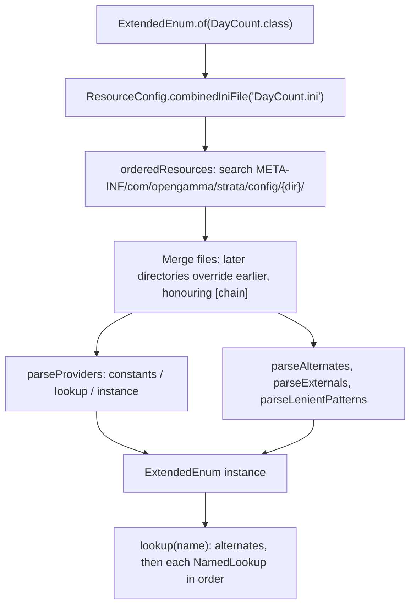
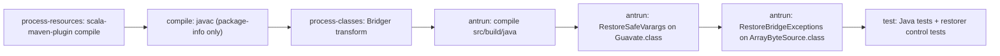

# collect

Active contributors: Stephen Colebourne, James White, Anand

`collect` is the bottom layer of Strata: general-purpose utilities with no dependency on any other Strata module. It provides argument checking, stream and collection helpers, primitive arrays and matrices, date-keyed time series, the `Result`/`Failure` model for reporting errors without exceptions, file and resource I/O (CSV, INI, XML, byte sources, configuration lookup) and the `Named`/`ExtendedEnum` machinery behind every extensible enum in the library. On this branch the production code is Scala 3.9.0, compiled to a Java API that is binary-compatible with the previous Java implementation; the tests are still Java.

## Purpose

Every other module imports `com.opengamma.strata.collect`. A count of production files that reference the package: `product` 264, `pricer` 240, `math` 177, `market` 140, `measure` 101, `basics` 81, `loader` 60, `calc` 39, `data` 27, `report` 21. Because of this, a change here affects the entire build, and the Java-facing API (class names, method descriptors, static entry points, checked exceptions, Joda-Beans metadata) is treated as a compatibility contract. See [Scala and Java interoperability](../features/scala-java-interop.md) for how the Scala code keeps that contract and [Scala migration](../background/scala-migration.md) for the history of the conversion.

The artifact is `com.opengamma.strata:strata-collect`. Its only compile dependencies are Guava, Joda-Beans, Joda-Convert and, on this branch, `scala3-library_3` (see `modules/collect/pom.xml`).

### Subsystem stats

| Measure | Value |
| --- | --- |
| Production Scala files | 114 (33,646 lines) under `modules/collect/src/main/scala` |
| Other production files | 8 `package-info.java` files under `modules/collect/src/main/java`, 1 resource (`version.properties`) |
| Test files | 100 Java files (19,271 lines) plus 27 test resources under `modules/collect/src/test` |
| Test-to-code ratio | 0.88 by file count, 0.57 by line count |
| Build-only helpers | 5 files under `modules/collect/src/build` |
| Unique committers on `main` since 2022 | 12 (11 people plus the `opengammacibot` release bot) |
| Bus factor | Low: Stephen Colebourne wrote 34 of the 52 human commits on `main` since 2022 |

On the `auto_model_migration` branch, factory-jim-frink authored 19 further commits to the module (the Scala conversion and its follow-ups).

## Directory layout

```
modules/collect/
├── pom.xml                         scala-maven-plugin, Bridger, antrun restorers
├── src/main/scala/com/opengamma/strata/collect/
│   ├── ArgChecker, Guavate, Messages, MapStream, Unchecked, DoubleArrayMath,
│   │   Decimal, FixedScaleDecimal, BasisPoints, Percentage, TypedString,
│   │   NumberFormatter, CharMatchers, Version, ...   (15 files)
│   ├── array/          DoubleArray, IntArray, LongArray, DoubleMatrix, Matrix
│   ├── concurrent/     CloseableExecutor
│   ├── function/       Checked* functional interfaces, primitive and tri-arity interfaces (29 files)
│   ├── io/             CSV, INI, properties, XML, byte/char sources, ZIP, ResourceConfig (27 files)
│   ├── named/          Named, NamedEnum, NamedLookup, ExtendedEnum, CombinedExtendedEnum, EnumNames, Described
│   ├── result/         Result, Failure, FailureItem, FailureReason, ValueWithFailures, exceptions (13 files)
│   ├── timeseries/     LocalDateDoubleTimeSeries, dense and sparse implementations, builder, point
│   └── tuple/          Pair, Triple, DoublesPair, IntDoublePair, LongDoublePair, ObjDoublePair, ObjIntPair, Tuple
├── src/main/java/com/opengamma/strata/collect/**/package-info.java
├── src/main/resources/com/opengamma/strata/collect/version.properties
├── src/build/
│   ├── java/           RestoreSafeVarargs.java, RestoreBridgeExceptions.java
│   ├── test/           RestoreSafeVarargsControls.java, RestoreBridgeExceptionsControls.java
│   └── test-fixtures/  ArrayByteSource.scala (Scala fixture used by the bridge control test)
└── src/test/
    ├── java/com/opengamma/strata/collect/   TestHelper and one test class per production class
    └── resources/      sample INI files under META-INF/com/opengamma/strata/config/base, ZIP and text fixtures
```

## Key abstractions

| Type | Path | Description |
| --- | --- | --- |
| `ArgChecker` | `modules/collect/src/main/scala/com/opengamma/strata/collect/ArgChecker.scala` | Static argument validation (`notNull`, `notEmpty`, `notNaN`, `inRange`, `isTrue` ...) throwing `IllegalArgumentException`. 65 `@static` methods. |
| `Guavate` | `modules/collect/src/main/scala/com/opengamma/strata/collect/Guavate.scala` | Collectors to Guava immutable collections, stream helpers, `list`/`set` varargs factories. The largest file in the module (1,758 lines). |
| `Messages` | `modules/collect/src/main/scala/com/opengamma/strata/collect/Messages.scala` | `{}` placeholder formatting, including `formatWithAttributes` for named `{abc}` placeholders. |
| `MapStream` | `modules/collect/src/main/scala/com/opengamma/strata/collect/MapStream.scala` | A `Stream` of map entries with key/value-aware operations. |
| `Decimal`, `FixedScaleDecimal` | `modules/collect/src/main/scala/com/opengamma/strata/collect/Decimal.scala` | Compact decimal values; `BasisPoints` and `Percentage` wrap `Decimal`. |
| `DoubleArray`, `DoubleMatrix` | `modules/collect/src/main/scala/com/opengamma/strata/collect/array/DoubleArray.scala` | Immutable primitive arrays and matrices used for curve parameters and sensitivities; `IntArray` and `LongArray` follow the same shape. |
| `LocalDateDoubleTimeSeries` | `modules/collect/src/main/scala/com/opengamma/strata/collect/timeseries/LocalDateDoubleTimeSeries.scala` | Immutable date-to-double series (fixings, historic quotes). Implemented by package-private dense and sparse classes. |
| `Result<T>` | `modules/collect/src/main/scala/com/opengamma/strata/collect/result/Result.scala` | Either a value or a `Failure`; used for every cell of calculation output. |
| `Failure`, `FailureItem` | `modules/collect/src/main/scala/com/opengamma/strata/collect/result/FailureItem.scala` | A failure is one or more items, each with a `FailureReason`, message, attributes, stack trace and optional cause type. |
| `ValueWithFailures<T>` | `modules/collect/src/main/scala/com/opengamma/strata/collect/result/ValueWithFailures.scala` | A value plus a list of non-fatal `FailureItem`s, used by loaders. |
| `ResourceConfig` | `modules/collect/src/main/scala/com/opengamma/strata/collect/io/ResourceConfig.scala` | Finds a named configuration file in up to thirty classpath directories and merges them into one `IniFile`. |
| `ResourceLocator` | `modules/collect/src/main/scala/com/opengamma/strata/collect/io/ResourceLocator.scala` | A file, URL or classpath resource addressed by a string such as `classpath:...` or `file:...`. |
| `IniFile`, `PropertySet` | `modules/collect/src/main/scala/com/opengamma/strata/collect/io/IniFile.scala` | Parsed INI file: named sections of multi-valued key/value pairs. |
| `CsvFile`, `CsvIterator`, `CsvRow`, `CsvOutput` | `modules/collect/src/main/scala/com/opengamma/strata/collect/io/CsvFile.scala` | In-memory and streaming CSV reading, and CSV writing. |
| `XmlFile`, `XmlElement` | `modules/collect/src/main/scala/com/opengamma/strata/collect/io/XmlFile.scala` | Simple immutable XML tree, used by the FpML loader. |
| `ArrayByteSource`, `BeanByteSource` | `modules/collect/src/main/scala/com/opengamma/strata/collect/io/ArrayByteSource.scala` | Guava `ByteSource` subclasses that are immutable beans and can be hashed, encoded and serialized. |
| `Named`, `NamedEnum`, `NamedLookup` | `modules/collect/src/main/scala/com/opengamma/strata/collect/named/Named.scala` | A type with a unique name; a lookup that maps names to instances. |
| `ExtendedEnum<T>` | `modules/collect/src/main/scala/com/opengamma/strata/collect/named/ExtendedEnum.scala` | Registry of `Named` instances configured by an INI file, with alternate names, external name groups and lenient patterns. |
| `Pair`, `Triple`, `DoublesPair` | `modules/collect/src/main/scala/com/opengamma/strata/collect/tuple/Pair.scala` | Immutable tuples; primitive variants avoid boxing. |
| `CheckedFunction` and friends | `modules/collect/src/main/scala/com/opengamma/strata/collect/function/CheckedFunction.scala` | Functional interfaces that may throw checked exceptions, used with `Unchecked.wrap`. |

## How it works

### Package roles

- **Root package.** Static utility classes (`ArgChecker`, `Guavate`, `Messages`, `Unchecked`, `DoubleArrayMath`, `CharMatchers`) and small value types (`Decimal`, `Percentage`, `BasisPoints`, `TypedString`). Each utility is a Scala `final class X private ()` with a companion `object X` holding the methods, so Java sees `X.method(...)` as a static call.
- **`array`.** `DoubleArray`, `IntArray` and `LongArray` wrap a private primitive array and expose `get`, `size`, `map`, `plus`, `multipliedBy`, `toArray` and similar. `DoubleMatrix` is the two-dimensional form and implements the `Matrix` trait.
- **`timeseries`.** `LocalDateDoubleTimeSeries` is the public trait with `@static` factories `empty`, `of`, `builder` and `collector`. `LocalDateDoubleTimeSeriesBuilder` decides at build time whether to create a `DenseLocalDateDoubleTimeSeries` (array indexed by date, with an `INCLUDE_WEEKENDS` or `SKIP_WEEKENDS` calculation) or a `SparseLocalDateDoubleTimeSeries` (parallel date and value arrays). Both implementations are `private[timeseries]`.
- **`result`.** The error model described below.
- **`io`.** Readers and writers for the file formats Strata uses. `CsvIterator` streams large files; `CsvFile` loads them fully. `UnicodeBom` and `CharSources` handle encodings. `ZipUtils` unpacks archives and guards against the ZIP slip attack; `SafeFiles` wraps `Files` methods so that file handles are not leaked. `ResourceConfig` and `ResourceLocator` find configuration on the classpath.
- **`named`.** Named types and `ExtendedEnum`, described below.
- **`tuple`, `function`, `concurrent`.** Plain building blocks: tuples, functional interfaces that Java's `java.util.function` lacks (tri-arity, primitive combinations, checked variants), and `CloseableExecutor`, an `AutoCloseable` wrapper that shuts an `ExecutorService` down with a timeout.

### Extended enum loading

`ExtendedEnum.of(Class)` is called from a static field of the type that owns the enum, for example `DayCounts` in [basics](basics.md). It builds the registry from configuration in four steps:



1. `ResourceConfig.orderedResources` walks the directory list. By default that is `base`, `base1` ... `base9`, `library` ... `library9`, `application` ... `application9`; the system property `com.opengamma.strata.config.directories` replaces it with a comma-separated list. For each directory it asks the class loader for `META-INF/com/opengamma/strata/config/<dir>/<Type>.ini`. If the same name appears more than once on the classpath (Strata on the classpath twice), the copies must have identical bytes or an `IllegalStateException` is thrown. If no file is found at all, the method also throws.
2. `ResourceConfig.combinedIniFile(List)` merges the files from lowest to highest priority. Each section is merged with `PropertySet.overrideWith`. A `[chain]` section with `chainNextFile = false` discards everything from lower-priority files, and `chainRemoveSections` discards named sections.
3. `ExtendedEnum.of` parses the merged file. The `[providers]` section maps a class name (resolved through Joda-Convert's `RenameHandler`) to one of three values:
   - `constants`: public static fields of the enum type are read reflectively. Scala 3 enum cases compile to public static fields that are not `final`, so `parseConstants` also accepts a non-final static field when the provider class is an enum and the field holds one of its own enum constants. Each instance is registered under its name and its upper-case name.
   - `lookup`: the class implements `NamedLookup` and has a no-argument constructor.
   - `instance`: the class has a static `INSTANCE` field of type `NamedLookup`.
   `[alternates]` maps aliases to standard names, `[externals.<group>]` sections hold mappings for external systems (for example `[externals.FpML]` in `modules/basics/src/main/resources/META-INF/com/opengamma/strata/config/base/DayCount.ini`), and `[lenientPatterns]` holds regular expressions used by `findLenient`.
4. Any `RuntimeException` during loading is logged at `SEVERE` and an empty `ExtendedEnum` is returned. This avoids an `ExceptionInInitializerError` in the owning class, but it means a broken INI file shows up later as "name not found" errors. [Debugging](../how-to-contribute/debugging.md) and [Pitfalls](../background/pitfalls.md) cover the symptoms.

`lookup(name)` first maps the name through the alternates, then asks each `NamedLookup` in provider order and returns the first hit. `CombinedExtendedEnum` merges several `ExtendedEnum`s of subtypes behind one lookup (used for `Index`, `RateIndex` and `FloatingRateIndex` in `modules/basics/src/main/scala/com/opengamma/strata/basics/index/Indices.scala`). The directory layout and override rules from an application's point of view are in [Reference data and configuration](../features/reference-data-and-configuration.md).

### Result, Failure and FailureItem

`Result<T>` is a Joda-Bean holding either a value or a `Failure`, never both (checked by an `@ImmutableValidator`). The Scala field for the failure is named `_failure`: a field called `failure` would suppress the static `failure(...)` forwarders that Java callers use. Joda-Beans still exposes it as the `failure` property and Java serialization maps it to `failure`. Factories include `success`, `failure` (many overloads: reason and message, exception, other failed results, a `Failure` or `FailureItem`), `of(Supplier)` and `wrap(Supplier)` which capture thrown exceptions, `ofNullable`, `combine`, `flatCombine`, `allSuccessful` and `countFailures`. Callers are expected to use `map` and `flatMap` rather than `isSuccess`/`getValue`.

A `Failure` aggregates one or more `FailureItem`s; if there are several items with different reasons, the overall reason is `FailureReason.MULTIPLE`. `FailureReason` is a Scala enum extending `java.lang.Enum` with the cases `MULTIPLE`, `ERROR`, `INVALID`, `PARSING`, `NOT_APPLICABLE`, `UNSUPPORTED`, `MISSING_DATA` and `CURRENCY_CONVERSION`.

Each `FailureItem` stores its stack trace as a string, interned with a weak Guava `Interner` because the same trace often repeats thousands of times. When the item is built from an exception, the trace is that exception's trace. When it is built from a reason and message (`FailureItem.of(reason, message, args...)`, or `Result.failure`/`Failure.of` which call the package-private `ofAutoStackTrace(1, ...)`), the trace is generated from the current stack and starts with the line `com.opengamma.strata.collect.result.FailureItem: <message>`.

The Scala implementation adds frames that the Java version never had: `@varargs` forwarders that turn an array into a `Seq`, and static forwarders on class `X` that call the companion `X$`. Tests and users compare these strings, so `FailureItem` rebuilds the trace that `Thread.getStackTrace()` on the Java implementation would have produced:

- `javaStackFrames()` walks the stack with a `StackWalker` (`SHOW_REFLECT_FRAMES`) and drops a frame when `isForwarderFrame` says it is a forwarder of the frame it calls. Both frames must be Strata classes compiled from `.scala` files with the same method name, and then either:
  - `isVarargsForwarderFrame`: same class, the callee descriptor ends in `Lscala/collection/immutable/Seq;)` and the caller descriptor has an array in that position with the same return type; or
  - `isStaticForwarderFrame`: the callee class is the caller class plus `$`, descriptors are identical, and the caller has no line number.
- The result is capped at 1,024 frames, which is HotSpot's default `-XX:MaxJavaStackTraceDepth`. The value is hard-coded because reading the real option needs `com.sun.management`, which the forbiddenapis check bans (commit d9c689c).
- Leading frames belonging to `FailureItem` or `FailureItem$` are skipped, then `skipFrames` more.
- `frameText` rewrites `com.opengamma.strata.X$.method(` to `com.opengamma.strata.X.method(` for Strata Scala frames, so the text matches the Java static call.

`summarizeStackTrace()` reduces such a trace to its first line for the `toString` form. `ValueWithFailures<T>` is the loader-side companion: a successful value with a list of `FailureItem`s for rows that could not be parsed. The runtime exceptions `FailureItemException`, `ParseFailureException` and `IllegalArgFailureException` implement `FailureItemProvider`, so `FailureItem.of(reason, cause)` reuses the item they carry. `FailureException` wraps a whole `Failure`.

### Scala build setup

`modules/collect/pom.xml` replaces the usual Java compile with these steps:



- **scala-maven-plugin 4.10.0** runs the `add-source` and `compile` goals at `process-resources`, before `maven-compiler-plugin`, with `scalaVersion` 3.9.0, `release` 17, `compileOrder` `Mixed` and `sendJavaToScalac` true. Compiler arguments are `-deprecation`, `-feature` and `-Xmixin-force-forwarders:false`. The last flag stops Scala emitting forwarder methods for trait default methods unless the JVM needs them, because the original Java interfaces had none and extra methods would change the class files. An `additionalDependency` on `jackson-annotations` 2.21 works around a ScalaDoc 3.9.0 dependency clash.
- **Bridger** (`org.jboss.bridger`) runs its `transform` goal at `process-classes`, with the version managed in `modules/pom.xml`.
- **maven-antrun-plugin 3.1.0**, also at `process-classes` and after Bridger, compiles `modules/collect/src/build/java` with `javac --release 8 -Werror` into `target/build-classes` and runs two ASM 9.5 tools on `target/classes`:
  - `RestoreSafeVarargs` adds `@SafeVarargs` to eight `Guavate` methods (`concatToList`, `concatItemsToList`, `concatToSet`, `combineMapsOverwriting`, two `firstNonEmpty` overloads, `list`, `set`), matched by name, descriptor and `ACC_PUBLIC | ACC_STATIC | ACC_VARARGS`. Scala 3 generates the varargs forwarders but cannot annotate them.
  - `RestoreBridgeExceptions` adds `throws java/io/IOException` to the two `InputStream`-returning bridge methods `openStream()` and `openBufferedStream()` on `ArrayByteSource`. javac copies the exception onto bridges; Scala 3 does not.
  Both tools fail closed: any missing, duplicated or unexpected target exits with status 1 and leaves the class file untouched; an already-correct class file is left byte-identical. ASM and `scala3-compiler_3` are plugin dependencies only, so nothing from `src/build` is packaged.
- At the `test` phase (skipped with `-DskipTests`) two more antrun executions compile `modules/collect/src/build/test` and run `RestoreSafeVarargsControls` and `RestoreBridgeExceptionsControls`. The bridge control first compiles `modules/collect/src/build/test-fixtures/ArrayByteSource.scala` with `dotty.tools.dotc.Main` into `target/build-test-fixtures`, so it checks the restorer against a real Scala 3 class.
- `maven.javadoc.skip` is true. With `-Ddist`, the `scaladoc-jar` profile runs `scala-maven-plugin:doc-jar` at `process-classes` with classifier `javadoc`, placed before the restorers so that the forked compile is a no-op and does not overwrite the restored classes.

[Tooling](../how-to-contribute/tooling.md) lists these plugins alongside the rest of the build, and `modules/basics/pom.xml` uses the same Scala compiler setup without the restorers.

## Integration points

- **basics**: every extended enum (`Currency`, `DayCount`, `HolidayCalendar`, `IborIndex` and others) is loaded through `ExtendedEnum` and `ResourceConfig`; the INI files live in `modules/basics/src/main/resources/META-INF/com/opengamma/strata/config/base/`. See [basics](basics.md).
- **data**: `MarketData` and `ExtendedMarketData` return `LocalDateDoubleTimeSeries` for fixings (`modules/data/src/main/java/com/opengamma/strata/data/MarketData.java`).
- **calc**: calculation tasks wrap each measure in `Result` (`modules/calc/src/main/java/com/opengamma/strata/calc/runner/CalculationTask.java`, `CalculationTaskCell.java`, `FunctionUtils.java`). See [calc](calc.md).
- **loader**: CSV loaders such as `modules/loader/src/main/java/com/opengamma/strata/loader/csv/FixingSeriesCsvLoader.java` read with `CsvIterator`/`CsvFile` and report row errors with `ValueWithFailures`; the FpML parser uses `XmlFile`. See [loader](loader.md).
- **math, market, pricer**: `DoubleArray` and `DoubleMatrix` carry curve parameters, Jacobians and sensitivities.
- **Tests in all modules**: `modules/collect/src/test/java/com/opengamma/strata/collect/TestHelper.java` (`coverImmutableBean`, `assertSerialization`, `assertJodaConvert`, `assertUtilityClass`, `assertThrowsIllegalArg`, `caputureLog` and more) is shared with the other modules through the test-jar that `modules/pom.xml` builds. See [Testing](../how-to-contribute/testing.md).

## Entry points for modification

- **Adding a utility method.** Put it in the companion `object` of the utility class. Check that Java callers see a static method with the same descriptor they would get from Java; use `@static` where a forwarder is not generated (for example on traits such as `LocalDateDoubleTimeSeries`, and for constants). Add `@varargs` for Java varargs, and remember that `@SafeVarargs` is only restored for the eight methods listed in `RestoreSafeVarargs.TARGETS`; a new generic varargs method needs a new entry there and in the control test.
- **Changing an extended enum loader.** Edit `modules/collect/src/main/scala/com/opengamma/strata/collect/named/ExtendedEnum.scala` and run `ExtendedEnumTest`, which uses the `Sample*` providers and `SampleInvalid*.ini` files under `modules/collect/src/test`.
- **Changing configuration search.** Edit `modules/collect/src/main/scala/com/opengamma/strata/collect/io/ResourceConfig.scala`. Its private state lives in the companion object so it is initialised when a method is first called, not when the `RESOURCE_DIRS_PROPERTY` constant is read.
- **Changing failure stack traces.** Edit the forwarder logic in `FailureItem.scala` and run `FailureItemTest` and `ResultTest`; the expected strings are Java-shaped.
- **Joda-Beans in Scala** (`Result`, `FailureItem`, `Failure`, `ValueWithFailures`, byte sources). The meta-bean code is hand-maintained Scala; there is no generator for it. Follow [Joda-Beans and serialization](../features/joda-beans-and-serialization.md) and [Patterns and conventions](../how-to-contribute/patterns-and-conventions.md).

## Key source files

| File | Why it matters |
| --- | --- |
| `modules/collect/pom.xml` | Scala compiler setup, restorers, ScalaDoc under `-Ddist` |
| `modules/collect/src/main/scala/com/opengamma/strata/collect/ArgChecker.scala` | Validation used by almost every factory method |
| `modules/collect/src/main/scala/com/opengamma/strata/collect/Guavate.scala` | Collection and stream helpers; target of `RestoreSafeVarargs` |
| `modules/collect/src/main/scala/com/opengamma/strata/collect/array/DoubleArray.scala` | Primitive array type used across the analytics modules |
| `modules/collect/src/main/scala/com/opengamma/strata/collect/timeseries/LocalDateDoubleTimeSeriesBuilder.scala` | Chooses dense or sparse storage |
| `modules/collect/src/main/scala/com/opengamma/strata/collect/result/Result.scala` | Result type and its factories |
| `modules/collect/src/main/scala/com/opengamma/strata/collect/result/FailureItem.scala` | Failure items and Scala-forwarder stack frame filtering |
| `modules/collect/src/main/scala/com/opengamma/strata/collect/io/ResourceConfig.scala` | Configuration directory search and INI merge |
| `modules/collect/src/main/scala/com/opengamma/strata/collect/named/ExtendedEnum.scala` | INI-driven enum registry |
| `modules/collect/src/main/scala/com/opengamma/strata/collect/io/ArrayByteSource.scala` | Byte source bean; target of `RestoreBridgeExceptions` |
| `modules/collect/src/build/java/RestoreSafeVarargs.java` | Restores `@SafeVarargs` after Scala compilation |
| `modules/collect/src/build/java/RestoreBridgeExceptions.java` | Restores `throws IOException` on two bridges |
| `modules/collect/src/test/java/com/opengamma/strata/collect/TestHelper.java` | Test helpers used by every module |

## Related pages

- [Modules](index.md)
- [basics](basics.md)
- [Scala and Java interoperability](../features/scala-java-interop.md)
- [Scala migration](../background/scala-migration.md)
- [Reference data and configuration](../features/reference-data-and-configuration.md)
- [Patterns and conventions](../how-to-contribute/patterns-and-conventions.md)
- [Tooling](../how-to-contribute/tooling.md)
- [Pitfalls](../background/pitfalls.md)
