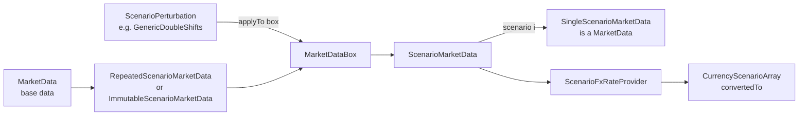

# data

Active contributors: Stephen Colebourne, Yuki Iwashita

## Purpose

The `data` module (`strata-data`) defines how Strata stores and looks up market data. It contains the identifier types used to request data (`MarketDataId`, `ObservableId`, `FxRateId`), the single-date container `MarketData` and its immutable implementation, an FX rate provider backed by market data, and the `scenario` package that holds market data for many scenarios at once. It has no knowledge of curves, pricing or trades: it depends only on [collect](collect.md) and [basics](basics.md).

Concrete identifiers and perturbations for curves, quotes and volatilities live in higher modules such as [market](market.md) and [pricer](pricer/index.md). The calculation engine in [calc](calc.md) builds `ScenarioMarketData` from these pieces.

Module statistics:

| Measure | Value |
| --- | --- |
| Main source files | 41 Java files |
| Test files | 31 Java files (test-to-code ratio about 0.76) |
| Unique committers on `main` since 2022 | 3 (2 humans plus the `opengammacibot` release bot) |

Most commits on `main` since 2022 touching this module are release version bumps by `opengammacibot`. The API has been stable for several years.

## Directory layout

```
modules/data/
  pom.xml
  src/main/java/com/opengamma/strata/data/            single-scenario market data and identifiers
  src/main/java/com/opengamma/strata/data/scenario/   multi-scenario market data, boxes, arrays, perturbations
  src/test/java/com/opengamma/strata/data/...         JUnit 5 tests
```

## Key abstractions

| Type | Kind | Role |
| --- | --- | --- |
| `MarketDataId<T>` | interface | Uniquely identifies one item of market data of type `T` (a quote, a curve, a surface, an FX rate). Only method: `getMarketDataType()`. |
| `ObservableId` | interface | A `MarketDataId<Double>` for data that can be observed from a provider. Holds a `StandardId`, a `FieldName` and an `ObservableSource`. Implemented by `QuoteId` and `IndexQuoteId` in `market`. |
| `MarketDataName<T>` | abstract class | A name that is unique only within one coherent data set, such as a curve name inside a curve group. |
| `NamedMarketDataId<T>` | interface | A `MarketDataId` that also exposes its `MarketDataName`, used to find data by name with `findIds(name)`. |
| `FxRateId`, `FxMatrixId` | final classes | Identify an `FxRate` for a currency pair (always stored in market convention order) and an `FxMatrix`. |
| `FieldName`, `ObservableSource` | final classes | Field of a market data record (`MarketValue`, `SettlementPrice`, `CleanPrice` and others) and the data source (`ObservableSource.NONE` by default). |
| `MarketData` | interface | Market data for one valuation date: `getValue(id)`, `findValue(id)`, `getTimeSeries(observableId)`, `combinedWith(other)`, `withValue(id, value)`. |
| `ImmutableMarketData` | Joda-Bean | Standard implementation of `MarketData`, built with `ImmutableMarketData.builder(date)`. |
| `MarketDataFxRateProvider` | Joda-Bean | Adapts `MarketData` to the `FxRateProvider` interface from `basics`, triangulating through each currency's triangulation currency when a direct rate is missing. |
| `MarketDataNotFoundException` | exception | Thrown by `getValue` and `getTimeSeries` when the requested data is absent. Extends `IllegalArgumentException`. |
| `ScenarioMarketData` | interface | Market data across one or more scenarios. Values are returned as `MarketDataBox<T>`; `scenario(i)` returns a single-scenario `MarketData` view. |
| `MarketDataBox<T>` | interface | Holds either one value shared by all scenarios or one value per scenario, and hides the difference behind `getValue(scenarioIndex)`, `map`, `mapWithIndex` and `combineWith`. |
| `ScenarioArray<T>` | interface | One value per scenario. Specialised forms: `CurrencyScenarioArray`, `MultiCurrencyScenarioArray`, `DoubleScenarioArray`, `FxRateScenarioArray`. |
| `ScenarioPerturbation<T>` | interface | Changes one item of market data to produce a box with one value per scenario: `applyTo(box, refData)`, `getScenarioCount()`, `getMarketDataType()`. |
| `ScenarioFxRateProvider` | interface | Multi-scenario FX rates: `fxRate(base, counter, scenarioIndex)` and `fxRateProvider(scenarioIndex)`. |
| `ScenarioFxConvertible<R>` | interface | Implemented by scenario results (for example `CurrencyScenarioArray`) so the engine can convert them to a reporting currency. |
| `ScenarioMarketDataId<T, U>` | interface | Requests data for all scenarios packaged as a `ScenarioArray` subtype, for functions that calculate all scenarios in bulk. |

## How it works

### Single-scenario lookup

A `MarketData` instance is a map from `MarketDataId` to value plus a map from `ObservableId` to `LocalDateDoubleTimeSeries`, all valid for one valuation date. `getValue` is a typed lookup: an `FxRateId` returns an `FxRate`, a `QuoteId` returns a `Double`, and a `CurveId` (defined in `market`) returns a `Curve`. Missing data raises `MarketDataNotFoundException`; `findValue` returns `Optional` instead.

`combinedWith` and `withValue` do not copy the data. They return the package-private decorators `CombinedMarketData` (looks in the first set, then the second) and `ExtendedMarketData` (adds or overrides one item).

`MarketDataFxRateProvider` is how pricers obtain FX rates from market data. The calculation engine creates one in `modules/calc/src/main/java/com/opengamma/strata/calc/runner/DefaultFxRateLookup.java`.

### Scenario market data



1. `ScenarioMarketData.of(scenarioCount, marketData)` repeats one `MarketData` for every scenario (`RepeatedScenarioMarketData`). `ImmutableScenarioMarketData.builder(date)` builds data where each item is a `MarketDataBox`.
2. A `MarketDataBox` is either a `SingleMarketDataBox` (one value used by every scenario) or a `ScenarioMarketDataBox` (wrapping a `ScenarioArray`). Storing a single value avoids copying unchanged data N times.
3. `ScenarioMarketData.withPerturbation(id, perturbation, refData)` applies a `ScenarioPerturbation` to the box for one identifier and returns new data via `ExtendedScenarioMarketData`. `ScenarioPerturbation.none()` returns `NoOpScenarioPerturbation`.
4. Calculation functions that work one scenario at a time call `scenario(i)` or `scenarios()` and receive a `SingleScenarioMarketData`, which implements plain `MarketData`.
5. Results are returned as `ScenarioArray` subtypes. `CurrencyScenarioArray` and `MultiCurrencyScenarioArray` store values in `DoubleArray`s and implement `ScenarioFxConvertible`, so the engine can convert them with a `ScenarioFxRateProvider` built from the same scenario data (`DefaultScenarioFxRateProvider`).

`CombinedScenarioMarketData` merges two scenario sets. They must have the same scenario count, or one of them must have exactly one scenario.

### Perturbations defined elsewhere

The `data` module only defines the `ScenarioPerturbation` interface. The concrete shifts are in `market`:

- `GenericDoubleShifts` (`modules/market/src/main/java/com/opengamma/strata/market/GenericDoubleShifts.java`) shifts a `Double` such as a quote, one shift per scenario plus an optional constant spread.
- `ShiftType` (`modules/market/src/main/java/com/opengamma/strata/market/ShiftType.java`) has the constants `RELATIVE`, `ABSOLUTE`, `SCALED` and `FIXED`.
- `FxRateShifts`, `CurveParallelShifts` and `PointShifts` (in `market`, `modules/market/src/main/java/com/opengamma/strata/market/curve` and `modules/market/src/main/java/com/opengamma/strata/market/param`) shift FX rates, whole curves and individual curve points.

The mapping from perturbations to market data identifiers, and the building of scenario data, happen in `calc` (`PerturbationMapping`, `ScenarioDefinition`, `MarketDataFactory.createMultiScenario`). See [Scenarios](../features/scenarios.md) for the full workflow.

## Integration points

- **Upstream:** `collect` (`LocalDateDoubleTimeSeries`, `DoubleArray`, `ObjIntFunction`, Joda-Beans support) and `basics` (`Currency`, `CurrencyPair`, `FxRate`, `FxRateProvider`, `FxConvertible`, `StandardId`, `ReferenceData`).
- **Identifiers implemented elsewhere:** `market` defines `QuoteId`, `IndexQuoteId`, `CurveId`, `RatesCurveGroupId`, `LegalEntityCurveGroupId` and others; `pricer` defines volatility identifiers such as `SwaptionVolatilitiesId` and `FxOptionVolatilitiesId`; `calc` defines `CalculationParametersId`.
- **Consumers:** about 140 main source files in `measure`, 63 in `pricer`, 56 in `market` and 39 in `calc` import from `com.opengamma.strata.data`. The `loader` module returns maps keyed by `QuoteId`, `FxRateId` and `ObservableId` that can be passed straight to `ImmutableMarketData.builder`.

## Entry points for modification

- **New kind of market data:** add a `MarketDataId<T>` implementation (usually a Joda-Bean) in the module that owns `T`, not in `data`. Implement `NamedMarketDataId` if the data has a name that is unique within a group.
- **New perturbation:** implement `ScenarioPerturbation<T>` as an immutable Joda-Bean in the module that owns `T`, following `GenericDoubleShifts`.
- **New bulk scenario structure:** implement `ScenarioArray<T>` and, if currency conversion is needed, `ScenarioFxConvertible`. Add a matching `ScenarioMarketDataId` if functions should request it from `ScenarioMarketData.getScenarioValue`.
- **Changing lookup behaviour:** the default methods on `MarketData` and `ScenarioMarketData` are used by every implementation, including the package-private decorators. Check `CombinedMarketData`, `ExtendedMarketData` and their scenario equivalents when changing them.

## Key source files

| File | Contents |
| --- | --- |
| `modules/data/src/main/java/com/opengamma/strata/data/MarketData.java` | Single-scenario market data interface and static factories |
| `modules/data/src/main/java/com/opengamma/strata/data/ImmutableMarketData.java` | Standard immutable implementation |
| `modules/data/src/main/java/com/opengamma/strata/data/MarketDataId.java` | Root identifier interface |
| `modules/data/src/main/java/com/opengamma/strata/data/ObservableId.java` | Identifier for observable values |
| `modules/data/src/main/java/com/opengamma/strata/data/FxRateId.java` | FX rate identifier |
| `modules/data/src/main/java/com/opengamma/strata/data/MarketDataFxRateProvider.java` | FX rates with triangulation |
| `modules/data/src/main/java/com/opengamma/strata/data/MarketDataNotFoundException.java` | Missing data exception |
| `modules/data/src/main/java/com/opengamma/strata/data/scenario/ScenarioMarketData.java` | Multi-scenario market data interface |
| `modules/data/src/main/java/com/opengamma/strata/data/scenario/ImmutableScenarioMarketData.java` | Standard multi-scenario implementation |
| `modules/data/src/main/java/com/opengamma/strata/data/scenario/MarketDataBox.java` | Single value or per-scenario values |
| `modules/data/src/main/java/com/opengamma/strata/data/scenario/ScenarioPerturbation.java` | Perturbation interface |
| `modules/data/src/main/java/com/opengamma/strata/data/scenario/CurrencyScenarioArray.java` | Per-scenario amounts in one currency |
| `modules/data/src/main/java/com/opengamma/strata/data/scenario/ScenarioFxRateProvider.java` | Per-scenario FX rates |

## Related pages

- [Scenarios](../features/scenarios.md)
- [market](market.md)
- [calc](calc.md)
- [Data models](../reference/data-models.md)
- [Modules](index.md)
