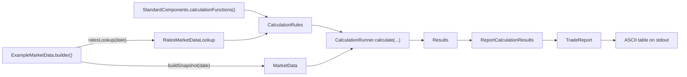

# examples

Active contributors: Stephen Colebourne, Marc Henrard, factory-jim-frink

## Purpose

The `examples` directory holds the `strata-examples` Maven module: runnable programs that show how to use Strata end to end, the sample market data, portfolios and report templates they read, and a command-line report tool. It composes [measure](measure.md), [report](report.md) and [loader](loader.md), and is the quickest way to see the whole calculation flow working. The module is not installed or deployed (`maven.install.skip` and `maven.deploy.skip` are set in `examples/pom.xml`), and `examples/README.md` states that its code has no backwards compatibility guarantees.

Stats: 47 Java source files (41 classes plus 6 `package-info.java`), 81 resource files, 6 test classes, a test-to-code ratio of about 0.13 by file count, and 6 unique committers on `main` since 2022 (4 people plus `dependabot[bot]` and `opengammacibot`).

## Directory layout

| Path | Contents |
| --- | --- |
| `examples/src/main/java/com/opengamma/strata/examples/` | Pricing examples for single asset classes |
| `examples/src/main/java/com/opengamma/strata/examples/finance/` | Curve calibration, scenario, swap and SABR swaption examples |
| `examples/src/main/java/com/opengamma/strata/examples/blog/multicurve1/`, `examples/src/main/java/com/opengamma/strata/examples/blog/multicurve2/` | Calibration examples written for blog posts |
| `examples/src/main/java/com/opengamma/strata/examples/report/` | `ReportRunnerTool` and its JCommander parameter converters |
| `examples/src/main/java/com/opengamma/strata/examples/marketdata/` | `ExampleMarketData`, `ExampleMarketDataBuilder` and its directory and JAR implementations, `ExampleData` |
| `examples/src/main/java/com/opengamma/strata/examples/gui/` | `ScheduleGui`, a JavaFX application |
| `examples/src/main/java/com/opengamma/strata/examples/data/export/` | `ExportUtils`, used by the blog examples to write CSV or console output |
| `examples/src/main/resources/` | Sample data (see below) |
| `examples/src/assembly/report-tool-dist.xml` | Assembly descriptor for the report tool zip |
| `examples/src/test/` | Tests and test data |

### Example programs

Every class listed here has a `main` method.

| Class | What it does |
| --- | --- |
| `FxPricingExample` | Prices two FX forwards, an FX swap and a bullet payment through the engine and prints a trade report |
| `SwapPricingExample`, `FraPricingExample`, `DsfPricingExample`, `TermDepositPricingExample`, `StirFuturePricingExample`, `GenericSecurityPricingExample` | The same pattern for swaps, FRAs, deliverable swap futures, term deposits, Ibor futures and generic securities |
| `examples/src/main/java/com/opengamma/strata/examples/finance/SwapTradeExample.java` | Builds swap trades with the API and prints them as XML |
| `examples/src/main/java/com/opengamma/strata/examples/finance/SwapPricingWithCalibrationExample.java`, `examples/src/main/java/com/opengamma/strata/examples/finance/SwapPricingCcpExample.java` | Load curve definitions from `example-calibration` with `RatesCalibrationCsvLoader`, calibrate them through `StandardComponents.marketDataFactory()`, and price swaps |
| `examples/src/main/java/com/opengamma/strata/examples/finance/CalibrationCheckExample.java`, `CalibrationEur3CheckExample`, `CalibrationSimpleForwardCheckExample`, `CalibrationUsdCpiExample`, `CalibrationUsdFfsExample`, `CalibrationXCcyCheckExample`, `CalibrationXCcyOisCheckExample` | Calibrate a curve set from `example-calibration` and check that each calibration instrument reprices to zero |
| `examples/src/main/java/com/opengamma/strata/examples/finance/CurveScenarioExample.java` | Applies shifts to calibrated curves with the scenario framework |
| `examples/src/main/java/com/opengamma/strata/examples/finance/HistoricalScenarioExample.java` | Runs historical scenarios on one swap |
| `examples/src/main/java/com/opengamma/strata/examples/finance/SabrSwaptionCubeCalibrationExample.java`, `examples/src/main/java/com/opengamma/strata/examples/finance/SabrSwaptionCubePvRiskExample.java` | Calibrate a shifted SABR swaption cube, then price and risk a swaption with it (data in `examples/src/main/java/com/opengamma/strata/examples/finance/SwaptionCubeData.java`) |
| `examples/src/main/java/com/opengamma/strata/examples/blog/multicurve1/CalibrationPV01Example.java`, `CalibrationPVPerformanceExample`, `examples/src/main/java/com/opengamma/strata/examples/blog/multicurve2/CalibrationInterpolationExample.java` | Bucketed PV01 after calibration, a timing estimate, and a comparison of interpolators |
| `examples/src/main/java/com/opengamma/strata/examples/report/ReportRunnerTool.java` | Command-line tool: portfolio file plus report template to an ASCII or CSV report |
| `examples/src/main/java/com/opengamma/strata/examples/gui/ScheduleGui.java` | JavaFX window that generates and displays a schedule |

### Sample data in `examples/src/main/resources/`

| Directory | Contents |
| --- | --- |
| `example-marketdata/` | Data read by `ExampleMarketData.builder()`: `curves/` (`groups.csv`, `settings.csv`, curve files for 2009-07-31 and 2014-01-22), `historical-fixings/` (USD LIBOR 3M and 6M, GBP LIBOR 3M, USD Fed Funds), `quotes/quotes.csv`, and `credit/` curve and static data for two dates |
| `example-calibration/` | `curves/` group, settings and node definitions for USD, EUR, GBP, cross-currency, CCP and CPI calibrations; `quotes/` market quotes and FX rates; `examples/src/main/resources/example-calibration/fixings/us-cpi-u.csv` |
| `example-historicalscenario-marketdata/` | Curves and fixings for `HistoricalScenarioExample` |
| `example-portfolios/` | Seven Joda-Bean XML files, each a `TradeList` (DSF, FRA, FX, generic security, STIR future, swap, term deposit) |
| `example-reports/` | Ten report templates in the INI format described in [report](report.md), one per portfolio plus `all-cashflow-report-template.ini`, `cds-report-template.ini` and `swap-report-template2.ini` |

## Key abstractions

| Type | Role |
| --- | --- |
| `ExampleMarketData` | Entry point: `builder()` returns an `ExampleMarketDataBuilder` for the bundled `example-marketdata` resource |
| `ExampleMarketDataBuilder` | Abstract builder that reads the directory layout `curves/`, `historical-fixings/`, `quotes/`. `ofResource(...)` handles both directories on disk and resources inside a JAR; `ofPath(...)` reads a directory |
| `DirectoryMarketDataBuilder`, `JarMarketDataBuilder` | The two concrete builders |
| `ExampleData` | Loads expected results and trade report templates from the classpath |
| `TradeList` | Joda-Bean wrapper for a list of trades, used as the portfolio file format |
| `ReportRunnerTool` | JCommander-driven CLI; implements `AutoCloseable` to close its `CalculationRunner` |

## How it works

The engine-based examples share one flow. `FxPricingExample` (`examples/src/main/java/com/opengamma/strata/examples/FxPricingExample.java`) builds trades, chooses columns such as `Column.of(Measures.PRESENT_VALUE)`, then:



`ExampleMarketDataBuilder.buildSnapshot(date)` loads fixings, curves (as nodal values through `RatesCurvesCsvLoader`, with no calibration), quotes and FX rates into an `ImmutableMarketData`. `ratesLookup(date)` loads all curve groups and returns `RatesMarketDataLookup.of(group)` for that date. The report step uses a template from `example-reports/` through `ExampleData.loadTradeReportTemplate(...)`.

`ReportRunnerTool` follows the same path but takes its inputs from the command line. It asks the template's `ReportRunner` for `ReportRequirements`, runs the engine for those columns, then writes the report as ASCII or CSV. Options:

| Option | Meaning |
| --- | --- |
| `-t`, `--template` | Report template INI file (required) |
| `-p`, `--portfolio` | Portfolio XML file (required) |
| `-d`, `--date` | Valuation date, `YYYY-MM-DD` (required) |
| `-m`, `--marketdata` | Market data root directory; defaults to the bundled `example-marketdata` |
| `-f`, `--format` | `ascii` or `csv` |
| `-i`, `--id` | Select a single trade by ID (needed for a cash flow report) |
| `-h`, `-v` | Help and version |

## Running the examples

Do a full `mvn install` from the repository root first, because the module depends on the library snapshots. The `build-and-test` skill and [Getting started](../overview/getting-started.md) use the exec plugin by full coordinates (it is not configured in the POM):

```sh
mvn -f examples/pom.xml org.codehaus.mojo:exec-maven-plugin:3.1.0:java \
  -Dexec.mainClass=com.opengamma.strata.examples.FxPricingExample
```

Any other class with a `main` method can be run by changing `exec.mainClass`. Several calibration, scenario and blog examples open files through paths relative to `examples/` (for example `src/main/resources/example-calibration/curves/`), so run them with `examples/` as the working directory, which `mvn -f examples/pom.xml` does. For `ReportRunnerTool`, pass arguments with `-Dexec.args`, for example `-p src/main/resources/example-portfolios/swap-portfolio.xml -t src/main/resources/example-reports/swap-report-template.ini -d 2014-01-22` (these are the arguments `ExamplesTest` uses).

Build profiles in `examples/pom.xml`:

- `openjfx-dep` (JDK 11 and later) adds `org.openjfx:javafx-controls` 11.0.2 so `ScheduleGui` compiles. `javafx-missing` excludes the `gui` package on Java 8 builds that lack JavaFX.
- `build-report-tool`, activated by `-Ddist`, shades a `jar-with-dependencies` with `ReportRunnerTool` as the main class and assembles `strata-report-tool-<version>.zip` containing `strata-report-tool.jar` plus `example-marketdata`, `example-portfolios` and `example-reports` (with CRLF line endings). See [Deployment](../deployment.md).

The POM also configures Spotless (`ratchetFrom main`), PMD reporting, and Surefire with `forkCount` 2.

## Tests

| Test | What it checks |
| --- | --- |
| `examples/src/test/java/com/opengamma/strata/examples/ExamplesTest.java` | 27 tests that run each example's `main` and each portfolio through `ReportRunnerTool`, capture stdout, and fail on `ERROR`, `FAIL`, `Exception` or `drill down`. Also parses every portfolio XML and checks calibration and SABR output messages |
| `examples/src/test/java/com/opengamma/strata/examples/BlogsTest.java` | Runs the two `examples/src/main/java/com/opengamma/strata/examples/blog/multicurve1` examples |
| `examples/src/test/java/com/opengamma/strata/examples/FxPricingIntegrationTest.java` | Checks the FX example report contains specific trade descriptions and columns |
| `examples/src/test/java/com/opengamma/strata/examples/marketdata/ExampleMarketDataBuilderTest.java` | Builder loading from paths, resources, paths with spaces, and invalid files in `examples/src/test/resources/test-marketdata-*` |
| `examples/src/test/java/com/opengamma/strata/examples/regression/SwapReportRegressionTest.java` | Golden copy test: a swap report at 2009-07-31 compared with `examples/src/test/resources/goldencopy/swap-report.txt` |

The tests read files through relative paths such as `src/main/resources/example-portfolios`, so they must run with `examples/` as the working directory, which Maven does by default.

## Integration points

- Depends on `strata-measure`, `strata-report` and `strata-loader`, plus `slf4j-simple` and `jcommander` (`examples/pom.xml`).
- Uses `StandardComponents` and `RatesMarketDataLookup` from [measure](measure.md), `CalculationRunner` from [calc](calc.md), and `TradeReport` and `ReportRunner` from [report](report.md).
- The calibration examples use curve loaders from [loader](loader.md) and `RatesCurveCalibrator` from [pricer](pricer/index.md).

## Entry points for modification

- **New example:** add a class with a `main` method in the matching package, reuse `ExampleMarketData.builder()` where possible, and add a test to `ExamplesTest` that runs it and checks the captured output.
- **New portfolio for the report tool:** add `<name>-portfolio.xml` and `<name>-report-template.ini`; `ExamplesTest.toolArgs(name)` assumes this naming.
- **Changed report output:** if the swap report changes intentionally, update `examples/src/test/resources/goldencopy/swap-report.txt`.
- **New market data date:** add a curve CSV under `examples/src/main/resources/example-marketdata/curves/` whose rows start with the valuation date, as `2014-01-22.csv` does. `groups.csv` and `settings.csv` are shared across dates.

## Key source files

| File | Why it matters |
| --- | --- |
| `examples/src/main/java/com/opengamma/strata/examples/FxPricingExample.java` | Shortest end-to-end example |
| `examples/src/main/java/com/opengamma/strata/examples/report/ReportRunnerTool.java` | Command-line report tool |
| `examples/src/main/java/com/opengamma/strata/examples/marketdata/ExampleMarketDataBuilder.java` | Loads sample market data |
| `examples/src/main/java/com/opengamma/strata/examples/finance/SwapPricingWithCalibrationExample.java` | Calibration inside the engine |
| `examples/src/main/java/com/opengamma/strata/examples/finance/CurveScenarioExample.java` | Scenario shifts |
| `examples/src/main/java/com/opengamma/strata/examples/gui/ScheduleGui.java` | JavaFX demonstration |
| `examples/pom.xml` | Dependencies, JavaFX profiles, report tool packaging |
| `examples/src/assembly/report-tool-dist.xml` | Report tool zip layout |

## Related pages

- [Getting started](../overview/getting-started.md)
- [Pricing a trade](../features/pricing-a-trade.md)
- [Curve calibration](../features/curve-calibration.md)
- [Scenarios](../features/scenarios.md)
- [report](report.md)
- [measure](measure.md)
