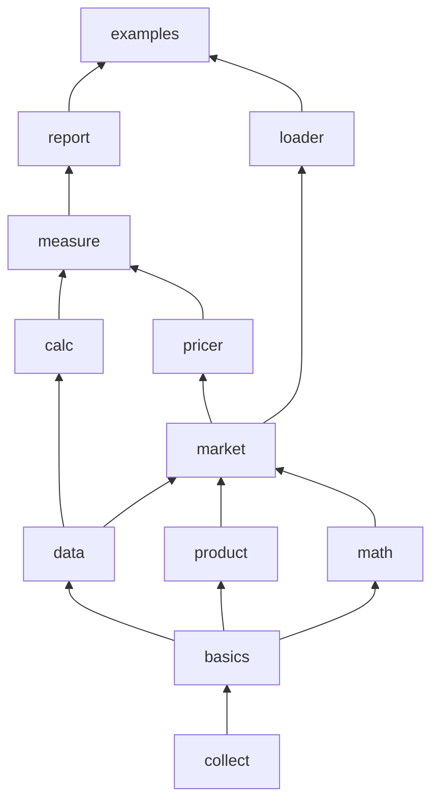

# Modules

Strata is a Maven multi-module build. The root `pom.xml` includes `modules/pom.xml` (the `strata-parent` POM, version 2.12.78-SNAPSHOT) and `examples/`. Each library module is published as its own artifact, `com.opengamma.strata:strata-<module>`, but all modules share one version and are released together.

## Module map

| Module | Language | Main source files | Direct Strata dependencies (compile scope) | Page |
| --- | --- | --- | --- | --- |
| `modules/collect` | Scala 3.9.0 | 114 Scala, 8 Java | none (Guava, Joda-Beans, Joda-Convert) | [collect](collect.md) |
| `modules/basics` | Scala 3.9.0 | 119 Scala, 7 Java | collect | [basics](basics.md) |
| `modules/data` | Java | 41 | collect, basics | [data](data.md) |
| `modules/product` | Java | 435 | collect, basics | [product](product/index.md) |
| `modules/math` | Java | 247 | collect, basics | [math](math.md) |
| `modules/market` | Java | 209 | collect, basics, data, product, math | [market](market.md) |
| `modules/loader` | Java | 69 | collect, basics, data, product, market | [loader](loader.md) |
| `modules/pricer` | Java | 360 | collect, basics, data, product, market (loader in test scope only) | [pricer](pricer/index.md) |
| `modules/calc` | Java | 69 | collect, basics, data | [calc](calc.md) |
| `modules/measure` | Java | 174 | collect, basics, data, calc, product, market, pricer | [measure](measure.md) |
| `modules/report` | Java | 52 | collect, basics, data, calc, product, market, pricer, measure | [report](report.md) |
| `examples` | Java | 47 | collect, loader, measure, report | [examples](examples.md) |

The Java files in `collect` and `basics` are `package-info.java` files and, in `collect`, the build-only helpers under `modules/collect/src/build`. Dependencies come from the `<dependencies>` section of each module POM.

Arrows point from a dependency to the module that uses it. Only the edges that define the layering are drawn.

## Layers

- **Foundation:** `collect` (utilities, arrays, time series, results, I/O) and `basics` (currencies, dates, indices, schedules, reference data). These are the two Scala modules on this branch.
- **Domain models:** `data` (market data containers and scenarios), `product` (trades and products), `math` (numerical methods), `market` (curves, surfaces, sensitivities).
- **Analytics:** `pricer` (pricing models and calibration) and `calc` (the calculation engine, which knows nothing about pricing models).
- **Integration:** `measure` joins `calc` to `pricer` with calculation functions for each product type. `loader` reads CSV and FpML files. `report` formats results.
- **Examples:** `examples` composes everything into runnable programs.

## Where to start

- To add a new product type, start in [product](product/index.md), then add a pricer in [pricer](pricer/index.md) and a calculation function in [measure](measure.md).
- To change how calculations are scheduled or how market data is built, see [calc](calc.md).
- To touch `collect` or `basics`, read [Scala and Java interoperability](../features/scala-java-interop.md) first.

## Related pages

- [Architecture](../overview/architecture.md)
- [Pricing a trade](../features/pricing-a-trade.md)
- [Dependencies](../reference/dependencies.md)
