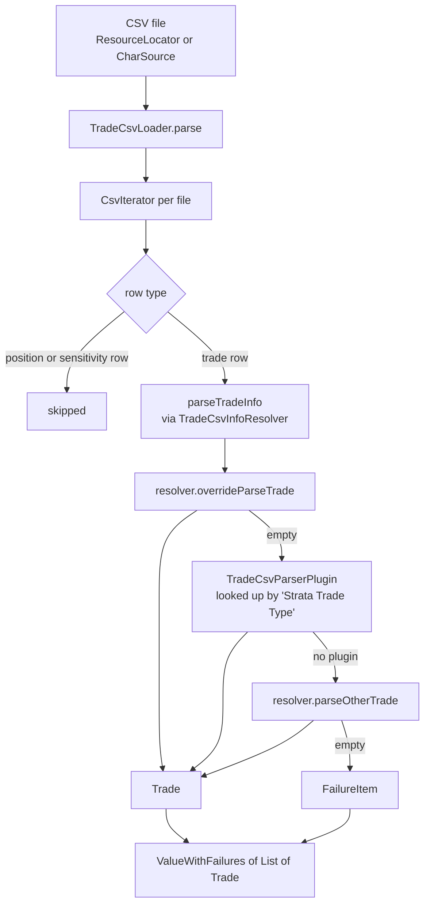

# loader

Active contributors: Stephen Colebourne, Alexis Skitini, Yuki Iwashita

## Purpose

The `loader` module (`strata-loader`) turns files into Strata objects. It reads trades, positions and sensitivities from CSV, market data (quotes, FX rates, fixing series, curves and curve definitions) from CSV, and trades from FpML XML. It also writes trades, sensitivities and curves back to CSV. Parsing of each trade or position type is pluggable through `ExtendedEnum` plugins registered in INI files.

The module depends on [collect](collect.md), [basics](basics.md), [data](data.md), [product](product/index.md) and [market](market.md). Nothing in the library modules depends on it at compile scope; `pricer` uses it in tests (8 test files) and [examples](examples.md) uses it to load sample market data and portfolios.

Module statistics:

| Measure | Value |
| --- | --- |
| Main source files | 69 Java files, plus 4 INI files in `src/main/resources` |
| Test files | 18 Java test classes and 130 test resource files (Java test-to-code ratio about 0.26) |
| Unique committers on `main` since 2022 | 11 (9 humans plus `opengammacibot` and `dependabot[bot]`) |

Compared with `data` and `math`, which have had only a handful of human commits since 2022, the loader changes regularly as CSV formats gain columns and trade types.

## Directory layout

```
modules/loader/src/main/java/com/opengamma/strata/loader/
  LoaderUtils.java            string parsers shared by all loaders (dates, tenors, indices, enums)
  csv/                        CSV loaders, writers, plugins and resolvers (52 files)
  fpml/                       FpML parser API (7 files)
  impl/fpml/                  FpML product parser plugins (8 files, internal)
modules/loader/src/main/resources/META-INF/com/opengamma/strata/config/base/
  TradeCsvParserPlugin.ini    PositionCsvParserPlugin.ini
  TradeCsvWriterPlugin.ini    FpmlParserPlugin.ini
```

## Key abstractions

| Type | Kind | Role |
| --- | --- | --- |
| `TradeCsvLoader` | final class | Entry point for trade CSV files. `standard()`, `of(refData)`, `of(resolver)`; `load(ResourceLocator...)` and `parse(Collection<CharSource>)` return `ValueWithFailures<List<Trade>>`. |
| `PositionCsvLoader` | final class | Entry point for position CSV files (securities, ETD futures and options). Also `parseLightweight`, which needs no reference data. |
| `SensitivityCsvLoader` | final class | Reads `CurveSensitivities` from standard, list or grid format files. |
| `QuotesCsvLoader`, `FxRatesCsvLoader`, `FixingSeriesCsvLoader` | utility classes | Return `ImmutableMap<QuoteId, Double>`, `ImmutableMap<FxRateId, FxRate>` and `ImmutableMap<ObservableId, LocalDateDoubleTimeSeries>`, ready to put into `ImmutableMarketData`. |
| `RatesCurvesCsvLoader`, `LegalEntityRatesCurvesCsvLoader` | utility classes | Read already-built curves (`RatesCurveGroup`, `LegalEntityCurveGroup`) from a groups file, a settings file and node files. `RatesCurvesCsvLoader` can also write them. |
| `RatesCalibrationCsvLoader`, `RatesCurveGroupDefinitionCsvLoader`, `SeasonalityDefinitionCsvLoader` | utility classes | Read curve definitions for calibration (`RatesCurveGroupDefinition`) and inflation seasonality. |
| `TradeCsvParserPlugin` | `ExtendedEnum` interface | Parses one trade type. Declares `tradeTypeNames()` (for example `FRA`), `isAdditionalRow` for multi-row trades, and `parseTrade`. |
| `PositionCsvParserPlugin` | `ExtendedEnum` interface | Parses one position type, keyed by `positionTypeNames()`. |
| `TradeCsvInfoResolver` | interface | Customisation hook for trade parsing: reference data, extra `TradeInfo` attributes, `completeTrade` post-processing per trade type, `overrideParseTrade` and `parseOtherTrade` for custom types. |
| `PositionCsvInfoResolver`, `LightweightPositionCsvInfoResolver` | interfaces | The same hook for positions, including how an ETD contract spec is found. |
| `SensitivityCsvInfoResolver` | interface | Hook for extra sensitivity columns and tenor or curve name checks. |
| `TradeCsvWriter`, `TradeCsvWriterPlugin`, `TradeCsvInfoSupplier` | class, `ExtendedEnum` interface, interface | Write trades to CSV; one writer plugin per trade class, extra columns from the supplier. |
| `SensitivityCsvWriter` | final class | Writes `CurveSensitivities` in standard format. |
| `CsvLoaderColumns`, `CsvLoaderUtils`, `CsvWriterUtils`, `LoaderUtils` | utility classes | Shared column name constants and parse/format helpers. |
| `FpmlDocumentParser` | final class | Entry point for FpML. `of(FpmlPartySelector)` and variants; `parseTrades(ByteSource)` returns `List<Trade>`. |
| `FpmlParserPlugin` | `ExtendedEnum` interface | Parses one FpML product element; its name is the element name, for example `fra`. |
| `FpmlDocument` | final class | Parsed document state (parties, `href` references, reference data) and helpers that convert FpML dates, day counts, business centres and indices to Strata types. |
| `FpmlPartySelector`, `FpmlTradeInfoParserPlugin` | interfaces | Choose which party is "us" (FpML is direction-neutral, Strata trades are not) and build `TradeInfo` from the trade header. |
| `FpmlParseException` | exception | Thrown on invalid or unsupported FpML; extends `ParseFailureException` from `collect`. |

`ValueWithFailures` lives in `modules/collect/src/main/scala/com/opengamma/strata/collect/result/ValueWithFailures.scala`.

## How it works

### Trade CSV loading



1. `TradeCsvLoader` reads each `CharSource` with `CsvIterator` from `collect`. The `Strata Trade Type` column selects the parser. Files may mix trades, positions and sensitivities; rows that are not trades are skipped.
2. At class load, `TradeCsvLoader` builds a map from upper-case type name to plugin by calling `TradeCsvParserPlugin.extendedEnum().lookupAllNormalized()` and expanding each plugin's `tradeTypeNames()`. The plugins come from `TradeCsvParserPlugin.ini`, which lists 15 classes such as `FraTradeCsvPlugin`, `SwapTradeCsvPlugin`, `FxSingleTradeCsvPlugin` and `CdsTradeCsvPlugin`, each exposing a `public static final INSTANCE`.
3. For each trade row, the resolver can claim the row first (`overrideParseTrade`). Otherwise the plugin parses it. Swaps and swaptions can span several rows: the plugin's `isAdditionalRow` pulls following `Variable` rows into the same trade. If no plugin matches, `parseOtherTrade` gets a final chance.
4. Errors never stop the load. A `RuntimeException` from a row, or an unknown type, becomes a `FailureItem` with `FailureReason.PARSING`, the file name and the line number. The caller gets `ValueWithFailures`, with the trades in `getValue()` and the problems in `getFailures()`.

`PositionCsvLoader` follows the same design with `PositionCsvParserPlugin` (`PositionCsvParserPlugin.ini` registers `SecurityPositionCsvPlugin`, `EtdFuturePositionCsvPlugin`, `EtdOptionPositionCsvPlugin` and `SmartPositionCsvPlugin`) and `PositionCsvInfoResolver`. `SensitivityCsvLoader` detects one of three layouts (standard, list or grid) from the headers.

### Market data CSV loading

The market data loaders are static utility classes. They read simple header-driven files and return immutable maps keyed by identifiers from [data](data.md) and [market](market.md). Each can load one valuation date (`load(date, resources)`) or every date in the file (`loadAllDates`). The examples load quotes, fixings and curve definitions this way before running [curve calibration](../features/curve-calibration.md).

### FpML parsing

`FpmlDocumentParser.parseTrades` reads the XML with `XmlFile` from `collect`, builds an `FpmlDocument` (parties, references and the selected "our" party), then for each `trade` element looks for a child element whose name matches a registered `FpmlParserPlugin`. `FpmlParserPlugin.ini` registers eight plugins in `modules/loader/src/main/java/com/opengamma/strata/loader/impl/fpml`: bullet payment, CDS, FRA, FX single leg, FX swap, swap, swaption and term deposit. Unlike the CSV loaders, the FpML parser throws `FpmlParseException` instead of collecting failures. `withLenientMode()` returns a parser that silently ignores FpML elements Strata does not support instead of failing.

### Writing

`TradeCsvWriter.write(trades, appendable)` groups trades by class and asks the matching `TradeCsvWriterPlugin` (registered in `TradeCsvWriterPlugin.ini`, 16 entries) for headers and rows. Many plugin classes implement both `TradeCsvParserPlugin` and `TradeCsvWriterPlugin`, so the read and write formats for a trade type stay together. `SensitivityCsvWriter`, `RatesCurvesCsvLoader.writeCurveSettings`/`writeCurveNodes` and `RatesCurveGroupDefinitionCsvLoader.writeCurveGroupDefinition` cover the other formats.

### The impl package

`com.opengamma.strata.loader.impl` holds only the FpML product plugins. It is excluded from the published Javadoc in `modules/pom.xml` (`excludePackageNames`), and `AGENTS.md` describes it as a private implementation detail. Code outside the module should go through `FpmlDocumentParser` and the plugin interface rather than calling these classes. See [Patterns and conventions](../how-to-contribute/patterns-and-conventions.md#public-api-and-impl-packages).

## Integration points

- **Configuration:** the four INI files use the standard `ExtendedEnum` provider format (`[providers]` and `[alternates]` sections) loaded through `ResourceConfig`. An application can add its own plugins by placing an INI file with the same name in a later configuration directory. See [Reference data and configuration](../features/reference-data-and-configuration.md).
- **Reference data:** trade and position loaders take `ReferenceData` (through the resolver) to look up holiday calendars and securities, for example ETD contract specifications.
- **Outputs into other modules:** trades and positions (`product`), `QuoteId`, `CurveSensitivities`, `RatesCurveGroup` and `RatesCurveGroupDefinition` (`market`), `FxRateId` and `ObservableId` (`data`).
- **Consumers:** `examples` (calibration and pricing examples under `examples/src/main/java/com/opengamma/strata/examples/finance/`) and `pricer` tests.

## Entry points for modification

- **Support a new trade type in CSV:** write a class implementing `TradeCsvParserPlugin` (and usually `TradeCsvWriterPlugin`) with a `public static final INSTANCE`, add it to both INI files, add column names to `CsvLoaderColumns`, and add a `completeTrade` overload and a `parse*Trade` default method to `TradeCsvInfoResolver` if callers need to customise it. `FraTradeCsvPlugin` is a compact example.
- **Capture extra columns without changing Strata:** implement `TradeCsvInfoResolver` (or the position or sensitivity resolver) and pass it to `TradeCsvLoader.of(resolver)`. Use `TradeCsvInfoSupplier` to write the same columns back out.
- **Support a new FpML product:** implement `FpmlParserPlugin` in `modules/loader/src/main/java/com/opengamma/strata/loader/impl/fpml`, name it after the FpML product element, and register it in `FpmlParserPlugin.ini`. Use `FpmlDocument` helpers for conversions.
- **New market data file format:** follow `QuotesCsvLoader` or `FixingSeriesCsvLoader`: static `load`/`parse` methods that take `ResourceLocator` or `CharSource` and return immutable maps.
- **Tests:** test classes are in `modules/loader/src/test/java/com/opengamma/strata/loader/` with sample files under `modules/loader/src/test/resources/`. See [Testing](../how-to-contribute/testing.md).

## Key source files

| File | Contents |
| --- | --- |
| `modules/loader/src/main/java/com/opengamma/strata/loader/csv/TradeCsvLoader.java` | Trade CSV entry point and format documentation |
| `modules/loader/src/main/java/com/opengamma/strata/loader/csv/TradeCsvParserPlugin.java` | Trade parser plugin interface |
| `modules/loader/src/main/java/com/opengamma/strata/loader/csv/TradeCsvInfoResolver.java` | Trade parsing customisation hook |
| `modules/loader/src/main/java/com/opengamma/strata/loader/csv/PositionCsvLoader.java` | Position CSV entry point |
| `modules/loader/src/main/java/com/opengamma/strata/loader/csv/SensitivityCsvLoader.java` | Sensitivity CSV formats |
| `modules/loader/src/main/java/com/opengamma/strata/loader/csv/QuotesCsvLoader.java` | Quotes loader |
| `modules/loader/src/main/java/com/opengamma/strata/loader/csv/RatesCurvesCsvLoader.java` | Curve loader and writer |
| `modules/loader/src/main/java/com/opengamma/strata/loader/csv/RatesCalibrationCsvLoader.java` | Calibration definition loader |
| `modules/loader/src/main/java/com/opengamma/strata/loader/csv/TradeCsvWriter.java` | Trade CSV writer |
| `modules/loader/src/main/java/com/opengamma/strata/loader/csv/CsvLoaderColumns.java` | Column name constants |
| `modules/loader/src/main/java/com/opengamma/strata/loader/fpml/FpmlDocumentParser.java` | FpML entry point |
| `modules/loader/src/main/java/com/opengamma/strata/loader/fpml/FpmlDocument.java` | FpML parse helpers |
| `modules/loader/src/main/java/com/opengamma/strata/loader/impl/fpml/SwapFpmlParserPlugin.java` | Largest FpML product plugin |
| `modules/loader/src/main/java/com/opengamma/strata/loader/LoaderUtils.java` | Shared string parsers |
| `modules/loader/src/main/resources/META-INF/com/opengamma/strata/config/base/TradeCsvParserPlugin.ini` | Trade parser plugin registration |

## Related pages

- [product](product/index.md)
- [market](market.md)
- [data](data.md)
- [examples](examples.md)
- [Curve calibration](../features/curve-calibration.md)
- [Modules](index.md)
