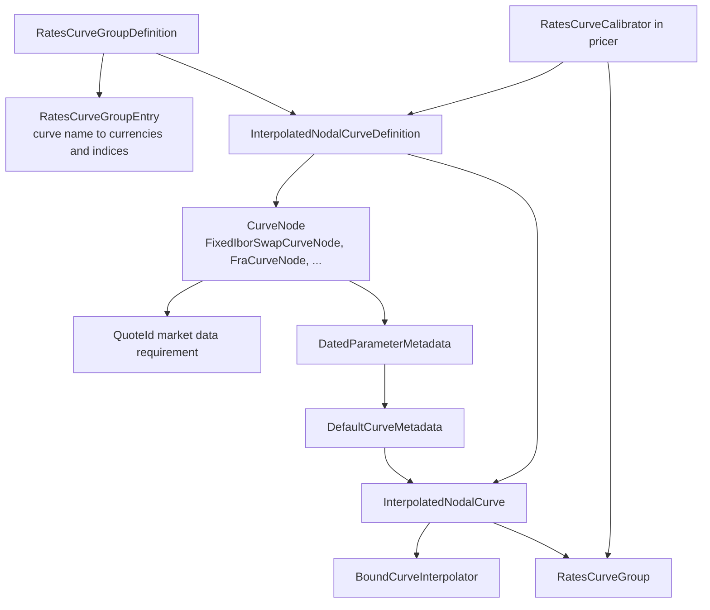

# market

Active contributors: Stephen Colebourne, Yuki Iwashita, Marc Henrard

## Purpose

The `market` module (`strata-market`) holds the data structures that describe a market at a point in time and the sensitivities computed against it. It defines curves, surfaces and cubes, the definitions used to build curves by calibration, the metadata that labels each parameter of those objects, point and parameter sensitivities, quote identifiers, option strike types and the `ExplainMap` used to explain a calculation.

The module contains structures only. It does not price anything and it does not calibrate curves: calibration lives in `modules/pricer` (see [Curve calibration](../features/curve-calibration.md) and [pricer](pricer/index.md)), and the conversion from point sensitivities to parameter sensitivities is done by the providers in `pricer` (see [Sensitivities](../features/sensitivities.md)).

Stats:

| Measure | Value |
| --- | --- |
| Production Java files | 209 (under `modules/market/src/main/java`) |
| Test Java files | 154 (under `modules/market/src/test/java`) |
| Test-to-code file ratio | 0.74 |
| Unique committers on `main` since 2022-01-01 | 7 (6 people plus the `opengammacibot` release bot, which made 176 of the 187 commits) |

The module depends on `strata-collect`, `strata-basics`, `strata-data`, `strata-product` and `strata-math` (`modules/market/pom.xml`). It needs `product` because curve nodes build trades from trade templates, and `math` because the curve interpolators delegate to the spline code in `com.opengamma.strata.math.impl.interpolation`. The `loader`, `pricer`, `measure` and `report` modules depend on it.

## Directory layout

```
modules/market/
├── pom.xml
└── src/
    ├── main/
    │   ├── java/com/opengamma/strata/market/
    │   │   ├── ValueType.java, ShiftType.java, MarketDataView.java,
    │   │   │   GenericDoubleShifts.java, FxRateShifts.java   (6 files at top level)
    │   │   ├── amount/          cash flows and leg amounts (6)
    │   │   ├── cube/            Cube, InterpolatedNodalCube, metadata (10)
    │   │   │   └── interpolator/
    │   │   ├── curve/           Curve, NodalCurve, definitions, groups, ids, metadata (54)
    │   │   │   ├── interpolator/  CurveInterpolator, CurveExtrapolator and implementations (35)
    │   │   │   └── node/          CurveNode implementations per instrument (18)
    │   │   ├── explain/         ExplainKey, ExplainMap, ExplainMapBuilder (4)
    │   │   ├── model/           SabrParameterType, MoneynessType (3)
    │   │   ├── observable/      QuoteId, IndexQuoteId, Quote, LegalEntityInformation (8)
    │   │   ├── option/          Strike, StrikeType and strike implementations (8)
    │   │   ├── param/           ParameterMetadata, ParameterizedData, parameter sensitivities, PointShifts (27)
    │   │   ├── sensitivity/     PointSensitivity, PointSensitivities, builders, CurveSensitivities (10)
    │   │   └── surface/         Surface, InterpolatedNodalSurface, metadata (13)
    │   │       └── interpolator/
    │   └── resources/META-INF/com/opengamma/strata/config/base/
    │       ├── CurveInterpolator.ini
    │       └── CurveExtrapolator.ini
    └── test/java/com/opengamma/strata/market/   (same package layout)
```

## Key abstractions

| Type | Package | Role |
| --- | --- | --- |
| `ParameterizedData` | `param` | Anything described by an indexed list of `double` parameters, each with `ParameterMetadata`. Supports `withParameter` and `withPerturbation`. |
| `ParameterMetadata` | `param` | Label and identifier for one parameter, for example `TenorDateParameterMetadata` (date plus tenor) or `LabelDateParameterMetadata`. `ParameterMetadata.empty()` means "no metadata". |
| `Curve` | `curve` | A `ParameterizedData` that maps x to y. Provides `yValue`, `firstDerivative` and `yValueParameterSensitivity`. |
| `NodalCurve` | `curve` | A curve defined by x and y node arrays. The parameters are the y-values. |
| `InterpolatedNodalCurve` | `curve` | The standard nodal curve: metadata, x-values, y-values, a `CurveInterpolator` and left/right `CurveExtrapolator`s (flat by default). |
| `ConstantCurve`, `ConstantNodalCurve`, `CombinedCurve`, `AddFixedCurve`, `ParallelShiftedCurve`, `HybridNodalCurve`, `InflationNodalCurve`, `ParameterizedFunctionalCurve` | `curve` | Other curve shapes, such as one constant parameter, a sum of two curves, or a curve with seasonality. |
| `CurveMetadata` / `DefaultCurveMetadata` | `curve` | Curve name, x and y `ValueType`, optional list of parameter metadata, and typed extra info (`CurveInfoType`: `DAY_COUNT`, `JACOBIAN`, `COMPOUNDING_PER_YEAR`, `PV_SENSITIVITY_TO_MARKET_QUOTE`, `CDS_INDEX_FACTOR`). |
| `CurveDefinition` / `NodalCurveDefinition` / `InterpolatedNodalCurveDefinition` | `curve` | The recipe for a calibrated curve: name, nodes, value types, interpolator. Builds the metadata and, given parameters, the `Curve`. |
| `CurveNode` | `curve` | One calibration instrument. Knows its market data requirements, its date, its `DatedParameterMetadata`, and how to build the trade that should reprice to zero. Implementations are in `modules/market/src/main/java/com/opengamma/strata/market/curve/node`. |
| `CurveGroupDefinition` / `RatesCurveGroupDefinition` | `curve` | A set of curve definitions calibrated together, with `RatesCurveGroupEntry` rows that map each curve name to discount currencies and indices. |
| `RatesCurveGroup`, `CurveId`, `RatesCurveGroupId` | `curve` | The calibrated result (discount curves by currency, forward curves by index) and the market data ids used to find it. |
| `CurveInterpolator` / `CurveExtrapolator` | `modules/market/src/main/java/com/opengamma/strata/market/curve/interpolator` | Named, `ExtendedEnum`-backed algorithms. `bind(...)` returns a `BoundCurveInterpolator` for a specific set of nodes. |
| `Surface`, `InterpolatedNodalSurface` | `surface` | Two-dimensional `ParameterizedData` (`zValue(x, y)`), typically volatility surfaces. |
| `Cube`, `InterpolatedNodalCube` | `cube` | Three-dimensional `ParameterizedData` (`wValue(x, y, z)`). |
| `PointSensitivity` / `PointSensitivityBuilder` | `sensitivity` | Sensitivity to a single point on a market object (for example a zero rate at a date). Pricers return builders that are combined lazily. |
| `PointSensitivities` / `MutablePointSensitivities` | `sensitivity` | Immutable and mutable lists of point sensitivities. |
| `CurrencyParameterSensitivity` / `CurrencyParameterSensitivities` | `param` | Sensitivity to every parameter of one named market object in one currency, aligned with its parameter metadata. |
| `UnitParameterSensitivity` / `UnitParameterSensitivities` | `param` | The same without a currency, used for derivative of a curve value with respect to its parameters. |
| `CrossGammaParameterSensitivity` | `param` | Second-order (cross gamma) parameter sensitivities. |
| `CurveSensitivities` | `sensitivity` | Typed sensitivities (`ZERO_RATE_DELTA`, `ZERO_RATE_GAMMA`) attached to a portfolio item, as loaded by `loader`. |
| `QuoteId`, `IndexQuoteId` | `observable` | `ObservableId`s for a market quote by `StandardId`, or for the fixing of an `Index`. |
| `Strike`, `StrikeType` | `option` | Strike representations for volatility data: `SimpleStrike`, `DeltaStrike`, `MoneynessStrike`, `LogMoneynessStrike`, `SimpleMoneynessStrike`. |
| `ValueType` | top level | Named type of a value, such as `ZERO_RATE`, `DISCOUNT_FACTOR`, `YEAR_FRACTION`, `BLACK_VOLATILITY`, `SABR_ALPHA`. Used to check that a curve holds what a pricer expects. |
| `ExplainMap` / `ExplainKey` | `explain` | A typed key-value tree that records how a value was calculated (legs, payment periods, rates, discount factors). `ExplainKey` defines 44 standard keys. |

## How it works

### Curves are parameterized data

Every curve, surface and cube implements `ParameterizedData` (`modules/market/src/main/java/com/opengamma/strata/market/param/ParameterizedData.java`). That interface reduces any market object to three things per index: a `double` value (`getParameter`), a `ParameterMetadata` (`getParameterMetadata`), and a way to replace the value (`withParameter`). Generic code can then bump, shift or perturb any market object without knowing its shape. `withPerturbation(ParameterPerturbation)` calls `perturbParameter(index, value, metadata)` for each parameter and rebuilds the object only where the value changed. Scenario shifts such as `PointShifts` in `modules/market/src/main/java/com/opengamma/strata/market/param/PointShifts.java` use this to shift nodes chosen by their metadata identifier.

For an `InterpolatedNodalCurve` the parameters are the y-values; the x-values (usually year fractions) are fixed. The constructor in `modules/market/src/main/java/com/opengamma/strata/market/curve/InterpolatedNodalCurve.java` checks that there are at least two nodes, that x and y arrays have the same length, that x-values are strictly increasing, and that the parameter metadata list (if present) has one entry per node. It then binds the interpolator once:

```java
this.boundInterpolator = interpolator.bind(xValues, yValues, extrapolatorLeft, extrapolatorRight);
```

`yValue(x)`, `firstDerivative(x)` and `yValueParameterSensitivity(x)` all delegate to the bound interpolator. `parameterSensitivity(x)` on `BoundCurveInterpolator` returns the derivative of the interpolated value with respect to each y-value, which the curve wraps into a `UnitParameterSensitivity` carrying its name and parameter metadata.

Interpolators and extrapolators are `Named` extended enums. `modules/market/src/main/resources/META-INF/com/opengamma/strata/config/base/CurveInterpolator.ini` registers the constants of `StandardCurveInterpolators`, so `CurveInterpolator.of("LogLinear")` works from configuration and from CSV curve definitions. `CurveInterpolators` exposes 15 interpolators (for example `LINEAR`, `LOG_LINEAR`, `DOUBLE_QUADRATIC`, `NATURAL_SPLINE`, `PCHIP`, `STEP_UPPER`) and `CurveExtrapolators` exposes 10 extrapolators (for example `FLAT`, `LINEAR`, `EXPONENTIAL`, `EXCEPTION`). The spline implementations call into `modules/math` internals such as `PiecewisePolynomialInterpolator`. See [math](math.md) and [Patterns and conventions](../how-to-contribute/patterns-and-conventions.md#named-and-extensible-types) for how extended enums load.

### Parameter metadata

`ParameterMetadata` (`modules/market/src/main/java/com/opengamma/strata/market/param/ParameterMetadata.java`) has two methods: `getLabel()` for display and `getIdentifier()` for matching. For a `TenorDateParameterMetadata` the identifier is the `Tenor`, so a 5Y node can be found across curves even when its date moves. When a nodal curve has no metadata list, `NodalCurve.getParameterMetadata(i)` falls back to `SimpleCurveParameterMetadata`, built from the x-value type and x-value.

Metadata comes from curve definitions. `InterpolatedNodalCurveDefinition.metadata(valuationDate, refData)` asks each `CurveNode` for its `DatedParameterMetadata` and stores the list in `DefaultCurveMetadata`. The calibrated curve therefore labels each y-value with the instrument that determined it, such as "5Y" for a 5-year swap node.

### From definition to curve



A `RatesCurveGroupDefinition` (`modules/market/src/main/java/com/opengamma/strata/market/curve/RatesCurveGroupDefinition.java`) lists curve definitions, the entries that say which curve discounts which currency and which forwards which index, optional seasonality definitions, and two flags: `computeJacobian` and `computePvSensitivityToMarketQuote`. Each node such as `FixedIborSwapCurveNode` holds a trade template, an `ObservableId` for its quote, an optional spread, a label, a `CurveNodeDate` and a `CurveNodeDateOrder`. From these the node reports its `requirements()`, its date, its metadata and the `trade(...)`/`resolvedTrade(...)` that the calibrator prices.

The calibrator in `pricer` solves for the parameter array and calls `CurveDefinition.curve(valuationDate, metadata, parameters)`, which for `InterpolatedNodalCurveDefinition` converts node dates to times using the day count and builds an `InterpolatedNodalCurve`. When requested, the calibrator stores a `JacobianCalibrationMatrix` and the PV sensitivity to market quotes in the curve metadata under `CurveInfoType.JACOBIAN` and `CurveInfoType.PV_SENSITIVITY_TO_MARKET_QUOTE`. The calibrated curves are grouped as a `RatesCurveGroup`, and individual curves are found in `MarketData` by `CurveId` (group name, curve name, observable source).

### How sensitivities attach to parameter metadata

Sensitivities come in two layers.

1. Point sensitivities. A pricer returns a `PointSensitivityBuilder` describing the sensitivity of a value to individual points, for example the zero rate of the GBP discount curve at one date. The concrete point types (`ZeroRateSensitivity`, `IborRateSensitivity`, `FxOptionSensitivity` and others) are in `modules/pricer`; this module only defines the interfaces. Builders combine without copying through `combinedWith` and `buildInto(MutablePointSensitivities)`, and `build()` produces an immutable `PointSensitivities`.
2. Parameter sensitivities. A provider projects each point onto the parameters of the curve it refers to. `RatesProvider.parameterSensitivity(PointSensitivities)` in `modules/pricer/src/main/java/com/opengamma/strata/pricer/rate/RatesProvider.java` does this per point type, and the underlying curve supplies `yValueParameterSensitivity` and `createParameterSensitivity(currency, sensitivities)`.

`Curve.createParameterSensitivity(Currency, DoubleArray)` builds a `CurrencyParameterSensitivity` (`modules/market/src/main/java/com/opengamma/strata/market/param/CurrencyParameterSensitivity.java`) from the curve name, the curve's parameter metadata list, the currency and the sensitivity array. Its validator requires the array and the metadata list to have the same length, so every number is tied to a labelled parameter. `CurrencyParameterSensitivities` merges entries with the same market data name and currency, converts currency through `FxRateProvider`, and totals them. Useful operations include:

- `sensitivities()` streams pairs of metadata and value.
- `toSensitivityMap(Tenor.class)` keys values by the metadata identifier.
- `combine(name, ...)` concatenates several sensitivities into one and records a `ParameterSize` split; `split()` reverses it.

The full workflow (PV01, bucketed PV01, market quote sensitivity through the Jacobian) is covered in [Sensitivities](../features/sensitivities.md).

### Surfaces, cubes, observables, options and explain

Surfaces and cubes follow the curve pattern: `Surface` (`zValue`, `zValueParameterSensitivity`, `firstPartialDerivatives`) and `Cube` (`wValue`, `wValueParameterSensitivity`) extend `ParameterizedData`, carry `SurfaceMetadata` or `CubeMetadata`, and have nodal implementations that bind a `SurfaceInterpolator` or `CubeInterpolator`. Pricer volatility classes in `modules/pricer` wrap these with expiry and strike conventions.

`QuoteId` identifies a quote by `StandardId`, `FieldName` and `ObservableSource`; `IndexQuoteId` identifies the observed value of an `Index`. Curve nodes declare these as requirements, and loaders populate them.

The `option` package gives strikes a type (`StrikeType.STRIKE`, `DELTA`, `MONEYNESS`, `LOG_MONEYNESS`, `SIMPLE_MONEYNESS`), and `model` holds `SabrParameterType` and `MoneynessType` used by SABR and volatility code.

`ExplainMap` (`modules/market/src/main/java/com/opengamma/strata/market/explain/ExplainMap.java`) is built by pricers' `explainPresentValue` methods through `ExplainMapBuilder`. Values are retrieved by typed `ExplainKey`s, nested maps represent legs and periods, and `explanationString()` renders the tree as text.

## Integration points

| Module | How it uses `market` |
| --- | --- |
| [data](data.md) | Supplies `MarketDataId`, `MarketDataName`, `ObservableId`, `ObservableSource`, `MarketData` and scenario types that `market` ids and shifts implement. |
| [product](product/index.md) | Curve nodes hold trade templates and return `Trade`/`ResolvedTrade` from `product`. |
| [math](math.md) | Interpolators use spline and matrix code from `modules/math/src/main/java/com/opengamma/strata/math/impl`. |
| [pricer](pricer/index.md) | Implements point sensitivity types, wraps curves in `DiscountFactors` and index rates, calibrates `CurveDefinition`s and produces `CurrencyParameterSensitivities` and `ExplainMap`s. |
| [measure](measure.md) | Market data functions turn `RatesCurveGroupDefinition` and quotes into `RatesCurveGroup` and curves inside the engine; measures return parameter sensitivities. |
| [loader](loader.md) | Loads quotes (`QuoteId`), curve definitions and nodes, and sensitivities (`CurveSensitivities`) from CSV. |
| [report](report.md) | Formats sensitivities and explain maps. |

## Entry points for modification

- New interpolator: implement `CurveInterpolator` and `BoundCurveInterpolator` (subclassing `AbstractBoundCurveInterpolator`), add a constant to `StandardCurveInterpolators` and `CurveInterpolators`. The INI file already loads all constants from `StandardCurveInterpolators`.
- New calibration instrument: add a `CurveNode` implementation in `modules/market/src/main/java/com/opengamma/strata/market/curve/node` modelled on `FixedIborSwapCurveNode`. Calibration support may also need changes in `pricer` (see [Curve calibration](../features/curve-calibration.md)).
- New parameter metadata: implement `ParameterMetadata` as a Joda-Bean with a stable `getIdentifier()`; implement `DatedParameterMetadata` or `TenoredParameterMetadata` if the parameter has a date or tenor.
- New curve shape: implement `Curve` or `NodalCurve`, keep `getParameterCount`, `getParameterMetadata` and `withParameter` consistent, and override `split()`/`withUnderlyingCurve` if the curve combines other curves.
- New explain entry: add an `ExplainKey` constant in `modules/market/src/main/java/com/opengamma/strata/market/explain/ExplainKey.java`.

All public types here are Joda-Beans or immutable classes; follow [Patterns and conventions](../how-to-contribute/patterns-and-conventions.md) and regenerate the bean code after changing properties.

## Key source files

| File | Purpose |
| --- | --- |
| `modules/market/src/main/java/com/opengamma/strata/market/param/ParameterizedData.java` | Base contract for any object described by parameters |
| `modules/market/src/main/java/com/opengamma/strata/market/param/ParameterMetadata.java` | Label and identifier of a parameter |
| `modules/market/src/main/java/com/opengamma/strata/market/param/CurrencyParameterSensitivity.java` | Sensitivity to all parameters of one market object in one currency |
| `modules/market/src/main/java/com/opengamma/strata/market/param/CurrencyParameterSensitivities.java` | Collection of parameter sensitivities with merge, FX conversion and totals |
| `modules/market/src/main/java/com/opengamma/strata/market/curve/Curve.java` | Curve interface |
| `modules/market/src/main/java/com/opengamma/strata/market/curve/NodalCurve.java` | Curve defined by nodes |
| `modules/market/src/main/java/com/opengamma/strata/market/curve/InterpolatedNodalCurve.java` | Standard interpolated curve |
| `modules/market/src/main/java/com/opengamma/strata/market/curve/CurveMetadata.java` | Curve name, value types, parameter metadata and info |
| `modules/market/src/main/java/com/opengamma/strata/market/curve/CurveDefinition.java` | Recipe for building a calibrated curve |
| `modules/market/src/main/java/com/opengamma/strata/market/curve/InterpolatedNodalCurveDefinition.java` | Standard nodal curve definition |
| `modules/market/src/main/java/com/opengamma/strata/market/curve/CurveNode.java` | Calibration instrument contract |
| `modules/market/src/main/java/com/opengamma/strata/market/curve/RatesCurveGroupDefinition.java` | Group of rates curves calibrated together |
| `modules/market/src/main/java/com/opengamma/strata/market/curve/interpolator/CurveInterpolators.java` | Standard interpolator constants |
| `modules/market/src/main/java/com/opengamma/strata/market/sensitivity/PointSensitivityBuilder.java` | Lazy builder for point sensitivities |
| `modules/market/src/main/java/com/opengamma/strata/market/sensitivity/PointSensitivities.java` | Immutable list of point sensitivities |
| `modules/market/src/main/java/com/opengamma/strata/market/surface/Surface.java` | Surface interface |
| `modules/market/src/main/java/com/opengamma/strata/market/observable/QuoteId.java` | Quote identifier |
| `modules/market/src/main/java/com/opengamma/strata/market/explain/ExplainMap.java` | Calculation explanation tree |
| `modules/market/src/main/java/com/opengamma/strata/market/ValueType.java` | Named value types |

## Related pages

- [Modules](index.md)
- [pricer](pricer/index.md)
- [Curve calibration](../features/curve-calibration.md)
- [Sensitivities](../features/sensitivities.md)
- [Scenarios](../features/scenarios.md)
- [data](data.md)
- [Glossary](../overview/glossary.md)
