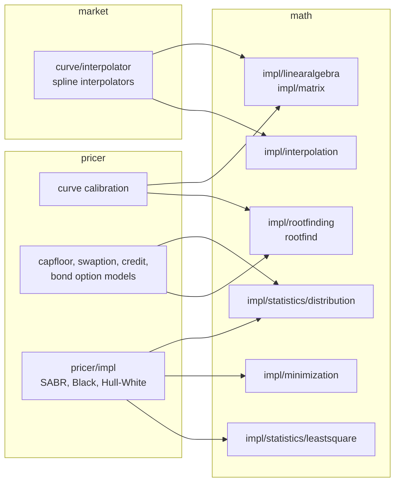

# math

Active contributors: Stephen Colebourne, Guillaume Santoro, Alexis Skitini

## Purpose

The `math` module (`strata-math`) holds the numerical methods that curve construction, calibration and option pricing need: polynomial and spline interpolation, root finding, minimisation and parameter transforms, linear algebra decompositions, numerical differentiation and integration, special functions, probability distributions, descriptive statistics and least-squares fitting.

Its package documentation (`modules/math/src/main/java/com/opengamma/strata/math/package-info.java`) states that the module is intended for internal use. Almost all of the code sits under `com.opengamma.strata.math.impl`, and applications should not depend on the `impl` packages. The small public surface is `MathException`, `MathUtils`, the `linearalgebra` package and the `rootfind` package. The module depends on [collect](collect.md) (for `DoubleArray` and `DoubleMatrix`), [basics](basics.md) and Apache `commons-math3`.

Module statistics:

| Measure | Value |
| --- | --- |
| Main source files | 247 Java files |
| Test files | 159 Java files (test-to-code ratio about 0.64) |
| Unique committers on `main` since 2022 | 4 (3 humans plus the `opengammacibot` release bot) |
| Files under `impl` that import `org.apache.commons.math3` | 27 |

## Directory layout

All paths are under `modules/math/src/main/java/com/opengamma/strata/math/`.

| Package | Files | Contents |
| --- | --- | --- |
| `math` (root) | 3 | `MathException`, `MathUtils` (`pow2`, `pow3`, `nearZero`, `nearOne`), `package-info.java` |
| `linearalgebra` | 3 | Public `Decomposition<R>` (a `Function<DoubleMatrix, R>`) and `DecompositionResult` |
| `rootfind` | 2 | Public `NewtonVectorRootFinder` with `broyden()` factories |
| `impl` (root) | 17 | Complex numbers, `FunctionUtils`, `TrigonometricFunctionUtils`, and the subpackages below |
| `modules/math/src/main/java/com/opengamma/strata/math/impl/interpolation` | 36 | Cubic splines (natural, clamped, not-a-knot), monotonicity and non-negativity preserving splines, Hermite splines, `PiecewisePolynomialInterpolator`, `PiecewisePolynomialResult`, B-spline basis functions, `PSplineFitter`, `PenaltyMatrixGenerator`, Smith-Wilson |
| `modules/math/src/main/java/com/opengamma/strata/math/impl/rootfinding` | 15 + 14 | Single root finders (`BrentSingleRootFinder`, `RidderSingleRootFinder`, `BisectionSingleRootFinder`, `NewtonRaphsonSingleRootFinder`), `BracketRoot`, polynomial root finders; `newton/` holds Newton, Broyden and Sherman-Morrison vector root finders |
| `modules/math/src/main/java/com/opengamma/strata/math/impl/minimization` | 15 | `GoldenSectionMinimizer1D`, bracketing, and parameter transforms (`ParameterLimitsTransform`, `SingleRangeLimitTransform`, `DoubleRangeLimitTransform`, `UncoupledParameterTransforms`, `NonLinearTransformFunction`) |
| `modules/math/src/main/java/com/opengamma/strata/math/impl/linearalgebra` | 19 | Cholesky, LU, QR and SV decompositions (Commons-backed and OpenGamma versions), `DecompositionFactory`, tridiagonal solver |
| `modules/math/src/main/java/com/opengamma/strata/math/impl/matrix` | 4 | `MatrixAlgebra` with `CommonsMatrixAlgebra` and `OGMatrixAlgebra`, `MatrixAlgebraFactory` |
| `modules/math/src/main/java/com/opengamma/strata/math/impl/statistics` | 3 + 25 + 16 + 7 | `descriptive/` (mean, variance, quantile methods), `distribution/` (`NormalDistribution`, `BivariateNormalDistribution`, `NonCentralChiSquaredDistribution`, Student-t, gamma), `leastsquare/` (`NonLinearLeastSquare`, `NonLinearLeastSquareWithPenalty`, `LeastSquareResults`) |
| `modules/math/src/main/java/com/opengamma/strata/math/impl/differentiation` | 8 | Finite-difference differentiators for scalar, vector and matrix fields (`FiniteDifferenceType`) |
| `modules/math/src/main/java/com/opengamma/strata/math/impl/integration` | 21 | Gaussian quadratures (Legendre, Laguerre, Hermite, Jacobi), Romberg, Simpson, Runge-Kutta, adaptive composite, 2D integrators |
| `modules/math/src/main/java/com/opengamma/strata/math/impl/function` | 15 + 13 | `VectorFunction`, `ParameterizedCurve`, piecewise polynomial functions; `special/` (gamma, incomplete beta, orthogonal polynomials) |
| `modules/math/src/main/java/com/opengamma/strata/math/impl/regression` | 7 | Ordinary, weighted and generalized least-squares regression |
| `modules/math/src/main/java/com/opengamma/strata/math/impl/random` | 2 | `NormalRandomNumberGenerator` |
| `modules/math/src/main/java/com/opengamma/strata/math/impl/cern` | 17 | Code copied from the CERN Colt library (`MersenneTwister`, `Gamma`, `Bessel`, `Normal`, `StudentT`) with its original licence header |
| `modules/math/src/main/java/com/opengamma/strata/math/impl/util` | 3 | `CommonsMathWrapper`, `Epsilon`, `Diff` |

## Key abstractions

| Type | Package | Role |
| --- | --- | --- |
| `NewtonVectorRootFinder` | `rootfind` (public) | Multi-dimensional root finding with an optional Jacobian. `broyden()` returns a Broyden finder using SV decomposition. |
| `Decomposition<R>`, `DecompositionResult` | `linearalgebra` (public) | Matrix decomposition contract used to solve linear systems. |
| `MathException` | root (public) | Runtime exception for numerical failures such as non-convergence. |
| `PiecewisePolynomialInterpolator`, `PiecewisePolynomialResult` | `modules/math/src/main/java/com/opengamma/strata/math/impl/interpolation` | Spline construction and the resulting polynomial coefficients, with a `WithSensitivity` variant that also returns node sensitivities. |
| `RealSingleRootFinder`, `BracketRoot` | `modules/math/src/main/java/com/opengamma/strata/math/impl/rootfinding` | One-dimensional root finding, used to solve for implied volatilities and par rates. |
| `NonLinearLeastSquare` | `modules/math/src/main/java/com/opengamma/strata/math/impl/statistics/leastsquare` | Levenberg-Marquardt style fitting, used by SABR calibration. |
| `ParameterLimitsTransform` | `modules/math/src/main/java/com/opengamma/strata/math/impl/minimization` | Maps constrained model parameters to an unconstrained space for fitting. |
| `MatrixAlgebra` | `modules/math/src/main/java/com/opengamma/strata/math/impl/matrix` | Matrix multiply, inverse, transpose and norms over `DoubleMatrix`. |
| `ProbabilityDistribution`, `NormalDistribution` | `modules/math/src/main/java/com/opengamma/strata/math/impl/statistics/distribution` | CDF, PDF and inverse CDF for option models. |
| `VectorFieldFirstOrderDifferentiator` | `modules/math/src/main/java/com/opengamma/strata/math/impl/differentiation` | Finite-difference Jacobians when an analytic Jacobian is not available. |

## How it works

The module is a library of independent algorithms rather than a pipeline. The usual call pattern is: a pricer or curve interpolator in a higher module creates an `impl` object (often a stateless instance held in a `static final` field), passes in `DoubleArray`/`DoubleMatrix` data or a `Function`, and reads back a result object. Several algorithms delegate to Apache Commons Math through `modules/math/src/main/java/com/opengamma/strata/math/impl/util/CommonsMathWrapper.java` and the `*Commons` decomposition classes.

### The impl package rule

`modules/math/src/main/java/com/opengamma/strata/math/package-info.java` says applications should not depend on the `impl` packages. The parent POM enforces the documentation side of this: the Javadoc plugin in `modules/pom.xml` lists `com.opengamma.strata.math.impl` in `excludePackageNames` (alongside `loader.impl`, `pricer.impl` and `examples`), so these packages do not appear in the published API docs. Other Strata modules do import `math.impl` freely; the rule is about external users, who get no compatibility promise for these classes. See [Patterns and conventions](../how-to-contribute/patterns-and-conventions.md#public-api-and-impl-packages).

## Integration points

Counts below are import statements in `src/main/java` of each consuming module. `measure`, `loader`, `calc` and `report` do not import `math` at all.

**market** (55 imports, all but one into `impl`):

- `impl.interpolation`: 35 imports, mainly `PiecewisePolynomialResult`, `PiecewisePolynomialResultsWithSensitivity`, `PiecewisePolynomialInterpolator`, `NaturalSplineInterpolator`, `LogNaturalSplineHelper`, `MonotonicityPreservingCubicSplineInterpolator`. The users are curve interpolators in `modules/market/src/main/java/com/opengamma/strata/market/curve/interpolator/`, for example `NaturalSplineCurveInterpolator.java`, `LogNaturalSplineDiscountFactorCurveInterpolator.java`, `PiecewiseCubicHermiteMonotonicityCurveInterpolator.java` and `ProductNaturalSplineCurveInterpolator.java`.
- `impl.matrix` (`OGMatrixAlgebra`, `MatrixAlgebra`), `impl.function` (`PiecewisePolynomialWithSensitivityFunction1D`), `impl.FunctionUtils`, and `impl.linearalgebra` (`TridiagonalMatrix`, `InverseTridiagonalMatrixCalculator`).

**pricer** (112 imports in 35 files; 13 of those files are in `modules/pricer/src/main/java/com/opengamma/strata/pricer/impl`, the rest in `bond`, `capfloor`, `cms`, `credit`, `curve`, `sensitivity` and `swaption`):

- `impl.rootfinding` (24): `BracketRoot`, `BrentSingleRootFinder`, `RealSingleRootFinder`, `NewtonRaphsonSingleRootFinder`, `RidderSingleRootFinder`.
- `impl.minimization` (23): parameter transforms used when fitting model parameters.
- `impl.statistics.leastsquare` (14) and `impl.statistics.distribution` (14): `NonLinearLeastSquare`, `NormalDistribution`, `ProbabilityDistribution`.
- `impl.matrix` (14), `impl.linearalgebra` (6), `impl.differentiation` (6), plus single uses of `impl.integration.RungeKuttaIntegrator1D`, `impl.util.Epsilon` and `impl.interpolation.PenaltyMatrixGenerator`.
- Public API: `rootfind.NewtonVectorRootFinder`, `linearalgebra.DecompositionResult` and `MathException`. The first two appear in `modules/pricer/src/main/java/com/opengamma/strata/pricer/curve/RatesCurveCalibrator.java`, `modules/pricer/src/main/java/com/opengamma/strata/pricer/credit/AnalyticSpreadSensitivityCalculator.java` and `modules/pricer/src/main/java/com/opengamma/strata/pricer/impl/option/SabrExtrapolationRightFunction.java`.

`pricer` also depends on `math` transitively through `market`.

## Entry points for modification

- **New interpolation scheme for curves:** implement the algorithm in `modules/math/src/main/java/com/opengamma/strata/math/impl/interpolation` only if it is general, then add the curve-facing `CurveInterpolator` in `market` (see [market](market.md)).
- **New root finder or minimiser:** extend `RealSingleRootFinder` or the `Minimizer` interfaces under `impl`. Keep inputs and outputs as `DoubleArray`/`DoubleMatrix` from `collect`.
- **Changing a public class:** `MathException`, `MathUtils`, `Decomposition`, `DecompositionResult` and `NewtonVectorRootFinder` are the only types with an API promise; treat signature changes there as breaking.
- **Precision-sensitive changes:** many tests compare to fixed tolerances. Run the `math` tests and the `pricer` and `market` tests that use the changed class, see [Testing](../how-to-contribute/testing.md).

## Key source files

| File | Contents |
| --- | --- |
| `modules/math/src/main/java/com/opengamma/strata/math/package-info.java` | States the internal-use and `impl` rule |
| `modules/math/src/main/java/com/opengamma/strata/math/rootfind/NewtonVectorRootFinder.java` | Public multi-dimensional root finder |
| `modules/math/src/main/java/com/opengamma/strata/math/linearalgebra/Decomposition.java` | Public decomposition interface |
| `modules/math/src/main/java/com/opengamma/strata/math/impl/interpolation/PiecewisePolynomialInterpolator.java` | Base for spline interpolators |
| `modules/math/src/main/java/com/opengamma/strata/math/impl/interpolation/NaturalSplineInterpolator.java` | Natural cubic spline used by curve interpolators |
| `modules/math/src/main/java/com/opengamma/strata/math/impl/rootfinding/BrentSingleRootFinder.java` | Brent's method |
| `modules/math/src/main/java/com/opengamma/strata/math/impl/rootfinding/newton/BroydenVectorRootFinder.java` | Broyden vector root finder |
| `modules/math/src/main/java/com/opengamma/strata/math/impl/statistics/leastsquare/NonLinearLeastSquare.java` | Non-linear least squares |
| `modules/math/src/main/java/com/opengamma/strata/math/impl/statistics/distribution/NormalDistribution.java` | Normal distribution |
| `modules/math/src/main/java/com/opengamma/strata/math/impl/matrix/MatrixAlgebra.java` | Matrix algebra abstraction |
| `modules/math/src/main/java/com/opengamma/strata/math/impl/util/CommonsMathWrapper.java` | Conversions to and from Apache Commons Math types |
| `modules/math/pom.xml` | Dependencies: collect, basics, commons-math3 |

## Related pages

- [market](market.md)
- [pricer](pricer/index.md)
- [Curve calibration](../features/curve-calibration.md)
- [Patterns and conventions](../how-to-contribute/patterns-and-conventions.md)
- [Modules](index.md)
