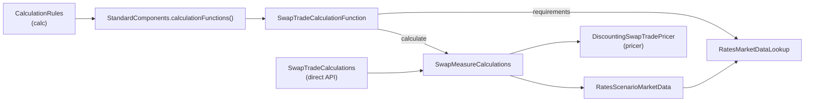

# measure

Active contributors: Stephen Colebourne, Yuki Iwashita, Guillaume Santoro

## Purpose

The `measure` module connects the calculation engine in [calc](calc.md) to the pricers in [pricer](pricer/index.md). It defines the standard measures (present value, PV01, par rate and so on), one calculation function for each supported trade or position type, and the market data functions that build curves, FX rates and FX volatilities inside the engine. `StandardComponents` collects all of these so that an application can price a mixed portfolio with a single call.

The module also exposes a direct API. Each asset-class package has a public `*TradeCalculations` class that computes the same measures for one resolved trade, without going through the engine.

Stats: 175 main files (174 Java sources plus one INI file), 84 test files, a test-to-code ratio of about 0.48, and 8 unique committers on `main` since 2022 (7 people plus the `opengammacibot` release account).

## Directory layout

All Java sources are under `modules/measure/src/main/java/com/opengamma/strata/measure/`.

| Path | Contents |
| --- | --- |
| `measure/` (root) | `Measures`, `AdvancedMeasures`, package-private `StandardMeasures`, `StandardComponents`, `ValuationZoneTimeDefinition` |
| `modules/measure/src/main/java/com/opengamma/strata/measure/calc/` | Extra calculation parameters: `TargetTypeCalculationParameter`, `TradeCounterpartyCalculationParameter` |
| `modules/measure/src/main/java/com/opengamma/strata/measure/rate/` | `RatesMarketDataLookup` and its views, plus `RatesCurveGroupMarketDataFunction` and `RatesCurveInputsMarketDataFunction` |
| `modules/measure/src/main/java/com/opengamma/strata/measure/curve/` | `CurveMarketDataFunction` and `RootFinderConfig` |
| `modules/measure/src/main/java/com/opengamma/strata/measure/fx/` | FX single, FX swap and FX NDF functions, `FxRateMarketDataFunction`, `FxRateConfig` |
| `modules/measure/src/main/java/com/opengamma/strata/measure/fxopt/` | Vanilla and barrier FX option functions, `FxOptionMarketDataLookup`, FX volatility definitions and `FxOptionVolatilitiesMarketDataFunction` |
| `modules/measure/src/main/java/com/opengamma/strata/measure/swaption/` | Swaption function and `SwaptionMarketDataLookup` |
| `modules/measure/src/main/java/com/opengamma/strata/measure/capfloor/` | Ibor cap/floor function and `IborCapFloorMarketDataLookup` |
| `modules/measure/src/main/java/com/opengamma/strata/measure/bond/` | Fixed coupon bond, capital indexed bond, bill, bond future and bond future option functions; `LegalEntityDiscountingMarketDataLookup`; `BondFutureOptionMarketDataLookup` |
| `modules/measure/src/main/java/com/opengamma/strata/measure/credit/` | CDS and CDS index functions, `CreditMeasures`, `CreditRatesMarketDataLookup` |
| `modules/measure/src/main/java/com/opengamma/strata/measure/index/` | Ibor and overnight futures and future options, with their option lookups |
| `modules/measure/src/main/java/com/opengamma/strata/measure/swap/`, `fra/`, `deposit/`, `dsf/`, `cms/`, `payment/` | Functions for swaps, FRAs, term deposits, deliverable swap futures, CMS and bullet payments |
| `modules/measure/src/main/java/com/opengamma/strata/measure/security/` | Functions for generic securities and positions priced from a quoted price |
| `modules/measure/src/main/resources/META-INF/com/opengamma/strata/config/base2/Measure.ini` | Registers `StandardMeasures` and `StandardCreditMeasures` as providers of the `Measure` extended enum |

Tests mirror this layout under `modules/measure/src/test/java/com/opengamma/strata/measure/`.

## Key abstractions

| Type | Role |
| --- | --- |
| `Measures` | Public constants for the standard measures, such as `PRESENT_VALUE`, `PV01_CALIBRATED_BUCKETED`, `PAR_RATE`, `CASH_FLOWS`, `CURRENCY_EXPOSURE` and `RESOLVED_TARGET` |
| `AdvancedMeasures` | Rarely needed measures: `PV01_SEMI_PARALLEL_GAMMA_BUCKETED` and `PV01_SINGLE_NODE_GAMMA_BUCKETED` |
| `CreditMeasures` | Credit-specific measures such as `CS01_PARALLEL`, `IR01_CALIBRATED_BUCKETED`, `RECOVERY01`, `JUMP_TO_DEFAULT` |
| `StandardComponents` | Static access to `calculationFunctions()`, `marketDataFunctions()` and `marketDataFactory()` |
| `*TradeCalculationFunction` | Implements `CalculationFunction<T>` from `calc` for one target type. Declares supported measures, market data requirements and calculates results for all scenarios |
| `*MeasureCalculations` | Package-private, multi-scenario implementation of each measure; calls the pricer once per scenario |
| `*TradeCalculations` | Public direct API with single-scenario and multi-scenario methods taking a `Resolved*Trade` |
| `RatesMarketDataLookup` | A `CalculationParameter` that maps currencies to discount curve IDs and indices to forward curve IDs, and turns market data into a `RatesProvider` |
| `RatesScenarioMarketData` / `RatesMarketData` | Scenario and single-scenario views of market data filtered through a `RatesMarketDataLookup` |
| `RatesCurveGroupMarketDataFunction` | Market data function that calibrates a `RatesCurveGroupDefinition` into a `RatesCurveGroup` |

## How it works

Every built-in function follows the same shape. `SwapTradeCalculationFunction` (`modules/measure/src/main/java/com/opengamma/strata/measure/swap/SwapTradeCalculationFunction.java`) is a good one to read first:

1. A static `ImmutableMap<Measure, SingleMeasureCalculation>` maps each supported measure to a method reference on `SwapMeasureCalculations.DEFAULT`. `supportedMeasures()` returns the key set.
2. `requirements(...)` reads the `RatesMarketDataLookup` from the `CalculationParameters` and asks it for the curves needed by the trade's currencies and indices.
3. `calculate(...)` resolves the trade once with `ReferenceData`, builds a `RatesScenarioMarketData` view with `ratesLookup.marketDataView(scenarioMarketData)`, then loops over the requested measures.
4. Each measure is wrapped in `Result.of(...)`, so a pricing exception becomes a failure for that cell. An unknown measure returns `Result.failure(FailureReason.UNSUPPORTED, ...)`.

Security-based products (bond futures, DSFs, bills, fixed coupon bonds and others) use a generic function class with two public instances, `TRADE` and `POSITION`, so the same code handles both trades and positions.

### Market data functions

`StandardComponents.marketDataFunctions()` returns five `MarketDataFunction` implementations that the engine's `MarketDataFactory` uses to build derived market data from observable inputs:

- `RatesCurveInputsMarketDataFunction` gathers the quotes needed to calibrate one curve into a `RatesCurveInputs`.
- `RatesCurveGroupMarketDataFunction` calibrates a whole group with `RatesCurveCalibrator`. It reads the `RatesCurveGroupDefinition` from `MarketDataConfig`, uses an optional `RootFinderConfig` for tolerances (defaults: 1e-9 absolute, 1e-9 relative, 1000 steps), and builds one curve group per scenario when inputs or valuation dates vary by scenario.
- `CurveMarketDataFunction` does not calibrate. It extracts a single `Curve` by name from an already built `RatesCurveGroup`.
- `FxRateMarketDataFunction` builds `FxRate` values from quotes, using `FxRateConfig` to map currency pairs to quote IDs.
- `FxOptionVolatilitiesMarketDataFunction` builds `FxOptionVolatilities` from an `FxOptionVolatilitiesDefinition`.

See [Curve calibration](../features/curve-calibration.md) for the calibration side of this flow.

### Lookups

A lookup tells a calculation function which market data IDs to use. It is passed to the engine as a `CalculationParameter`, usually through `CalculationRules.of(functions, lookup...)`. The main lookups are:

- `RatesMarketDataLookup`: discount and forward curves. Factory methods accept explicit ID maps, a `RatesCurveGroup`, or a `RatesCurveGroupDefinition`.
- `LegalEntityDiscountingMarketDataLookup`: issuer and repo curves for bonds.
- `CreditRatesMarketDataLookup`: credit and discount curves for CDS products.
- `FxOptionMarketDataLookup`, `SwaptionMarketDataLookup`, `IborCapFloorMarketDataLookup`, `IborFutureOptionMarketDataLookup`, `OvernightFutureOptionMarketDataLookup`, `BondFutureOptionMarketDataLookup`: volatilities for option products.

Each lookup has a `Default*` implementation (a Joda-Bean) and `marketDataView(...)` methods that return a `*ScenarioMarketData` or `*MarketData` view. `TargetTypeCalculationParameter` lets you supply a different lookup for each target type.

## Integration points

- Implements `CalculationFunction`, `CalculationParameter` and `MarketDataFunction` from [calc](calc.md).
- Calls pricers and calibrators from [pricer](pricer/index.md), such as `DiscountingSwapTradePricer` and `RatesCurveCalibrator`.
- Uses curve, sensitivity and explain types from [market](market.md), and trade types from [product](product/index.md).
- [report](report.md) uses `StandardComponents.calculationFunctions()` as the default in `ReportCalculationResults.of(...)` and `Measures.EXPLAIN_PRESENT_VALUE` for cash flow reports.
- The [examples](examples.md) module builds `CalculationRules` from `StandardComponents` and a `RatesMarketDataLookup`.

## Entry points for modification

### Adding a measure for a new product

1. Make sure the product, its trade, and a resolved trade exist in [product](product/index.md), and a pricer exists in [pricer](pricer/index.md).
2. Create a package under `modules/measure/src/main/java/com/opengamma/strata/measure/`, or use the matching asset-class package.
3. Add a package-private `XxxMeasureCalculations` class with a `DEFAULT` instance and one multi-scenario method per measure. Copy the structure of `SwapMeasureCalculations`.
4. Add a public `XxxTradeCalculations` class that delegates to it, offering single-scenario and `*ScenarioArray` methods.
5. Add `XxxTradeCalculationFunction implements CalculationFunction<XxxTrade>` with the measure-to-method map, `requirements(...)` and `calculate(...)`. For a security-based product, follow `BondFutureTradeCalculationFunction` with `TRADE` and `POSITION` instances.
6. If the product needs data that no lookup covers, add a lookup interface, a `Default*` implementation, and scenario and single views, following `SwaptionMarketDataLookup`.
7. Register the function in the `STANDARD` list in `StandardComponents`.
8. Add tests for each class under `modules/measure/src/test/java/com/opengamma/strata/measure/<package>/`. `modules/measure/src/test/java/com/opengamma/strata/measure/StandardComponentsTest.java` has a basic test of `StandardComponents`.

### Adding a new measure name

Add a constant to `StandardMeasures` (package-private, created with `ImmutableMeasure.of(name)`) and expose it from `Measures` or `AdvancedMeasures`. `Measure.ini` registers `StandardMeasures` with the `constants` provider, so new constants are picked up by `Measure.of(name)` without further configuration. Credit measures follow the same pattern with `StandardCreditMeasures` and `CreditMeasures`.

## Key source files

| File | Why it matters |
| --- | --- |
| `modules/measure/src/main/java/com/opengamma/strata/measure/StandardComponents.java` | The list of all built-in calculation and market data functions |
| `modules/measure/src/main/java/com/opengamma/strata/measure/Measures.java` | Public measure constants |
| `modules/measure/src/main/java/com/opengamma/strata/measure/StandardMeasures.java` | Measure names, and whether each is currency-convertible |
| `modules/measure/src/main/java/com/opengamma/strata/measure/swap/SwapTradeCalculationFunction.java` | Reference pattern for a calculation function |
| `modules/measure/src/main/java/com/opengamma/strata/measure/swap/SwapTradeCalculations.java` | Reference pattern for the direct API |
| `modules/measure/src/main/java/com/opengamma/strata/measure/bond/BondFutureTradeCalculationFunction.java` | Trade and position variant of the pattern |
| `modules/measure/src/main/java/com/opengamma/strata/measure/rate/RatesMarketDataLookup.java` | The most widely used lookup |
| `modules/measure/src/main/java/com/opengamma/strata/measure/rate/RatesCurveGroupMarketDataFunction.java` | Curve calibration inside the engine |
| `modules/measure/src/main/java/com/opengamma/strata/measure/curve/CurveMarketDataFunction.java` | Extracts one curve from a curve group |
| `modules/measure/src/main/java/com/opengamma/strata/measure/curve/RootFinderConfig.java` | Calibration tolerances |
| `modules/measure/src/main/resources/META-INF/com/opengamma/strata/config/base2/Measure.ini` | Measure name registration |

## Related pages

- [calc](calc.md)
- [pricer](pricer/index.md)
- [report](report.md)
- [Pricing a trade](../features/pricing-a-trade.md)
- [Curve calibration](../features/curve-calibration.md)
- [Scenarios](../features/scenarios.md)
- [Sensitivities](../features/sensitivities.md)
