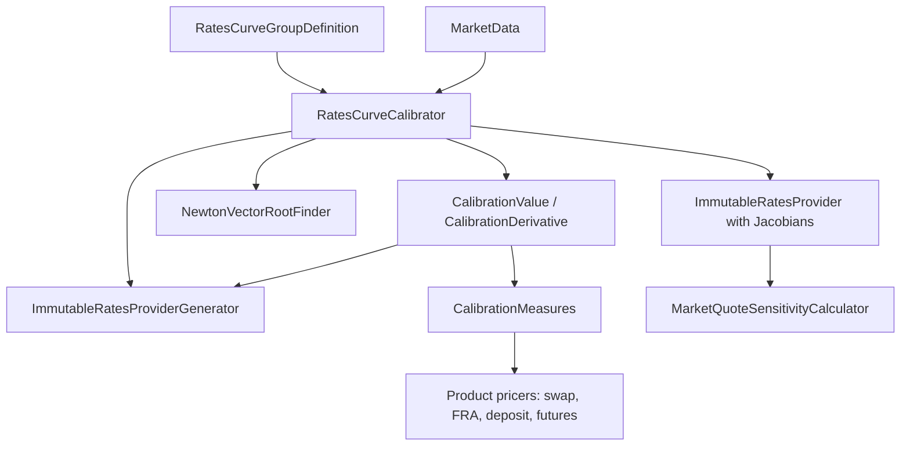

# Calibration and sensitivity code

Active contributors: Marc Henrard, Yuki Iwashita, Stephen Colebourne

## Purpose

This page covers two packages of the [pricer](index.md) module: `modules/pricer/src/main/java/com/opengamma/strata/pricer/curve`, which calibrates rates curves to market quotes, and `modules/pricer/src/main/java/com/opengamma/strata/pricer/sensitivity`, which turns parameter sensitivities into market quote sensitivities, gamma and finite-difference checks. The workflow around them (curve group definitions, nodes, and calibration inside the engine) is described in [Curve calibration](../../features/curve-calibration.md), and the use of the results in [Sensitivities](../../features/sensitivities.md).

## Directory layout

```
modules/pricer/src/main/java/com/opengamma/strata/pricer/
├── curve/
│   ├── RatesCurveCalibrator.java            public entry point
│   ├── SyntheticRatesCurveCalibrator.java   calibrates to quotes computed from another provider
│   ├── CalibrationMeasures.java             PAR_SPREAD, MARKET_QUOTE, PRESENT_VALUE sets
│   ├── CalibrationMeasure.java              interface: value(trade, provider), sensitivities(trade, provider)
│   ├── TradeCalibrationMeasure.java         par spread measures per trade type
│   ├── MarketQuoteMeasure.java              market quote measures per trade type
│   ├── PresentValueCalibrationMeasure.java  present value measures per trade type
│   ├── RatesProviderGenerator.java, ImmutableRatesProviderGenerator.java
│   └── CalibrationValue.java, CalibrationDerivative.java   package-private root-finder functions
└── sensitivity/
    ├── MarketQuoteSensitivityCalculator.java
    ├── CurveGammaCalculator.java
    ├── RatesFiniteDifferenceSensitivityCalculator.java
    ├── NotionalEquivalentCalculator.java
    └── CurveSensitivityUtils.java
```

## Key abstractions

| Type | Role |
| --- | --- |
| `RatesCurveCalibrator` | `standard()` uses tolerances of 1e-9, at most 1000 steps, `CalibrationMeasures.PAR_SPREAD` for the root-finding function and `CalibrationMeasures.PRESENT_VALUE` for the PV-to-market-quote sensitivity stored in the curves. `calibrate(...)` returns an `ImmutableRatesProvider`. |
| `CalibrationMeasures` | A set of `CalibrationMeasure` keyed by trade class. `PAR_SPREAD` covers FRA, FX swap, Ibor fixing deposit, Ibor future, overnight future, swap and term deposit. `MARKET_QUOTE` and `PRESENT_VALUE` cover the same types except FX swap. |
| `TradeCalibrationMeasure` | Wraps a value function and a point sensitivity function from a product pricer. For example `SWAP_PAR_SPREAD` uses `DiscountingSwapProductPricer.DEFAULT.parSpread` and `parSpreadSensitivity`. `sensitivities` converts with `provider.parameterSensitivity`. |
| `RatesProviderGenerator` | Builds an `ImmutableRatesProvider` from a parameter vector. `ImmutableRatesProviderGenerator` is the implementation used by the calibrator. |
| `SyntheticRatesCurveCalibrator` | Computes synthetic quotes from an existing `RatesProvider` with `CalibrationMeasures.MARKET_QUOTE` (`marketData(...)`), then calibrates a new curve group to them. Used for alternative risk views. |
| `MarketQuoteSensitivityCalculator` | Converts curve parameter sensitivities to market quote sensitivities using the `JacobianCalibrationMatrix` stored in curve metadata during calibration. |
| `CurveGammaCalculator` | Finite-difference gamma and cross-gamma (`DEFAULT` is forward difference with a 1e-4 shift). |
| `RatesFiniteDifferenceSensitivityCalculator` | Bump-and-reprice parameter sensitivity, mainly used to test analytic sensitivities. |

## How it works

`RatesCurveCalibrator.calibrate(RatesCurveGroupDefinition, MarketData, ReferenceData)` builds a starting `ImmutableRatesProvider` from the market data's FX rates and index time series, then calls the list-based `calibrate`. That method works through the curve groups in order:

1. Bind time series to the group, resolve the node trades with `groupDefnBound.resolvedTrades(marketData, refData)`, and read the initial guesses.
2. Create an `ImmutableRatesProviderGenerator` from the provider built so far and the group definition.
3. Find the parameters with a `NewtonVectorRootFinder`, using `CalibrationValue` (the measure value for each trade, which should be zero for par spread) and `CalibrationDerivative` (the Jacobian of those values with respect to the curve parameters).
4. If the group asks for it, compute `JacobianCalibrationMatrix` objects and the PV sensitivity to market quotes, and store them in the curve metadata.
5. Generate the combined provider and move to the next group.



The calibrator therefore depends on the product pricers: each node's par spread and its curve sensitivity come from the same pricer code used for valuation, through the `TradeCalibrationMeasure` constants.

## Integration points

- `RatesCurveGroupDefinition`, curve nodes and `JacobianCalibrationMatrix` come from [market](../market.md).
- `NewtonVectorRootFinder` and matrix algebra come from [math](../math.md).
- In the engine, measure's curve market data functions call `RatesCurveCalibrator`, and `SwapMeasureCalculations` and others use `MarketQuoteSensitivityCalculator` and `CurveGammaCalculator`; see [measure](../measure.md).

## Entry points for modification

- **New calibration instrument type:** add a constant to `TradeCalibrationMeasure`, `MarketQuoteMeasure` and `PresentValueCalibrationMeasure`, then include it in the matching `CalibrationMeasures` set. A trade type with no measure in the set cannot be calibrated with it.
- **Different solver settings:** use `RatesCurveCalibrator.of(...)` with custom tolerances, step count and measures.
- **New sensitivity transformation:** add a calculator in `modules/pricer/src/main/java/com/opengamma/strata/pricer/sensitivity` that takes `CurrencyParameterSensitivities` and a provider.

## Key source files

| File | Purpose |
| --- | --- |
| `modules/pricer/src/main/java/com/opengamma/strata/pricer/curve/RatesCurveCalibrator.java` | Calibration entry point (477 lines) |
| `modules/pricer/src/main/java/com/opengamma/strata/pricer/curve/CalibrationMeasures.java` | Standard measure sets |
| `modules/pricer/src/main/java/com/opengamma/strata/pricer/curve/TradeCalibrationMeasure.java` | Par spread measures per trade type |
| `modules/pricer/src/main/java/com/opengamma/strata/pricer/curve/ImmutableRatesProviderGenerator.java` | Parameters to provider |
| `modules/pricer/src/main/java/com/opengamma/strata/pricer/curve/SyntheticRatesCurveCalibrator.java` | Synthetic curve calibration |
| `modules/pricer/src/main/java/com/opengamma/strata/pricer/sensitivity/MarketQuoteSensitivityCalculator.java` | Market quote sensitivities |
| `modules/pricer/src/main/java/com/opengamma/strata/pricer/sensitivity/CurveGammaCalculator.java` | Gamma and cross-gamma |
| `modules/pricer/src/main/java/com/opengamma/strata/pricer/sensitivity/RatesFiniteDifferenceSensitivityCalculator.java` | Finite-difference sensitivity |

## Related pages

- [pricer](index.md)
- [Curve calibration](../../features/curve-calibration.md)
- [Sensitivities](../../features/sensitivities.md)
- [Rates providers](rates-providers.md)
