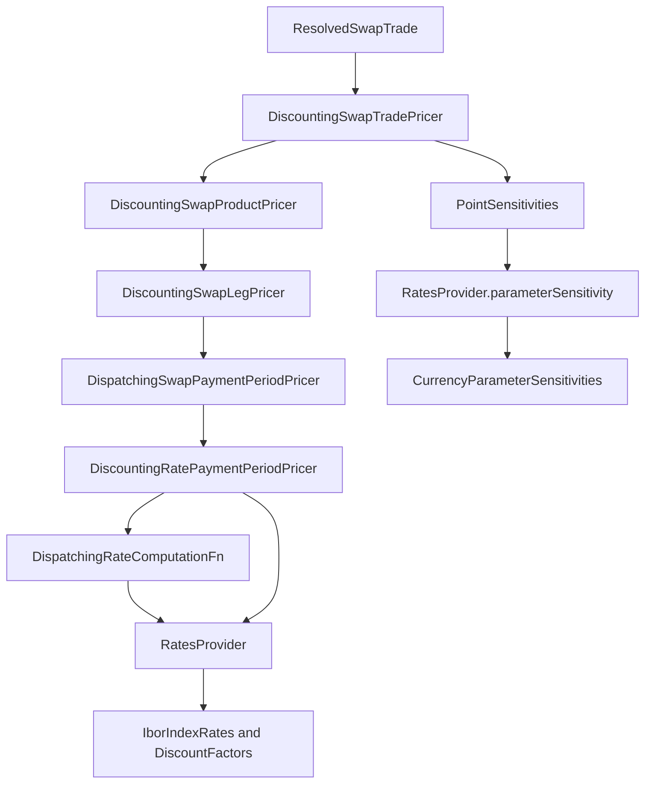

# pricer

Active contributors: Marc Henrard, Yuki Iwashita, Stephen Colebourne

## Purpose

The `pricer` module (`com.opengamma.strata:strata-pricer`, described in `modules/pricer/pom.xml` as "Pricing APIs") holds the analytic code that turns a resolved product and a set of market views into numbers: present value, par rate, par spread, cash flows, currency exposure and curve sensitivities. It also holds the market views themselves (`RatesProvider`, discount factors, index rates, volatilities), the pricing models (Black, normal, SABR, Hull-White, ISDA credit, trinomial trees) and the curve calibrator.

Pricers know nothing about the calculation engine. They take plain Java arguments and return plain results, so they can be called directly from tests or user code. The [measure](../measure.md) module wraps them for the engine. The end-to-end flow is described in [Pricing a trade](../../features/pricing-a-trade.md).

Stats:

- 360 production files under `modules/pricer/src/main/java`, all Java (including `package-info.java` files). The module has no resources.
- 322 Java test files under `modules/pricer/src/test` (348 files in total), a test-to-code ratio of about 0.89 by file count.
- 11 unique commit author names on `main` since 2022-01-01, 9 of them human after removing `opengammacibot` and `dependabot[bot]`.

Compile dependencies (from `modules/pricer/pom.xml`): `strata-collect`, `strata-basics`, `strata-data`, `strata-product` and `strata-market`. `strata-loader` and the collect and product test jars are test scope only.

## Sub-pages

| Page | Covers |
| --- | --- |
| [Rates providers](rates-providers.md) | `BaseProvider`, `RatesProvider`, `ImmutableRatesProvider`, `DiscountFactors`, `IborIndexRates`, `OvernightIndexRates`, `FxForwardRates`, point sensitivity types, and the bond and credit providers |
| [Product pricers](product-pricers.md) | Trade, product, leg and period pricer layering for every asset class, method conventions, dispatching pricers |
| [Models and volatilities](models-and-volatilities.md) | Black, normal, SABR and Hull-White models, volatility interfaces per product, the `impl` formula and smile packages |
| [Calibration and sensitivity code](calibration-and-sensitivity.md) | `modules/pricer/src/main/java/com/opengamma/strata/pricer/curve` (`RatesCurveCalibrator`, `CalibrationMeasures`, `SyntheticRatesCurveCalibrator`) and the `modules/pricer/src/main/java/com/opengamma/strata/pricer/sensitivity` calculators |

## Directory layout

All paths are under `modules/pricer/src/main/java/com/opengamma/strata/pricer/`. Numbers are Java file counts, including `package-info.java`.

```
pricer/            10  BaseProvider, DiscountFactors, ZeroRateSensitivity, DiscountingPaymentPricer, PricingException
├── rate/          18  RatesProvider, ImmutableRatesProvider, IborIndexRates, OvernightIndexRates, PriceIndexValues, RateComputationFn
├── swap/           6  DiscountingSwapTradePricer, ...ProductPricer, ...LegPricer, period and event pricer interfaces
├── fra/ deposit/ dsf/ payment/   discounting pricers for FRA, deposits, deliverable swap futures, bullet payments
├── fx/            13  FX single, swap and NDF pricers, FxForwardRates, FxIndexRates
├── fxopt/         25  Black, Vanna-Volga and trinomial-tree FX option pricers, FX volatilities
├── index/         23  Ibor and overnight future and future option pricers and volatilities
├── bond/          31  bond, bill, bond future and bond option pricers, LegalEntityDiscountingProvider
├── credit/        27  ISDA CDS and CDS index pricers, CreditRatesProvider, credit curve calibrators
├── capfloor/      58  Black, normal and SABR cap/floor pricers, caplet volatilities and their calibrators
├── swaption/      39  Black, normal, SABR and Hull-White swaption pricers, swaption volatilities, SABR calibrator
├── cms/            8  discounting and SABR replication CMS pricers
├── model/          6  SabrParameters, SabrInterestRateParameters, Hull-White parameters and provider
├── curve/         12  RatesCurveCalibrator, CalibrationMeasures, SyntheticRatesCurveCalibrator
├── sensitivity/    6  MarketQuoteSensitivityCalculator, CurveGammaCalculator, finite-difference calculator
├── common/ option/       PriceType, raw option data, generic volatility parameter metadata
└── impl/                 internal: rate computation functions, swap period pricers, option formulas, smile models, trees
```

## Key abstractions

| Type | Kind | Role |
| --- | --- | --- |
| `RatesProvider` | interface | The main market view: discount factors, Ibor, overnight and price index rates, FX spot and forward rates, time series. Converts point sensitivities to parameter sensitivities. |
| `ImmutableRatesProvider` | Joda-Bean | The standard `RatesProvider`, built from curves keyed by currency and index. Output of curve calibration. |
| `DiscountFactors`, `IborIndexRates`, `OvernightIndexRates`, `FxForwardRates` | interfaces | Per-currency or per-index views over one curve, each able to produce point sensitivities and map them to curve parameters. |
| `Discounting*TradePricer` and `*ProductPricer` | classes | Two-level pricer pattern repeated in every asset class: the trade pricer adds premium and settlement handling, the product pricer does the analytics. |
| `SwapPaymentPeriodPricer`, `RateComputationFn` | interfaces | Extension points below the swap leg. Their `standard()` methods return the dispatching implementation in `impl`. |
| `SwaptionVolatilities`, `FxOptionVolatilities`, `IborCapletFloorletVolatilities` and others | interfaces | Volatility views passed as an extra argument to option pricers. |
| `PointSensitivityBuilder`, `PointSensitivities` | from `market` | Sensitivity to individual rates or discount factors, before projection onto curve parameters. |
| `RatesCurveCalibrator` | final class | Calibrates a `RatesCurveGroupDefinition` into an `ImmutableRatesProvider`. |
| `PricingException` | `RuntimeException` | Thrown by pricers on invalid pricing conditions. |

## How it works

A pricer takes a `Resolved*` product or trade from the [product](../product/index.md) module plus one or more provider objects and returns a `CurrencyAmount`, `MultiCurrencyAmount`, `double` or `PointSensitivityBuilder`. Sensitivity flows back through the same path: each pricer combines the builders of its parts, the trade pricer calls `build()` to obtain `PointSensitivities`, and `RatesProvider.parameterSensitivity` projects those onto curve parameters as `CurrencyParameterSensitivities`.



The same shape applies across the module. Option pricers add a volatility argument (for example `VolatilitySwaptionPhysicalProductPricer.presentValue(ResolvedSwaption, RatesProvider, SwaptionVolatilities)`), and bond pricers take a `LegalEntityDiscountingProvider` instead of a `RatesProvider`. See [Product pricers](product-pricers.md) for the layering in detail and [Sensitivities](../../features/sensitivities.md) for what happens after parameter sensitivities are produced.

### The impl package rule

`modules/pricer/src/main/java/com/opengamma/strata/pricer/impl/package-info.java` states that the package and its sub-packages "contain the internal implementation of pricers" and "may change in a non-backwards compatible way". Public pricers reach the implementations through static `standard()` methods on public interfaces (`SwapPaymentPeriodPricer.standard()`, `SwapPaymentEventPricer.standard()`, `RateComputationFn.standard()`), so callers do not need to import `impl` classes. Public classes inside the module do import `impl` freely, for example `BlackFormulaRepository` in the FX option pricer. Outside the module, the only import from `pricer.impl` is `NormalFormulaRepository` in `examples/src/main/java/com/opengamma/strata/examples/finance/SabrSwaptionCubeCalibrationExample.java`. The same rule applies to `modules/math/src/main/java/com/opengamma/strata/math/impl` and `modules/loader/src/main/java/com/opengamma/strata/loader/impl`; see [Patterns and conventions](../../how-to-contribute/patterns-and-conventions.md).

## Integration points

- **Inputs from [product](../product/index.md):** `ResolvedSwapTrade`, `ResolvedFra`, `ResolvedSwaption` and the other resolved types, plus rate computation types such as `IborRateComputation`.
- **Inputs from [market](../market.md):** `Curve`, `PointSensitivity`, `CurrencyParameterSensitivities`, `ParameterPerturbation`, `ExplainMap`, surfaces and curve group definitions.
- **Inputs from [math](../math.md):** root finders, matrix algebra and distributions, including classes in `modules/math/src/main/java/com/opengamma/strata/math/impl` (for example `NewtonRaphsonSingleRootFinder` in `SabrSwaptionCalibrator`).
- **Consumers in [measure](../measure.md):** each `*MeasureCalculations` class holds a trade pricer. For example `modules/measure/src/main/java/com/opengamma/strata/measure/swap/SwapMeasureCalculations.java` calls `DiscountingSwapTradePricer.presentValueSensitivity` and then `ratesProvider.parameterSensitivity(...)` to compute PV01, and uses `MarketQuoteSensitivityCalculator` and `CurveGammaCalculator`.
- **Calibration inside the engine:** measure's curve market data functions call `RatesCurveCalibrator`; see [Curve calibration](../../features/curve-calibration.md).

## Entry points for modification

- **Add a pricer for a new product:** create a `<Model><Product>ProductPricer` and `<Model><Product>TradePricer` pair in the asset-class package, each with a `public static final DEFAULT`, then add a `*MeasureCalculations` class in measure. Start from [Product pricers](product-pricers.md).
- **Support a new swap rate type:** add a `RateComputationFn` implementation in `modules/pricer/src/main/java/com/opengamma/strata/pricer/impl/rate` and wire it into `DispatchingRateComputationFn`.
- **Add a new kind of curve-based market view:** extend `RatesProvider` and its `parameterSensitivity` dispatch; see [Rates providers](rates-providers.md).
- **Add a calibration instrument:** add `TradeCalibrationMeasure`, `MarketQuoteMeasure` and `PresentValueCalibrationMeasure` constants and include them in `CalibrationMeasures`; see [Calibration and sensitivity code](calibration-and-sensitivity.md).

## Key source files

| File | Why it matters |
| --- | --- |
| `modules/pricer/src/main/java/com/opengamma/strata/pricer/rate/RatesProvider.java` | Main market view and `parameterSensitivity` dispatch |
| `modules/pricer/src/main/java/com/opengamma/strata/pricer/rate/ImmutableRatesProvider.java` | Standard provider implementation (771 lines) |
| `modules/pricer/src/main/java/com/opengamma/strata/pricer/BaseProvider.java` | Valuation date, FX rates and discount factors shared by providers |
| `modules/pricer/src/main/java/com/opengamma/strata/pricer/swap/DiscountingSwapTradePricer.java` | Reference trade pricer |
| `modules/pricer/src/main/java/com/opengamma/strata/pricer/swap/DiscountingSwapProductPricer.java` | Reference product pricer |
| `modules/pricer/src/main/java/com/opengamma/strata/pricer/swap/DiscountingSwapLegPricer.java` | Leg pricer, PVBP and annuity calculations |
| `modules/pricer/src/main/java/com/opengamma/strata/pricer/impl/rate/DispatchingRateComputationFn.java` | Dispatches eleven rate computation types |
| `modules/pricer/src/main/java/com/opengamma/strata/pricer/curve/RatesCurveCalibrator.java` | Curve calibration |
| `modules/pricer/src/main/java/com/opengamma/strata/pricer/impl/package-info.java` | The internal-package rule |
| `modules/pricer/pom.xml` | Module dependencies |

## Related pages

- [Modules](../index.md)
- [Pricing a trade](../../features/pricing-a-trade.md)
- [Curve calibration](../../features/curve-calibration.md)
- [Sensitivities](../../features/sensitivities.md)
- [market](../market.md), [product](../product/index.md), [measure](../measure.md)
- [Glossary](../../overview/glossary.md)
