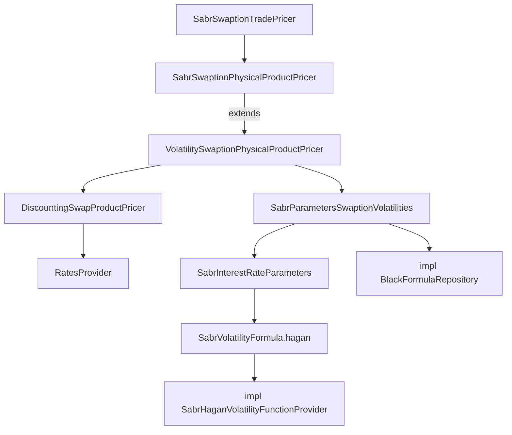

# Models and volatilities

Active contributors: Marc Henrard, Yuki Iwashita, Stephen Colebourne

## Purpose

Option pricers in the [pricer](index.md) module need a model on top of the curves in a `RatesProvider`. This page covers the volatility views passed to option pricers, the model parameter classes in `modules/pricer/src/main/java/com/opengamma/strata/pricer/model`, and the numerical code they rely on in `modules/pricer/src/main/java/com/opengamma/strata/pricer/impl`.

## Directory layout

Paths are under `modules/pricer/src/main/java/com/opengamma/strata/pricer/`.

```
swaption/   SwaptionVolatilities and Black/Normal/SABR variants, SabrSwaptionCalibrator
capfloor/   IborCapletFloorletVolatilities and variants, caplet volatility calibrators and bootstrappers
fxopt/      FxOptionVolatilities, BlackFxOptionFlat/Smile/SurfaceVolatilities, SmileDeltaTermStructure,
            ImpliedTrinomialTreeFxOptionCalibrator
index/      IborFutureOptionVolatilities, OvernightFutureOptionVolatilities (normal, simple moneyness)
bond/       BondFutureVolatilities, BondYieldVolatilities
model/      SabrParameters, SabrInterestRateParameters, SabrVolatilityFormula,
            HullWhiteOneFactorPiecewiseConstantParameters, HullWhiteOneFactorPiecewiseConstantParametersProvider
impl/option/            BlackFormulaRepository, NormalFormulaRepository, BlackScholesFormulaRepository,
                        barrier and one-touch formulas, GenericImpliedVolatiltySolver, SabrExtrapolationRightFunction
impl/volatility/smile/  SabrHaganVolatilityFunctionProvider, SabrModelFitter, SsviVolatilityFunction, SmileModelFitter
impl/volatility/local/  DupireLocalVolatilityCalculator, ImpliedTrinomialTreeLocalVolatilityCalculator
impl/tree/              TrinomialTree, lattice specifications, option functions
impl/rate/model/        HullWhiteOneFactorPiecewiseConstantInterestRateModel
```

## Key abstractions

| Type | Role |
| --- | --- |
| `SwaptionVolatilities` | Extends `MarketDataView` and `ParameterizedData`. Gives `volatility(expiry, tenor, strike, forward)`, `price`, `priceDelta`, `priceGamma`, `priceTheta`, `priceVega`, `relativeTime`, `tenor` and `parameterSensitivity`. |
| `BlackSwaptionVolatilities`, `NormalSwaptionVolatilities`, `SabrSwaptionVolatilities` | Sub-interfaces fixing the volatility type (for example `ValueType.BLACK_VOLATILITY`). |
| `BlackSwaptionExpiryTenorVolatilities` and similar | Joda-Bean implementations backed by a `Surface`. Their `price` methods call `BlackFormulaRepository` or `NormalFormulaRepository`. |
| `SabrParametersSwaptionVolatilities` | Swaption volatilities defined by `SabrInterestRateParameters` (alpha, beta, rho, nu and shift surfaces by expiry and tenor). |
| `SabrParameters` | SABR parameters as curves by expiry, used for caplets; `volatility(expiry, strike, forward)` and `volatilityAdjoint`. |
| `SabrVolatilityFormula` | Interface with `hagan()` factory, backed by `SabrHaganVolatilityFunctionProvider` in `impl`. |
| `HullWhiteOneFactorPiecewiseConstantParametersProvider` | Hull-White parameters with a day count and valuation date-time, used by Hull-White swaption and Ibor future pricers. |
| `FxOptionVolatilities`, `IborCapletFloorletVolatilities`, `IborFutureOptionVolatilities`, `BondFutureVolatilities`, `BondYieldVolatilities` | The equivalent views for other option types. |
| `*Sensitivity` types (`SwaptionSensitivity`, `SwaptionSabrSensitivity`, `FxOptionSensitivity`, `IborCapletFloorletSensitivity` and others) | Point sensitivities to volatility or model parameters, projected by the volatility object's `parameterSensitivity`. |

## How it works

An option product pricer receives the curves and the volatilities as separate arguments. It computes the forward and the annuity or discount factor from the `RatesProvider`, then asks the volatilities object for a volatility and an option price, so the formula choice lives in the volatilities implementation and not in the pricer.



Sensitivities come in two kinds. Curve sensitivities follow the normal path described in [Rates providers](rates-providers.md). Model sensitivities come from methods such as `presentValueSensitivityModelParamsVolatility` or `presentValueSensitivityModelParamsSabr`, which return point sensitivities that the volatilities object (not the `RatesProvider`) converts into `CurrencyParameterSensitivities`.

Several packages contain calibrators for model parameters: `SabrSwaptionCalibrator` (fits SABR to swaption volatilities with `SabrModelFitter` and root finders from `modules/math/src/main/java/com/opengamma/strata/math/impl`), the caplet calibrators and bootstrappers in `capfloor`, `ImpliedTrinomialTreeFxOptionCalibrator`, and the ISDA credit curve calibrators in `credit`. These are separate from rates curve calibration in `modules/pricer/src/main/java/com/opengamma/strata/pricer/curve`.

The formula classes in `modules/pricer/src/main/java/com/opengamma/strata/pricer/impl/option` are static utility classes (`BlackFormulaRepository.price`, `delta`, `gamma`, `vega`, `impliedVolatility` and so on). Because they live under `impl`, they can change without notice; public code should go through the volatility interfaces.

## Integration points

- Surfaces, cubes and their parameter metadata come from [market](../market.md).
- Root finders, least-squares fitters and distributions come from [math](../math.md).
- [measure](../measure.md) obtains volatilities through lookup classes such as `SwaptionMarketDataLookup` and passes them to the trade pricers.

## Entry points for modification

- **New volatility representation:** implement the relevant volatilities interface (for example `BlackSwaptionVolatilities`) as a Joda-Bean with `parameterSensitivity` support. Existing pricers then work with it unchanged.
- **New smile model:** add the formula in `modules/pricer/src/main/java/com/opengamma/strata/pricer/impl/volatility/smile` and expose it through a public interface in `model` or the product package.
- **New option model for a product:** add a pricer pair that takes the model's provider type, following `HullWhiteSwaptionPhysicalProductPricer`.

## Key source files

| File | Purpose |
| --- | --- |
| `modules/pricer/src/main/java/com/opengamma/strata/pricer/swaption/SwaptionVolatilities.java` | Swaption volatility interface |
| `modules/pricer/src/main/java/com/opengamma/strata/pricer/swaption/SabrParametersSwaptionVolatilities.java` | SABR-based swaption volatilities |
| `modules/pricer/src/main/java/com/opengamma/strata/pricer/swaption/SabrSwaptionCalibrator.java` | SABR calibration to swaption data |
| `modules/pricer/src/main/java/com/opengamma/strata/pricer/model/SabrInterestRateParameters.java` | SABR parameter surfaces |
| `modules/pricer/src/main/java/com/opengamma/strata/pricer/model/SabrVolatilityFormula.java` | SABR formula interface |
| `modules/pricer/src/main/java/com/opengamma/strata/pricer/model/HullWhiteOneFactorPiecewiseConstantParametersProvider.java` | Hull-White model provider |
| `modules/pricer/src/main/java/com/opengamma/strata/pricer/impl/rate/model/HullWhiteOneFactorPiecewiseConstantInterestRateModel.java` | Hull-White formulas (convexity factors, alpha, kappa) |
| `modules/pricer/src/main/java/com/opengamma/strata/pricer/impl/option/BlackFormulaRepository.java` | Black formulas and Greeks |
| `modules/pricer/src/main/java/com/opengamma/strata/pricer/impl/option/NormalFormulaRepository.java` | Normal (Bachelier) formulas |
| `modules/pricer/src/main/java/com/opengamma/strata/pricer/impl/tree/TrinomialTree.java` | Trinomial tree used by barrier option pricing |

## Related pages

- [pricer](index.md)
- [Product pricers](product-pricers.md)
- [Glossary](../../overview/glossary.md)
- [Sensitivities](../../features/sensitivities.md)
