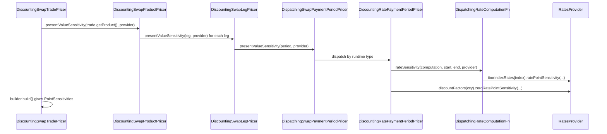

# Product pricers

Active contributors: Marc Henrard, Yuki Iwashita, Stephen Colebourne

## Purpose

This page describes how pricer classes are structured and named across the asset-class packages of the [pricer](index.md) module, using the swap pricers as the reference example.

## Directory layout

Pricer classes live in one package per asset class under `modules/pricer/src/main/java/com/opengamma/strata/pricer/`. Each package mirrors the product package of the same name in [product](../product/index.md). `*` stands for both the `TradePricer` and `ProductPricer` classes.

```
swap/      DiscountingSwapTradePricer, DiscountingSwapProductPricer, DiscountingSwapLegPricer,
           SwapPaymentPeriodPricer, SwapPaymentEventPricer
fra/       DiscountingFra*Pricer
deposit/   DiscountingTermDeposit*Pricer, DiscountingIborFixingDeposit*Pricer
dsf/       DiscountingDsf*Pricer
payment/   DiscountingBulletPaymentTradePricer
fx/        DiscountingFxSingle*Pricer, DiscountingFxSwap*Pricer, DiscountingFxNdf*Pricer
fxopt/     BlackFxVanillaOption*Pricer, VannaVolgaFxVanillaOption*Pricer,
           BlackFxSingleBarrierOption*Pricer, ImpliedTrinomialTreeFxSingleBarrierOption*Pricer
index/     DiscountingIborFuture*Pricer, DiscountingOvernightFuture*Pricer, HullWhiteIborFuture*Pricer,
           NormalIborFutureOptionMargined*Pricer, NormalOvernightFutureOptionMargined*Pricer
bond/      DiscountingFixedCouponBond*Pricer, DiscountingCapitalIndexedBond*Pricer, DiscountingBill*Pricer,
           DiscountingBondFuture*Pricer, BlackBondFutureOptionMargined*Pricer, BlackFixedCouponBondOptionPricer
credit/    IsdaCds*Pricer, IsdaHomogenousCdsIndex*Pricer
capfloor/  {Black,Normal,Sabr,Volatility}IborCapFloor{Trade,Product,Leg}Pricer, caplet period pricers,
           SabrOvernightInArrearsCapFloor*Pricer
swaption/  {Black,Normal,Sabr,Volatility}Swaption{Trade,PhysicalProduct,CashParYieldProduct}Pricer,
           HullWhiteSwaptionPhysical*Pricer
cms/       DiscountingCms*Pricer, SabrExtrapolationReplicationCms*Pricer
impl/swap/ DispatchingSwapPaymentPeriodPricer, DiscountingRatePaymentPeriodPricer, notional exchange pricers
impl/rate/ DispatchingRateComputationFn and eleven Forward*RateComputationFn classes
```

## Key abstractions

| Concept | Convention |
| --- | --- |
| Class name | `<Model><Product><Level>Pricer`. The model is `Discounting`, `Black`, `Normal`, `Sabr`, `HullWhite`, `Isda`, `VannaVolga`, `ImpliedTrinomialTree` or `Volatility` (generic over any volatility type). The level is `Trade`, `Product`, `Leg` or `Period`. |
| Default instance | Each pricer has `public static final ... DEFAULT`, built from the `DEFAULT` of the pricer below it. |
| Composition | Pricers take their sub-pricers in a public constructor validated with `ArgChecker.notNull`, so a caller can supply a different leg or period pricer. |
| Inputs | A `Resolved*` product or trade, then the providers: `RatesProvider`, `LegalEntityDiscountingProvider` or `CreditRatesProvider`, plus a volatilities object for options. |
| Outputs | `presentValue` returns `CurrencyAmount` (single currency) or `MultiCurrencyAmount`. `parRate`, `parSpread` and `price` return `double`. Sensitivity methods return `PointSensitivityBuilder` at product level and `PointSensitivities` at trade level. `cashFlows`, `explainPresentValue`, `currencyExposure` and `currentCash` are also common. |
| Model parameter sensitivity | Option pricers add methods such as `presentValueSensitivityModelParamsVolatility` (Black, normal) or `presentValueSensitivityModelParamsSabr` (SABR) for sensitivity to the volatility parameters. |

## How it works

`DiscountingSwapTradePricer` (`modules/pricer/src/main/java/com/opengamma/strata/pricer/swap/DiscountingSwapTradePricer.java`) holds a `DiscountingSwapProductPricer` and mostly delegates with `trade.getProduct()`. Its `presentValueSensitivity` calls the product pricer and then `.build()` to turn the builder into `PointSensitivities`. Trade pricers for products with a premium add its value here. `SabrSwaptionTradePricer`, for example, combines a cash par yield pricer, a physical pricer and a `DiscountingPaymentPricer`, and chooses between the first two by settlement type.

`DiscountingSwapProductPricer` loops over the legs. For `presentValue(ResolvedSwap, Currency, RatesProvider)` it sums `legPricer.presentValueInternal(leg, provider) * provider.fxRate(leg.getCurrency(), currency)`. For sensitivities it combines the leg builders with `PointSensitivityBuilder.combinedWith`, converting currency with `withCurrency(...)` and `multipliedBy(fxRate)` when needed.

`DiscountingSwapLegPricer` prices payment periods and payment events through two interfaces. Its `DEFAULT` uses `SwapPaymentPeriodPricer.standard()` and `SwapPaymentEventPricer.standard()`, which return `DispatchingSwapPaymentPeriodPricer.DEFAULT` and `DispatchingSwapPaymentEventPricer.DEFAULT` from `modules/pricer/src/main/java/com/opengamma/strata/pricer/impl/swap`. The dispatcher checks the runtime type (`RatePaymentPeriod` or `KnownAmountSwapPaymentPeriod`) and throws `IllegalArgumentException` for anything else.

`DiscountingRatePaymentPeriodPricer` computes each accrual period's rate with a `RateComputationFn<RateComputation>`, discounts with `provider.discountFactor(currency, paymentDate)`, and builds sensitivities from `rateComputationFn.rateSensitivity` plus the discount factor's zero-rate sensitivity. `DispatchingRateComputationFn` routes eleven rate computation types (Ibor, interpolated Ibor, averaged Ibor, overnight compounded, overnight compounded annual, overnight averaged, overnight averaged daily, and four inflation variants) to `Forward*RateComputationFn` classes. These read `provider.iborIndexRates(...)` or the overnight and price index equivalents.



Option pricers follow the same layering with a model argument added. `VolatilitySwaptionPhysicalProductPricer` reuses `DiscountingSwapProductPricer` to compute the forward swap rate and the fixed-leg PVBP, then asks `SwaptionVolatilities` for the volatility and the option price. `BlackSwaptionPhysicalProductPricer`, `NormalSwaptionPhysicalProductPricer` and `SabrSwaptionPhysicalProductPricer` extend it, and the cap/floor pricers use the same pattern (`BlackIborCapFloorProductPricer` extends `VolatilityIborCapFloorProductPricer`). `HullWhiteSwaptionPhysicalProductPricer` takes a `HullWhiteOneFactorPiecewiseConstantParametersProvider` instead and uses `CashFlowEquivalentCalculator` from `modules/pricer/src/main/java/com/opengamma/strata/pricer/impl/rate/swap`. See [Models and volatilities](models-and-volatilities.md).

## Integration points

- Resolved product types come from [product](../product/index.md).
- Providers are described in [Rates providers](rates-providers.md).
- Each trade pricer is wrapped by a `*MeasureCalculations` class in [measure](../measure.md), which is how the engine reaches it; see [Pricing a trade](../../features/pricing-a-trade.md).
- Calibration reuses product pricers through `TradeCalibrationMeasure`, `MarketQuoteMeasure` and `PresentValueCalibrationMeasure`; see [Calibration and sensitivity code](calibration-and-sensitivity.md).

## Entry points for modification

- **New measure on an existing product:** add the method to the product pricer, then a delegating method on the trade pricer, with a matching sensitivity method if the value depends on curves.
- **New swap period type:** add a `SwapPaymentPeriodPricer` implementation and a branch in `DispatchingSwapPaymentPeriodPricer`.
- **New rate computation:** add a `RateComputationFn` in `modules/pricer/src/main/java/com/opengamma/strata/pricer/impl/rate`, then a constructor argument and branch in `DispatchingRateComputationFn`.
- **Alternative model for an option:** add a `<Model><Product>ProductPricer` and `TradePricer` that take the relevant volatilities type. The `Volatility*` pricers show how to stay generic over Black and normal volatilities.

## Key source files

| File | Purpose |
| --- | --- |
| `modules/pricer/src/main/java/com/opengamma/strata/pricer/swap/DiscountingSwapTradePricer.java` | Trade-level reference |
| `modules/pricer/src/main/java/com/opengamma/strata/pricer/swap/DiscountingSwapProductPricer.java` | Product-level reference, par rate and par spread |
| `modules/pricer/src/main/java/com/opengamma/strata/pricer/swap/DiscountingSwapLegPricer.java` | Leg-level pricing, PVBP |
| `modules/pricer/src/main/java/com/opengamma/strata/pricer/swap/SwapPaymentPeriodPricer.java` | Period pricer interface with `standard()` |
| `modules/pricer/src/main/java/com/opengamma/strata/pricer/impl/swap/DispatchingSwapPaymentPeriodPricer.java` | Runtime type dispatch |
| `modules/pricer/src/main/java/com/opengamma/strata/pricer/impl/swap/DiscountingRatePaymentPeriodPricer.java` | Rate period pricing |
| `modules/pricer/src/main/java/com/opengamma/strata/pricer/rate/RateComputationFn.java` | Rate computation interface |
| `modules/pricer/src/main/java/com/opengamma/strata/pricer/impl/rate/DispatchingRateComputationFn.java` | Rate computation dispatch |
| `modules/pricer/src/main/java/com/opengamma/strata/pricer/swaption/VolatilitySwaptionPhysicalProductPricer.java` | Option pricer built on the swap pricer |
| `modules/pricer/src/main/java/com/opengamma/strata/pricer/DiscountingPaymentPricer.java` | Premium and single payment pricing |

## Related pages

- [pricer](index.md)
- [Rates providers](rates-providers.md)
- [Models and volatilities](models-and-volatilities.md)
- [Pricing a trade](../../features/pricing-a-trade.md)
