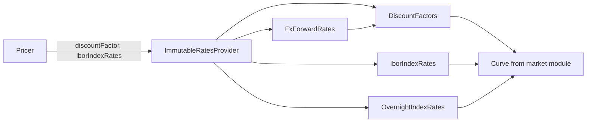

# Rates providers

Active contributors: Marc Henrard, Yuki Iwashita, Stephen Colebourne

## Purpose

A provider is the read-only market view a pricer works against. It hides how curves are stored and exposes the quantities pricers need: discount factors, forward Ibor and overnight rates, price index values, FX spot and forward rates, and fixings. Every view can also produce a point sensitivity and map it back to the parameters of the underlying curve. This page covers the provider types in `modules/pricer/src/main/java/com/opengamma/strata/pricer/` and its `rate/` and `fx/` packages. For the parent module, see [pricer](index.md).

## Directory layout

```
pricer/
├── BaseProvider.java              valuation date, FX rates, discountFactors(Currency)
├── DiscountFactors.java           interface; of(currency, valuationDate, curve)
├── SimpleDiscountFactors.java, ZeroRateDiscountFactors.java, ZeroRatePeriodicDiscountFactors.java
├── ZeroRateSensitivity.java       point sensitivity to a zero rate
├── rate/
│   ├── RatesProvider.java         extends BaseProvider
│   ├── ImmutableRatesProvider.java, ImmutableRatesProviderBuilder.java
│   ├── IborIndexRates.java        Discount, Simple and Historic implementations
│   ├── OvernightIndexRates.java   Discount and Historic implementations
│   ├── PriceIndexValues.java      Simple and Historic implementations
│   └── IborRateSensitivity.java, OvernightRateSensitivity.java, InflationRateSensitivity.java
├── fx/
│   ├── FxForwardRates.java, DiscountFxForwardRates.java, FxForwardSensitivity.java
│   └── FxIndexRates.java, ForwardFxIndexRates.java, FxIndexSensitivity.java
├── bond/LegalEntityDiscountingProvider.java, ImmutableLegalEntityDiscountingProvider.java
└── credit/CreditRatesProvider.java, ImmutableCreditRatesProvider.java
```

## Key abstractions

| Type | Main methods | Point sensitivity type |
| --- | --- | --- |
| `BaseProvider` | `getValuationDate()`, `fxRate(...)`, `discountFactors(Currency)`, `discountFactor(Currency, LocalDate)`, `data(MarketDataId)` | none directly |
| `RatesProvider` | `iborIndexRates`, `overnightIndexRates`, `priceIndexValues`, `fxIndexRates`, `fxForwardRates`, `timeSeries`, `parameterSensitivity`, `currencyExposure`, `toImmutableRatesProvider` | dispatches all of the types below |
| `DiscountFactors` | `discountFactor(LocalDate)`, `zeroRate`, `zeroRatePointSensitivity`, `parameterSensitivity(ZeroRateSensitivity)` | `ZeroRateSensitivity` |
| `IborIndexRates` | `rate(IborIndexObservation)`, `rateIgnoringFixings`, `ratePointSensitivity` | `IborRateSensitivity` |
| `OvernightIndexRates` | `rate`, `periodRate(startObservation, endDate)`, `periodRatePointSensitivity` | `OvernightRateSensitivity` |
| `PriceIndexValues` | `value(PriceIndexObservation)`, `valuePointSensitivity` | `InflationRateSensitivity` |
| `FxForwardRates` | `rate(baseCurrency, referenceDate)`, `ratePointSensitivity`, `rateFxSpotSensitivity` | `FxForwardSensitivity` |
| `FxIndexRates` | `rate(FxIndexObservation, Currency)`, `ratePointSensitivity` | `FxIndexSensitivity` |
| `LegalEntityDiscountingProvider` | repo and issuer discount factors for bonds, own `parameterSensitivity` | `RepoCurveZeroRateSensitivity`, `IssuerCurveZeroRateSensitivity` |
| `CreditRatesProvider` | survival probabilities, recovery rates and discount factors for CDS, own `parameterSensitivity` | `CreditCurveZeroRateSensitivity` |

The curve views also have `withParameter(int, double)` and `withPerturbation(ParameterPerturbation)`, which return a modified copy. Finite-difference sensitivities and scenario shifts use these methods.

## How it works

`ImmutableRatesProvider` is a Joda-Bean (`@BeanDefinition(builderScope = "private", constructorScope = "package")`) with five properties: `valuationDate`, `fxRateProvider`, `discountCurves` (a map of `Currency` to `Curve`), `indexCurves` (a map of `Index` to `Curve`) and `timeSeries`. It does not store `DiscountFactors` or `IborIndexRates` objects. It creates them on each call:

- `discountFactors(currency)` returns `DiscountFactors.of(currency, valuationDate, curve)`. That factory reads the curve's y-value type: discount factor curves become `SimpleDiscountFactors`, zero-rate curves become `ZeroRateDiscountFactors`, or `ZeroRatePeriodicDiscountFactors` if the metadata has `CurveInfoType.COMPOUNDING_PER_YEAR`. Any other type throws `IllegalArgumentException`.
- `iborIndexRates(index)` returns `IborIndexRates.of(index, valuationDate, curve, timeSeries(index))`, or `HistoricIborIndexRates` holding fixings only when no forward curve exists.
- `overnightIndexRates` follows the same pattern. `fxForwardRates(pair)` builds a `DiscountFxForwardRates` from the FX rate provider and the two currencies' discount factors.



### From point to parameter sensitivity

Pricers return point sensitivities such as "sensitivity of PV to the USD zero rate at a given date". `RatesProvider.parameterSensitivity(PointSensitivities)` in `modules/pricer/src/main/java/com/opengamma/strata/pricer/rate/RatesProvider.java` loops over the points, checks each type with `instanceof`, finds the matching view (`discountFactors`, `iborIndexRates`, `overnightIndexRates`, `fxIndexRates`, `priceIndexValues` or `fxForwardRates`) and calls that view's `parameterSensitivity` method. Each view applies the curve's sensitivity to its own parameters and returns `CurrencyParameterSensitivities`, which are combined. A point type the method does not recognise is skipped silently, which is why bond and credit sensitivities need the `parameterSensitivity` methods on `LegalEntityDiscountingProvider` and `CreditRatesProvider`. `currencyExposure(PointSensitivities)` does a similar projection for FX index sensitivities.

## Integration points

- Curves (`Curve`, `InterpolatedNodalCurve`) and sensitivity types come from [market](../market.md).
- `RatesCurveCalibrator` produces `ImmutableRatesProvider` instances; see [Calibration and sensitivity code](calibration-and-sensitivity.md).
- In the engine, `modules/measure/src/main/java/com/opengamma/strata/measure/rate/RatesMarketDataLookup.java` and `DefaultLookupRatesProvider` in the same package supply a `RatesProvider` backed by `MarketData`; see [measure](../measure.md).

## Entry points for modification

- To support a new kind of index, add a view interface with a `parameterSensitivity` method, a getter on `RatesProvider`, an implementation in `ImmutableRatesProvider` and a branch in `RatesProvider.parameterSensitivity`.
- To change how a curve is read as discount factors, start with `DiscountFactors.of` and the `ZeroRateDiscountFactors` and `SimpleDiscountFactors` implementations.

## Key source files

| File | Purpose |
| --- | --- |
| `modules/pricer/src/main/java/com/opengamma/strata/pricer/BaseProvider.java` | Base provider interface |
| `modules/pricer/src/main/java/com/opengamma/strata/pricer/rate/RatesProvider.java` | Rates provider and sensitivity projection |
| `modules/pricer/src/main/java/com/opengamma/strata/pricer/rate/ImmutableRatesProvider.java` | Standard implementation |
| `modules/pricer/src/main/java/com/opengamma/strata/pricer/DiscountFactors.java` | Discount factor view and its factory |
| `modules/pricer/src/main/java/com/opengamma/strata/pricer/rate/IborIndexRates.java` | Ibor forward rates |
| `modules/pricer/src/main/java/com/opengamma/strata/pricer/rate/OvernightIndexRates.java` | Overnight rates |
| `modules/pricer/src/main/java/com/opengamma/strata/pricer/fx/FxForwardRates.java` | Forward FX rates |
| `modules/pricer/src/main/java/com/opengamma/strata/pricer/bond/LegalEntityDiscountingProvider.java` | Bond discounting provider |
| `modules/pricer/src/main/java/com/opengamma/strata/pricer/credit/CreditRatesProvider.java` | Credit provider |

## Related pages

- [pricer](index.md)
- [Product pricers](product-pricers.md)
- [Sensitivities](../../features/sensitivities.md)
- [market](../market.md)
