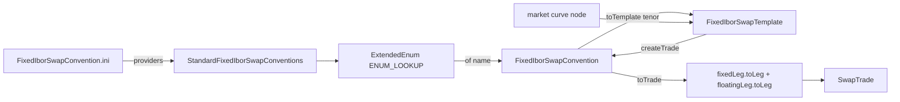

# Conventions and templates

Active contributors: Stephen Colebourne, Marc Henrard, Yuki Iwashita

A convention captures the market-standard terms for a kind of trade, such as "USD fixed 6M vs LIBOR 3M swap". A template adds the tenor or period so that only the trade date, notional and rate are missing. Conventions are named `ExtendedEnum` values loaded from INI files, so `FixedIborSwapConvention.of("USD-FIXED-6M-LIBOR-3M")` works anywhere, including in CSV files and curve definitions. For the overall module see [product](index.md).

## Purpose

Curve calibration, trade loaders and tests all need to build standard trades from a few market inputs. Conventions and templates keep those market rules in one place in the `type` sub-packages instead of in each caller.

## Directory layout

```
modules/product/src/main/java/com/opengamma/strata/product/
├── TradeConvention.java, TradeTemplate.java      marker interfaces
├── swap/type/      56 files: fixed-Ibor, fixed-overnight, fixed-inflation, Ibor-Ibor, overnight-Ibor,
│                   overnight-overnight, three-leg basis, XCcy Ibor-Ibor, XCcy overnight-overnight;
│                   leg conventions (FixedRateSwapLegConvention, IborRateSwapLegConvention, ...)
├── fra/type/       FraConvention, ImmutableFraConvention, FraConventions, FraTemplate
├── deposit/type/   TermDepositConvention, IborFixingDepositConvention and templates
├── fx/type/        FxSwapConvention, StandardFxSwapConventions, FxSwapTemplate
├── index/type/     IborFutureConvention, IborFutureContractSpec, OvernightFutureContractSpec, templates
└── credit/type/    CdsConvention, TenorCdsTemplate, DatesCdsTemplate

modules/product/src/main/resources/META-INF/com/opengamma/strata/config/base/
├── CdsConvention.ini, FraConvention.ini, FxSwapConvention.ini, IborFixingDepositConvention.ini
├── IborFutureContractSpec.ini, IborFutureConvention.ini, OvernightFutureContractSpec.ini
├── FixedIborSwapConvention.ini, FixedOvernightSwapConvention.ini, FixedInflationSwapConvention.ini,
│   FixedFloatSwapConvention.ini, IborIborSwapConvention.ini, OvernightIborSwapConvention.ini,
│   OvernightOvernightSwapConvention.ini, ThreeLegBasisSwapConvention.ini,
│   XCcyIborIborSwapConvention.ini, XCcyOvernightOvernightSwapConvention.ini
├── TermDepositConvention.ini, IsdaYieldCurveConvention.ini
└── SwapIndex.ini, SwapIndexData.csv
```

## Key abstractions

Using the fixed-Ibor swap family as the example (other families follow the same file pattern):

| Type | Path | Description |
| --- | --- | --- |
| `TradeConvention` | `modules/product/src/main/java/com/opengamma/strata/product/TradeConvention.java` | Marker. Implementations should offer `toTrade` and, where a template exists, `toTemplate`. |
| `TradeTemplate` | `modules/product/src/main/java/com/opengamma/strata/product/TradeTemplate.java` | Marker. Implementations should offer a `createTrade`/`toTrade` method. |
| `FixedIborSwapConvention` | `modules/product/src/main/java/com/opengamma/strata/product/swap/type/FixedIborSwapConvention.java` | Interface with `@FromString of(String)`, `extendedEnum()`, `createTrade(...)`, `toTrade(...)`, `toTemplate(Tenor)`. |
| `ImmutableFixedIborSwapConvention` | `modules/product/src/main/java/com/opengamma/strata/product/swap/type/ImmutableFixedIborSwapConvention.java` | Bean with `name`, `fixedLeg`, `floatingLeg`, `spotDateOffset`; `toTrade` builds the two legs and a `SwapTrade`. |
| `StandardFixedIborSwapConventions` | `modules/product/src/main/java/com/opengamma/strata/product/swap/type/StandardFixedIborSwapConventions.java` | Package-private constants such as `USD_FIXED_6M_LIBOR_3M`. Registered as the provider in the INI file. |
| `FixedIborSwapConventions` | `modules/product/src/main/java/com/opengamma/strata/product/swap/type/FixedIborSwapConventions.java` | Public constants for callers, plus `ENUM_LOOKUP = ExtendedEnum.of(FixedIborSwapConvention.class)`. |
| `FixedIborSwapTemplate` | `modules/product/src/main/java/com/opengamma/strata/product/swap/type/FixedIborSwapTemplate.java` | `periodToStart`, `tenor`, `convention`; `createTrade(tradeDate, buySell, notional, fixedRate, refData)`. |
| `FixedRateSwapLegConvention`, `IborRateSwapLegConvention` | `modules/product/src/main/java/com/opengamma/strata/product/swap/type/` | Leg conventions with `toLeg(...)` that produce `RateCalculationSwapLeg`s. |

## How it works



1. **Registration.** Each INI file has a `[providers]` section naming a class and how to read it: `constants` (public static final fields), `lookup` (a `NamedLookup` with a no-args constructor) or `instance` (a static `INSTANCE` field of type `NamedLookup`). `FixedIborSwapConvention.ini` uses `StandardFixedIborSwapConventions = constants`. `FraConvention.ini` and `IborFixingDepositConvention.ini` use `instance` with `FraConventionLookup` and `IborFixingDepositConventionLookup`, which can derive a convention from an index name. An `[alternates]` section maps extra names to standard ones.
2. **Lookup.** `FixedIborSwapConvention.of(name)` calls `extendedEnum().lookup(name)`. `ExtendedEnum` reads the INI files from every configuration directory through `ResourceConfig`, so applications can add conventions in their own `META-INF/com/opengamma/strata/config/library` or `META-INF/com/opengamma/strata/config/application` INI files without code changes. See [Reference data and configuration](../../features/reference-data-and-configuration.md).
3. **Trade creation.** `FixedIborSwapTemplate.createTrade` delegates to `convention.createTrade(tradeDate, periodToStart, tenor, buySell, notional, fixedRate, refData)`, a default method inherited from `SingleCurrencySwapConvention` (`modules/product/src/main/java/com/opengamma/strata/product/swap/type/SingleCurrencySwapConvention.java`) that computes the spot date from the trade date, adds `periodToStart` and the tenor, and calls `toTrade`. In `ImmutableFixedIborSwapConvention.toTrade`, buying pays fixed (`PayReceive.ofPay(buySell.isBuy())` on the fixed leg) and receives floating.

`FixedFloatSwapConvention` uses a `CombinedExtendedEnum` (`CONVENTIONS_LOOKUP` in `FixedFloatSwapConventions`). Its INI file has a `[types]` section listing `FixedIborSwapConvention` and `FixedOvernightSwapConvention`, so one lookup finds conventions of both families.

## Integration points

- Curve nodes in `modules/market/src/main/java/com/opengamma/strata/market/curve/node/` (for example `FixedIborSwapCurveNode.java`) hold templates and call them during calibration. See [market](../market.md) and [Curve calibration](../../features/curve-calibration.md).
- CSV trade loaders accept a convention name and build trades with it. See [loader](../loader.md).
- `ExtendedEnum`, `CombinedExtendedEnum` and `ResourceConfig` are in [collect](../collect.md).

## Entry points for modification

- **New named convention of an existing family**: add a constant to the `Standard*Conventions` class and a public constant to the `*Conventions` class, then add a test in `modules/product/src/test/java/com/opengamma/strata/product/swap/type/`. Users can instead add conventions through their own INI providers.
- **New convention family**: create the interface (with `of`, `extendedEnum`, `toTrade`), an `Immutable*` bean, `Standard*` and public `*Conventions` classes, a template, and a `<Interface>.ini` file in `modules/product/src/main/resources/META-INF/com/opengamma/strata/config/base/`. The INI file name must match the interface simple name because `ExtendedEnum` finds it by type.

## Key source files

| File | Why it matters |
| --- | --- |
| `modules/product/src/main/java/com/opengamma/strata/product/swap/type/FixedIborSwapConvention.java` | Template for the convention interface pattern. |
| `modules/product/src/main/java/com/opengamma/strata/product/swap/type/ImmutableFixedIborSwapConvention.java` | Shows how a convention builds legs and a trade. |
| `modules/product/src/main/java/com/opengamma/strata/product/swap/type/StandardFixedIborSwapConventions.java` | Market data for standard conventions. |
| `modules/product/src/main/java/com/opengamma/strata/product/fra/type/FraConventions.java` | `FraConventions.of(IborIndex)` derives a convention from an index. |
| `modules/product/src/main/resources/META-INF/com/opengamma/strata/config/base/FixedIborSwapConvention.ini` | Provider registration format. |
| `modules/product/src/main/resources/META-INF/com/opengamma/strata/config/base/SwapIndexData.csv` | CSV-backed swap index definitions. |

## Related pages

- [product](index.md)
- [Swaps and rate computations](swaps-and-rates.md)
- [Patterns and conventions: named and extensible types](../../how-to-contribute/patterns-and-conventions.md#named-and-extensible-types)
- [Configuration](../../reference/configuration.md)
