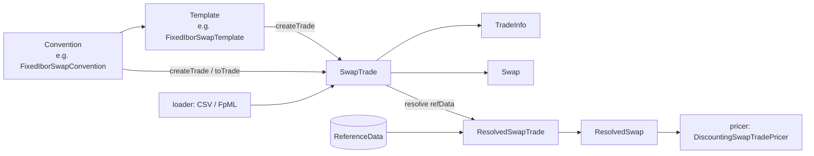

# product

Active contributors: Stephen Colebourne, Marc Henrard, Yuki Iwashita

The `product` module (`strata-product`) holds Strata's model of trades, products, positions and securities for every supported asset class, plus the market conventions and trade templates used to build standard trades. Everything in it is an immutable Joda-Bean. It contains no pricing logic: pricers in [pricer](../pricer/index.md) consume the resolved forms defined here.

This page is the entry point. Three sub-pages go deeper:

- [Trade model and resolution](trade-model.md): `Trade`, `Product`, `Position`, `Security`, `TradeInfo`, attributes, and how `resolve(ReferenceData)` turns a trade into a pricing-ready `ResolvedTrade`.
- [Swaps and rate computations](swaps-and-rates.md): `Swap`, `RateCalculationSwapLeg`, `ResolvedSwapLeg`, payment and accrual periods, and the `rate` package that the swap, FRA, cap/floor and CMS products share.
- [Conventions and templates](conventions-and-templates.md): `TradeConvention`, `TradeTemplate`, the `*/type` packages, and the INI/CSV files that register named conventions.

## Purpose

The module answers one question: "what was agreed?" A `SwapTrade` records the counterparty, trade date and the full swap definition; it does not know about curves or market data. Keeping the description of a trade separate from its valuation lets the same trade be loaded from CSV or FpML ([loader](../loader.md)), stored, serialized, priced by several models, and reported on.

The module depends only on `collect` and `basics` (see `modules/product/pom.xml`). It uses holiday calendars, indices, day counts and schedules from [basics](../basics.md), and `ExtendedEnum`/`ResourceConfig` from [collect](../collect.md).

### Subsystem stats

| Metric | Value |
| --- | --- |
| Production Java files (`src/main/java`) | 435 |
| Test Java files (`src/test/java`) | 312 |
| Test-to-code ratio (files) | 0.72 |
| Resource files (`src/main/resources`) | 24 (20 INI files and `SwapIndexData.csv` under `modules/product/src/main/resources/META-INF/com/opengamma/strata/config/base`, plus `modules/product/src/main/resources/META-INF/com/opengamma/strata/config/base1/Index.ini` and the Joda-Beans and Joda-Convert INI files) |
| Commits to `modules/product` on `main` since 2022-01-01 | 238, of which 176 are release commits by `opengammacibot` |
| Unique human committers since 2022-01-01 | 22 |
| Bus factor | Low. Stephen Colebourne (CODEOWNERS owner) authored 16 of the 62 human commits; no one else has more than 7. |

## Directory layout

All paths are under `modules/product/src/main/java/com/opengamma/strata/product/`. Numbers are production file counts.

```
product/            46  core interfaces: Trade, Product, Position, Security, TradeInfo, attributes
├── bond/           43  fixed coupon bonds, capital indexed bonds, bills, bond futures and options
├── capfloor/       17  Ibor cap/floor, overnight in-arrears cap/floor
├── cms/             9  constant maturity swap legs and products
├── common/         12  shared enums and ids: BuySell, PayReceive, PutCall, LongShort, ExchangeId, CcpId
├── credit/         15  single-name CDS, CDS index, calibration trades
│   └── type/       11  CdsConvention, CDS templates
├── deposit/         9  term deposits, Ibor fixing deposits
│   └── type/       11  deposit conventions and templates
├── dsf/             7  deliverable swap futures
├── etd/            25  generic exchange traded futures and options, ETD ids
├── fra/             6  forward rate agreements
│   └── type/        6  FraConvention, FraTemplate
├── fx/             18  FX spot/forward (FxSingle), FX swap, FX NDF
│   └── type/        6  FxSwapConvention, FxSwapTemplate
├── fxopt/           9  FX vanilla and single barrier options
├── index/          26  Ibor and overnight (STIR) futures and future options
│   └── type/       15  future conventions, contract specs, templates
├── option/          6  barrier and option helper types
├── payment/         5  bullet payment
├── rate/           17  RateComputation and its implementations
├── swap/           48  Swap, swap legs, rate calculations, payment periods, SwapIndex
│   └── type/       56  swap conventions and templates per swap family
└── swaption/       12  swaptions, exercise and settlement
```

Configuration files live in `modules/product/src/main/resources/META-INF/com/opengamma/strata/config/base/` (one INI per convention type, plus `SwapIndexData.csv`). Tests mirror the same package tree under `modules/product/src/test/java/com/opengamma/strata/product/`.

## Key abstractions

| Type | Path | Description |
| --- | --- | --- |
| `PortfolioItem` | `modules/product/src/main/java/com/opengamma/strata/product/PortfolioItem.java` | Base of trades and positions; extends `CalculationTarget` from basics so the calc engine can process it. |
| `Trade` | `modules/product/src/main/java/com/opengamma/strata/product/Trade.java` | A transaction on a date between two counterparties, carrying a `TradeInfo`. |
| `ProductTrade` | `modules/product/src/main/java/com/opengamma/strata/product/ProductTrade.java` | A trade that directly contains a `Product` (OTC style). |
| `ResolvableTrade<T>` | `modules/product/src/main/java/com/opengamma/strata/product/ResolvableTrade.java` | A trade that can be resolved with `ReferenceData` into a `ResolvedTrade`. |
| `ResolvedTrade` | `modules/product/src/main/java/com/opengamma/strata/product/ResolvedTrade.java` | Pricing-ready trade holding a `ResolvedProduct`; the primary input to pricers. |
| `Product` | `modules/product/src/main/java/com/opengamma/strata/product/Product.java` | Economic terms of an instrument, independent of trade date and counterparty. |
| `Security` | `modules/product/src/main/java/com/opengamma/strata/product/Security.java` | A standardized, exchange-style instrument referenced by `SecurityId` and looked up in `ReferenceData`. |
| `SecurityTrade` | `modules/product/src/main/java/com/opengamma/strata/product/SecurityTrade.java` | A trade of a quantity of a security referenced only by id. |
| `Position` | `modules/product/src/main/java/com/opengamma/strata/product/Position.java` | Net (or long/short) quantity of a security. |
| `TradeInfo` | `modules/product/src/main/java/com/opengamma/strata/product/TradeInfo.java` | Id, counterparty, trade date/time/zone, settlement date and typed attributes. |
| `ProductType` | `modules/product/src/main/java/com/opengamma/strata/product/ProductType.java` | Classification string used in summaries and reports (`Swap`, `Fra`, `FxSingle`, ...). |
| `TradeConvention` / `TradeTemplate` | `modules/product/src/main/java/com/opengamma/strata/product/TradeConvention.java`, `modules/product/src/main/java/com/opengamma/strata/product/TradeTemplate.java` | Marker interfaces for market conventions and templates that build trades. |

The [trade model page](trade-model.md) covers how these fit together.

## How it works

Each asset class follows the same shape. A product class (`Swap`, `Fra`, `FxSingle`, `FixedCouponBond`, ...) holds the economic terms. A trade class (`SwapTrade`, `FraTrade`, ...) pairs it with `TradeInfo` and implements `ResolvableTrade<ResolvedXxxTrade>`. Calling `resolve(refData)` produces `ResolvedXxxTrade` and `ResolvedXxx`, where holiday calendars have been applied, schedules expanded and securities looked up. A convention (`FixedIborSwapConvention`, `FraConvention`, ...) in the `type` sub-package can create the trade from a few market inputs.



Packages by asset class, with the main trade types (all in `modules/product/src/main/java/com/opengamma/strata/product/`):

| Package | Main products and trades | Convention / template support |
| --- | --- | --- |
| `swap` | `Swap`, `SwapTrade`, `ResolvedSwapTrade`; legs `RateCalculationSwapLeg`, `KnownAmountSwapLeg`, `RatePeriodSwapLeg` | `modules/product/src/main/java/com/opengamma/strata/product/swap/type`: fixed-Ibor, fixed-overnight, fixed-inflation, Ibor-Ibor, overnight-Ibor, overnight-overnight, three-leg basis, cross-currency Ibor-Ibor and overnight-overnight |
| `fra` | `Fra`, `FraTrade` | `FraConvention`, `FraTemplate` |
| `deposit` | `TermDeposit`, `IborFixingDeposit` and trades | `TermDepositConvention`, `IborFixingDepositConvention` |
| `capfloor` | `IborCapFloor`, `OvernightInArrearsCapFloor` and trades | none |
| `swaption` | `Swaption`, `SwaptionTrade` | none (built from a swap) |
| `cms` | `Cms`, `CmsLeg`, `CmsTrade` | none |
| `dsf` | `Dsf`, `DsfSecurity`, `DsfTrade`, `DsfPosition` | none |
| `index` | `IborFuture`, `OvernightFuture`, their options; security, trade and position for each | `modules/product/src/main/java/com/opengamma/strata/product/index/type`: `IborFutureConvention`, `IborFutureContractSpec`, `OvernightFutureContractSpec`, templates |
| `bond` | `FixedCouponBond`, `CapitalIndexedBond`, `Bill`, `BondFuture`, `BondFutureOption`, `FixedCouponBondOption` | yield convention enums |
| `credit` | `Cds`, `CdsIndex`, trades and calibration trades | `modules/product/src/main/java/com/opengamma/strata/product/credit/type`: `CdsConvention`, `TenorCdsTemplate`, `DatesCdsTemplate` |
| `fx` | `FxSingle`, `FxSwap`, `FxNdf` and trades; `FxTrade`, `FxProduct` interfaces | `modules/product/src/main/java/com/opengamma/strata/product/fx/type`: `FxSwapConvention`, `FxSwapTemplate` |
| `fxopt` | `FxVanillaOption`, `FxSingleBarrierOption` and trades | none |
| `etd` | `EtdFutureSecurity`, `EtdOptionSecurity`, trades, positions, `EtdContractSpec` | `EtdIdUtils` builds `SecurityId`s |
| `payment` | `BulletPayment`, `BulletPaymentTrade` | none |
| top level | `GenericSecurity`, `GenericSecurityTrade`, `GenericSecurityPosition`, `SecurityTrade`, `SecurityPosition` | none |

## Integration points

- **basics**: `ReferenceData`, `Resolvable`, `CalculationTarget` and `ResolvableCalculationTarget` (`modules/basics/src/main/scala/com/opengamma/strata/basics/`), plus indices, holiday calendars, schedules and `ValueSchedule`.
- **collect**: `ExtendedEnum` and `ResourceConfig` load the named conventions; see [Reference data and configuration](../../features/reference-data-and-configuration.md).
- **calc**: `CalculationTasks.resolveTarget` (`modules/calc/src/main/java/com/opengamma/strata/calc/runner/CalculationTasks.java`) calls `resolveTarget(refData)` on any `ResolvableCalculationTarget`, which turns `SecurityTrade`/`SecurityPosition` into the concrete product trade. See [calc](../calc.md).
- **measure**: each product has a calculation function such as `modules/measure/src/main/java/com/opengamma/strata/measure/swap/SwapTradeCalculationFunction.java`, which calls `trade.resolve(refData)` before pricing. All are registered in `modules/measure/src/main/java/com/opengamma/strata/measure/StandardComponents.java`. See [measure](../measure.md).
- **pricer**: pricers take resolved types, for example `presentValue(ResolvedSwapTrade, Currency, RatesProvider)` in `modules/pricer/src/main/java/com/opengamma/strata/pricer/swap/DiscountingSwapTradePricer.java`.
- **market**: curve nodes build trades from conventions, for example `modules/market/src/main/java/com/opengamma/strata/market/curve/node/FixedIborSwapCurveNode.java`. See [market](../market.md).
- **loader**: one CSV plugin per trade type (`modules/loader/src/main/java/com/opengamma/strata/loader/csv/SwapTradeCsvPlugin.java`, `FraTradeCsvPlugin.java`, ...) registered in `modules/loader/src/main/resources/META-INF/com/opengamma/strata/config/base/TradeCsvParserPlugin.ini`, and the FpML parser in `modules/loader/src/main/java/com/opengamma/strata/loader/fpml/`.

## Entry points for modification

- **Add a field to an existing product**: edit the `@PropertyDefinition` fields of the bean, then regenerate the code between the `AUTOGENERATED START/END` markers with the Joda-Beans Maven plugin. Update the `resolve` method and the resolved type if pricers need the field. See [Patterns and conventions](../../how-to-contribute/patterns-and-conventions.md#joda-beans-immutable-bean).
- **Add a standard convention**: add a constant to the relevant `Standard*Conventions` class (for example `modules/product/src/main/java/com/opengamma/strata/product/swap/type/StandardFixedIborSwapConventions.java`) and the matching public constant in the `*Conventions` class. See [Conventions and templates](conventions-and-templates.md).
- **Add a new product type**: follow the checklist below.

### Adding a new product

Use an existing package of similar shape as a template (`fra` is the smallest OTC example; `dsf` is a small security-based one).

1. Create a package `modules/product/src/main/java/com/opengamma/strata/product/<name>/` with a `package-info.java`.
2. Write the product bean `Xxx implements Product, Resolvable<ResolvedXxx>, ImmutableBean, Serializable` and implement `allCurrencies()` and `resolve(ReferenceData)`.
3. Write `ResolvedXxx implements ResolvedProduct` holding the expanded, date-adjusted form that pricers need.
4. Write `XxxTrade implements ProductTrade, ResolvableTrade<ResolvedXxxTrade>` with `TradeInfo info` and `Xxx product`, implementing `withInfo`, `summarize()` and `resolve`. Use `ResolvedXxxTrade implements ResolvedTrade`.
5. If the instrument is exchange traded, also add `XxxSecurity` (implements `Security`), `XxxPosition`, and make the trade implement `SecuritizedProductTrade<Xxx>`, following `modules/product/src/main/java/com/opengamma/strata/product/bond/FixedCouponBondSecurity.java`.
6. Add a `ProductType` constant in `modules/product/src/main/java/com/opengamma/strata/product/ProductType.java` for summaries.
7. Optionally add a `type` sub-package with a convention, template and INI file (see [Conventions and templates](conventions-and-templates.md)).
8. Add tests under `modules/product/src/test/java/com/opengamma/strata/product/<name>/` using `coverImmutableBean`, `coverBeanEquals` and `assertSerialization` (see [Testing](../../how-to-contribute/testing.md)).
9. Outside this module: a pricer in [pricer](../pricer/index.md), a `CalculationFunction` in [measure](../measure.md) registered in `StandardComponents`, and optionally a CSV plugin in [loader](../loader.md).

## Key source files

| File | Why it matters |
| --- | --- |
| `modules/product/src/main/java/com/opengamma/strata/product/Trade.java` | Root trade interface. |
| `modules/product/src/main/java/com/opengamma/strata/product/ResolvableTrade.java` | Contract for the resolve step. |
| `modules/product/src/main/java/com/opengamma/strata/product/TradeInfo.java` | Common trade metadata and attributes. |
| `modules/product/src/main/java/com/opengamma/strata/product/Security.java` | Security contract, including `createProduct` and `createTrade`. |
| `modules/product/src/main/java/com/opengamma/strata/product/ResolvableSecurityTrade.java` | Turns an id-only security trade into a concrete product trade. |
| `modules/product/src/main/java/com/opengamma/strata/product/swap/Swap.java` | Most widely used product; `resolve` loops over legs. |
| `modules/product/src/main/java/com/opengamma/strata/product/swap/RateCalculationSwapLeg.java` | Schedule-driven leg that generates payment periods. |
| `modules/product/src/main/java/com/opengamma/strata/product/swap/type/FixedIborSwapConvention.java` | Typical named convention with `of(String)` lookup. |
| `modules/product/src/main/java/com/opengamma/strata/product/ProductType.java` | Product classification constants. |
| `modules/product/src/main/resources/META-INF/com/opengamma/strata/config/base/FixedIborSwapConvention.ini` | Typical provider registration for an `ExtendedEnum`. |
| `modules/product/pom.xml` | Module dependencies (collect, basics; JUnit 5, AssertJ, Mockito for tests). |

## Related pages

- [Trade model and resolution](trade-model.md)
- [Swaps and rate computations](swaps-and-rates.md)
- [Conventions and templates](conventions-and-templates.md)
- [Modules](../index.md)
- [Pricing a trade](../../features/pricing-a-trade.md)
- [Data models](../../reference/data-models.md)
- [Glossary](../../overview/glossary.md)
