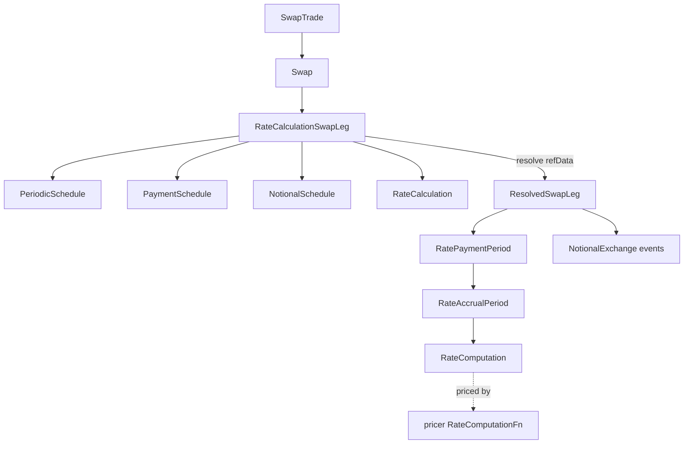

# Swaps and rate computations

Active contributors: Stephen Colebourne, Marc Henrard, Yuki Iwashita

The `swap` package is the largest product package (48 files plus 56 in `modules/product/src/main/java/com/opengamma/strata/product/swap/type`). A `Swap` is a list of `SwapLeg`s. On resolution each leg expands its schedules into `SwapPaymentPeriod`s made of `RateAccrualPeriod`s, and each accrual period carries a `RateComputation` that says how its rate is observed. The `rate` package that defines `RateComputation` is shared with FRAs, deposits, futures, caps/floors and capital indexed bonds. For the overall module see [product](index.md).

## Purpose

Swaps need to describe a wide range of trades (fixed vs Ibor, overnight compounding, inflation, cross-currency with FX resets, amortizing notionals, stubs) while handing pricers a flat, date-adjusted list of cash flows. The package solves this with two layers: a parameterized definition (`RateCalculationSwapLeg`) and an expanded resolved form (`ResolvedSwapLeg`).

## Directory layout

```
modules/product/src/main/java/com/opengamma/strata/product/
├── swap/
│   ├── Swap.java, SwapTrade.java, ResolvedSwap.java, ResolvedSwapTrade.java
│   ├── SwapLeg.java, ScheduledSwapLeg.java, SwapLegType.java
│   ├── RateCalculationSwapLeg.java, KnownAmountSwapLeg.java, RatePeriodSwapLeg.java, ResolvedSwapLeg.java
│   ├── PaymentSchedule.java, NotionalSchedule.java, ResetSchedule.java, FxResetCalculation.java
│   ├── RateCalculation.java, FixedRateCalculation.java, IborRateCalculation.java,
│   │   OvernightRateCalculation.java, InflationRateCalculation.java (+ stub calculations)
│   ├── SwapPaymentPeriod.java, NotionalPaymentPeriod.java, RatePaymentPeriod.java, RateAccrualPeriod.java,
│   │   KnownAmountSwapPaymentPeriod.java, KnownAmountNotionalSwapPaymentPeriod.java
│   ├── SwapPaymentEvent.java, NotionalExchange.java, FxResetNotionalExchange.java, FxReset.java
│   ├── SwapIndex.java, ImmutableSwapIndex.java, SwapIndices.java, SwapIndexCsvLookup.java
│   └── type/   conventions and templates (see Conventions and templates)
└── rate/
    ├── RateComputation.java, OvernightRateComputation.java
    ├── FixedRateComputation.java, FixedOvernightCompoundedAnnualRateComputation.java
    ├── IborRateComputation.java, IborInterpolatedRateComputation.java, IborAveragedRateComputation.java, IborAveragedFixing.java
    ├── OvernightCompoundedRateComputation.java, OvernightAveragedRateComputation.java,
    │   OvernightAveragedDailyRateComputation.java, OvernightCompoundedAnnualRateComputation.java
    └── InflationMonthlyRateComputation.java, InflationInterpolatedRateComputation.java,
        InflationEndMonthRateComputation.java, InflationEndInterpolatedRateComputation.java
```

## Key abstractions

| Type | Path | Description |
| --- | --- | --- |
| `Swap` | `modules/product/src/main/java/com/opengamma/strata/product/swap/Swap.java` | Product holding a non-empty list of `SwapLeg`; implements `Product` and `Resolvable<ResolvedSwap>`. |
| `SwapTrade` | `modules/product/src/main/java/com/opengamma/strata/product/swap/SwapTrade.java` | `TradeInfo` plus `Swap`; resolves to `ResolvedSwapTrade`. |
| `SwapLeg` | `modules/product/src/main/java/com/opengamma/strata/product/swap/SwapLeg.java` | Leg contract: type, pay/receive, start/end date, currency, indices, `resolve(ReferenceData)`. |
| `RateCalculationSwapLeg` | `modules/product/src/main/java/com/opengamma/strata/product/swap/RateCalculationSwapLeg.java` | The standard leg: `payReceive`, `accrualSchedule` (`PeriodicSchedule`), `paymentSchedule`, `notionalSchedule`, `calculation`. |
| `KnownAmountSwapLeg` | `modules/product/src/main/java/com/opengamma/strata/product/swap/KnownAmountSwapLeg.java` | Fixed leg defined by known payment amounts per period; designed to match FpML. |
| `RatePeriodSwapLeg` | `modules/product/src/main/java/com/opengamma/strata/product/swap/RatePeriodSwapLeg.java` | Leg defined by an explicit list of payment periods; the Javadoc recommends `RateCalculationSwapLeg` instead. |
| `RateCalculation` | `modules/product/src/main/java/com/opengamma/strata/product/swap/RateCalculation.java` | Fixed, Ibor, overnight or inflation calculation; `createAccrualPeriods(...)` produces `RateAccrualPeriod`s. |
| `ResolvedSwapLeg` | `modules/product/src/main/java/com/opengamma/strata/product/swap/ResolvedSwapLeg.java` | `type`, `payReceive`, `paymentPeriods` (`SwapPaymentPeriod`) and `paymentEvents` (`SwapPaymentEvent`). |
| `RatePaymentPeriod` | `modules/product/src/main/java/com/opengamma/strata/product/swap/RatePaymentPeriod.java` | One payment: payment date, accrual periods, day count, currency, optional `FxReset`, notional, `CompoundingMethod`. |
| `RateAccrualPeriod` | `modules/product/src/main/java/com/opengamma/strata/product/swap/RateAccrualPeriod.java` | Adjusted and unadjusted dates, year fraction, `RateComputation`, gearing, spread, `NegativeRateMethod`. |
| `SwapPaymentEvent` | `modules/product/src/main/java/com/opengamma/strata/product/swap/SwapPaymentEvent.java` | Single-date events such as `NotionalExchange` and `FxResetNotionalExchange`. |
| `RateComputation` | `modules/product/src/main/java/com/opengamma/strata/product/rate/RateComputation.java` | Describes how a period's rate is observed (fixed, Ibor fixing, overnight compounding, inflation index ratio...). |
| `SwapIndex` | `modules/product/src/main/java/com/opengamma/strata/product/swap/SwapIndex.java` | Named swap rate index (used by CMS), loaded from `SwapIndexData.csv`. |

## How it works

`Swap.resolve` loops over the legs once (a comment notes that streams were a profiling hotspot), resolves each leg, and collects the currencies and indices into the `ResolvedSwap`.

`RateCalculationSwapLeg.resolve` does the expansion:

1. `accrualSchedule.createSchedule(refData, true)` builds the accrual schedule from the `PeriodicSchedule`, applying holiday calendars from `ReferenceData`.
2. `paymentSchedule.createSchedule(resolvedAccruals, refData)` groups accrual periods into payment periods.
3. `calculation.createAccrualPeriods(...)` builds a `RateAccrualPeriod` for each accrual period, attaching the right `RateComputation` (for example an `IborRateComputation` with the fixing date).
4. `paymentSchedule.createPaymentPeriods(...)` combines accrual periods, notional and pay/receive sign into `NotionalPaymentPeriod`s (normally `RatePaymentPeriod`).
5. `notionalSchedule.createEvents(...)` adds notional exchanges if configured.
6. The result is `new ResolvedSwapLeg(type, payReceive, payPeriods, payEvents, currency)`.



`SwapLegType` (`FIXED`, `IBOR`, `OVERNIGHT`, `INFLATION`, `OTHER`) is taken from the calculation and lets `ResolvedSwap.getLegs(SwapLegType)` and `getPayLeg()`/`getReceiveLeg()` find legs.

### Rate computations beyond swaps

`RateComputation` implementations are used outside swaps too: `ResolvedFra.floatingRate`, `ResolvedIborFixingDeposit.floatingRate`, `ResolvedIborFuture.iborRate`, `ResolvedOvernightFuture.overnightRate`, `IborCapletFloorletPeriod.iborRate`, `OvernightInArrearsCapletFloorletPeriod.overnightRate` and `CapitalIndexedBondPaymentPeriod.rateComputation`. On the pricing side, `RateComputationFn.standard()` in `modules/pricer/src/main/java/com/opengamma/strata/pricer/rate/RateComputationFn.java` dispatches on the computation type. A new `RateComputation` therefore needs a matching function in [pricer](../pricer/index.md).

### Swap indices

`SwapIndex` instances are an `ExtendedEnum` whose provider is `SwapIndexCsvLookup` (registered as `instance` in `modules/product/src/main/resources/META-INF/com/opengamma/strata/config/base/SwapIndex.ini`). It reads every `SwapIndexData.csv` found by `ResourceConfig.orderedResources`, with columns `Name,Active,Convention,Tenor,FixingTime,FixingZone`, for example `USD-LIBOR-1100-1Y` using convention `USD-FIXED-6M-LIBOR-3M`. `modules/product/src/main/resources/META-INF/com/opengamma/strata/config/base1/Index.ini` adds `SwapIndex` to the combined `Index` lookup defined in basics.

## Integration points

- Schedules, day counts, `IborIndex`, `OvernightIndex`, `PriceIndex` and `ValueSchedule` come from [basics](../basics.md).
- Pricers: `modules/pricer/src/main/java/com/opengamma/strata/pricer/swap/DiscountingSwapTradePricer.java`, `DiscountingSwapLegPricer.java` and `SwapPaymentPeriodPricer.java` in the same package.
- Curve calibration builds swaps from conventions through curve nodes in `modules/market/src/main/java/com/opengamma/strata/market/curve/node/`. See [Curve calibration](../../features/curve-calibration.md).
- Loaders: `modules/loader/src/main/java/com/opengamma/strata/loader/csv/SwapTradeCsvPlugin.java`, `FullSwapTradeCsvPlugin.java` and the FpML parser.

## Entry points for modification

- A new floating-rate observation style: add a `RateComputation` in `rate/`, a `RateCalculation` (or extend an existing one) in `swap/` that creates it, and a pricer function.
- New leg features usually touch `PaymentSchedule`, `NotionalSchedule` or `ResetSchedule`, then `RatePaymentPeriod` if the pricer needs the data.
- Tests for these types are in `modules/product/src/test/java/com/opengamma/strata/product/swap/` (39 files) and `modules/product/src/test/java/com/opengamma/strata/product/rate/` (14 files).

## Key source files

| File | Why it matters |
| --- | --- |
| `modules/product/src/main/java/com/opengamma/strata/product/swap/RateCalculationSwapLeg.java` | Resolution logic for the common leg. |
| `modules/product/src/main/java/com/opengamma/strata/product/swap/PaymentSchedule.java` | Groups accrual periods into payments, compounding. |
| `modules/product/src/main/java/com/opengamma/strata/product/swap/IborRateCalculation.java` | Ibor fixing offsets, stubs, gearing and spread schedules. |
| `modules/product/src/main/java/com/opengamma/strata/product/swap/OvernightRateCalculation.java` | Overnight accrual method (compounded or averaged), rate cut-off days, gearing and spread. |
| `modules/product/src/main/java/com/opengamma/strata/product/swap/RatePaymentPeriod.java` | Main resolved cash-flow type. |
| `modules/product/src/main/java/com/opengamma/strata/product/rate/RateComputation.java` | Root of the observation model. |

## Related pages

- [product](index.md)
- [Trade model and resolution](trade-model.md)
- [Conventions and templates](conventions-and-templates.md)
- [pricer](../pricer/index.md)
- [Glossary](../../overview/glossary.md)
