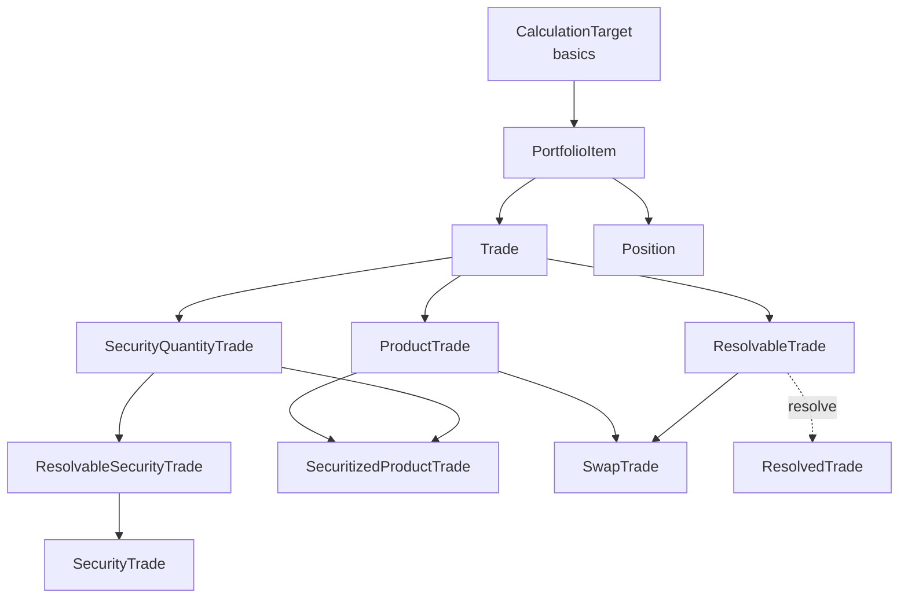
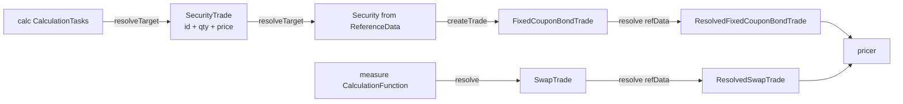

# Trade model and resolution

Active contributors: Stephen Colebourne, Marc Henrard, Yuki Iwashita

Strata separates what was traded (`Product`), the fact that a trade happened (`Trade` plus `TradeInfo`), and holdings of exchange-traded instruments (`Security`, `Position`). Before pricing, every trade is resolved against `ReferenceData` into a `ResolvedTrade`, which fixes holiday calendars, expands schedules and looks up securities. This page describes those interfaces in `modules/product/src/main/java/com/opengamma/strata/product/`. For the module overview see [product](index.md).

## Purpose

The top-level package defines the type hierarchy that every asset class package implements. The calc engine, the loaders and the reports work against these interfaces, so a new product only has to implement them to be loaded, priced and reported.

## Directory layout

```
modules/product/src/main/java/com/opengamma/strata/product/
├── PortfolioItem.java, PortfolioItemInfo.java, PortfolioItemSummary.java, PortfolioItemType.java
├── Trade.java, ProductTrade.java, ResolvableTrade.java, ResolvedTrade.java
├── Product.java, ResolvedProduct.java, SecuritizedProduct.java
├── Security.java, SecurityId.java, SecurityInfo.java, SecurityPriceInfo.java, GenericSecurity.java
├── SecurityQuantity.java, SecurityQuantityTrade.java, SecurityTrade.java, ResolvableSecurityTrade.java
├── SecuritizedProductTrade.java, SecuritizedProductPosition.java, SecuritizedProductPortfolioItem.java
├── Position.java, SecurityPosition.java, ResolvableSecurityPosition.java, GenericSecurityPosition.java
├── TradeInfo.java, TradeInfoBuilder.java, PositionInfo.java, PositionInfoBuilder.java, ItemInfo.java
├── Attributes.java, AttributeType.java, SimpleAttributes.java
├── LegalEntity.java, LegalEntityId.java, SimpleLegalEntity.java
├── ProductType.java, TradedPrice.java, TradeConvention.java, TradeTemplate.java
└── common/   BuySell, PayReceive, LongShort, PutCall, CapFloor, SettlementType, ExchangeId(s), CcpId(s), SummarizerUtils
```

## Key abstractions

| Type | Path | Description |
| --- | --- | --- |
| `PortfolioItem` | `modules/product/src/main/java/com/opengamma/strata/product/PortfolioItem.java` | Extends `CalculationTarget`. Has `getInfo()`, optional `getId()`, `withInfo` and `summarize()`. |
| `Trade` | `modules/product/src/main/java/com/opengamma/strata/product/Trade.java` | `PortfolioItem` whose info is a `TradeInfo`. |
| `ProductTrade` | `modules/product/src/main/java/com/opengamma/strata/product/ProductTrade.java` | Trade with `getProduct()`. Used by OTC trades such as `SwapTrade`. |
| `ResolvableTrade<T extends ResolvedTrade>` | `modules/product/src/main/java/com/opengamma/strata/product/ResolvableTrade.java` | `Trade` plus `Resolvable<T>`; `resolve(ReferenceData)` may throw `ReferenceDataNotFoundException`. |
| `ResolvedTrade` | `modules/product/src/main/java/com/opengamma/strata/product/ResolvedTrade.java` | `getInfo()` and `getProduct()` returning a `ResolvedProduct`. Not a `CalculationTarget`. |
| `Product` | `modules/product/src/main/java/com/opengamma/strata/product/Product.java` | `allCurrencies()`, `allPaymentCurrencies()`, `isCrossCurrency()`. |
| `SecuritizedProduct` | `modules/product/src/main/java/com/opengamma/strata/product/SecuritizedProduct.java` | Product of a security: has `getSecurityId()` and a single trading currency. |
| `Security` | `modules/product/src/main/java/com/opengamma/strata/product/Security.java` | `SecurityInfo`, `getUnderlyingIds()`, `createProduct(refData)`, `createTrade(...)`, `createPosition(...)`. |
| `SecurityQuantityTrade` | `modules/product/src/main/java/com/opengamma/strata/product/SecurityQuantityTrade.java` | Trade with security id, quantity and price. |
| `SecuritizedProductTrade<P>` | `modules/product/src/main/java/com/opengamma/strata/product/SecuritizedProductTrade.java` | Both a `ProductTrade` and a `SecurityQuantityTrade`, for example `FixedCouponBondTrade`. |
| `SecurityTrade` | `modules/product/src/main/java/com/opengamma/strata/product/SecurityTrade.java` | Id-only trade of any security; implements `ResolvableSecurityTrade`. |
| `Position` / `SecurityPosition` | `modules/product/src/main/java/com/opengamma/strata/product/Position.java`, `modules/product/src/main/java/com/opengamma/strata/product/SecurityPosition.java` | Net quantity of a security, with `PositionInfo`. `SecurityPosition` stores long and short quantities. |
| `TradeInfo` | `modules/product/src/main/java/com/opengamma/strata/product/TradeInfo.java` | Optional `id`, `counterparty`, `tradeDate`, `tradeTime`, `zone`, `settlementDate`, plus an `attributes` map keyed by `AttributeType<?>`. |
| `AttributeType<T>` | `modules/product/src/main/java/com/opengamma/strata/product/AttributeType.java` | Typed key for extensible attributes (for example a description or name). |

## How it works

### Type hierarchy



OTC instruments such as swaps, FRAs and FX forwards embed their `Product` directly in a `ProductTrade`. Exchange-traded instruments are described once as a `Security` (stored in `ReferenceData` under its `SecurityId`) and traded by quantity. The `Security` Javadoc states this split directly: OTC instruments "are embedded directly within the trade, rather than handled as one-off securities."

### Resolve flow

Resolution has two forms.

1. **Product trades.** `ResolvableTrade.resolve(refData)` converts the trade into its resolved form. In `modules/product/src/main/java/com/opengamma/strata/product/swap/SwapTrade.java` this is `new ResolvedSwapTrade(info, product.resolve(refData))`. The product's own `resolve` does the work: for a swap, each leg resolves its schedules with the holiday calendars in `ReferenceData` and produces payment periods (see [Swaps and rate computations](swaps-and-rates.md)).
2. **Security trades and positions.** `SecurityTrade` and `SecurityPosition` carry only a `SecurityId`. They implement `ResolvableCalculationTarget`, and `resolveTarget(refData)` in `modules/product/src/main/java/com/opengamma/strata/product/ResolvableSecurityTrade.java` looks the `Security` up in `ReferenceData` and calls `security.createTrade(info, quantity, price, refData)`. The result must be a `SecuritizedProductTrade`, for example a `FixedCouponBondTrade` built by `FixedCouponBondSecurity.createTrade`.



The calc engine calls `resolveTarget` once per target when building tasks (`modules/calc/src/main/java/com/opengamma/strata/calc/runner/CalculationTasks.java`). The `resolve` call that produces a `ResolvedTrade` happens later inside each calculation function, for example `modules/measure/src/main/java/com/opengamma/strata/measure/swap/SwapTradeCalculationFunction.java`.

The `ResolvedTrade` Javadoc warns that resolved objects are bound to reference data at the time of resolution, so a cached resolved trade will not see later holiday changes.

### Trade information and attributes

`TradeInfo` is built with `TradeInfo.builder()` (`modules/product/src/main/java/com/opengamma/strata/product/TradeInfoBuilder.java`) and every field is optional. Extra data goes in the attributes map through `AttributeType<T>` keys. `modules/product/src/main/resources/META-INF/org/joda/convert/Renamed.ini` maps the older `TradeAttributeType`, `PositionAttributeType` and `SecurityAttributeType` class names to `AttributeType` so old serialized data still loads.

`summarize()` returns a `PortfolioItemSummary` with a `ProductType` and a human readable description. Helpers for building those descriptions are in `modules/product/src/main/java/com/opengamma/strata/product/common/SummarizerUtils.java`.

## Integration points

- `CalculationTarget`, `ResolvableCalculationTarget`, `Resolvable` and `ReferenceData` come from `modules/basics/src/main/scala/com/opengamma/strata/basics/`. See [basics](../basics.md).
- The calc engine treats every `PortfolioItem` as a target. See [calc](../calc.md).
- Reports use `PortfolioItemSummary` and `TradeInfo`. See [report](../report.md).

## Entry points for modification

- New trade metadata that applies to all trades belongs in an `AttributeType` constant rather than a new `TradeInfo` field, because `TradeInfo` is serialized widely.
- A new security-based product needs `Security.createProduct`, `createTrade` and `createPosition` so that `SecurityTrade` and `SecurityPosition` can resolve to it.

## Key source files

| File | Why it matters |
| --- | --- |
| `modules/product/src/main/java/com/opengamma/strata/product/PortfolioItem.java` | Link to the calc engine through `CalculationTarget`. |
| `modules/product/src/main/java/com/opengamma/strata/product/ResolvableTrade.java` | Resolve contract and its Javadoc on caching. |
| `modules/product/src/main/java/com/opengamma/strata/product/ResolvableSecurityTrade.java` | Security lookup and trade creation. |
| `modules/product/src/main/java/com/opengamma/strata/product/SecurityPosition.java` | Same lookup for positions. |
| `modules/product/src/main/java/com/opengamma/strata/product/TradeInfo.java` | Trade metadata bean. |
| `modules/product/src/main/java/com/opengamma/strata/product/bond/FixedCouponBondSecurity.java` | Reference implementation of a `Security`. |

## Related pages

- [product](index.md)
- [Patterns and conventions: resolve before pricing](../../how-to-contribute/patterns-and-conventions.md#resolve-before-pricing)
- [Reference data and configuration](../../features/reference-data-and-configuration.md)
- [Data models](../../reference/data-models.md)
