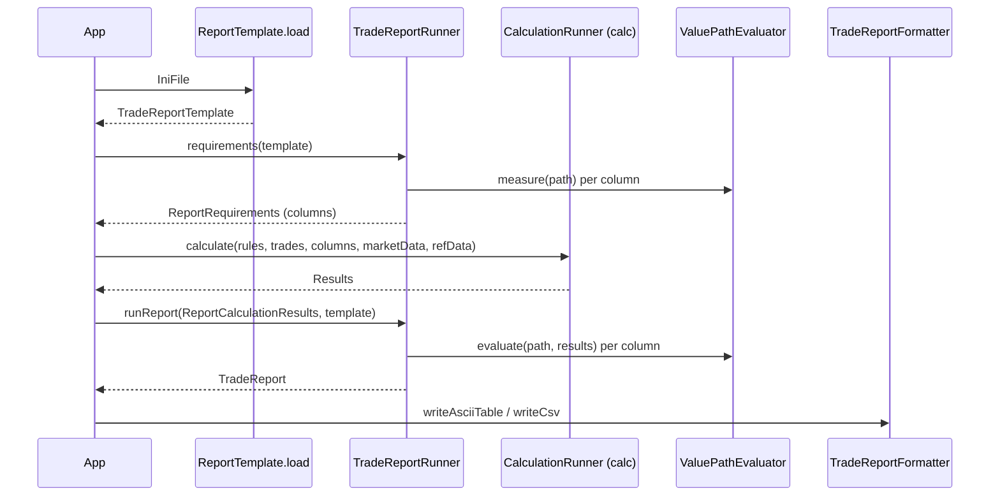

# report

Active contributors: Stephen Colebourne

## Purpose

The `report` module turns calculation engine output into tables a person can read. A report template says which columns to show; a report runner works out which measures the template needs, then evaluates each column against the results and produces a `Report` that can be written as an ASCII table or CSV. Two report types are built in: trade reports (one row per trade) and cash flow reports (one row per cash flow of a single trade).

Stats: 52 Java source files, 14 test files, a test-to-code ratio of about 0.27, and 2 unique committers on `main` since 2022 (Stephen Colebourne and the `opengammacibot` release account). The module has changed very little in recent years.

## Directory layout

All sources are under `modules/report/src/main/java/com/opengamma/strata/report/`.

| Path | Contents |
| --- | --- |
| `report/` (root) | `Report`, `ReportTemplate`, `ReportRunner`, `ReportRequirements`, `ReportCalculationResults`, `ReportTemplateIniLoader`, package-private `DispatchingReportTemplateIniLoader` |
| `modules/report/src/main/java/com/opengamma/strata/report/trade/` | `TradeReport`, `TradeReportColumn`, `TradeReportTemplate`, `TradeReportTemplateIniLoader`, `TradeReportRunner`, `TradeReportFormatter` |
| `modules/report/src/main/java/com/opengamma/strata/report/cashflow/` | `CashFlowReport`, `CashFlowReportTemplate`, `CashFlowReportTemplateIniLoader`, `CashFlowReportRunner`, `CashFlowReportFormatter` |
| `modules/report/src/main/java/com/opengamma/strata/report/framework/expression/` | Value path parsing: `ValuePathEvaluator`, `ValueRootType`, `RootEvaluator`, `ResultsRow`, and the `TokenEvaluator` implementations |
| `modules/report/src/main/java/com/opengamma/strata/report/framework/format/` | Formatting: `ReportFormatter`, `ReportOutputFormat`, `FormatSettings`, `FormatSettingsProvider`, `FormatCategory`, `ValueFormatter` and `ValueFormatters` |

Tests are in `modules/report/src/test/java/com/opengamma/strata/report/` and test templates in `modules/report/src/test/resources/` (`trade-report-test-simple.ini`, `trade-report-test-path.ini`, `trade-report-test-ignore-failures.ini`).

## Key abstractions

| Type | Role |
| --- | --- |
| `ReportCalculationResults` | Joda-Bean holding the valuation date, targets, columns, engine `Results`, `CalculationFunctions` and `ReferenceData`. The short `of(...)` factory uses `StandardComponents.calculationFunctions()` and `ReferenceData.standard()` |
| `ReportTemplate` | Marker interface. `ReportTemplate.load(IniFile)` picks the loader by the `reportType` setting |
| `ReportRunner<T>` | `requirements(template)` returns `ReportRequirements`; `runReport(results, template)` returns a `Report` |
| `ReportRequirements` | The list of `Column`s the engine must calculate for the report |
| `Report` | A table with headers, row count, valuation date and run instant; `writeCsv`, `writeAsciiTable`, `toAsciiTableString` |
| `TradeReportColumn` | One column: `header`, optional `value` path, `ignoreFailures` flag |
| `ValuePathEvaluator` | Parses and evaluates paths such as `Measures.PresentValue` or `Product.legs.fixed.calculation.rate.initialValue` |
| `TokenEvaluator<T>` | Resolves one path token against an object of type `T` |
| `ReportFormatter<R>` | Base class that writes a report as CSV or ASCII table using per-type `FormatSettings` |

## How it works



### Templates

Templates are INI files read with `IniFile` from [collect](collect.md). Every template needs a `[settings]` section (matched case-insensitively) with a `reportType` key. `DispatchingReportTemplateIniLoader` holds the two known loaders and picks one by type, case-insensitively:

- `trade`: `TradeReportTemplateIniLoader`. Each section other than `settings` becomes a column, in file order. The section name is the header, `value` is the value path, and `ignoreFailures = true` prints an empty cell instead of `FAIL: <message>`.
- `cashflow`: `CashFlowReportTemplateIniLoader`. The template has no options; it returns an empty `CashFlowReportTemplate`.

An excerpt of `examples/src/main/resources/example-reports/swap-report-template.ini`:

```ini
[Settings]
reportType = Trade

[Maturity Date]
value = Product.endDate

[Fixed Rate]
value = Product.legs.fixed.calculation.rate.initialValue
ignoreFailures = true

[NPV]
value = Measures.PresentValue

[USD Discounting PV01]
value = Measures.PV01CalibratedBucketed.usd.usd-disc
```

### Value paths

`ValuePathEvaluator` splits a path on `.`. The first token must be one of the `ValueRootType` roots: `Measures`, `Product`, `Security`, `Trade`, `Position` or `Target`. For `Measures`, the second token is the measure name, which is how `TradeReportRunner.requirements(...)` derives the engine columns from the template.

Evaluation starts with `RootEvaluator` on a `ResultsRow` (one trade's results). After each step the evaluator picks the next `TokenEvaluator` whose target type matches the current value, in this order: `CurrencyAmount`, `Map`, `CurrencyParameterSensitivities`, `CurrencyParameterSensitivity`, `Position`, `Trade`, `Security`, any Joda-Bean, any `Iterable`. A bean token is a property name, so `Product.endDate` calls the bean's `endDate` property. If no evaluator matches, the cell becomes a failure saying the expression cannot be invoked on that type. `ValuePathEvaluator.tokens(object)` lists the valid next tokens, which is useful when debugging a template.

### Formatting

`ReportFormatter` writes CSV through `CsvOutput` and ASCII tables through `AsciiTable` (both in `collect`). `FormatSettingsProvider` maps value types to a `FormatCategory` (`DATE`, `NUMERIC`, `TEXT`) and a `ValueFormatter`; numeric and date columns are right-aligned in ASCII output. `TradeReportFormatter` and `CashFlowReportFormatter` are the two concrete formatters.

### Cash flow reports

`CashFlowReportRunner` requires one measure, `Measures.EXPLAIN_PRESENT_VALUE`, and accepts results for exactly one trade (it throws `IllegalArgumentException` for zero or several). It flattens the nested `ExplainMap` from [market](market.md) into rows and orders columns by a fixed list of `ExplainKey`s (flow type, leg number, dates, rates, forecast value, discount factor, present value and so on).

## Integration points

- Consumes `Results`, `Column`, `Measure` and `CalculationFunctions` from [calc](calc.md).
- Uses `StandardComponents` and `Measures` from [measure](measure.md).
- Uses `IniFile`, `CsvOutput`, `AsciiTable` and `Result` from [collect](collect.md).
- Used by `ReportRunnerTool` and the pricing examples in [examples](examples.md), and by the golden-copy regression test there.

## Entry points for modification

- **New trade report column:** usually no Java change. Add a section to a template with a value path. If a type cannot be traversed, add a `TokenEvaluator` in `modules/report/src/main/java/com/opengamma/strata/report/framework/expression/` and register it in the `EVALUATORS` list in `ValuePathEvaluator`, keeping specific types before `BeanTokenEvaluator`.
- **New value format:** add a `ValueFormatter` in `modules/report/src/main/java/com/opengamma/strata/report/framework/format/`, expose it in `ValueFormatters`, and map the type in `FormatSettingsProvider.TYPE_SETTINGS`.
- **New report type:** implement `ReportTemplate`, a `ReportTemplateIniLoader` with a new `reportType` string, a `ReportRunner`, a `Report` and a `ReportFormatter`, then add the loader to `DispatchingReportTemplateIniLoader.LOADERS`.

## Key source files

| File | Why it matters |
| --- | --- |
| `modules/report/src/main/java/com/opengamma/strata/report/ReportCalculationResults.java` | Input to every report |
| `modules/report/src/main/java/com/opengamma/strata/report/DispatchingReportTemplateIniLoader.java` | Template type dispatch |
| `modules/report/src/main/java/com/opengamma/strata/report/trade/TradeReportRunner.java` | Builds requirements and the trade report table |
| `modules/report/src/main/java/com/opengamma/strata/report/trade/TradeReportTemplateIniLoader.java` | Trade template INI format |
| `modules/report/src/main/java/com/opengamma/strata/report/framework/expression/ValuePathEvaluator.java` | Value path parsing and evaluation |
| `modules/report/src/main/java/com/opengamma/strata/report/framework/expression/ValueRootType.java` | Allowed path roots |
| `modules/report/src/main/java/com/opengamma/strata/report/framework/format/ReportFormatter.java` | CSV and ASCII table output |
| `modules/report/src/main/java/com/opengamma/strata/report/framework/format/FormatSettingsProvider.java` | Type-to-formatter mapping |
| `modules/report/src/main/java/com/opengamma/strata/report/cashflow/CashFlowReportRunner.java` | Explain map flattening |

## Related pages

- [measure](measure.md)
- [calc](calc.md)
- [examples](examples.md)
- [Pricing a trade](../features/pricing-a-trade.md)
