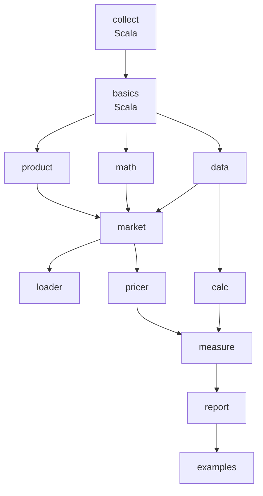
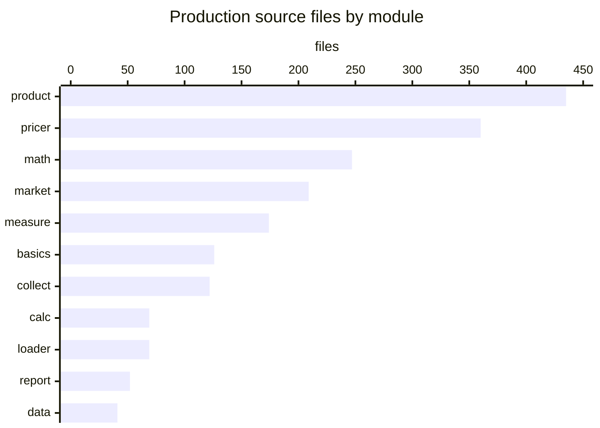
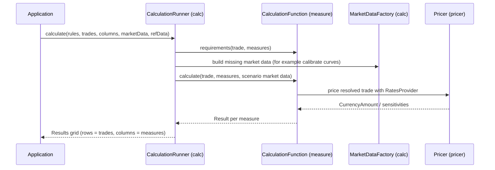

# Architecture

Strata is a layered set of Maven modules. Each module depends only on modules below it, so the low-level utilities in `collect` know nothing about trades or pricing, and the reporting layer at the top can use everything. The root `pom.xml` builds `modules/pom.xml` (the `strata-parent` POM, version 2.12.78-SNAPSHOT) and `examples/pom.xml`.

## Module layers

The dependencies below come from the `<dependency>` sections of each `modules/*/pom.xml`.

Arrows point from a module to the modules that use it. Test-scope dependencies are left out; for example `pricer` uses `loader` only in its tests.

| Layer | Modules | Role |
| --- | --- | --- |
| Foundation | `collect`, `basics` | Utilities, collections, time series, results, I/O, configuration; currencies, dates, holidays, indices, schedules, reference data |
| Domain model | `data`, `product`, `math` | Market data identifiers and scenarios; products, trades and conventions; numerical methods |
| Market model | `market` | Curves, surfaces, cubes, parameter metadata and sensitivities |
| Input | `loader` | CSV and FpML loading of trades, positions, quotes, curves and sensitivities |
| Pricing | `pricer` | Pricers for every product, rates and volatility providers, curve calibration |
| Engine | `calc`, `measure` | Calculation runner and task model; calculation functions and measures for every trade type |
| Output | `report` | Trade and cash-flow reports, report templates, ASCII/CSV formatting |
| Usage | `examples` | Runnable examples and the `ReportRunnerTool` command line tool |

`AGENTS.md` notes that the `impl` packages in `pricer` and `loader` are private implementation details. `math` has the same convention for `com.opengamma.strata.math.impl`.

## Languages

Counts are production source files under `src/main`, taken from the working tree at commit 7caa43e.

`collect` (114 Scala files plus 8 `package-info.java`) and `basics` (119 Scala files plus 7 `package-info.java`) are Scala 3.9.0. All other modules are Java compiled with `--release 8`. The Scala modules emit Java 17 bytecode, so the whole project needs JDK 17 or later.

## How a calculation flows

1. The application builds `Trade` objects (`modules/product/src/main/java/com/opengamma/strata/product/Trade.java`) and chooses `Column`s of `Measure`s.
2. `CalculationRules` combine the `CalculationFunctions` from `modules/measure/src/main/java/com/opengamma/strata/measure/StandardComponents.java` with market data lookup rules.
3. `CalculationRunner` (`modules/calc/src/main/java/com/opengamma/strata/calc/CalculationRunner.java`) turns the grid into `CalculationTasks`, asks each function for its market data requirements, and runs the tasks on a thread pool.
4. Missing derived market data, such as calibrated curves, is built by `MarketDataFactory` (`modules/calc/src/main/java/com/opengamma/strata/calc/marketdata/MarketDataFactory.java`) using market data functions from `measure`.
5. Each calculation function resolves the trade against `ReferenceData`, builds a `RatesProvider` and calls the pricer, for example `DiscountingFraTradePricer` in `modules/pricer/src/main/java/com/opengamma/strata/pricer/fra/DiscountingFraTradePricer.java`.
6. Results come back as `Result<T>` values (`modules/collect/src/main/scala/com/opengamma/strata/collect/result/Result.scala`), so one failing trade does not stop the grid.

See [Pricing a trade](../features/pricing-a-trade.md) for the detailed walk-through.

## Cross-cutting building blocks

- **Immutable beans.** Almost every value type is an immutable Joda-Beans bean with a builder and a meta-bean. See [Joda-Beans and serialization](../features/joda-beans-and-serialization.md).
- **Extended enums and configuration.** Named types such as `HolidayCalendarId`, `DayCount` and `IborIndex` are looked up by name from INI files under `META-INF/com/opengamma/strata/config/`, merged by `ResourceConfig`. See [Reference data and configuration](../features/reference-data-and-configuration.md).
- **Resolution.** Products and trades implement `Resolvable` and are turned into `Resolved*` forms using `ReferenceData` before pricing.
- **Results instead of exceptions.** The engine reports failures as `Failure` values with a `FailureReason`, keeping the result grid complete.

## The Scala foundation

`collect` and `basics` were migrated from Java to Scala 3.9.0 on this branch. The migration keeps every Java class name, method descriptor, static entry point, checked exception and Joda-Beans property, and the Java tests of both modules run unchanged against the Scala bytecode. The build uses `scala-maven-plugin` 4.10.0 in `modules/collect/pom.xml` and `modules/basics/pom.xml`. Build-only bytecode restorers in `modules/collect/src/build/` add back `@SafeVarargs` and bridge-method `IOException` clauses that scalac does not emit. See [Scala and Java interoperability](../features/scala-java-interop.md) and [Scala migration](../background/scala-migration.md).

## Related pages

- [Modules](../modules/index.md)
- [Getting started](getting-started.md)
- [Reference: dependencies](../reference/dependencies.md)
