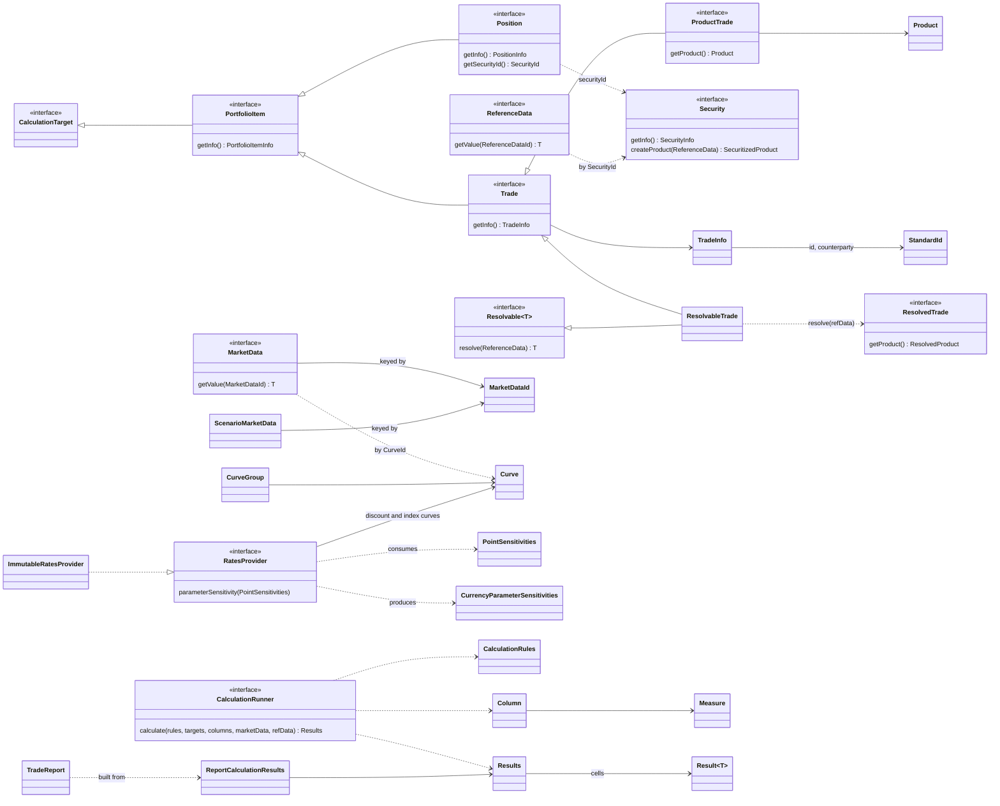

# Data models

Strata's domain model is a chain of immutable types: trades and positions describe what is held, reference data and market data describe the world on a valuation date, providers such as `RatesProvider` turn market data into pricing inputs, and the calculation engine returns a grid of `Result` values that reports format. This page lists the key types, where they live, and how they connect.

Almost all of these types are immutable Joda-Beans or interfaces implemented by Joda-Beans. The types in `collect` and `basics` are Scala on this branch but keep the same Java API; see [Scala and Java interoperability](../features/scala-java-interop.md).

## Relationships

Solid arrows with a hollow triangle show interface inheritance. Plain arrows show a field or accessor. Dotted arrows show a method-level use rather than a stored field.

## Key types

### Trades, positions and products (`product`)

| Type | Path | Purpose |
| --- | --- | --- |
| `PortfolioItem` | `modules/product/src/main/java/com/opengamma/strata/product/PortfolioItem.java` | Common parent of trades and positions. Extends `CalculationTarget` and exposes `getInfo()` and `summarize()`. |
| `Trade` | `modules/product/src/main/java/com/opengamma/strata/product/Trade.java` | A trade with a `TradeInfo`. Implemented per asset class, for example `SwapTrade` or `FxSingleTrade`. |
| `TradeInfo` | `modules/product/src/main/java/com/opengamma/strata/product/TradeInfo.java` | Optional trade metadata: `id` and `counterparty` (`StandardId`), trade date, time, zone, settlement date and typed attributes. |
| `ProductTrade` | `modules/product/src/main/java/com/opengamma/strata/product/ProductTrade.java` | A `Trade` that holds a `Product` directly. |
| `ResolvableTrade` | `modules/product/src/main/java/com/opengamma/strata/product/ResolvableTrade.java` | A `Trade` that is also `Resolvable` into a `ResolvedTrade`. Most product trades, such as `SwapTrade`, implement it. |
| `SecurityTrade` | `modules/product/src/main/java/com/opengamma/strata/product/SecurityTrade.java` | A trade that refers to a security by `SecurityId` and is resolved through reference data. |
| `Product` | `modules/product/src/main/java/com/opengamma/strata/product/Product.java` | The financial instrument itself, with no trade details. Reports `allCurrencies()`. |
| `ResolvedTrade` | `modules/product/src/main/java/com/opengamma/strata/product/ResolvedTrade.java` | A trade after resolution: dates adjusted, schedules expanded, ready for pricing. Exposes a `ResolvedProduct`. |
| `ResolvedProduct` | `modules/product/src/main/java/com/opengamma/strata/product/ResolvedProduct.java` | Marker for the resolved form of a product. |
| `Position` | `modules/product/src/main/java/com/opengamma/strata/product/Position.java` | A quantity of a security, identified by `SecurityId`, with a `PositionInfo`. |
| `Security` | `modules/product/src/main/java/com/opengamma/strata/product/Security.java` | A tradable instrument stored in reference data, with a `SecurityInfo`. Creates products, trades and positions. |

### Reference data and identifiers (`basics`)

| Type | Path | Purpose |
| --- | --- | --- |
| `ReferenceData` | `modules/basics/src/main/scala/com/opengamma/strata/basics/ReferenceData.scala` | Lookup of static data (holiday calendars, securities) by `ReferenceDataId`. `ReferenceData.standard()` returns the built-in set. |
| `ReferenceDataId` | `modules/basics/src/main/scala/com/opengamma/strata/basics/ReferenceDataId.scala` | Typed key into `ReferenceData`. |
| `StandardId` | `modules/basics/src/main/scala/com/opengamma/strata/basics/StandardId.scala` | Scheme plus value identifier used for trades, counterparties, securities and legal entities. |
| `Resolvable` | `modules/basics/src/main/scala/com/opengamma/strata/basics/Resolvable.scala` | `resolve(ReferenceData)` contract implemented by trades and products. |
| `CalculationTarget` | `modules/basics/src/main/scala/com/opengamma/strata/basics/CalculationTarget.scala` | Marker for anything the calculation engine can calculate, usually a trade or position. |

### Market data (`data`)

| Type | Path | Purpose |
| --- | --- | --- |
| `MarketData` | `modules/data/src/main/java/com/opengamma/strata/data/MarketData.java` | Market data for one valuation date: values by `MarketDataId` and time series by `ObservableId`. |
| `MarketDataId` | `modules/data/src/main/java/com/opengamma/strata/data/MarketDataId.java` | Typed key for a market data value, for example a quote, an FX rate or a curve. |
| `ObservableId` | `modules/data/src/main/java/com/opengamma/strata/data/ObservableId.java` | Key for a directly observable value such as a quote, also used for time series. |
| `ScenarioMarketData` | `modules/data/src/main/java/com/opengamma/strata/data/scenario/ScenarioMarketData.java` | Market data for many scenarios at once. Values are held in `MarketDataBox`, which is either a single value or one per scenario. |

### Curves, providers and sensitivities (`market`, `pricer`)

| Type | Path | Purpose |
| --- | --- | --- |
| `Curve` | `modules/market/src/main/java/com/opengamma/strata/market/curve/Curve.java` | A one-dimensional curve with `CurveMetadata` and parameters. Implemented by, among others, `InterpolatedNodalCurve`. |
| `InterpolatedNodalCurve` | `modules/market/src/main/java/com/opengamma/strata/market/curve/InterpolatedNodalCurve.java` | Curve defined by x and y node values, an interpolator and left and right extrapolators. |
| `CurveGroup` | `modules/market/src/main/java/com/opengamma/strata/market/curve/CurveGroup.java` | A named set of curves, usually calibrated together. |
| `RatesCurveGroup` | `modules/market/src/main/java/com/opengamma/strata/market/curve/RatesCurveGroup.java` | Curve group with discount curves by currency and forward curves by index. |
| `CurveGroupDefinition` | `modules/market/src/main/java/com/opengamma/strata/market/curve/CurveGroupDefinition.java` | The inputs needed to calibrate a curve group. See [Curve calibration](../features/curve-calibration.md). |
| `PointSensitivities` | `modules/market/src/main/java/com/opengamma/strata/market/sensitivity/PointSensitivities.java` | List of `PointSensitivity` values, sensitivities to individual points such as one discount factor date. |
| `CurrencyParameterSensitivities` | `modules/market/src/main/java/com/opengamma/strata/market/param/CurrencyParameterSensitivities.java` | Sensitivities to curve parameters, one `CurrencyParameterSensitivity` per curve and currency. Used for PV01 and bucketed PV01. |
| `BaseProvider` | `modules/pricer/src/main/java/com/opengamma/strata/pricer/BaseProvider.java` | Valuation date, FX rates and discount factors. |
| `RatesProvider` | `modules/pricer/src/main/java/com/opengamma/strata/pricer/rate/RatesProvider.java` | Extends `BaseProvider` with Ibor, overnight, price and FX index rates and time series. `parameterSensitivity(PointSensitivities)` converts point to parameter sensitivities. |
| `ImmutableRatesProvider` | `modules/pricer/src/main/java/com/opengamma/strata/pricer/rate/ImmutableRatesProvider.java` | The standard `RatesProvider`, holding discount curves, index curves, time series and an `FxRateProvider`. |

### Calculation engine and results (`calc`, `collect`, `report`)

| Type | Path | Purpose |
| --- | --- | --- |
| `CalculationRunner` | `modules/calc/src/main/java/com/opengamma/strata/calc/CalculationRunner.java` | Entry point. `calculate(rules, targets, columns, marketData, refData)` returns `Results`. |
| `CalculationRules` | `modules/calc/src/main/java/com/opengamma/strata/calc/CalculationRules.java` | The `CalculationFunctions` to use, a reporting currency, and `CalculationParameters`. |
| `Column` | `modules/calc/src/main/java/com/opengamma/strata/calc/Column.java` | One output column: a `ColumnName`, a `Measure`, and optional reporting currency and parameters. |
| `Measure` | `modules/calc/src/main/java/com/opengamma/strata/calc/Measure.java` | Named, extensible kind of value to calculate, such as present value. Standard measures are in `modules/measure/src/main/java/com/opengamma/strata/measure/Measures.java`. |
| `Results` | `modules/calc/src/main/java/com/opengamma/strata/calc/Results.java` | Grid of `Result<?>` cells, one row per target and one column per `Column`. |
| `Result` | `modules/collect/src/main/scala/com/opengamma/strata/collect/result/Result.scala` | Either a value or a `Failure`, so one failing cell does not stop the run. |
| `Failure` | `modules/collect/src/main/scala/com/opengamma/strata/collect/result/Failure.scala` | Reason and message for a failed calculation, made of one or more `FailureItem`s. |
| `ReportCalculationResults` | `modules/report/src/main/java/com/opengamma/strata/report/ReportCalculationResults.java` | Bundles valuation date, targets, columns, `Results`, functions and reference data as input to a report. |
| `TradeReport` | `modules/report/src/main/java/com/opengamma/strata/report/trade/TradeReport.java` | A table of `Result<?>` values with column headers, valuation date and run instant. Built by `TradeReportRunner` and written as ASCII or CSV. |

## How the types flow

1. A `Trade` (or `Position`) is created or loaded with [loader](../modules/loader.md). Its `TradeInfo` carries identifiers as `StandardId`.
2. The engine resolves it with `ReferenceData` into a `ResolvedTrade`, using holiday calendars and securities from reference data.
3. `MarketData` (or `ScenarioMarketData`) supplies quotes and curves by `MarketDataId`. Market data functions in [measure](../modules/measure.md) build a `RatesProvider` from curves.
4. A pricer in [pricer](../modules/pricer/index.md) returns values and `PointSensitivities`, which `RatesProvider.parameterSensitivity` turns into `CurrencyParameterSensitivities`.
5. The `CalculationRunner` collects each value as a `Result` in `Results`, and the report layer turns `ReportCalculationResults` into a `TradeReport`.

[Pricing a trade](../features/pricing-a-trade.md) walks through this flow with code.

## Related pages

- [Trade model](../modules/product/trade-model.md)
- [Rates providers](../modules/pricer/rates-providers.md)
- [market](../modules/market.md), [calc](../modules/calc.md), [report](../modules/report.md)
- [Sensitivities](../features/sensitivities.md)
- [Scenarios](../features/scenarios.md)
